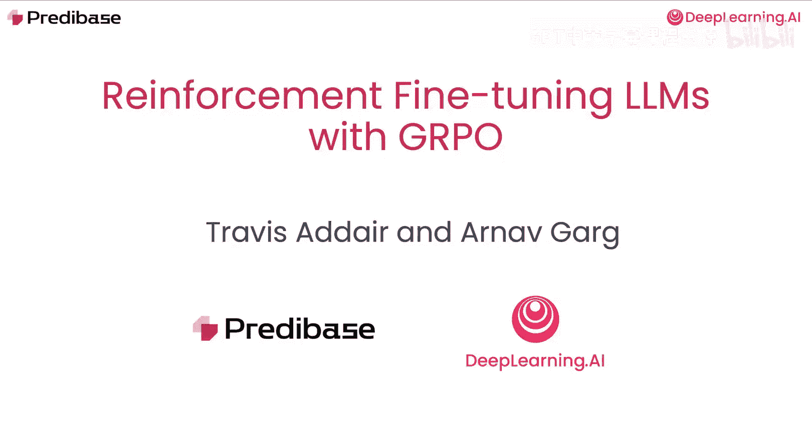
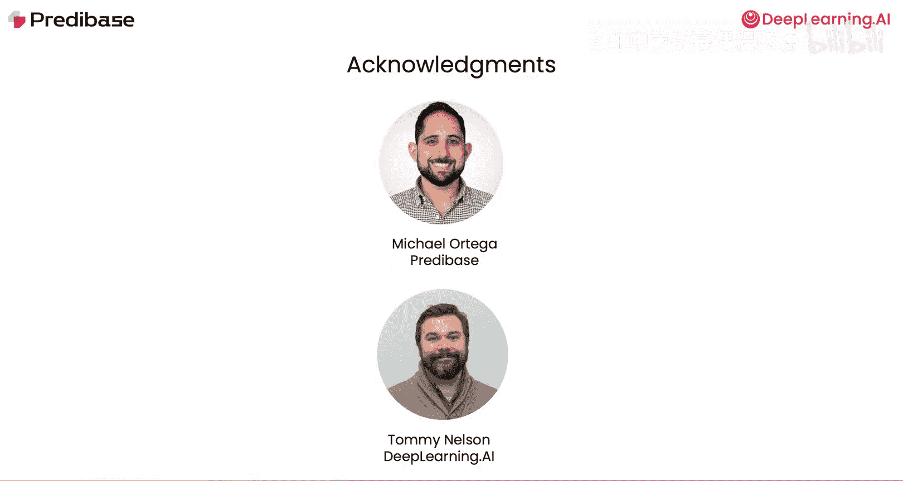

# 吴恩达《使用 GRPO 对大型语言模型进行强化微调Reinforcement Fine-Tuning LLMs with GRPO》 - P1：1.intro.zh_en - GPT中英字幕课程资源 - BV1RMjJziEH2

Welcome to reinforcement fine tuning OMs with GRPO built in partnership with Prebase In this course。

 you take a deep technical dive into reinforcement fine tuning or RFftT。

 which is training technique that uses reinforcement learning to improve the performance of OMs on tasks that require multistep reasoning。

 say to complete tasks like math or codegen。By harnessing an Elm's ability to reason through problems。

 to think step by step， reinforcement fine tuning guides the model to discover solutions to complex tasks on its own。

 rather than relying on preexisting examples as in traditional supervised learning。

This approach lets you adapt models to complex house with much less training data save just a couple dozen examples than you typically need for successful supervised fine tuning I'm delighted to introduce your instructorors for this course Travis there is co-founder and CTO at Prebase and Arnav Gog is senior machine learning engineer and machine learning lead at the company both have worked closely with many customers to solve practical business problems using RT Thanks Andrew we're excited to be here。

😊。

In this course， you'll explore how RFT works using a fun example。

 training a small LM to play Worddle， a popular word puzzle game in which the player has to guess a five letter word and six tries or fewer。

You'll start by prompting the Quinn 2。57 billion model to play the game。

 analyze its performance and develop a reward function that can be used to help the model learn how to do better over time。

This reward function is the key component of group relative policy optimization， or GRPO。

 the learning algorithm developed by deepse to carry out reinforcement learning of reasoning tasks in GRPO。

 an LM produces multiple responses to a single prompt that a dense code using a reward function based on verifiable metrics like correct formatting or functioning code。

This use of a reward function is the key difference between GRPO and other orL algorithms。

If you vote of RL algorithms like PPO or DPO， that rely on human feedback or complex multimod systems to assign rewards。

After developing a reward function for the Worddle example。

 you'll learn some other general principles for writing good reward functions then you can apply to a wide range of problems。

 you will also explore ways to a wide reward hacking。

 which is where a model learns behaviors that maximize rewards without actually solving the problem at hand。

Next， you'll take a close look at the technical details of how loss is calculated during RFT。

 You'll see how the seeminglyly complex process of the GRPO algorithm。

 like clipping and kale divergence of the loss function are actually simpler than you might think once you implement them in code。

 Finally， you'll wrap up the course by seeing how you can carry out RFT using the Pretabase API with your own data and your own custom reward functions。

 Many people have worked to devout this course from Predbase。

 I'd like to thank Michael Otega and from Dbing AI Tommy Nelson。

Oms that can reason well are critical components of many agent systems。

 and RFT will let smaller models work well in agent workflows。

There's a lot of excitement around this capability of Os。And RL itself is。

 I think a very powerful and important technique that is still very mysterious to many people。

 so this is a great time to learn how Ar works and how to use it to tune your own custom reasoning models。

 I think you find learning these things really rewarding。😊。

Let's go to the next video where you learn what are the major differences between RFFT and supervise fine tuning。

