# 吴恩达《使用 GRPO 对大型语言模型进行强化微调Reinforcement Fine-Tuning LLMs with GRPO》 - P2：2.introduction-to-reinforcement-learning.zh_en - GPT中英字幕课程资源 - BV1RMjJziEH2

Let's get started by exploring how reinforcement learning can help an LLM learn a new task by experimenting and receiving feedback on the results。

You' will see how this process differs from supervised fine tuning and gain intuition about how the most important reinforcement learning algorithms work。

Let's dive in。Traditionally， we teach LLM task such as classification。

 name entity recognition and coregen through a process called supervised fine tuning。 First。

 we assemble a label dataset set of prompt and response pairs that demonstrate the behavior we want the LLM to learn。

 Then during training， each example goes through two steps in the forward pass the model generates an output for the given prompt。

 Then in the backward pass， we compare the model's output to the correct response。

 compute the error and update the model's weights to reduce that error。

 when we repeat these steps across thousands of similar examples。

 the model learns to desired behavior。

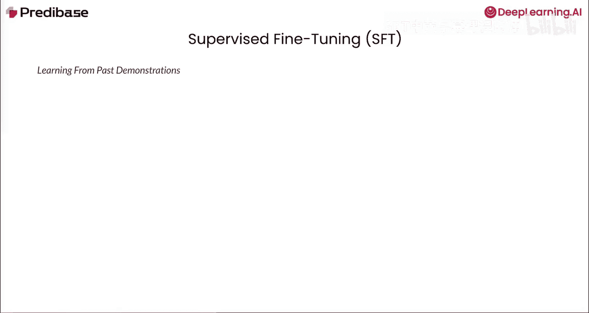

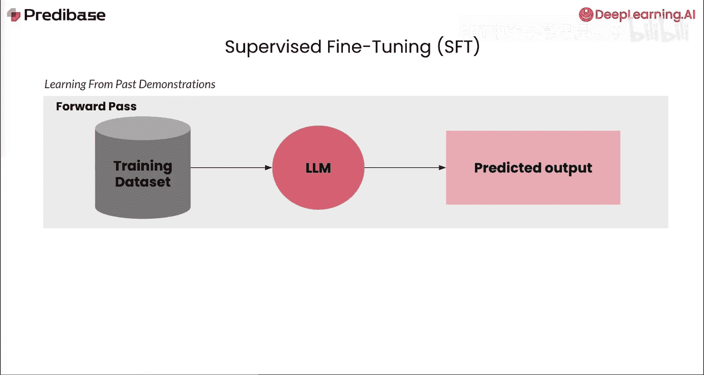

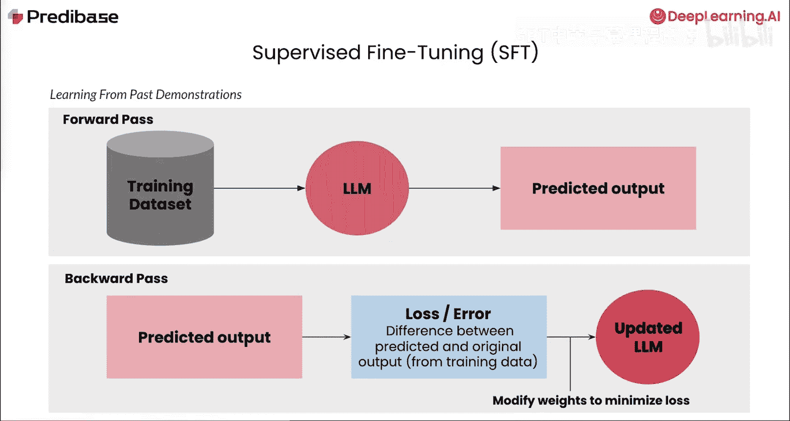

The key aspect of supervised fine tuning is that it teaches the model using demonstrations。

 For example， we can show the model a set of math problems and the final answer。

 and it will learn the patterns to produce these outputs。

 even for similar math problems that has not seen before for more complex tasks。

 you can include reasoning traces in pink tags alongside your answers by structuring your data set this way。

 you can teach the model two aspects simultaneously。 The first is the output format。

 that is how to use tags as separate thoughts from the final answer。

 And the second is this ability to do step by step reasoning， This system done teaching the model。

 how to produce the chain of logic that leads from the prompt to do the desired solution。 However。

 while SP is good at many tasks， it does have some limitations to see good quality improvements。

 you typically need thousands of high quality labelbeled examples for the model to learn from which can be more difficult and expensive to collect Another common problem that you may run into is the phenomenon of overfitting where the model learns the patterns in the。

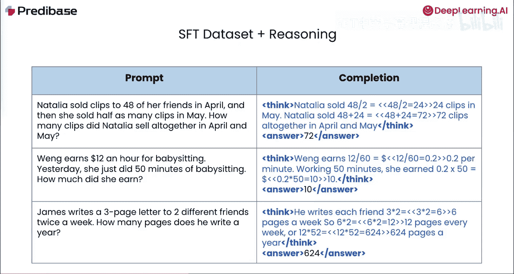

Data too well and does not show the same performance on examples it has not seen before。

 these limitations point towards the need for a training approach that can reduce ourliance on needing extensive labeling and mitigate overfitting while still guiding the model towards the desired behavior。

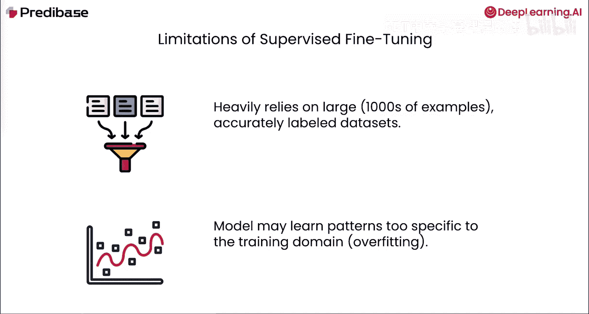

One such alternative is the enforcement learning， where the model learns by interacting with its environment and optimizing for the reward signal。

 rather than mimicking fixed labeled examples to understand this idea better。

 let's take a closer look at this example。 In this example。

 your puppy has many different actions that it can take。 It can choose to sit in one place。

 it can choose to roll over， or it can choose to fetch the stick when you actually throw it。

 The puppy learns that out of all the actions that it can take， it does get a treat。

 which is its reward when it actually fetches the stick and returns it back to you compared to setting in the same place。

 So in this example， the puppy is the agent。 fetching a stick as an action that the puppy takes。

 and the treat is the reward receive from the environment。

 The observation is that the puppy receives a treat for bringing the stick rather than other actions。

 Now， how does this idea actually translate to LLM training。 Well， we can start with an example。

 such as a prompt， which comes from the environment。 and we can feed it to an LM， which is the agent。

 The LM then takes an action。😊。

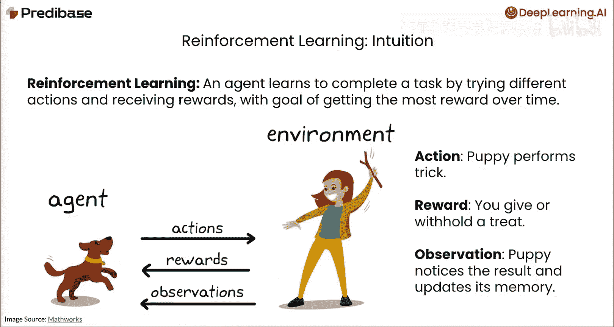

Generating a sequence of tokens as its response。 We can evaluate this response and provide a score that will serve as a reward for the action at Turk。

 This score can be based on quality human preference or an automated metric like accuracy。

 The model can then use this reward as feedback to adjust its weights so that it can learn to maximize its reward for different input prompts。

 This process can be repeated on new examples or even the same ones and the model will continue to refine its weights to get higher rewards。

 So how do we actually go about implementing such a training process。

 One approach that's proven extremely effective is reinforcement learning with human feedback or RLHF。

 And this is the very process that powers child GT。 the RH workflow as four steps In step1。

 we send a prompt to the LM and sample multiple candidated responses using temperaturebased sampling In step 2。

 we ask annotators to rank these responses for the prompt from best to worst。

 This produces a preference ranking dataset set In step 3， we train a separate reward model。

To learn to predict these human preferences， it takes a prompt and response pair as input and output the score to indicate how good this response is。

 Finally， in step 4， we finding the original LLM where the reinforcement learning algorithm like BpoO for each prompt。

 the LM generates a response。 a reward model scores it and the LLM's weights are updated to increase the likelihood of producing high scoringing outputs。

 as we repeat the step over hundreds of prompts。 It learns to generate responses that will produce high scores and align with human preferences。

 Another reinforcement learning algorithm that is gained popularity is direct preference optimization or DpoO like RLHf。

 it uses human preference data。 But instead of first chaining a separate reward model。

 It directly fine tunes to LLM on human preference pairs。 Let's see how it does this。

 we start with the same process as RLHF where we pass the prompt to the LLM and sample candidate responses。

 However， in this case， we will just sample two different responses A and B。 Next。

 we can get human feedback。

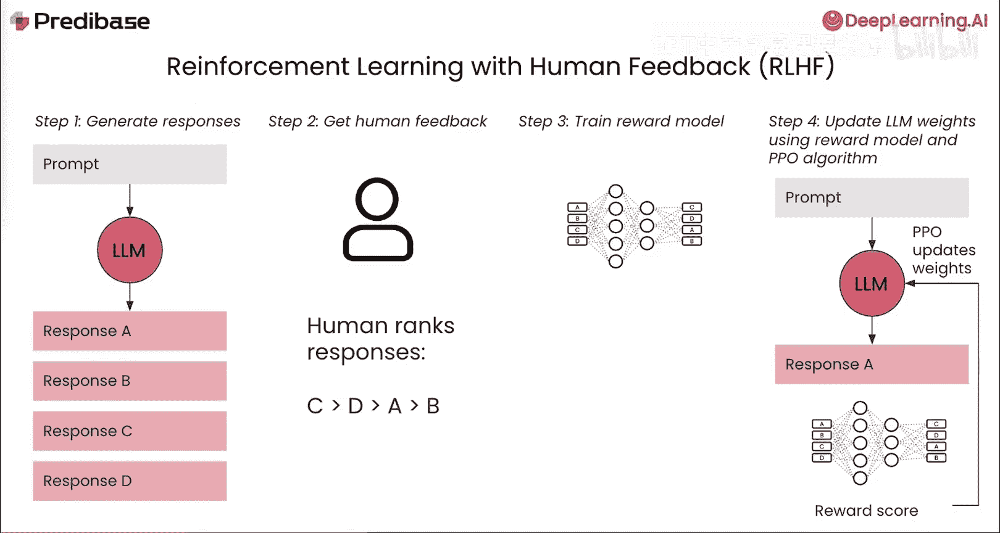

By asking annotators to tell us which of the two responses they prefer more。

 This is often done using thumbs up or thumbs down in various apps。

 but there are alternate ways of collecting it as well。

 These preferences are then used to create a preference data set that consists of a prompt the chosen response and the rejected response for the same prompt。

 Finally， we can use the DPO algorithm to update the model。

 weights to generate responses with higher human preference。

 The idea behind the training algorithm itself is very simple for each prompt you compare the model's probability distribution for the preferred response to the reject response and see which one it is more likely to generate Then we adjust the weights so that the model's probability for the like response goes up and the probability for the dislike response goes down。

 Both RHf and DPO rely on human preference labels instead of ground truth dance but the differ in label format cost and risk。

 RHf requires full rankings over many candidated response to a reward model and also requires multiple copies of the model's weights to be loaded into memory resulting。

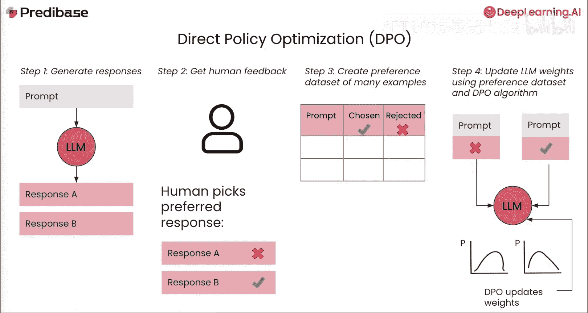

Very high compute and memory overhead。 DPO， in contrast， uses simple preference pairs。

 reducing computational load by not requiring a reward model。

 but still demands large numbers of annotated comparisons to learn fine grain nuances and preferences。

 However， neither method teaches the model entirely new tasks。

 They simply guide the model towards human preferred behaviors。

 to get it on the limitations of large preference dataset sets。

 the deep C team impose a new alternative method called group relative policy optimization。 or GRPO。

 the algorithm behind deep C R1。 The GRPO algorithm side steps in need for any human preference labels by leaning on programmable reward functions that we can define。

 It core training loop has three steps。 like R HF， we first send a prompt to the Lm and sample multiple candidateid responses。

 Next， we can write one or more programmable reward functions that take each prompt and response pairs input and emits a score。

 For example， you can create the format of the output or its correctness。

 If these functions are written well。

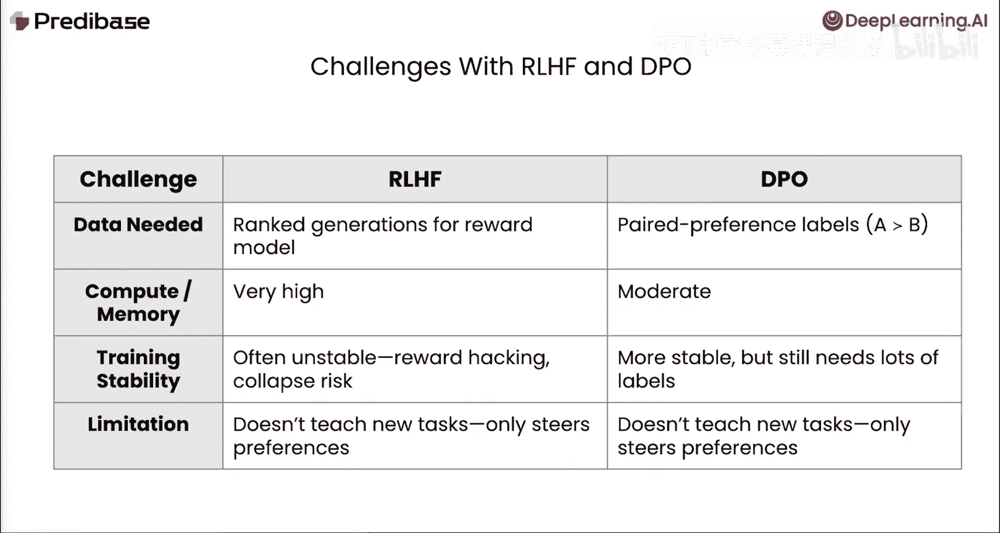

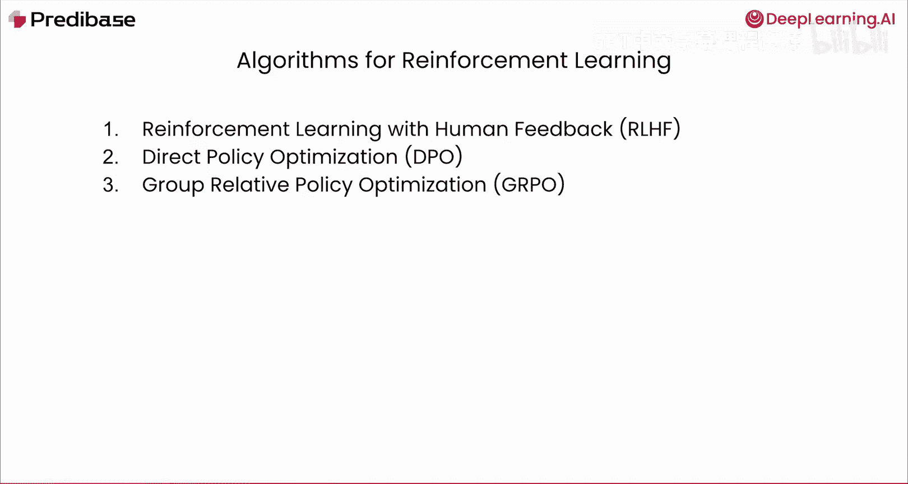

Generated responses will receive a range of scores GRPO algorithm then treats each candidate's reward as a training signal。

 It pushes up the probability of producing responses with above average scores within this group and pushes down those responses with below average scores by repeating this loop GRPO fine tunes to model directly on the reward functions you care about with our ever collecting preference data and thus unlocks the enforcement fine tuning even when human labels are scarce or costly there are many more details on reward functions that well cover along with the GRPO training algorithm throughout the rest of this course。

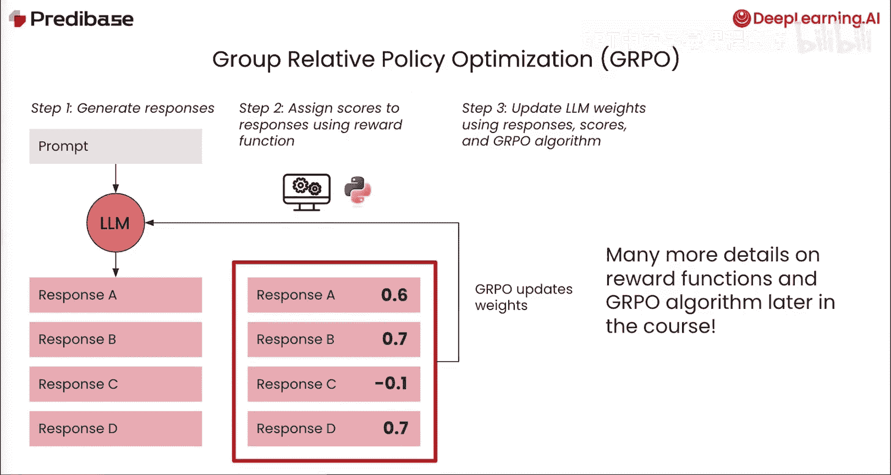