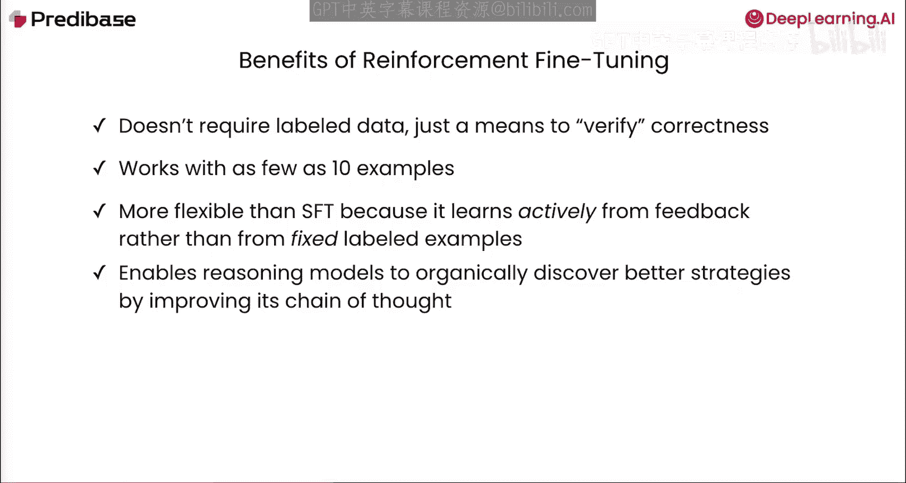
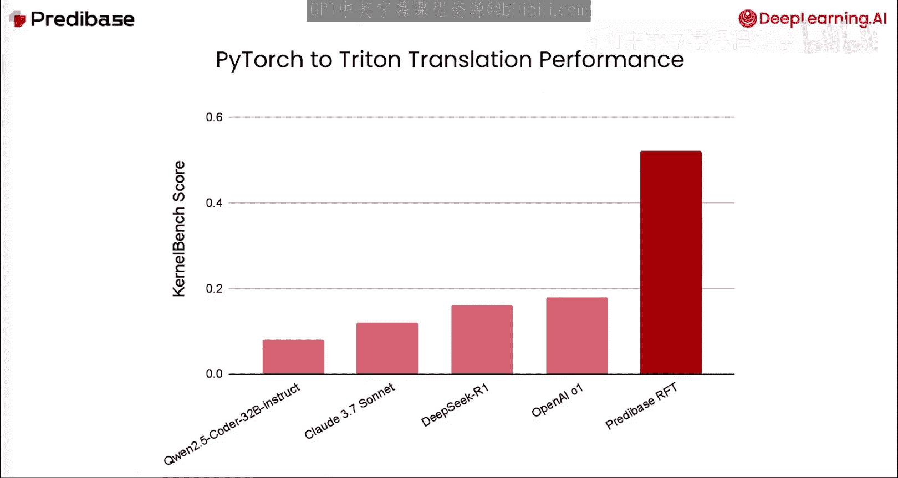
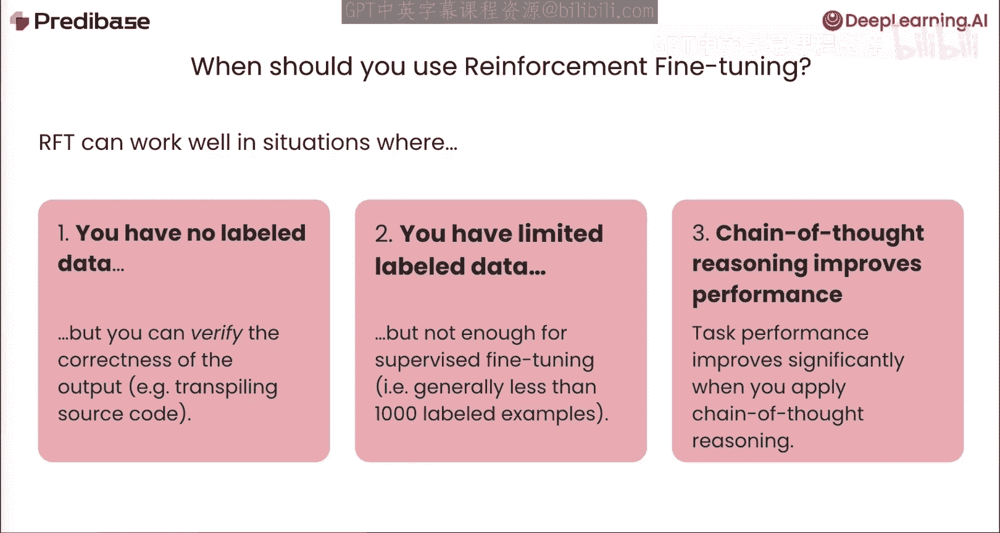
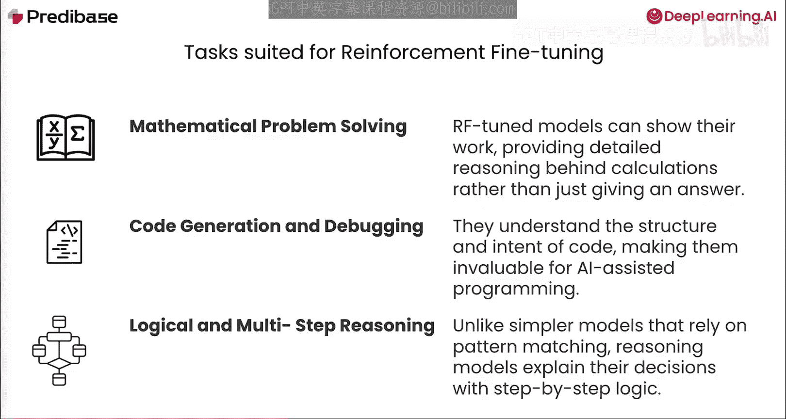
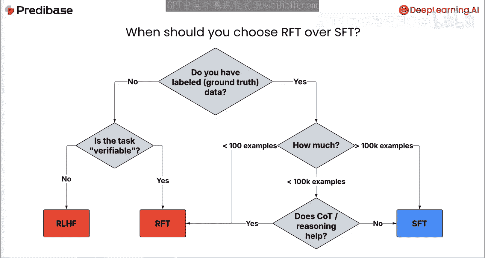

# 吴恩达《使用 GRPO 对大型语言模型进行强化微调Reinforcement Fine-Tuning LLMs with GRPO》 - P3：3.benefits-of-reinforcement-finetuning.zh_en - GPT中英字幕课程资源 - BV1RMjJziEH2

Now that you've see the basics of how the enforcement learning works。

 let's discuss how Rl as a fine tuning technique can benefit your work and which tasks are best suited for this training method。

 Let's look at the concrete advantages。 GRPO delivers in practice。

 The first is that it doesn't actually acquire label data。

 All you need is a means to verify correctness either through programmable reward functions or LLM as a judge and other methods that we' talk about to the course。

 It works with as few as1 examples， but scales as you increase in number of prompts that you show the model during training。

 It is also a lot more flexible than supervised fine tuning because it learns actively from feedback during the training process。

 rather than from a fixed set of labeled examples。 And because of this。

 it enables reasoning models to organically discover better strategies to solve really complex problems。

 by improving its internal chain of thought。 at Crbase。

 we wanted to see how GRP or train models really perform on a tough realwor tasks such as translate。

Pythtorch code into highly optimized GPU kernels written in Triton using perbaase's reinforcement find tuning built on top of GRPO。

 we were able to create a state of the art Triton kernel generation model。

 Charing from an open weights model like  when32 billion instruct。

 And this beats models like cloth 3。7 thinking deep C1 and even open a01 model。

 This result underscores how reinforcement find tuning with programmable rewards can push Lms well beyond supervised or preferencebased training methods。

 So when should you actually use reinforcement find tuning。 Well。

 it can work really well in three situations。 The first is when you don't have labeled data。

 but you can verify the correctness of the output is producing such as code or simple agent workflows that have absolute output。

 The second is when you have limited labeled data。 but it's not enough for supervised fine tuning in itself。

 And this is usually when you have lesser than let's say，1000 labeled examples。

 The third is when chain of thought reasoning improves performance。 Now chain of thought reason。

I a process where you ask the model to produce tokens that tell us how it's thinking about the answer before actually telling us what the answer is。

 And it turns out that in cases where you have tasks that improve when you apply chain of thought。

 those tasks are very well suited to RFD as well。 What are some tasks that are also very well suited for reinforced and find tuning。

 There are many and here are three examples。 The first is mathematical problem solving。 In this case。

 RF lets the model generate and verify detailed solution steps and it refines its chain of thought until the calculation checks out core generation debugging is also a great use case for RFD。

 it learns by scoring against test cases or liing rules。

 Learn to produce correct idiomatic code and to iterativeably fixed errors。

 and it also lends itself very well to logical and multistep reasoning tasks such as agent workflows。

 when a task requires a sequence of decisions。 RFD encourages the model to selfcitique and improve each step based on the final outcome。

 In each scenario， the ability to learn actively from programmatic or。

com based awards unlocks far richer， more reliable behaviors than static supervised fine tuning alone。

 If you're deciding whether to use reinforce fine tuning。

 Start by checking for label data with ample label data upwards of 100000 rows。

 Supervised fine tuning is usually your fastest path to a good model。

 when you have moderate label data， say under 100000 rows， but on the order ofte 100 rows。

 you should ask yourself whether the chain of thought or other reasoning prompts improve initial performance。

 If it does RF can amplify those reasoning gains by rewarding correct reasoning steps。 If not。

 you will likely get the most from using SF next， if you have no label data。

 you should think about task verifiability。 if you can verify the outputs and assign them a score。

 you can use RF with programmatic reward functions。 However， if your task is nonverfiable。

 you will likelyate to use other algorithms like idL HF or DPO by first gathering preference labels in the next lesson will demonstrate how we use GRPO to。

a model to play Wdle。 Although Worddle is a game， It provides an ideal sandbox for exploring every component of the GRPO algorithm and seeing first hand why this approach excels at reinforcement fine tuning。

