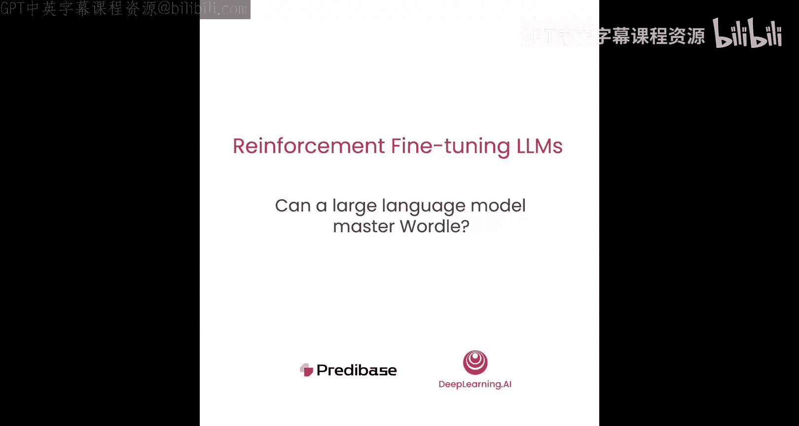
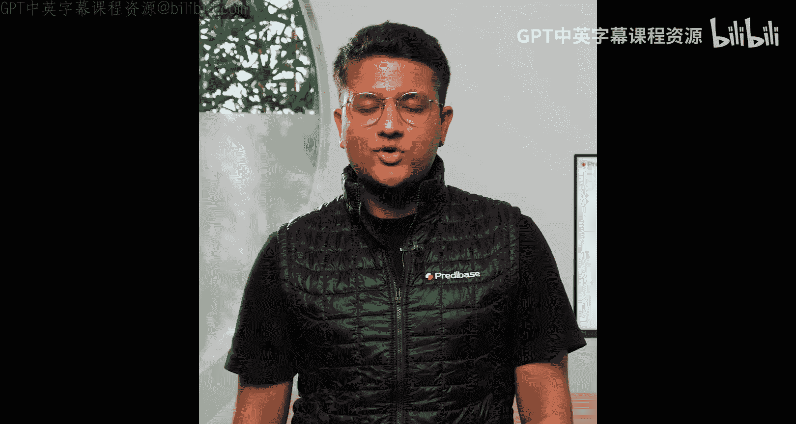
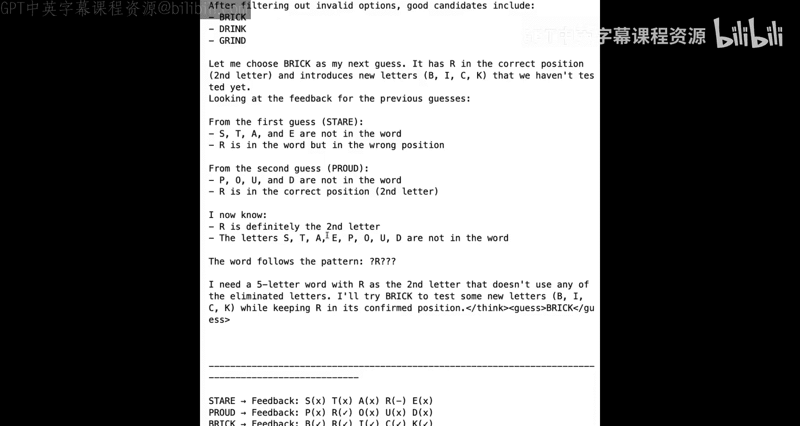

# 吴恩达《使用 GRPO 对大型语言模型进行强化微调Reinforcement Fine-Tuning LLMs with GRPO》 - P4：4.can-a-large-language-model-master-wordle.zh_en - GPT中英字幕课程资源 - BV1RMjJziEH2

In this lesson， we introduce Wordle as a running example for GRPO。 Wordordle is a simple game。

 but it requires planning， hypothesis testing and step by step reasoning to play well。

This makes it a great example to see how an LLM can learn to plan， analyze feedback。

 and improve its strategy over time by reinforcement fine tuning。

Let's dive in。Let's start by reviewing the rules of the game。

 The goal is to identify a secret 5 letter word in at most 6 guesses。 After each guess。

 you receive feedback on every letter in your guess。

 Green means the letter is correct and the right position。

 Ylow indicates that the letter appears in the word， but in a different position。

 and gray means that the letter does not appear in the word at all。

 because we're feeding this into an Lm will represent those colors with text symbols。

 The check mark to indicate green， a dash to indicate yellow and a cross mark to indicate gray。 Now。

 let's head to the notebook and see how we can frame wordle as a reinforcement find tu problem。

We'll start by importing some necessary packages， we'll point the open AI SDK to a model hoster and Pebase by giving it a different base URL。

 and for this lesson we'll be looking at Gn2。57 billion Instruct。Once we initialize our client。

 we can use the transformers packets to load the tokenizer associated with this model。

 Once we load the tokenizer， let's set up our system prompt that we will pass the model to play the game of Wordle。

 The system prompt has a few key components。 The first is we will tell the LM that it is playing Wordle。

 which is a word guessing game。 The second part of the system prompt focuses on giving it the three game rules that we just discussed。

 The third part of the system prompt， It tells the model how it's going to receive feedback。

 Once we give it these basic piece of information will also give it an example of a secret word as well as guesses and feedback。

 So in this case， we give it secret word is brisk and let's say made the guess storm will give it feedback in the format of a symbol for each letter。

 So in this case， S is in the word brisk， but in the wrong position。

 So we give it a dash and O T and M are not in the word at all。 And finally。

 well tell the model what response format we want。Specifically。

 we're going to ask it to use chain of thought reasoning to explain its thought prompt。

and return that within think tags， and then we wanted to return the guest word between guest tags。

Next， we'll work on defining some helper classes and methods。

 We can import some additional dependencies to help us define these will define an enum。

 which will help us indicate feedback for each letter in the guess will also define a data class called guess with feedback that we will use throughout the course and it contains a guess which is a string and a feedback attribute。

 which is a list of these enum objects willll also define a wrapper and what this does is it helps us convert the guess and feedback into a string that we can add into our prompt。

 now that we have a way to represent this feedback we' need to define a method that helps us capture all of this feedback into a user prompt that we can pass the model So we'll always start with the base prompt make a new five letter word guess and we'll use the list of past guesses to create these feedback strings from the guess with feedback object and return this in the user prompt。

 Next， we need a way to capture our system prompt our user prompt with feedback。

 and also give the model a little bit of a preamble as a starting point for its step bystep reasoning。

SoWe'll define this message this object that has the system prompt， the fully rendered user prompt。

 and this preamble， and then we'll use the tokenizer to format this with the right chat template tokens so that the model gets it in the format that it expects。

Finally， we'll define a generate stream function that takes a prompt and an optional adapter Id。

 This willll call the open aI completions are create endpoint。

 with the prompt temperature matchni tokens and then stream the output as it's generating it。

 It's important to note that will setting temperature to zeroto to produce the deterministic responses since we're trying to evaluate the model's quality。

Not that we have these helper methods defined， let's take a look at how the formatted data looks with our prompts。

 Let's assume that the secret where we want to guess is craft。 And so far。

 the model has made two guesses， crane and crash。 we can create instances of the guessted feedback class that have the guess。

 along with detailed feedback for each letter。 And when we pass this into the render of prompt method。

 we'll see that our prompt has all of the same stuff as our system prompt。

 along with formatted feedback and the preamble to start making a guess。Next。

 we can see what happens when we send this prompt to the base model。

 So the base model understands a lot of the feedback that CR are in correct positions while N E S and H are not。

 yet it decides to repeat its original guess， which is crane。 So this is a pretty suboptimal guess。

 Now， we can see how a fine tune model would do on the same prompt。

 note that we're passing in an adapter Id here， and this points to the weights of a model that we trained using this reinforcement fine tuning process that we will continue to explore to the rest of this course。

 we fine tuned our model using a technique called Laurara。

 which allows us to add and update only a small set of low rank adapter weights。

 instead of modifying all the weights in the base model。 So as it starts to produce a response。

 we can see that it understands that CR R and are in the correct position and N and E are not in the word。

 Similarlyly， it understands the same is true for the word crash。 Next。

 it thinks about possible words and eliminates them step by step after produce。

InThis large chain of thought， it decides that craft is an optimal guess to make based on all the criteria that it's left。

 The fine tune model actually use the past feedback to correctly guess our secret word in three guesses。

 Now that we've taken a look at how the base model and fine tune models do on a single turn。

 we can try and simulate an entire game for this， we can define two useful helper methods。

 The get feedback method will take a guess and secret word is input and assign feedback for each letter in the guess using the criteria we defined above。

 So as the letter matches in the exact position， we give it a correct symbol。

 if it's in the list of letters， but in the wrong position will give it a dash。

 And if it's just not in the word at all will mark it as the wrong letter。

 Itll then return a list of these individual feedbacks back as output。😊。

We can also define a function to simulate gameplay turn by turn， which we'll call next turn。

 This takes three attributes as input， past gases， secret word and an optional adapter Id。

 It starts by taking a list of past caseses and generating the rendered prompt we saw above。 Next。

 it senses to the model to generate an output。 Once we have the response， we'll use rex matching。

 to extract the words between guess tags。 If the re match succeeds。

 we actually have the models guess。 And we can assign its feedback using the get feedback methods we defined above。

 We can add this to a list of past guesses and continue this process。 Finally。

 this function will print all the past caseses at this point。

 And if the guess matches a secret word will mark it as a success。

 And if we've made more than six guesses will say that the model did not succeed。

 With all these helper methods defined， let's get to the front part。

 for the gameplay will find guess a secret word brick。

 which is rather easy word for this model to guess。

 We'll start with no past caseses as our history and we'll set adapter I to empty so that we can guess with the base model first。

😊，Next， we can invoke the next turn function with the past gas's secret word and adapter I and see what it will produces output。

 So for the first guess， the model decides that it's a good idea to guess a common word that has a popular vowels andcons。

 So it getses the word grain。 and accordingly， it gets some feedback。

 Let's see how incorporates feedback in the next guess。

 So if you look at the models chain of thought on the second guess。

 we can see that it utilize some of the feedback。 such as R being in the correct place。

 but it also concluded that C A and and E are not in the word at all， which is incorrect。

 If we read the rest of the chain of thought we'll see that it decided to take a random guess and guess the word brick。

 And so it gets this word correct。 Now， let's see how the fine tune model does for the same secret word。

 Once again， we'll define our secret word。 our past gases as an empty list。

 But this time we will set the adapter I to the same model we saw above。

 Then we can invoke the next turn function just like we did before。

So the fine tune model decides that it wants to pick a first word。

 and it needs to contain common letters， have vowels and has minimal repeated letters。

 It comes up with a set of reasonable candidates such as arise or sta or crane。

 then decides that stare is a good first guess because it has a lot of common letters in it for this guess。

 It receives the following feedback。 Let's see how it utilizes its feedback in its next guess。

So the model starts by analyzing its first guess and it correctly learns that S D A and E are not in the secret word。

 It also acknowledges that R is in the word， but in the wrong position。 based on this。

 it comes up with the strategy where it thinks about common letters， it hasn't tried yet。

 And then thinks about how to use this information。

 So based on the fact that it knows that R is in the word but in the wrong position。

 It thinks that R should probably be in the second position。

 and it comes up with a list of possible words。 Now， based on this。

 it eliminates words such as print， because it knows that D is not in the word。

 And as it continues on， it decides that proud is a good guess because it tests multiple new letters which will eliminate a lot of words。

 for the guess proud， it learns that R is indeed in the second position。

 but O U D and B are not in the word。 Now if you think about this for a moment， it's guess A。

 O U and E 4 of the five vowels that exist。 So the next guess。

 it should actually try and make a guess with the letter I。 Let's see。It does in its third guess。

So once again， it starts by analyzing the two guesses and tries to use this to think about what words follow the following pattern。

 which is question mark are followed by three question marks。

 And it comes up with a list of candidate words。 It also correctly eliminates words that are not valid that are too short or that are too long and it eventually reaches the point where it decides that there's only three valid options。

 B， drink and grind that would be good candidates for the next guess。

 It decides to go with brick because it introduces new letters that we haven't tested yet。

 And then it spends a moment verifying that this guess is a valid guess based on all the criteria from the initial feedback。

 And it turns out that B is indeed a correct guess。 Now。

 one thing you'll notice compared to the base model is that the fine tune model iteratively thought through its reasoning process and had a much more strategic approach to solving the game of Wordle。

 And this is actually one of the benefits of the enforced and fine tuning because we ask the model to emit its chain of thought before providing a response It can learn how to iteratively refine。

During the training process to come up with more sound reasoning to get good results this would be a great moment to try other secret words to see how the base model and find your model compare and in particular。

 to get a good understanding of how the find good model comes up with consistent sound reasoning as it works towards towards guessing the secret word and when you're done you can join Travis in the next lesson where he'll show you how to define reward functions for the game of Wordle。

