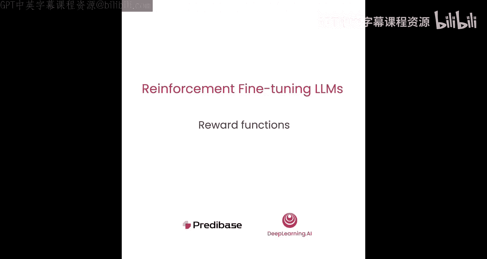
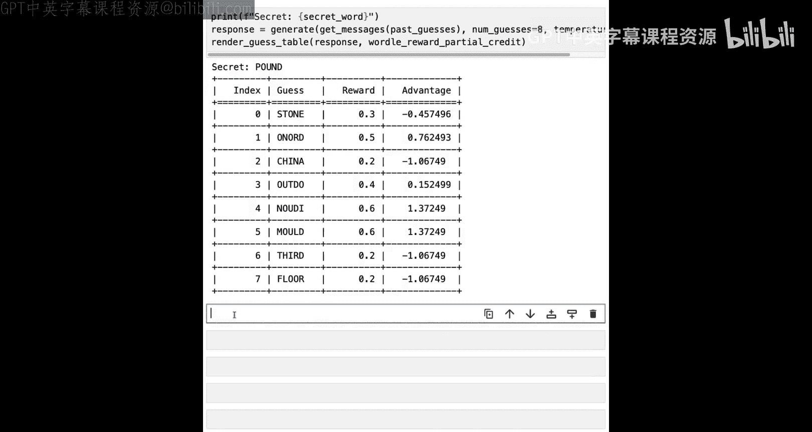

# 吴恩达《使用 GRPO 对大型语言模型进行强化微调Reinforcement Fine-Tuning LLMs with GRPO》 - P5：5.reward-functions.zh_en - GPT中英字幕课程资源 - BV1RMjJziEH2

。

In the last lesson， you saw Han L M can be instructed to play the game of Wordle In this lesson。

 you'll learn how to design the reward functions that power the reinforcement fine tuning process and see how rewards are converted to advantages that helps steer the model towards better outcomes during learning。

 Let's head to the notebook to get started。 Let's go ahead and get started by importing our dependencies。

 And this lesson， we're going to be making use of pitorrch as well。

 So let's go ahead and import that。 And let's create our deployment。

 which we'll be using to prompt as the base model。 and this base model for this lesson is going to be the quinn 2。

57 billion instruct model。 let's define that as a variable。

 a straightforward approach to defining a reward function is to use a simple binary success or failure signal。

 This assigns a reward of one for a correct answer。 and 0 for incorrect。

 So this is analogous to in the supervised fine tuning world。

 having a ground truth answer that the model trying to get correct。😊。

Now let's see how this reward function works in practice on some example guesses so let's say that our secret word is pound and we're going to assume that the model has guessed a few things before this point。

 the word crane and blonde and then finally found。 So we have this helper class here called guess with feedback which is essentially just going to take our guess and the secret word as input and then store off information about which of these letters were correct versus incorrect versus in the wrong position so forth。

Now let's go ahead and take all these pass guesses and attempt to generate a new guess from our model。

 what we're going to do is call the generate function。

 converting the pass guesses into our fully rendered prompt。

 get a response and then from that response we're going to extract out the guess and then we're finally going to use the world reward function that we defined above to score the final guess and let's see when we get。

So in this case， the model guest gone， which got a reward of zero。

 meaning that from the perspective of the learning process， this guess was just completely wrong。

 So now let's briefly talk about how these reward functions ultimately translate into learning in this process in reinforcement learning。

 a reward function gives feedback to the agent about how well it's achieving its goal。

 and these rewards are numerical values assigned after some actions is taken。

 indicating how desirable the outcome is。 What we're ultimately doing is we are taking all the different guesses that the model making for a particular prompt and then figuring out which ones are relatively better than the others。

 The agent's goal is to maximize its overall reward over time there are two ingredients that are necessary for this learning to occur。

 One is that we need to have diversity of the responses that are generated and two that ultimately needs to lead to a diversity of rewards and the reason that this is the case is because the way that we determine the relative desire。

Our ability of one response versus another is with something we call the advantage。

 This is the equation that computes the advantage。 All we're really doing here is we're taking all the rewards that were computed for a particular prompt。

 And then we're just computing a normalized value where we subtract out the mean divided by the standard deviation。

 So it ends up being a nice number centered around 0。In code。

 what this looks like is a function like this。 So we have this compute advantages function。

 It takes in a list of rewards。 we compute the mean， we compute the standard deviation。

 We avoid a division by0 here by just giving all zeros in the event that the standard deviation is 0 and then the advantages themselves are just computed as shown in the equation and we return that all as a list at the end。

 Let's look at a quick example of how this advantage computation works assuming some fake reward scores So let's say we had rewards scores ranging from 0 to 1 and then a bunch of values in between like 0。

2。405 etc ce。 and let's see what the advantages look like。

 You can see that the advantages are centered at0 for those rewards that are in the middle。

 They go down to negative values for rewards that are low relative to the others and they go up proportionally forward numbers that are relatively high。

 So this shows you that from a learning perspective we're going to discourage the model from generating。

Responses that look like the things that scored zero and we're going to be encouraging the model to generate more responses that look like the responses that generated these high reward values let's visualize the rewards and the advantages for our existing reward function on the task of words so we're going to define this function here that's going to print out the table of guesses so for every response and the reward function we're going to get the guesses get the rewards and print out a table showing those values let's make a few guesses and go ahead and compute the rewards and the advantages and render that table here we can see that again for our secret word of pound we had eight different guesses that we made crane tower sort food etc and in each case none of these guesses was the word pound So the reward was zero and as a result the advantage is zero and so consequently from the perspective of the GPO algorithm these rewards actually are not going to。

in any learning at all Now， although all the guesses are currently receiving a reward of0。

 not all of them are equally incorrect some guesses contain correct letters in the correct positions like for example。

 you can see news here N OU rather OU， those are definitely in the right right letters in the right position in is the right letter but in the wrong position。

 So you could say that this is directionally better than a guess like Crane。

 which has far fewer correct letters in the correct position。

 This suggests that a binary reward function might be too strict。

 and then instead we can introduce a partial credit system to assign high rewards for guesses that are closer to the target word based on correctness and positional accuracy。

 Let's introduce a new reward function that assigns partial credit。

 First thing we're going to do is look at the length of the guess compared to the length of the secret word If they're not the same length。

 we're just going to return a reward of0 and therefore directionally。

Discourge the model from making any guesses that are not the right number of letters Next。

 we're going to get a set of all the valid letters that exist in the secret words and we're going to iterate over every letter that's in the guess and in the secret word one at a time and compare them so if the letter and the secret letter match then we're in the situation where we have the right letter and the right location and we're going to give it a reward of 0。

2 if we have a letter that's in the word but in the wrong location then we're going to give it a score of 0。

1 and otherwise we're going to give it no rewards and what this means is that for a given five letter word that if every single letter is in the right location。

 it's going to get a total reward of 1 and for everything in between we're going to have partial credit where right letters in the right location could lead to say a score 0。

2 or 0。4 etc so we should hope to see some variation and the types of reward scores we're getting from this process。

Let's try applying our new partial credit reward function to the previous secret word and use our model to try creating a few guesses。

 as we're going to see here， this process， even with partial credit relies heavily on getting a good diversity of different responses for a given prompt and the way we control that diversity is what a parameter called temperature。

 there other sampling parameters as well that exists。

 but temperature is one of the most common ones that we can use。

 and here we're going to see what happens if we set temperature equals0 which means that the model will always select for the highest probability guess for each prompt。

Unsurprisingly， when we set temperature equals 0， we have essentially created deterministic sampling process。

 and so every time the model guesses the same thing。 In this case。

 the word frown frown receives a reward of 0。2， but because it guesses frown literally every single time we're back to the situation where the advantage itself is just all zeros on the other end of the spectrum we can try generating responses with a high temperature like 1。

3 here， which should introduce a lot more variation。

 using a higher temperature value has successfully resulted in more variety and the reward scores that are generated。

 so we are seeing now the kind of advantage variation that we're hoping for。

 but we're also seeing that the guesses in general are just on average worse than if we do greedy sampling。

 so we're seeing a lot more examples where the guesses blank meaning that the model never actually manage to generate a guess。

 And so what this ultimately means is that while there will be some directional learning here that happens because。

We are able to compute advantages。 the overall learning process will be slower because the guest quality itself is generally pretty low So what we want to do is find a way to strike a balance between these two extremes and that means setting a reasonable temperature value here like 0。

7 All right so now we can see that we're finally starting to get something that looks a lot more like what we're hoping for。

 So the guesses tend to generally be the right number of letters。 they're all valid words。

 some of them are better than others。 we're seeing that there is some variation in the reward scores。

 there's variation in the advantages as well and in general we expect that this is going to start pushing our model towards learning to guess words that are more likely to receive higher reward and therefore more likely to ultimately get the word correct in the next lesson we'll look at other examples of reward functions that you can use to assess softer criteria that is sometimes more subjective or relies more on human value judgment during the learning process。

