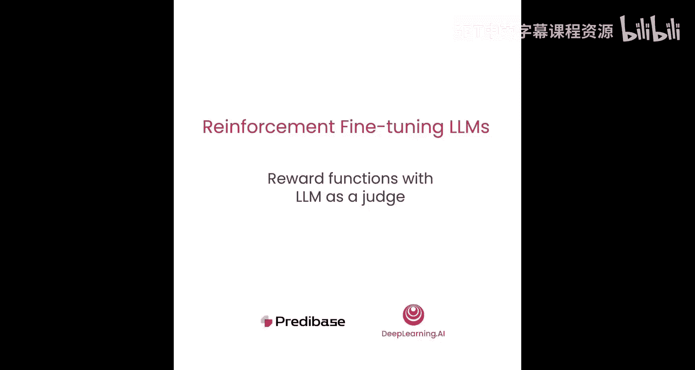
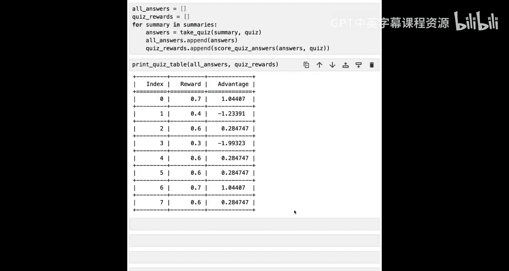

# 吴恩达《使用 GRPO 对大型语言模型进行强化微调Reinforcement Fine-Tuning LLMs with GRPO》 - P6：6.reward-functions-with-llm-as-a-judge.zh_en - GPT中英字幕课程资源 - BV1RMjJziEH2

In this lesson， you'll write a reward function for a more subjective task。

 creating a summary of a call transcript。 You'll see how you can use an Elm as a proxy for human judgment and create reward functions that produce learning signals in situations where the outcomes are not easily verifiable on code。

 Let's take a look。 Let's start by importing our standard dependencies。

For this lesson， we're going to be using a different use case than Wtle in this case。

 we're going to be summarizing earnings call transcripts。

 so let's go ahead and load this dataset set from Hugingface and take a look at one of the example transcripts。

 You can see that these transcripts tend to be quite long。 and in this case。

 we've even truncated them to a limited number of characters and let's assume that for the purpose of this task。

 Our goal is to create a summary that would be useful for someone like a financial analyst who just wants the high level picture of based on the earnings call。

 what were the key takeaways about the health of the company。

Let's go ahead and construct a prompt that we want to use to generate these summaries In this case。

 the prompt is pretty simple， generate a concise summary of the information in the following earnings call transcript。

 only respond with the summary did not include any extraneous text and we're going to give it the transcript as a variable Let's define a function that takes a transcript is input and some number of different samples we want to generate and generates the summary to do this we're going to take our summarize prompt and insert that transcript we're then going to convert this into the chat API format and using an openaiI API compatible SDK we're going to generate a completion given these messages and we're going to set temperature 0。

9 to ensure some randomness and let's go ahead and generate the summary for the transcript that we pulled out from the data set from above As you can see the model does generate a summary and it is a lot shorter than the original transcript。

But it also still has a lot of unnecessary language in it。

 like here is a concise summary that earnings called transcript。

 and in general there are some things here that may not be necessary for our financial analyst。

 so the next step in this process is going to be thinking about how we can construct a reward function to help steer this summary that's generated more in the direction of what our analysts would be looking for for their work。

One way we can think about creating a reward function is to use an LLM as a proxy for our analyst judgment that attempts to rate the summary on a scale from 1 to 10。

 and then we can use that final score as a reward function score So here this prompt says rate this on scale from1 to 10 where one is very poor and 10 is very good and then finally output the final score between some score tags and it takes as input the transcript and the summary。

 putting this all behind a reward function that takes as input the transcript。

 the summary and a judge model in this case we can use GT40 mini。

 but this could be any model and returns a float value at the end。 I know this looks pretty long。

 but it's actually quite straightforward。 What we're going to do is take our prompt that we defined above insert the transcript and the summary turn that into messages in the chat format as we did before Then we're going to have our judge model here。

 create a response。Just one response， we're going to set temperature equals zero so it will give us what it believes to be its best response rather than something a little bit more random and then we're going to extract out the final score using this regular expression。

 convert that into an integer and then we're going to divide by 10 so we get a nice normalized value between0 and 1 and if anything goes wrong along the way we're just going to return a score of 0。

Let's go ahead and apply our judge reward function to our summary and our transcript。

 You can see that our judge model provides some reasoning here。

 which we can use to audit its judgment and get a sense for whether or not this is reasonable and then provides its final score at the end。

 which is09。 So now let's try scaling this up to eight different samples instead of just one and get a sense for what the diversity of reward scores from our judge model looks like。

 We've gone ahead and generated eight different summaries from our original transcript。

 and then we're going to use our judge model to score each of these summaries according to the judge reward function that we wrote above。

 This may take a second to run in your notebook as the judge model needs to generate a lot of tokens as part of its reasoning process。

 but we've sp it up here in the video。 As you can see， the scores are generally quite high point8s。

7s， etc ce。 but importantly， you'll notice that it never really notices that there's anything particularly wrong with any of the summaries and it never。

goeses so far as to say that any of the summaries are perfect。

 And this is in general a problem with using LM as a judge in this very straightforward way。

 It tends to say that things are generally good because it doesn't want to be called out for being explicitly wrong。

 And this is ultimately a problem for us is that we want the model to be very opinionated about whether a particular response is good or bad so that we can more clearly direct the learning process in a way that encourages it to do what we're wanting it to do So how do we address this problem。

 One way we can think about is to try to ground it in something that's a little bit more objective。

 So instead of just telling the model， what do you think about this summary is it good， Is it bad。

 We can instead think about trying to generate a multiple choice quiz based on the information and the transcript that we think is most relevant to a financial analyst who be looking at these summaries。

 And so we give some examples like what was the Q1 earnings per share and then some short。

ABC or D along with the answer key at the end and our goal here is that because all the information that we care about is in the original transcript。

 it should be a relatively straightforward and objective task for the LLM to construct this quiz and then during the learning process we can refer back to the quiz as a way of scoring the summary to see if all the information that we put in the quiz was retained by the summary。

 This was a technique that one of our customers actually came up with for their summarization problem Now we could go about generating this quiz by having the model generate some text and then coming up with a way to parse out that text but one nice property of LLMs is that they very commonly support something called structure generation as well which can make use of a pedantic schema that defines the output structure that we're looking for so in this case we don't just want to generate text we want to generate a quiz that consists of these。

Questions and every question is going to have the question text。

 the question options and then the answer which is going to be an index into which of these options was correct We're also going to define a couple helper functions like a function that helps us shuffle the different options which will come back to why that's important and a way of rendering these options and these questions as a string Now that we've defined the question class we can also define the quiz class which wraps the questions so this is just going to be a list of questions and again we're going to have a helper function here that we can use to shuffle all of the options for every question and a helper that helps us print the quiz itself as a string so they can be inserted directly into the prompt putting this all together we're going to define this helper function called create quiz is's going to take a string as input which is the transcript we're going to use our quiz prompt to tell the model to generate a quiz from this。

And then we're going to use this completions parse API passing in the response format of the quiz and using a temperature of 0。

7 as we might want to play around with different variations of the quiz and then once we run this function we're going to get an output which is one of these quiz objects and then we're going to shuffle all the options for every question in the quiz The reason why we're going to shuffle the options is because LLMs tend to be pretty predictable in terms of where they put the right answer。

 so oftentimes the right answer will end up being be because maybe that's a very common thing that humans guess when they don't know the answer。

 So in order to account for this implicit bias in the model。

 we're going to shuffle all the options so that it's a little bit more random than what an LM would generate little left to its own devices So let's go ahead and create a quiz from our transcript as before and print it out。

As you can see the quiz consists of many different questions and these all look pretty relevant to the particular earnings called transcript and the numbers all look pretty reasonable as well。

 One question you might have is how do we know this quiz is actually correct we won't show it explicitly in this lesson in the interest of time but what we can do is actually have the Lm take the quiz with the original transcript see which answers are correct and then discard any answers that are inconsistent between what the quiz says is the right answer and what the transcript says is the right answer。

 Now that we've generated the quiz we're going to write the helper function that allows the judge model to take the quiz using the summary So let's go ahead and define our prompt for this use case So use the provide summary of a transcript to answer the following quiz We provide the quiz as input as well as the summary and this is where our quiz to string function will be helpful and we're going to tell。

model to just respond with a list of answers and no additional text and tell the model that it must provide an answer to all 10 questions so if it doesn't know it should answer with zero and this is because for the purposes of this problem we don't want the model to take a random guess if the model legitimately doesn't know what the answer to a particular question is because the information is and in the summary it should explicitly say so defining our take quiz function now we take the summary is input as well as the quiz we go ahead and generate the quiz string we insert the quiz string and the summary and the prompt we go ahead and prompt our judge model again G4 many here with temperature0 so we say give us your best answers to these questions given the summary we get its response and remember that the response is expected to be a list of answers surrounded by brackets so we're going to strip out those brackets split on commas and that would give us a list of letters that are answers let's run it and see what we get。

As you can see there's a good variety of different answers here and also at least one occasion where the model was not able to answer the question based on the information in the summary。

 So finally we need to score the answers that came out of the take quiz function above so let's write this helper functions score quiz answers。

 it takes the answers as well as the quiz we're going to do a simple sandy check here to make sure that the number of answers that we generate equals the number of quiz questions and then we're going to iterate over every one of the answers and every one of the questions and if they match。

 then we're going to plus one to your number of correct answers divide that by the total number of questions in the quiz and that's going to give us the percentage of correct answers in the quiz and let's go ahead and run that and we get a score of07 So that was computing the scores for just one of our summaries but now let's run it on all of the summaries that we generate previously so。

Just going to iterate over every summary， take the quiz and then record the answers and then score those answers using our scoring function and keep track of that as well Pri out the rewards in the advantages。

 we can see that our quiz-based approach provides a pretty decent amount of variety in terms of the scores and therefore the advantages that we get from our element as a judge method and so as a result we can expect that we'll get a nice amount of learning from this process now because of the fact that we're having this diversity of different rewards and advantages and the next lesson we'll take a closer look at this particular use case and think about some ways that this might be exploited by our reward model to encourage kind of bad behavior。

 so-called reward hacking and then we'll come back to the idea of putting this all together into a loss function and the lesson after that。

