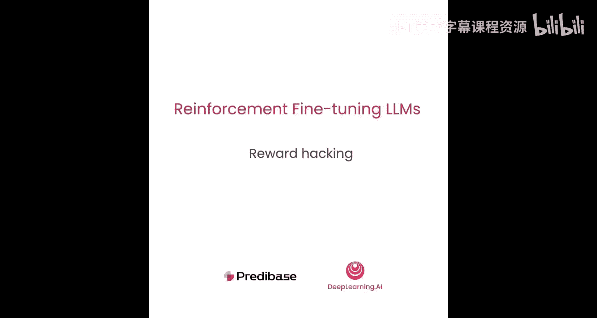
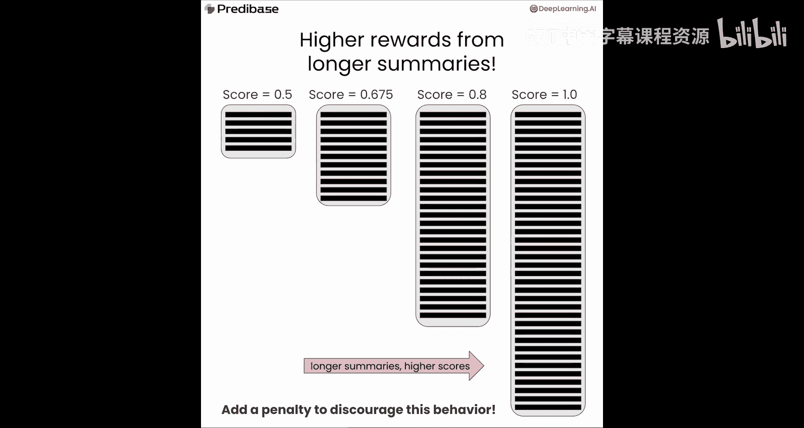
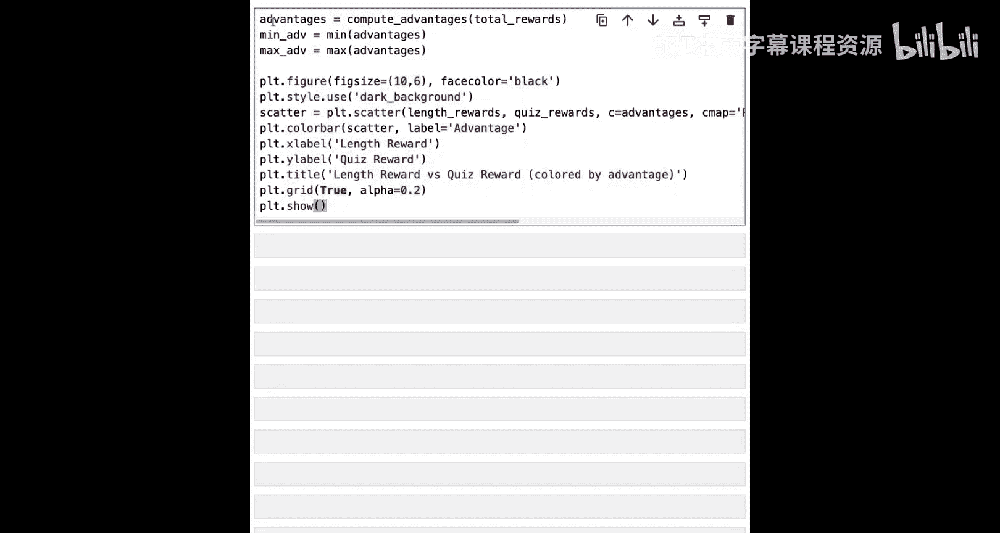
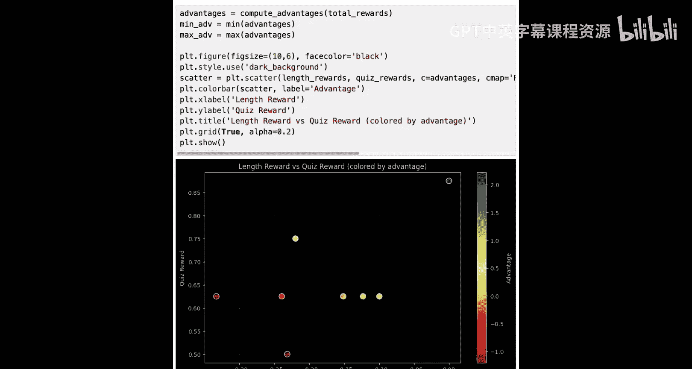
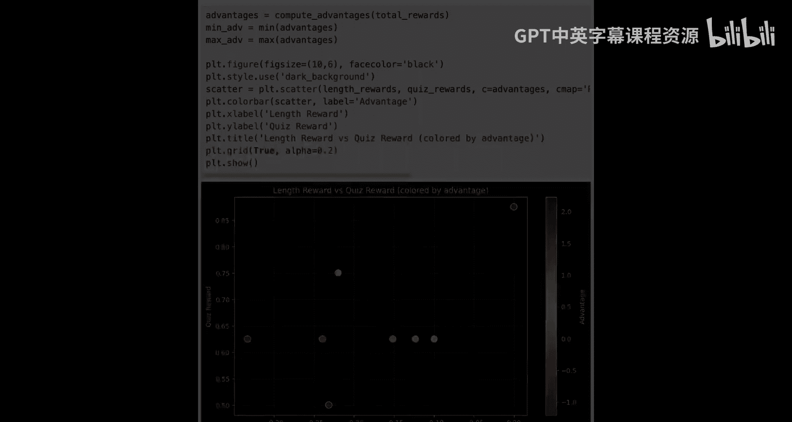

# 吴恩达《使用 GRPO 对大型语言模型进行强化微调Reinforcement Fine-Tuning LLMs with GRPO》 - P7：7.reward-hacking.zh_en - GPT中英字幕课程资源 - BV1RMjJziEH2

An interesting problem that can arise during reinforcement learning is known as reward hacking。

 where a model learns a strategy that maximizes the rewards it receives without actually carrying out the task you want it to do。

 In this lesson， you'll explore what reward hacking might look like for the summarization task and add some penalties to a reward function that can discourage this bad behavior。

 As in the last lesson， we're going to use the earnings called transcript summarization task。

 which can be found on hugging face。 We'll use the same generate quiz function that we use previously as well to construct our quiz。

😊。

Let's start by generating eight summaries using the same prompt as before generating concise bolded summary information in the earnings called transcript。

 Well'll set temperature equals 0。9。 So to ensure that there's some diversity in the outputs as well。

 and let's see how these different summaries score on the quiz。 As we can see。

 we have some variety in the outputs for this quiz。

 So translating this into advantages we should see good learning from this distribution of scores。

 However， one thing we may not have considered is what would happen if we considered the transcript itself as the summary。

 how would the transcript itself do on this quiz。 and lo and behold。

 the transcript actually gets a perfect score。 So if we're thinking about a reward function as just being the quiz reward。

 then the transcript itself having a perfect score will actually be the optimal generation for the model。

 this actually creates a bit of a perverse incentive for art a learning process where even though the goal is to generate。

A concise summary。 The model is actually being rewarded on the basis of how much of the transcript information is retained。

 And over time， we might expect that the model actually learn to game the system or hack its way to a better score by ignoring the objective of being concise that's in the prompt。

 and instead just optimizing for the reward by just returning exactly what was in the transcript。

 How might we think about mitigating this。 Well， one thing we can do is put in a new reward function that accounts for the conciseness attribute that we care about。

 So what if we take a look at the length of the different completions that were generated。

 You'll notice that there's also， in addition to being a good variation in the quiz scores。

 a good amount of variety in the links as well。 So some of the summaries are 900 characters and others are a bit longer at 1300 characters。

 But if we look at the length of the transcript itself。

 we can see that it's about an order of magnitude larger at。

21000 characters long。 definitely quite a bit of ways from our ideal summary length。

 So this is definitely something we want to discourage our model from generating。

 Let's introduce a new reward function that serves the purpose of actually penalizing the model for being too long and exceeding the definition of what we consider to be a concise summary。

 So we're going to find this new reward function that's actually a penalty。

 So we expect its value to be negative called the length penalty reward。

 It takes the response computes its length and the number of characters。

 and compares that against a target length， which we consider to be the max reasonable length for a summary。

 which we're going to set to 1024 characters。 If the length of the summary is less than the target length。

 then we're going to return 0， which means that there's no penalty。 Otherwise。

 you get a penalty that gets larger the longer the text is compared to our target length up to a max penalty of negative 10。

Let's see what the effect of this length penalty reward would have on the transcript if that were the summary that was generated by the model。

 as you can see， because the transcript is very long over 20，000 characters。

 it gets the maximum penalty of negative 10， which should heavily disincentivize the model from generating summaries of that length Now let's go back to our original completions and see how the length penalty reward would affect each of them。

What we can see is that for the smallest summaries，941 characters in this case。

 which is below our target of 1024， it gets a reward of 0。

 which is the highest possible reward we can get for this function， In other words，0 penalty。

 And if we look at the longest summary at 1365 characters， it gets the most negative reward。

 which also translates to the lowest advantage。 again。

 note that even though the summary with 941 characters got a reward of 0。

 it got a positive advantage of 1。8， because relative to all of the others。

 it was a significantly higher reward than the other completions。😊，Now。

 let's put these two disparate reward functions together into a final total reward function。

 So in this case， we're going to take the reward penalty that comes from the reward penalty function and the quiz reward。

 And we're just going to add them together directly。 and that becomes our final reward。 Now。

 we can go ahead and compute these。Let's visualize this relationship between the length reward and thequiz reward。

Here you can see an upper right hand corner， the response that was generated that had the highest overall advantage and dark green here。

 which both had the highest length reward， and the highest quiz reward。

 And so because this had the highest advantage。 This is the type of response that the model will be steered towards through the learning process to be generating more responses that looked like this。

 By comparison， you can see this band of responses here that all had very similar quiz rewards of somewhere between 0。

6 and 。65。 But their advantage was actually quite different owing to the length penalty。

 So on the far left here。 you can see one of the lowest performing responses in terms of its overall advantage had the same quiz reward as the response on the right that had a pretty good advantage by virtue of the fact that it was overly long and got heavily penalized as such。

 And then you also had some responses that performed poorly on the quiz that also were not particularly strong performers in length reward。

got similarly penalized when it came to the final advantage and so in summarizing what we see is that introducing penalties like this can help mitigate the effects of reward hacking。

 which would otherwise lead to some of these longer responses getting higher total rewards and therefore higher advantages which will overall help our learning process。

 avoid these kinds of failure modes where it technically gets a good reward。

 but ultimately doesn't do what we wanted to do， which is generate a concise summary in this particular use case in the next lesson。

 we're going to bring this all together in showing you how these advantages that come out of these reward functions ultimately translate into learning。

 which happens through the computation of the loss。

 and so we'll go into details on how the loss is derived and what different components make up the loss that you can configure to help steer your learning process with RFftT。

