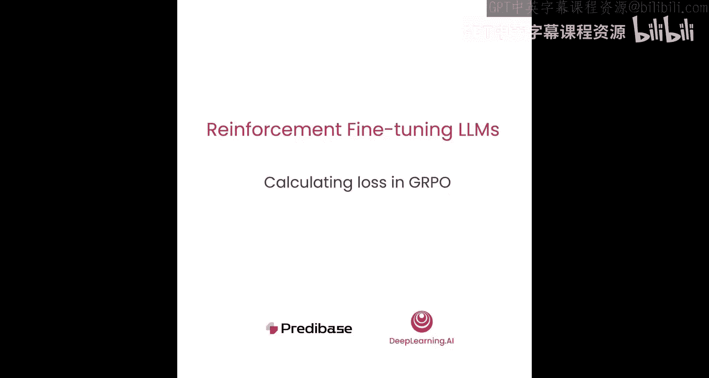
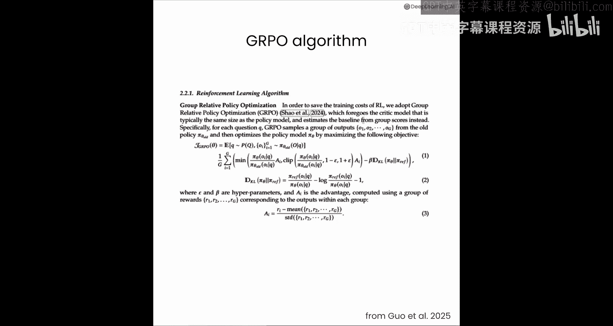

# 吴恩达《使用 GRPO 对大型语言模型进行强化微调Reinforcement Fine-Tuning LLMs with GRPO》 - P8：8.calculating-loss-in-grpo.zh_en - GPT中英字幕课程资源 - BV1RMjJziEH2

Now that you've explored how you can assign rewards and calculate advantages。

 let's take a closer look at how loss is calculated in the GRPO algorithm。

 This is the key step that drives your LM to learn from its experiments during training。

 The deepse R1 paper introduced the GRPO algorithm。 And on first look， it looks rather complex。

 However， it turns out that this big equation can be broken down into four key components that we'll be talking to today。

 The first component is called the policy loss。 and it represents the ratio of token probability distributions in your model with and without an adapter。

 The second component is something you should be familiar with。

 which is the advantages that we computed from our word functions。

 The third component is called the clipping objective。

 It is used to make sure that we don't have large loss values for any individual step。

 And the final term is called the Kl divergence。 and this term is used to make sure that during the training process。

 The model that we're training doesn't deviate too much from the baseline。

knowledgenledge that it already knows with that， let's take a look at how this loss function is actually implemented in code。

 We'll start by importing transformers and a bunch of u functions。

 as well as initializing a model called baby Lama will initialize its weights as well as the associated tokenizer。

 Next， we can take a look at what this model looks like。

 So here you can see that it's Lama model that has the embedding layer。

 a set of transformer layers with attention and MlPs along with the Lm head that is responsible for producing a probability distribution。

 Now that we loaded a model in memory。 Let's see how we can use our model to generate some tokens。

 We'll start by defining a prompt such as the quick brown fox jumped over it there。

 This prompt is then tokenized using the tokenizer associated with this model。 Once we have tokens。

 we can pass this into the model using the model generate method and specify that we want to produce two new output tokens。

 We can then convert the output tokens back into text using the tokenizer。

Decode method and see what these output tokens look like。

 So let's run this cell and what you can see here is that the model predicted that the next two tokens are IC ground。

In GRPO， we use two different models to guide the learning process。

 The first is called the reference model， and this is just the base model without a Laurara。

 and it remains frozen throughout the training process。 The second model is the policy model。

 and this is the model that we will be training using a set of Laurara weights that are constantly updated throughout the learning process。

 So for the reference model will just create a copy of baby Lama and call a refph model and for the policy model which we're want to refer to as the model in our code。

 we first define a configuration file for the Laurara weights that we want to add to the model。

 This constitutes of some common parameters， such as rank and target modules that we want to insert the weights into。

 Once we load the Laurara config， we can just call the gett theft model method that will add the Laurara weights to the base model。

 And just to see what this looks like， we can print out a policy model itself。

So you can see that now in the Qpro and the vpro layers we have these Laurara modules。

 Lauraura A and Laurara B， and these are the weights that we will keep updating during training。

 Now that we have our reference model and policy model initialize let's start implementing the loss function。

 We'll start by creating a prepare inputs method that takes a prompt and the completion。

 The first step that we do is tokenize our prompts and our completions using the tokenizer Next we need to combine the prompt tokens and the completion tokens into a single tensor so that we can pass this to the model alongside the input Is we also need to produce an attention mask so that the model knows what tokens it should attend to during the forward pass。

 Next we'll capture some metadata。 the lens of the prompt the length of the completion and the total lens and this will be useful as we produce something called the completion mask。

 The idea here is that we only want to produce a loss value for the tokens that are associated with the completion。

 and so the way this mask works is that we'll get a tensor。

Of zeros that is equal to the total length of the prompt and completion tokens and then will' set all values to one that follow all the prompt tokens。

 Finally， once we have our input ids attention mask and completion masks set up。

 we can just return all C of these values。 once we prepared our inputs we'll define a method called compute log drops that will gather the probabilities assigned by the model for each token in the output。

 we do this by passing in the input I and attention mask from the prepare input function into the model so that it produces an output。

 these output contain an attribute called logs， which are essentially these unnormalized draw outputs that are produced by the model。

 and when we apply the log softmax function to these logicits。

 we actually get the log probabilities associated for each token。 However。

 what we really care about is the probability assigned to the token that was actually produced in the output。

 and that is what we're going to return through the gather step where we only return the log probabilities for the token that was produced now。

With both our prepare inputs and log probability functions defined。

 we can actually go ahead and implement the GRPO loss function。

 So in the GRPO loss function we're going to pass in the model。

 which is our policy model that has the Laura that we're training the reference model which is the frozen base model。

 the prompt completion and as you know the advantage associated with this completion which we can produce ahead of time with programmatic reward functions So the first step is that we prepare these inputs by passing in the prompting completion Next we can generate the log probabilities associated with the completion from both the trained policy model as well as a reference model once we have these two components we can then focus on the core policy loss implementation Now in the equation that we saw earlier。

 the policy loss as a ratio of the probabilities assigned by the policy model divided by the probabilities assigned by the reference model however。

 that is actually mathematically equivalent to an expon。Of the difference of these log probabilities。

 And so this effectively computes the ratio of these tokens。

 And the intuition here for why we're computing this ratio is that we're trying to see if our policy model assigns a higher probability or lower probability to each token compared to the reference model。

 Now， once we have the ratios， the next part is to scale the ratios by the advantage assigned it to the completion。

 So this tells us that if the token that the model produced led to a positive advantage we want to boost that as part of the loss。

 and if the advantage is negative， then we actually want to decrease that loss。 Finally。

 most optimizers during training are built to minimize loss。 but in our case。

 we actually want to maximize the reward so we can flip the sign of the policy loss because they are mathematically equivalent。

 And finally， all we need to do is compute loss over just the tokens we care about。

 which are the output tokens。 If you remember completion mask is a set of zeros。

By a set of ones So the loss coming from the input tokens basically get negated and we only consider the loss coming from the completion tokens。

 We sum the loss across all the tokens and divided by the length of the total output and this produces the policy loss in the GO equation but this function implement it。

 let's see what happens when we pass in the model reference model， our initial input prompt。

 the quick brown f jumps over there and an example completion that the model may have created F end let's assume that our reward functions give this an advantage of 2。

0 So you'll see here that if computes a loss of negative 1。6 which is pretty good。

 but one thing to think about is that during the first step of training。

 the model and the reference model are actually exactly the same。

 What this means is that the ratio in our function。

 the policy loss is actually one If that is true then how does the model actually start to learn and it's because in the loss function we multiply the ratio by the advantage。

So during the first type of training， the losses just the advantage and then as the weights get updated during training。

 there's a difference between the actual model and the reference model and this produces a ratio that is not equal to one that along with the advantages continues to help scale training This is also why it's really important to define reward functions that produce a wide range of reward scores if the reward scores are all constant we end up with an advantage of0 which would cause the loss to be zero and would prevent the training process from actually kickstaring we know that the ratio effectively captures the difference between the probabilities that the reference model and the policy model assigned to each token into the completion we can see what these values look like by computing the ratio directly one thing you'll notice as you look at this is that some of these values are significantly larger then other values right so in this case like this value is about 1370 and that is significantly larger than others so if the advantage assigned that this output is extremely high。

Then effectively your loss value becomes a very big negative value。

 and this can lead to very unstable training during GRPO or any RL algorithm。

 and so we need a way to prevent overly large loss values from being generated during any single training step and the mechanism to do this is called ratio clipping which is the third term in the GRPO loss function。

 Let's see how we can add this clipping objective to the loss function we just implemented so we'll keep our prepare inputs the same。

 we'll keep the parts where we generate the log probabilities the same as well and we'll also continue to calculate the ratio。

 Now the goal of the clipping objective is to prevent any single ratio from being too large or too small so we can calculate two different versions of the loss。

 The first is the original loss that we computed currently called policy loss Let's rename this to unclipped we can also compute an additional loss term called clipped and we're going to use a method called torch or clamp where we pass。

the original ratio， and then we pass it two additional arguments。

1 minus epsilon and one plus epsilon。 The way this clamp function works is that for each value in the ratio tensor。

 it checks if the value either is below one minus epsilon or exceeds one plus epsilon if it's lower than one minus epsilon it clamps it to one minus epsilon and if it exceeds one plus epsilon it clamps it to one plus epsilon。

 So effectively it makes sure that everything is between these two ranges and in practice a good value for epsilon is0。

2 So what this will do is that for any token where the ratio exceeds these two bounds。

 it will clamp them to within the bounds and then will multiply this by the advantage once we have the unc loss and the clip loss we want to pick whatever loss is lower because that will help us ensure it was that we don't have overly large loss values So our policy loss now is no longer just ratio times advantages its actually the minimum of the unlippped and the clip loss。

And once we have a policy loss， we can keep everything else the same。

 we invert the sign so that we can minimize it and then we compute loss with the completion mask to differentiate between the initial loss function we implemented and this new loss function Let's rename this the GRPO loss with clip Let's see how this updated loss function acts in practice we'll take the same set of inputs as before。

 so the models， the reference model， the same prompt。

 the same generated output and advantage and this epsilon term。

 And so now with the clipped objective added to the loss。

 we can see that the loss is much lower than the GRPO loss without the clipping function。

 similar to before， during the first step when the models are the same we' see that the clipping objective doesn't actually change the loss value。

 we still get minus-2 because the ratio is one and it's within the bounds of one minus epsilon and1 plus epsilon。

 one important thing to remember is that the clipping is happening on each token's probability ratio。

Not on the overall loss。 Now， one question we might ask ourselves is how often do tokens actually get clipped and we can see this by taking the same prompt in completion。

 producing its log probabilities from the reference model and the policy model Comp the uncpped and clipped ratios as we did above。

 and then actually visualizing this Since we're only concerned with the completion tokens since they' also are the ones that are used to calculate loss。

 let's see how clipping affected the ratios for those tokens。

 for the first token the uncpped ratio is significantly larger than the bounds of one minus epsilon and 1 plus epsilon。

 And so the clip ratio is 1。2。 And since the clip ratio is a lot smaller than the unlippped ratio。

 we end up picking the clip ratio in our loss value and the same applies to the second output token as well。

 one common observation during reinforcement learning is that as we update the policy model。

 it starts to deviate in the tokens it produces compared to the reference model Now this is not。

Necessarily a bad thing， but often we introduce a penalty term called KL divergence to prevent the policy model from deviating too far from this reference model。

 and this is the final term in the GRPO loss function。

 Let's take the GRPO loss function we just implemented with the clipping objective and since it's the penalty term。

 it means that it is additive to the loss you've computed so far。

 So we'll keep this as the policy loss and then we can work on figuring out how we want to compute the KL divergence loss。

 We'll start by renaming this for clarity to GRPO loss with KL to differentiate this from the previous implementation and what we can do is we can add the KL divergence。

 which comes from this equation in the paper。On first look， this equation is a bit opaque。

 but the idea behind this term in general is that it's a way of measuring how much the distributions deviate between the policy model and the reference model。

 where defined delta as a difference in log probabilities from those produced by the policy model and the reference model and what this difference represents is that when this is a positive value it means that the policy model is more confident about the token it's producing compared to the reference model and when it's negative it means that the policy model is less confident in the token it's producing compared to the reference model So once we calculate our per token kl divergence loss using this equation。

 we can now rewrite our new per token loss as the original policy loss that we computed before which comes from the clipped objective minus some sort of scaling parameter。

 which well call beta times the per token kl divergence and the idea is that this is a penalty to beta can be as small or as big as you'd like and this is often depend。

On two things， the task you're actually trying to train the model for and how much of the reference models capabilities you want to keep in the new model that you're training and we'll also look at the effects of beta in just a moment。

 the last thing we need to do is add the beta term to our loss function definition and so here we can add a new parameter called beta and set this to 0。

1 to start with and this gives us our complete GRPO loss function。

 Now let's start by understanding how the Kl divergence term works。

 let's visualize the effect of Kl divergence in the GRPO loss function Kl divergence is ultimately a function of this delta term that we just talked about。

 let's take a a look at how Kl divergence values behave when this delta is between a range of negative 6 and 6 at the point where delta is 0 it means that the policy model and the reference model assign the same probabilities to the output and so they're equally confident in the tokens being produced now。

Let's say that the policy model assigns higher confidence to the tokens being produced compared to the reference model。

 In that case， the Kl divergence term actually is a small positive value on the right side of0。

 So essentially what the Kl divergence term does in the loss function as it tells the policy model you're doing great and the outputs you're producing are favorable but don't get to head of yourself。

 and so it sort of pulls it back very slowly towards the reference model。

 Now in the scenario where the policy model is trying out different strategies。

 but it is underconfi in those predictions。 you can see that the KL penalty actually increases very rapidly as this difference increases。

 and this very quickly tells the policy model that it is off track and it needs the course correct by returning closer to the reference model。

 let's also look at the effect of the beta term that is used to weight how much kl divergence we actually add to the loss。

 we can try three different values of beta00。1 and 0。5。

And see the effect it has on the loss when beta is equal to 0 the loss value skips the Kl diversionence term entirely as we increase the value of beta。

 you can see that the loss value actually starts to decrease and this is because we're telling the model that it shouldn't deviate too far away from the KL diversion term with beta is equal to 0。

5 you can see that the loss value decreases even more preventing overly large deviations from the reference model and perbase we found that a beta value of 0。

1 is usually a safe be in ensuring that the model has the room to learn the task that you care about however。

 if you're optimizing for generality while learning some aspects of the new task in that case you want to set a higher beta value of 0。

2 or even up to 0。5 so in summary loss and reinforcement learning seems complicated because of the big equation but it's really similar to the loss used in pretrainining or in supervised fine tuning the key difference is that each text sample is weighted by how much toward it receives in other words the answer。

Gett higher advantages and clipping in KL divergence are there to put the brakes on big changes companies like Prabase are building training systems that implement these algorithms so you don't have to do it yourself let's move on to the final lesson to see how the world model was tuned using the RFD service from Prabase。

