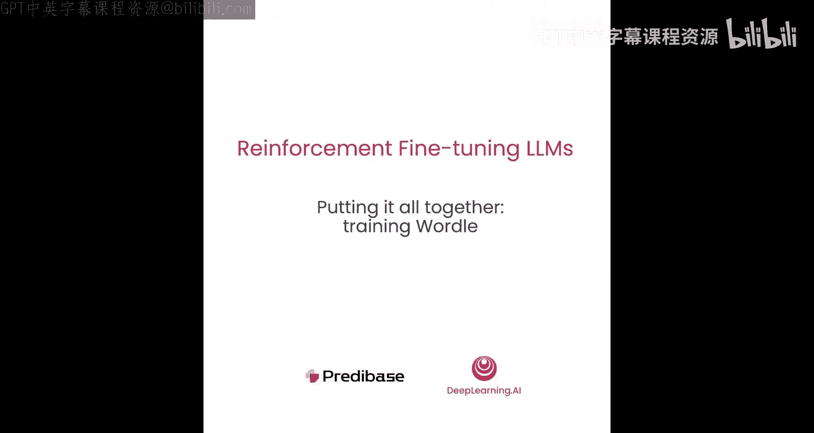
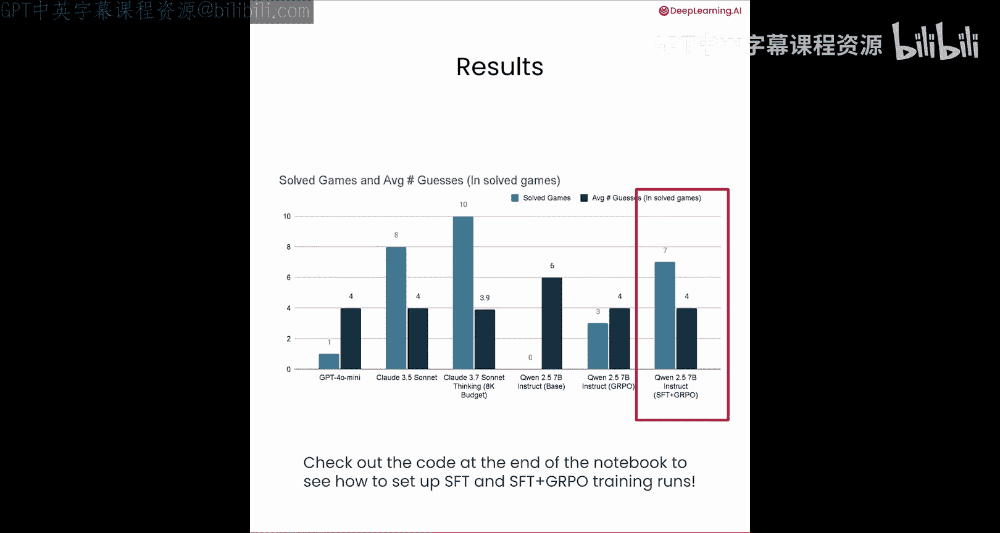
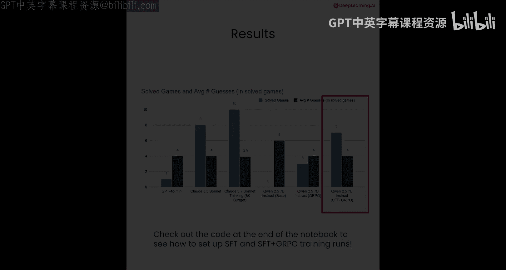

# 吴恩达《使用 GRPO 对大型语言模型进行强化微调Reinforcement Fine-Tuning LLMs with GRPO》 - P9：9.putting-it-all-together -training-wordle.zh_en - GPT中英字幕课程资源 - BV1RMjJziEH2

With all the details of reward functions and GRPO loss in hand， let's get to the fun part。

 setting up an RF run to train an LM to play Worddle。

 you'll see how to set up an RF training job using the parabase SDK。

 and then compare the resulting models， Wordle abilities to some other LMs。 Finally。

 you'll also see how GRPO can be combined with the supervised fine tuning warm up stage for even better performance outcomes。

 We're going to see how we can train a model for Worddle using RF in Pbase。

 will start by writing out our system and user prompts， as we saw in lessons2 and3。

 the system prompt lays out the games rules， the format of the feedback and an example of a valid response。

 The user prompt includes the current game state， So previous guesses。

 the feedback that it received for those guesses and a clear instructions to make a new guess。

 once we have these prompts defined。 we pass the complete prompt to the LLM， which is 12。

57 billion instruct and how to generate 16 candidate responses using temperaturebased sampling。😊。

Each of these guesses is then scored using three distinct reward functions。

 These three functions are actually a lot more sophisticated than the reward functions you've seen。

 and these were developed as we iteratively worked on improving our model to learn how to pay the game of Wordle。

 The first reward function is called output format check and it ensures that the model's response includes the correct think and guess tags and that it outputs the valid five letter English word from the dictionary。

 The user's previous feedback function evaluates how well the new guess incorporates feedback from earlier attempts rewarding guesses that logically build on prior clues。

 The guess feedback reward function scores how effective a guesses in in eliminating possibilities more incorrect words。

 a guess helps rule out from the set of all possible5 letter English words the higher the reward。

 If you're interested in seeing how these functions are implemented。

 Please take a look at the Us file associated with this lesson。 Finally。

 we use these reward scores to compute advantages， apply clipping to prevent any training instability。

And calculate the GRP or loss to updatebate the model over time。

 this loop nudges the model towards more strategic and successful wordle play。

 Now that you've seen the roadmap for how we can do RFD for Wordle。

 let's jump into the code to see how we can build a through Prabase we can start by importing prabase and various confi classes that we will use to train the model as well as the data type from Huging face Next。

 since we're training this through Prabase， you will need to sign up with the Prabase account and you can sign into the Prabase SDK by providing your API token SO。

Now that we signed into Pebase， let's get started。 The first thing well want to do is actually load a dataset to do GRPO training。

 We can do this by loading a dataset from Hoingface。

 Just data is hosted at Pebase/wl GRPO and we created this dataset by taking a set of seed 5 letter2 words from pastwle games and having strong models like 3。

7 thinking simulate gameplay。 we discarded the actual outputs produced by the model。

 but we kept the intermediate guesses it makes as it works toward the solution。 Once we do that。

 we can actually upload this data to Prabase directly from pandas and this is done by calling PB do datas up from panda's data frame。

Once we uploaded our data to Prabase， the next step is to create a new deposititory。

 A deposititory is just like a Github depository， except that you can use it to track all of your training experiments in the platform。

 In our case， we'll create a repository called Wordle。 Don't worry about this warning。

Once you've created our repository and uploaded the data， we're now ready to set up our training run。

 as you know in GRPO， we need to define our reward functions and we've done that in our U file so we have the guess value。

 the output format check and users previous feedback with our reward function setup we can now define the tuning job that we want to run as you can see the fine tuning job consists of four parts a config to define what we want to train with reward functions。

 a data set， the repository and optional description that's zoom in the GRPO config that helps define the configuration for our GRPO training run。

 we can specify the base model which is  Que2。57 billion instruct next we can define our set of reward functions using the reward functions config this consists of two attributes that we can set runtime and the set of functions which is a mapping of a human readable name to the actual function definition the reward functions are executed on Prabas server and so if these need optional dependencies such as pandas or maybe open AI。

you LLM as a judge。 those need to be specified within this fronttime config Once you defined a reward functions we also have the option of setting optional sampling parameters。

 This can include things like max tokens temperaturek sampling etc in this case we want to give the model enough tokens to evolve its chain of thought and so we set Mac tokens to 4096 Finally we can set numb generations to 8 or 16 our in enlar number depending on the compute budget we want to give it。

 and these are all the components that are required to set up a valid G or config once our fineunning job is set up we can run the cell to execute to kick off the training job。

 you won't actually be able to run this in the notebook but if you set up your own prabase API key when you run this cell you will see an output that looks very similar to what you're seeing on your screen right now If you want to try this yourself you can get started with $25 worth the free credits on prabase today we use this setup to train a model to play Wordle throughout the duration of this course。

 Let's take a。At how this model performed on a set of games that it's never seen before。

 We benchmark both closed source and open source models on 10 games of worldle。

 and specifically we measured two metrics。 The number of games that the model could solve and the average number of guesses in those solved games。

 We found the G4 or mini is only able to solve one game While cloth 3。

5 sonnet is able to solve about 8 out of 10 games， which is pretty good。 Cloud 3。

7 sonnet thinking is able to solve all 10 games with fewer than four guesses on average。

 but it does this only when we give it a thinking budget of 8000 tokens。

 The base Quen model actually fail to solve a single game。

 when we use GRPO to do reinforcement find un The Quen model solve 3 out of 10 games with an average of four guesses in the game that solves。

 This is actually pretty incredible for a model of this size and clearly demonstrates gains in strategic play and efficiency from purely reward drivenn optimizations。

 We can also combine supervised and reinforcement find un to get the best。😊，Both worlds in step 1。

 we start by having cloth 3。7 sonnet play 35 games of Worddle and capture the reasoning traces it generates for each intermediate guess。

 These prompt completion pairs form our SF data set。

 which teaches the model how to think through its guesses step by step in a logical way。

 The resulting SF checkpoint gives us a strong initialization for further optimization。 essentially。

 a model that mimics good reasoning。 Then in step 2。

 we use this SF model as the starting point for GBO。

 we will run the same reinforce and fine tuning process that we described earlier。

 So generating the completions， showinging them with reward functions。

 Comp advantages and updating the model， and this produces our final GRPO checkpoint。

 Now optimized not just to imitate reasoning， but to solve Worddle more efficiently。

 by combining supervised fine tuning with reinforce and fine tuning， our  Quent2。

5 model was now able to solve 7 out of 10 games correctly。

 which is over a 2x improvement in its performance。 One thing to remember about GRPO。😊。

An RL in general is that it is a on policy algorithm。

 it is used to help the model to find its own knowledge to do better on a downstream task when you do SFT using outputs from a strong model and then use GRPO to refine that knowledge very often we find that small models are actually able to beat these larger models on the same task if you're interested in training a model using SFT or training it using a combination of SFT and GRPO。

 we've made the code available to do this in pairase towards the end of the notebook。

