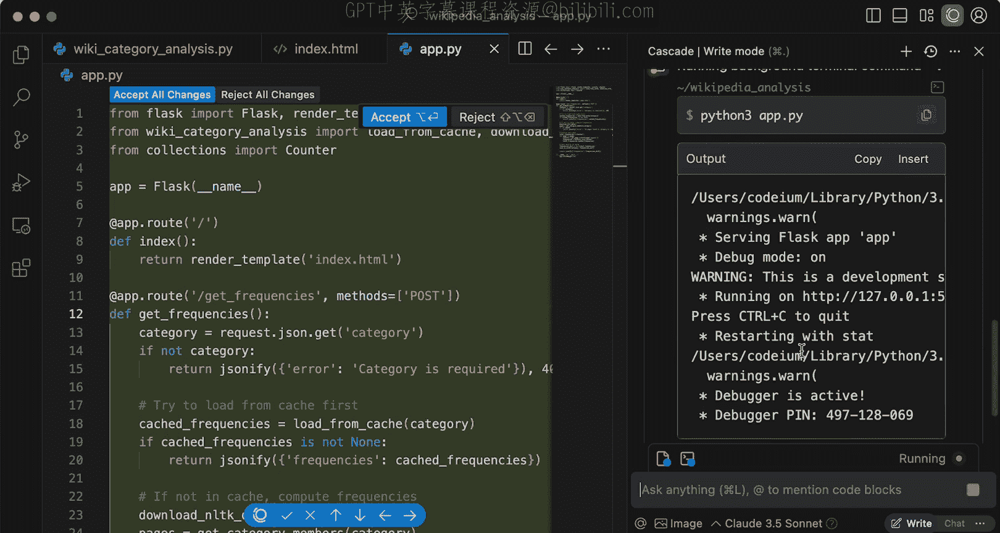
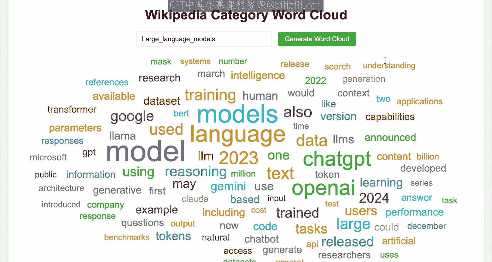
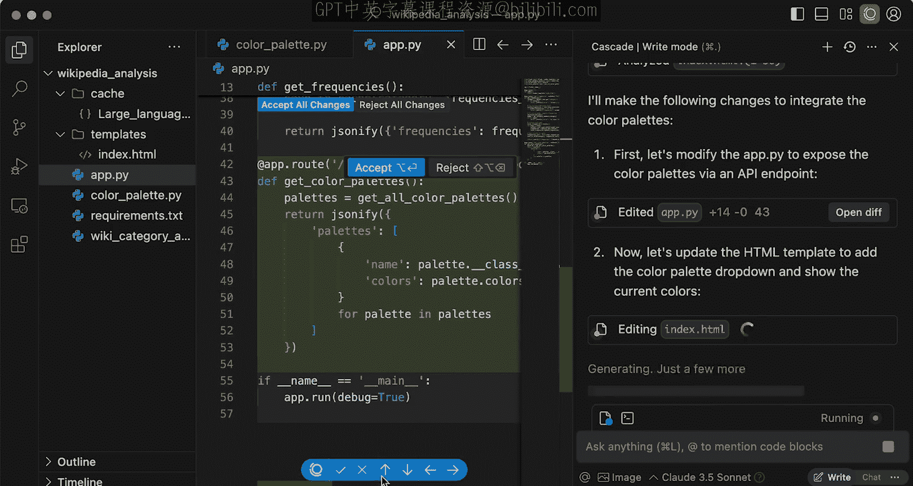
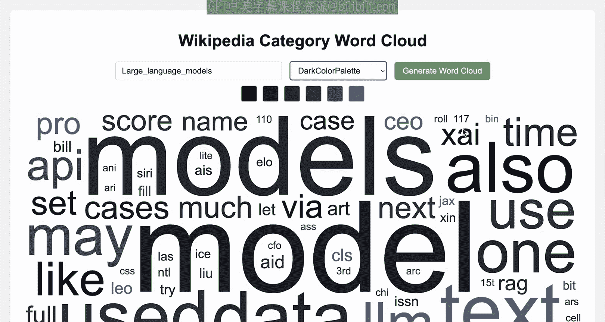
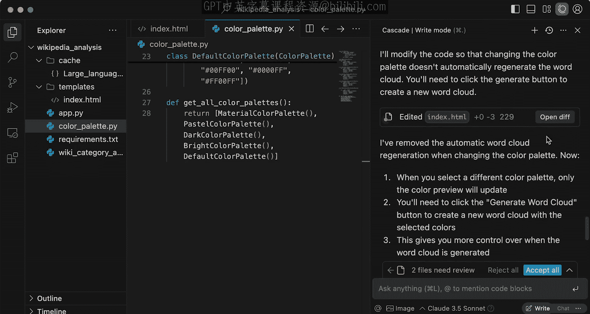
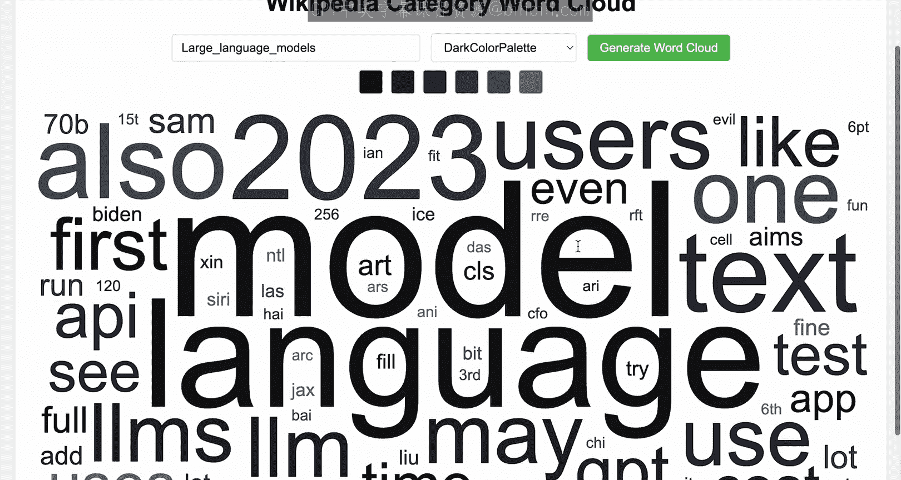
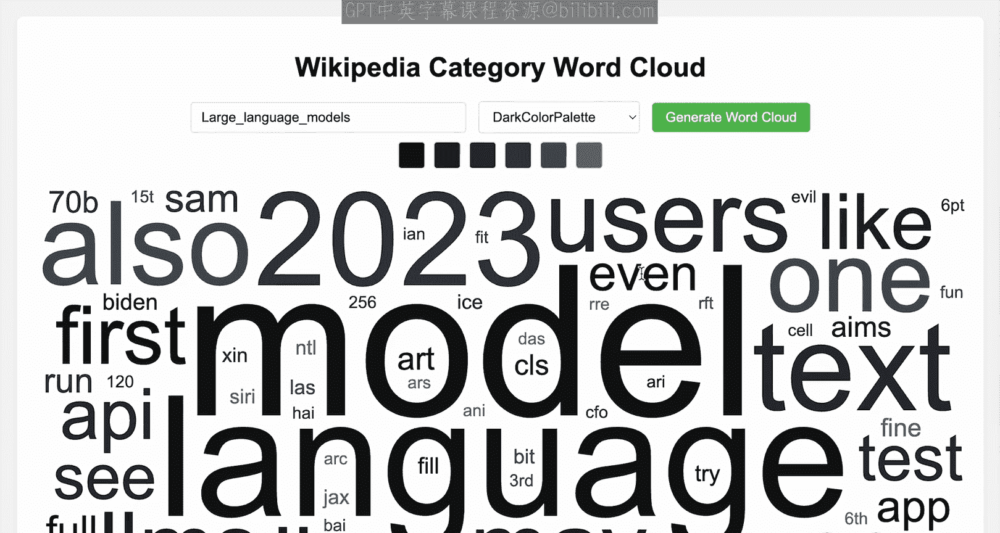
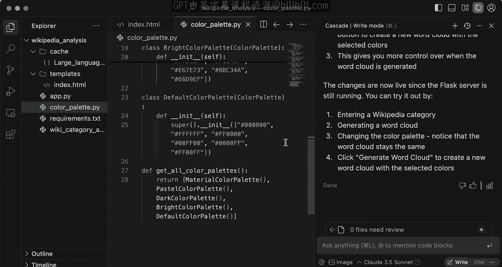

# 吴恩达《使用 Windsurf 的 AI 编程代理构建应用程序｜Build Apps with Windsurf’s AI Coding Agents》中英字幕 - P10：10.wikipedia-analysis-app-–-fullstack-app.zh_en - GPT中英字幕课程资源 - BV1aYXUYFE2D

In this lesson， you will build a full stack app to display the results of the data analysis that you've done for your Wikipedia analysis app。

Along the way， you will learn a number of tips and tricks and best practices to maximize your interactions with the AI agent。

 Let's get started。 All right， Now is the fun part。

 where we're going to take all the work we've done to build out the frequency analysis and caching and make it visual with a web page。

 So I'm going to switch over to Winsurf。 This is where we left off last time。

 What I'm going to do is I'm just gonna to start a new conversation for this。

 because we're building out a front end。😊。

And I'm going to use this prompt， create a web page that loads data from the results cache。

 if available， of course， otherwise compute the frequency from scratch and display a word cloud where the size of the words are proportional to the frequency and again。

 I'm specifying that I want to use HTML JavaScript and flask for this task。

So let's see what Cascade can do。All right， it seems like Cascade has added and edited a bunch of files。

 again I can use the OpenDff tool， the cascade bar in order to observe and investigate all the changes that have been made。

 let's go and run the app。Okay， seems like the app is live。

Let's go check it out。 So here we are at local host 5000 where it said it was deployed。

Let me type in my large language models category。Generate the word cloud。And boom。

 seems like it was fast enough， seems like I was hitting the cash。Looks great to me。

 Let's go back to Winsurf and I'll show a few more things。 The first thing I'm want to show is that。

 as you can see， currently， Cascade is running a terminal process。😊。

You'll notice here。In this bar that appears above the input prompt area。

 you can see all the changes that you need to review over and all the files that you need to look into。

 and you can also see all the terminal processes that are currently running。

 you can also end and cancel any of the processes from here or directly from where the command was actually run。

 So let's go in when making reviews。 again， I can go file to file。

 I can accept changes at the block level。 I can accept changes at the file level。

 I can accept all the changes directly from this bar。

 So there's a lot of different ways in order to accept or reject changes from Cascade。

 So so far so good。 Let's do a little bit more looking around。I have the HTML file here。

She looks great。 There's obviously a lot of jascript here as asked， maybe I'm just not expert on ja。

 and I kind of want to understand a little bit of what's going on。

There' are some nice other handy features hidden around the Windsor editor to make these kinds of operations really easy。

 For example， if I go to the function， this is a function generate word cloud and jascript not expert this。

 you'll notice that a number of helpful code lenses appear at the top above the text editor。

 So I could just click explain And what this will do is cascade will pull in all that relevant information into cascade perform analysis and explain to me what's going on。

 This is really helpful， especially as I use cascade in these agents in unfamiliar languages or frameworks。

 I can also use it to explain exactly what's going on。

 and our ability to be able to detect this and pull in just the relevant information is due to all that complex parsing logic that we built on top of code bases that we mentioned in an earlier lesson。

 So this is always a helpful utility in order to understand code that exists。

 The next thing I want to add， though， to my app is different colors。😊。

I want to make it look really pretty And to do this。

 I'm more actually going to demonstrate a number of the functionalities that have nothing to do with Cascade or the agent Again。

 this is an AI native IE。 So it has much more than just the agent to experience So do this。

 I'm going to go to my file Exper。 I'm going to create a new file called color palette。😊。

Do P Y just to define the color palette。 I'm going to close cascade for now。

 The first functionality that I'm going to show is what's called command。

 This is the ability to give instructions to the AI directly in natural language in the text center。

 The shortcut for that is command I As you can see， the command entry comes up In this case。

 I'll just give command and instruction。 to create a color palette class that contains six typess colors。

 bunch of common color palettes extending。 Let's see how it works。 As you can see。

 it's going to rapidly generate a lot of code for me。 which is great。

 Even faster than I can probably do it while prompting cascade。

 which is why you shouldn always use agent gen experience for everything。

 But it's nice because you can also use further functionalities。 For example。

 you can already see that autocomplete is trying to suggest additional boilerplate code。

 So looking at this， maybe I want like class RGB color palette。

 I can just autocomplete and multiple lines of code can be generated rapidly。

 I can continue my work here。 I can say define a function。😊。

To just get all color palettes find a method。 just to return all of them。 That's great。

 But you'll notice here。 Let me actually word wrap to make it visible。

 But it's not just the ability to command or autocomplete。

 There's a lot of the passive experience that exists with editing in the text editor。 For example。

 I might just go here。 And I might just rename this default color palette。

 What you'll notice is that R AI is already suggesting the next edits that appear far away from my cursor position。

 So this is the benefit of having a really strong passive experience inside the text editor itself。

 You can rapidly generate a lot of boiler plate code without really needing to rely on the agent as a crutch for every edit that you want to make。

 So this is helpful。 But now I actually need to incorporate this color palette class that I created into my application。

 So for this， I'm going to switch back to Cascade。 What I'm going to ask Cascade to do is I'm going to integrate this。

😊，Get all color palettes method into my existing app to to this。

 I'm going to use a functionality called app mentions。Something that we haven't mentioned so far。

 but just to show what it really does is it's a way for you as the developer to guide the AI in a very lightli manner in places that you already know what the AI needs to look at。

Again， because it's agentic Cascade does have the capability to go and figure this out by themselves。

 But just like if you're working with a pair programmer。

 if you can just nicely nudge them in the right direction， you're just going to save them some time。

 So think about it that mentions in a similar kind of manner。 You're able to mention files。

 directories。 You can mention individual methods and functions， which we'll use in a moment。

 you could even app mentioned the web or a bunch of thirdpart public docs for third party APIs that are common。

 So let's integrate this color palette into our word cloud app to do that。

 I'll just use the that mention， as we just discussed to tag in the getall color palettes function。😊。

So into the word cloud app， again， best practices， let's be a little descriptive what we want to see。

 make the color palettes。Selectable in a drop down and display the colors being used。

Let's see what happens。嗯。As you can see by using an app mentioned。

The agency is able to directly go to where it needs to look。

And then it will use its agent search and discovery capabilities to look at other relevant pieces。

 start making some modifications。You can use the open diff as I go along。

 see some of the changes being made。

Let's see how this looks， looks pretty good to me。So let's try to generate category N， of course。

That聪 me。Oh。I accidentally misspelled。That's fine。Cool， so。

Seems like we got word cloud using this material color palette。

 Let's start changing the color palette。Ching the dark color palette seems to generate the word cloud differently。

Awesome， seemsm to be working kind of like how it expect to work。

 One thing I noticed that when selecting a different color palette。

 it would automatically change the word cloud without me clicking the generate word cloud button。

 Maybe I like it。 Maybe I actually want to change this a little bit。 Again。

 this is the iteration part of working with an AI agent or any AI tools。

 So I'm going go back to Winsurf and to say， make sure。😊。

That I need to click。The January button。To create a new word cloud。Even if I change。

The selection of the color palelleette。Or just some kind of instructive action。

 and we'll see what it does。Seemed like it wasn't。A huge change。 Okay。 So let's accept all changes。

 Let's go back to the application， refresh it。

Put in。Category。Okay now if I select。And new color pal， the color pal changed。

 but the word cloud didn't change。 So let's see。Give me the loading screen。Awesome， so again。

 these are minor details， but way to iterate on your applications。

Using cascade。We did quite a lot in this lesson。We not only built the entire full stack app using Cascade。

 but we also used command and autocomplete to rapidly build a bunch of boilerplate code and then incorporate it into our overall application。

 As you can see， using Winsurp is more than just。Iterating with an agent。

 it is a full experience with AI in order to maximally improve your velocity in developing the features that you want to。

 So this was fun。 We're going to wrap it up with one more lesson right after this。 So let's continue。

😊。

