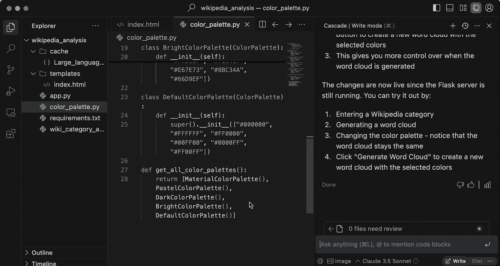
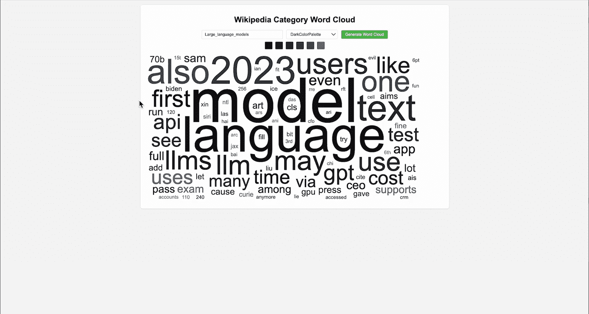
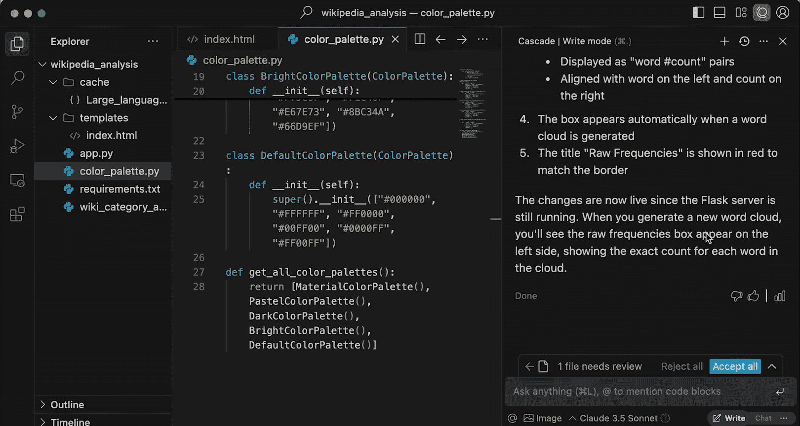
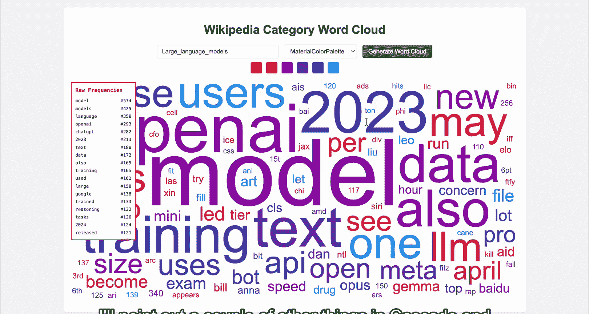
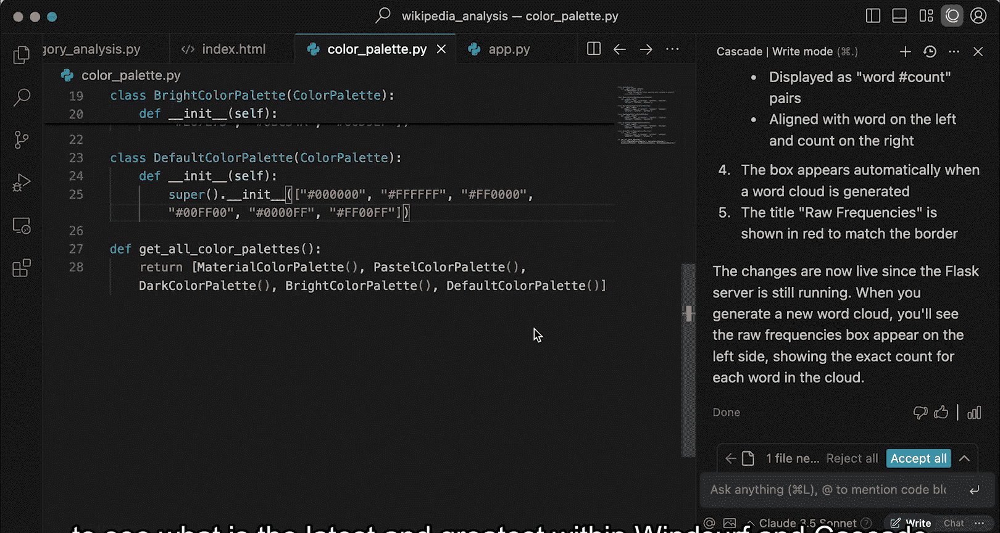

# 吴恩达《使用 Windsurf 的 AI 编程代理构建应用程序｜Build Apps with Windsurf’s AI Coding Agents》中英字幕 - P11：11.wikipedia-analysis-app-–-polish.zh_en - GPT中英字幕课程资源 - BV1aYXUYFE2D

In this lesson， you will add some further functionalities by leveraging the multimodality capabilities of the AI agent。

 and you will also learn about a number of features and best practices so that you can continue to build and customize your Wikipedia analysis app。

啊陈天你。You made it to the final lesson in this last lesson。

 we're just going to add one more functionality using some multimodality inputs。

 so let's switch over to Winsurf。

Great， so the app looks good。 One thing you'll notice is down here。

 there's the ability to insert images into。Cascade， so we're going to utilize that。

 So what I'm going to do is I'm going to go back to my application and the application looks good。

 What Im going to do now that I'm here in my application， let me zoom out a little bit。

 I'm actually going to take a screenshot。😊。

Let me open the screenshot。Great。I'm actually just going to add some stuff to this。

 So let me add a rectangle。Over here on the left。San。😔，Text。Let's say I also want to， you know。

 the visual representation is great， but I actually also want to see the raw frequencies while I'm at it。

 so。I'm to put raw frequencies。Let's add another text box， word  one。Were two。

 let me actually just put in some text here。 This is kind of just roughly what I want to do。

 about 30 seconds kind of sketched out。 instead of having to explain all the details of the layout。

 I'm just gonna say that image。 Let's go back to Cascade。 Great。

 So I'm gonna to use this image input now。 So I just added。

The image to。Cascade， and now I'll just say， add raw frequencies。To the app has shown。In the image。

Something， that's simple that。Casscade can use the multimodality aspects of these reasoning models。

Already， it noticed that these raw frequencies had to go to the box on the left of the word cloud。

 I never mentioned that to cascade。

All right， changes seem to be live， So let's go back。 let's refresh。Large language models。

Zoom back in a little。Okay， the raw frequencies are there on the box on the left。

 even using the red text and the red outlines like I showed in the image。

 So this is a simple usage of using multimodality in order to increase your development velocity。

 So this is the last feature that we were going to actually add as part of this demonstration， but。

I'm excited to see all that you can build on top of this。 And just to help you along the way。

 I'll point out a couple of other things in Cascade and windsurf that I wasn't able to as part of this demo。

 The first is there's a lot of settings on the windsurf settings panel。

 Any kind of ways in order to customize your experience。

 One of the things that we didn't show was the idea of memories。

 The idea behind memories is to similarly to rules。

 be pieces of information that Cascade can continuously go back and reference。

 So allows Cascade to essentially build state of how you do work and what's important to you as time goes on。

 These memories can either be explicitly mention。 Those are the rules。

 or they can even be auto generated。 So that's what these cascade generated memories does Either Cascade will automatically generate these memories as you're doing work。

 and it will give you a notification。 or you can just tell Cascade， remember this for me。

 and it will insert memories into its memory bank。 similar to rules you can go back and edit those at any point in time。

😊。

It's a way for cascade to automatically learn things without you having to explicitly mention everything in terms of a rule。

 There's a lot of pieces that control your passive experience and other kind of nice little UX pieces over here as well。

 There are other functionalities in the settings panel。

 So if I search up Winsurf in the settings panel you'll see theres a lot of other different kinds of editable fields for you。

 One of my favorite is actually the cascade commands all out and deny lists As you can see every single command that cascade suggested I had to accept but sometimes there are certain commands that I'm totally fine auto running or there certain commands I never wanted to auto run So you can actually whitelist and blacklist commands in more recent releases。

 there's even turbo mode， which will just automatically run everything for you if you just want to go full vibe coding with your AI agent That's all for this lesson course As we saw。

 there are a lot of functionalities and features that make working with Winsurf and cascade a lot of fun And hopefully you learned a thing or two about how to best improve your development。

😊，and workflows with these AI collaborative agents Of course。

 this is just a moment in time and Cascade and a Winsur are only going to continue to get better the AI is going to get smarter。

 the functionalities and polish guidance and observability will only continue to expand so keep up to date with all the changes on our docs or using our change logs to see what is the latest and greatest within a windsurfing cascade so you can maximize your experience as a developer with AI。

