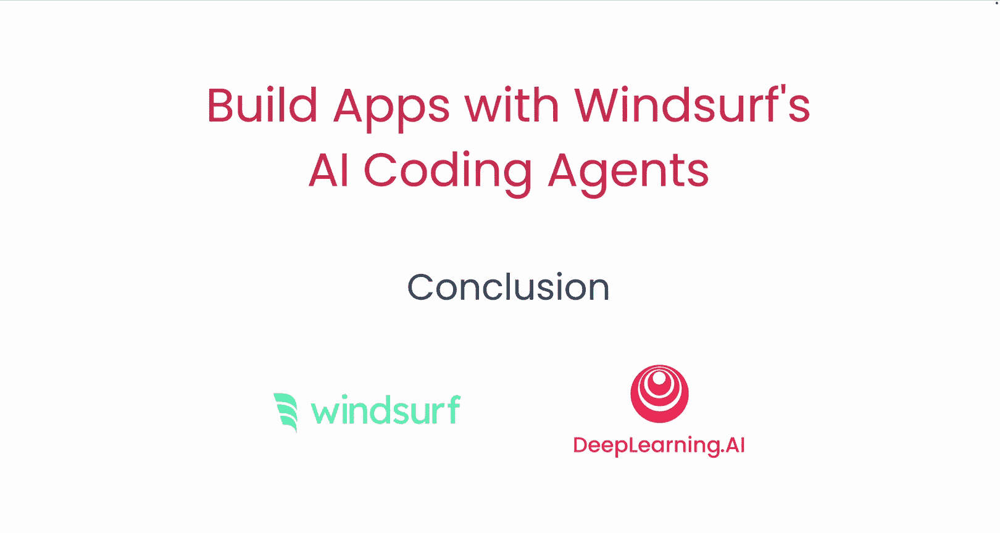

# 吴恩达《使用 Windsurf 的 AI 编程代理构建应用程序｜Build Apps with Windsurf’s AI Coding Agents》中英字幕 - P12：12.conclusion.zh_en - GPT中英字幕课程资源 - BV1aYXUYFE2D

Congratulations on completing this course in this course。

 you learn about the history of AI code assistant， how to separate some hype from reality。

 how to think about these AI code assistants and how these AI agents work。

 We deep dived into search and discovery as a specific important paradigm。 And along the way。

 you built a number of different apps using windsurf and the collaborative agent。😊。

I look forward to seeing what you build with Windsurf。

