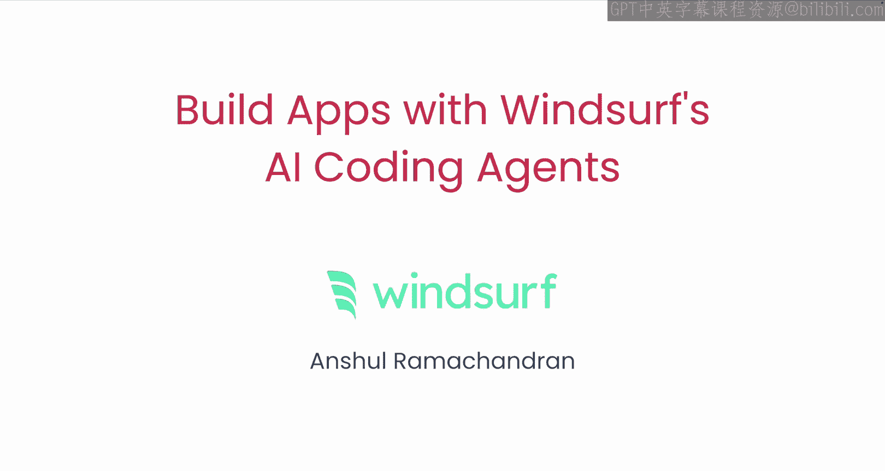
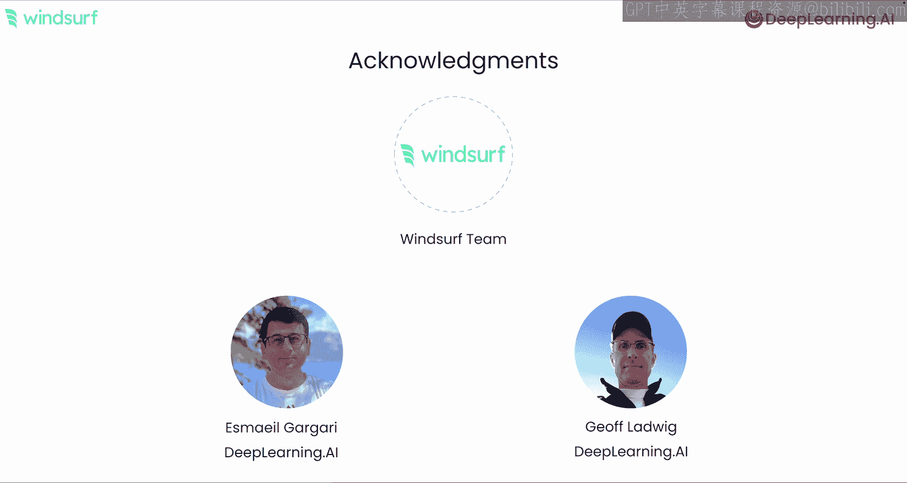

# 吴恩达《使用 Windsurf 的 AI 编程代理构建应用程序｜Build Apps with Windsurf’s AI Coding Agents》中英字幕 - P1：1.intro.zh_en - GPT中英字幕课程资源 - BV1aYXUYFE2D

Welcome to build apps with Windsurf's AI coding agents。

 built in partnership with Winsurf and taught by Anhu Ramachandran WinsSurf is a collaborative agent IDE that provides a workspace where you can work with an AI agent In this course you learn how to use Winsurf to build several cool applications and also pure underhood to deeply understand how a coding agent is built on top of large language models。

I know many people using AI in their coding work though， Sa code also complete as a basic feature。

 but many users， even that AI physical coding， are not yet using AI anywhere near to the full extent of what's possible。

This course will make you highly skilled in today's cutting edge best practices。

 and I hope will transform how you code。 The instructor Aishha Ramasandran。

 is a founding team member of Winsurf and World Exp in AI coding agents。

 welcome Thanks Andrew Winsurf makes coding with AI more fun and a lot easier。

 There is a wide spectrum of AI coding tools available to developers On one end。

 there are simple coding assistance tools that generally make a single call to a large language model。

 On the other end， there are autonomous agents that aim to fully automate the coding experience。

 We will built Winsurf to serve as a collaborative agent that bridges the gap between simple coding assistance and fully autonomous agents。

😊，I always feel that when I know how a tool is built。

 I make a much better and more powerful use of it。 That is what makes me especially excited about this course。

 You will learn what goes on under the hood of an agent AI tool like Winsurf all while using it to build games。

 fix unit tests， update large repositories and build an entire Wikipedia topic analysis app from scratch。

 a major difference between different AI coding tools is how they use OMs in their flow to plan and execute actions。

 Have you coding agent that is effective at maintaining context of the codebase and track what you to develop the ones and in the right tools to what gives it the few of a good peer program I working alongside you。

😊，One of the main factors that make Winsurf a successful AI coding agent is robust search and discovery capabilities that lets it take multiple steps to scan multiple files and even search online for documentation。

 Then identify the most relevant code or darkc for task and it come with a sequence of code edits to execute the programme intent。

 This is much more complex and disical Ra pipeline and Anho be going over all of these details。

 Many people have worked to create this course， I'd like to thank the whole windsurf team。

 And from Deep Bta AI Ema Gagari and Jeff Ladwwickig also contributed to this course。

 This course is going be a lot of fun。 I think so， let's go on to the next video to get started。😊。

