# 吴恩达《使用 Windsurf 的 AI 编程代理构建应用程序｜Build Apps with Windsurf’s AI Coding Agents》中英字幕 - P2：2.getting started.zh_en - GPT中英字幕课程资源 - BV1aYXUYFE2D

In this lesson， you will learn how to get started with Winsurf and build your first app in just a couple of minutes with an AI agent。

 Let's dive in All， let's get started with Winsurf。

 All you have to do is go to Google Search up Winsurf AI download and click the button and the link according to your O。

 I'm using Mac。 all have to do is click this download button。 and I'm pretty much good to go。

 Once downloading the application， you'll open it up and you'll see something similar to this This is Winsurf。

 you'll have to log in and authenticate and then you're ready to get started。

 Winsurf is a visual Studio code fork。 So if you've used VS code。

 a lot of this will visually look similar， although there's a lot of AI pieces that we're going to explore throughout this course。

 because it's a VS code fork， you could also throughout installation。

 importport all of your settings from your existing VS code setup。

 The main thing to notice about Winsurf first is this panel on the right called Cascade。

 That is our AI collaborative agent， which we'll be using extensively in this course。😊。

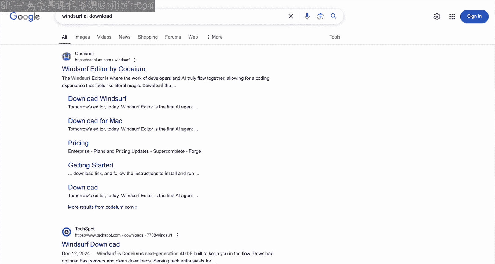

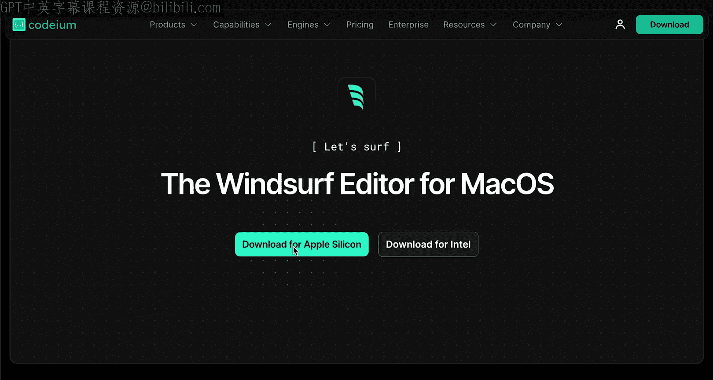

As you can see， I have a completely empty project to start。

 and I'm just going to go ahead and ask Cascade to build our first app。

 If Caskege doesn't show up for you， all you have to use is the keyboard shortcut。😊，Command L。

 in order to close and open it。Alright， so let's use Cascade to build our first app。 In my case。

 I love the snake game。 So I'm just going to go to Cascade and say， create a snake game。😊。

Wait JavaScriptscript and。Htl。Immediately， you'll see Cascade go out and start taking multiple actions。

 itll go out and write multiple files of code in order to complete the task at hand。

Casscade is even capable of suggesting terminal commands so I can even run my application。Good。

 seems like everything's ready to go， so I'm going to go to local host 8000 to check out my game。

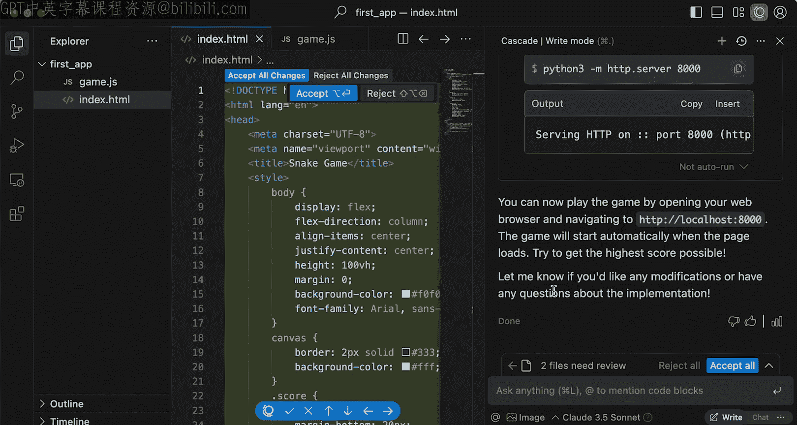

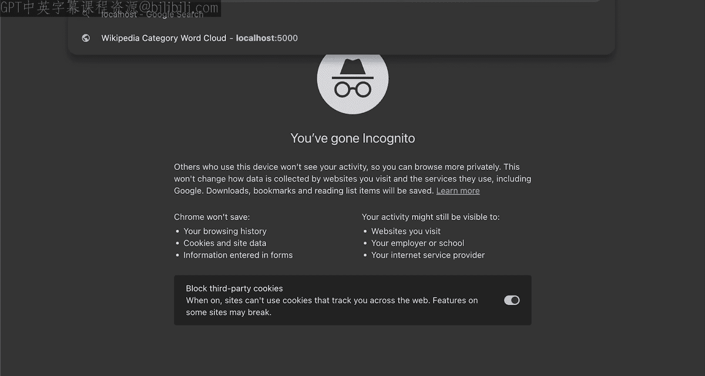

Well， there we go， the snake game， it exists。Gams over， I can restart it。Cool。

 but let's make this a little bit more fun， becauseuse this is the beauty of working with the AI agent。

 When I go back to Winsurf， as an example modification。

 let's say I want to change the background color。😊。

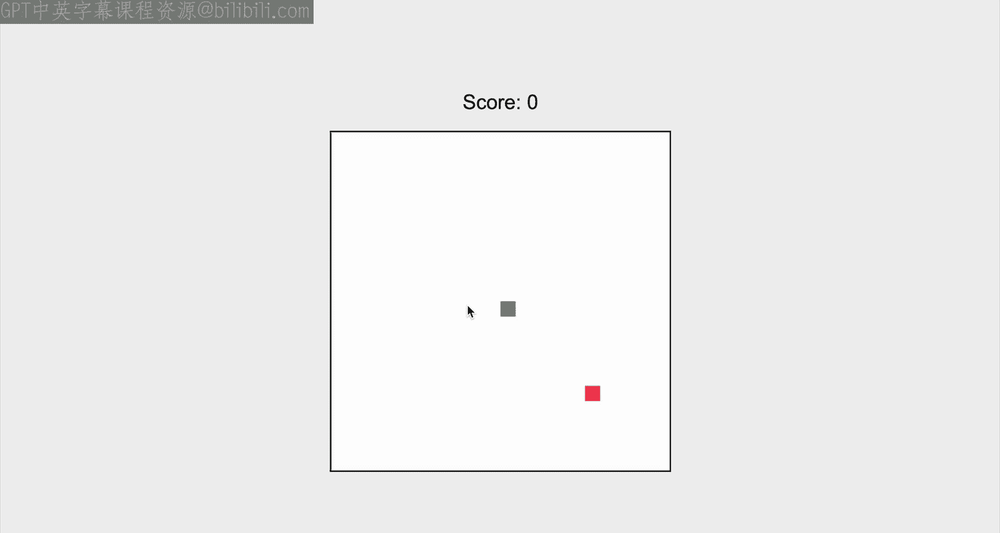

Every time a food square is consumed。Something fun。Great， seems like a sum。 I'll go back into my。

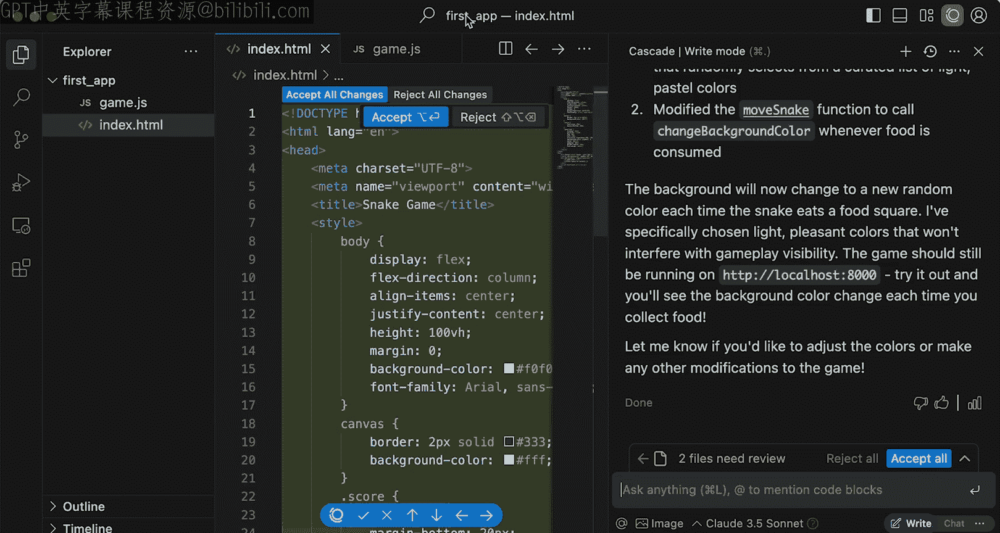

Com。All right， refresh my Chrome， let's see if this worked。Well， great。

 the background color is changing every time I consume a square， exactly like I asked。

 this is the beauty of working with AI agents。 Whatever your creativity is。

 you can use it to build whatever you want。😊。

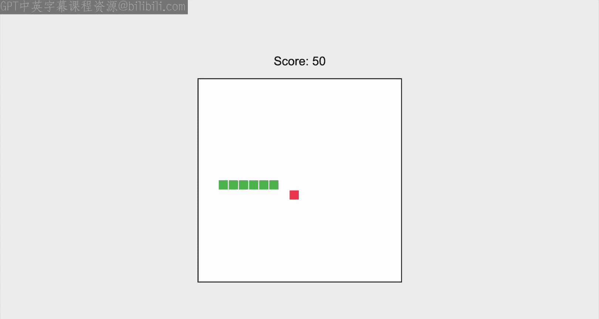

Let's actually add one more thing， I actually wanted to make it look more like a classic S snake game。

Change the food square。To be an Apple emoji。

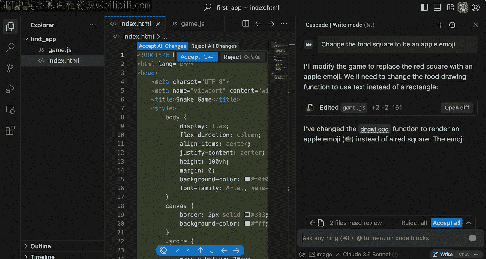

Great， let's go back to Chrome。Fresh。And just like， we wanted it。The apple emoji。

And the background color is changing。We can keep on doing this forever。

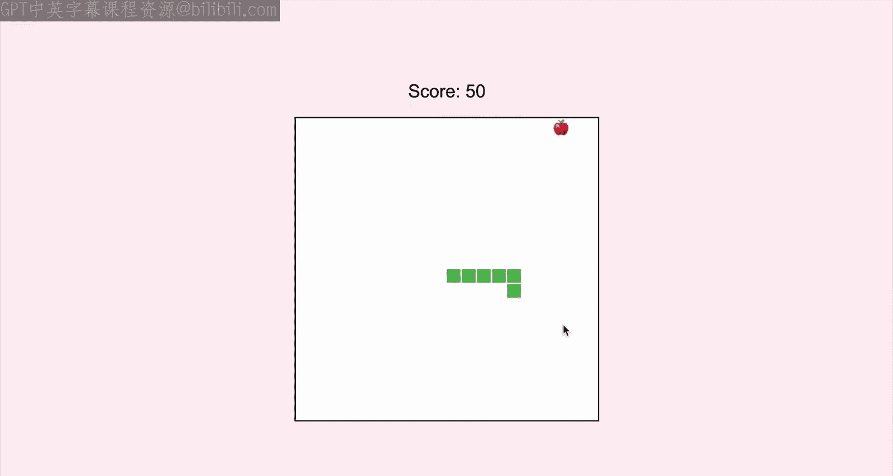

Let's keep on making this one。Let's go back to Winsurf。Add a little explosion。Where the food square。

Is consumed。Every time is successful。All right， seems like it's on again。Let's go back。

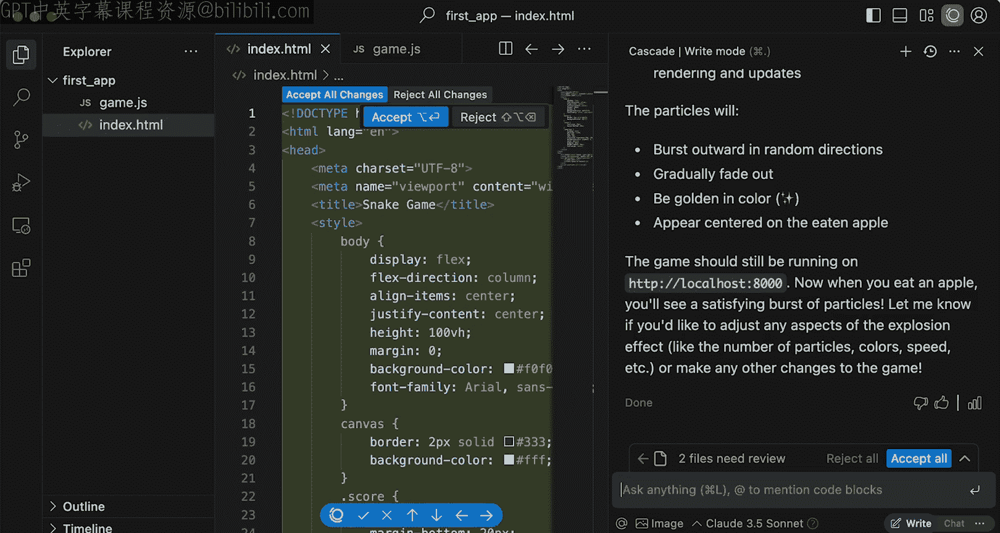

To Che， restart。And there we have it。A particle explosion， every single time。

 I consume z the apple and the background color changes。

How about we just completely start breaking the rules， Let's go back。

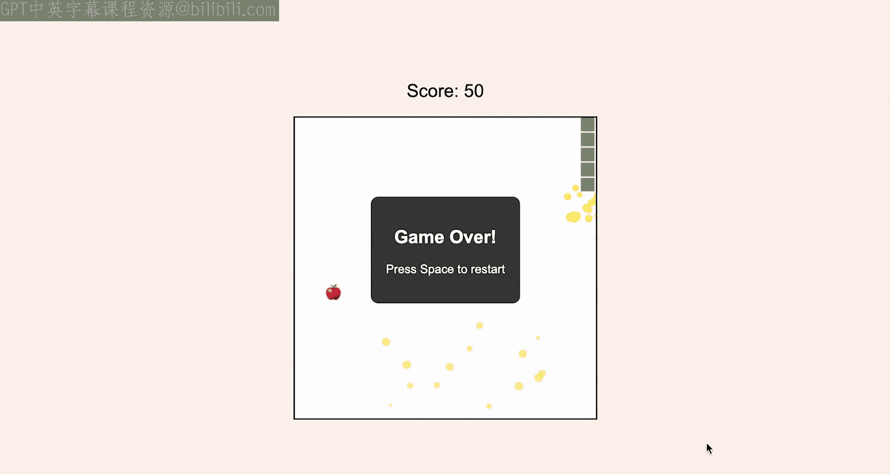

To windsurf， and let's make the apple also move， make the apple into a moving target。

Move slower and the snake。Of course。Right， seems like it's in again。

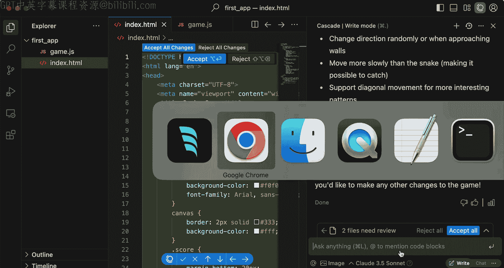

Now the drill， refresh。OhAnd there we see， you can see the apple is moving slower than the snake does。

 but still very catchable。Great， so you've just seen me build my own personalized snake game。

 You should go out there and try building your own。 Of course， AI is non deterministic。

 so you might get slightly different results， or you might have to change an area on a few things。

 but expand your creativity。 See what you can make。😊。

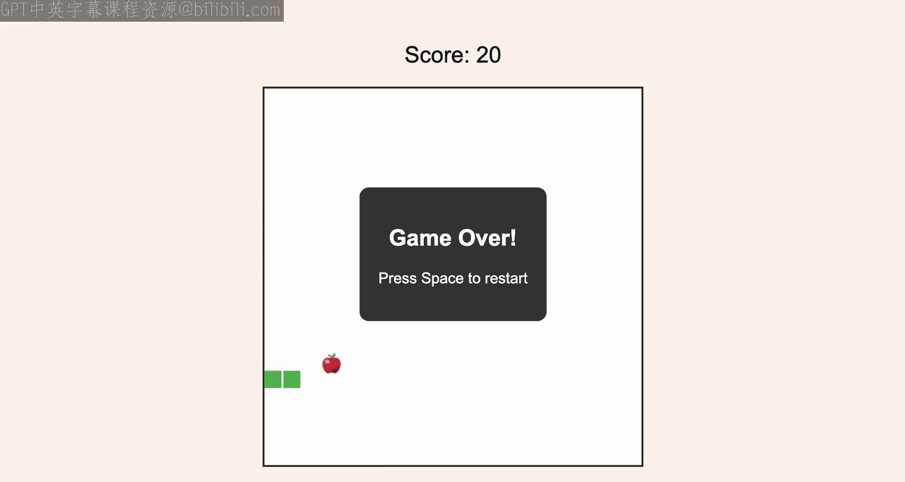

