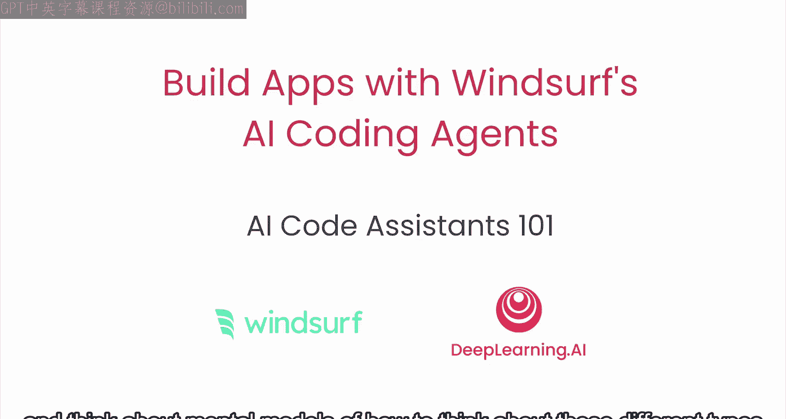
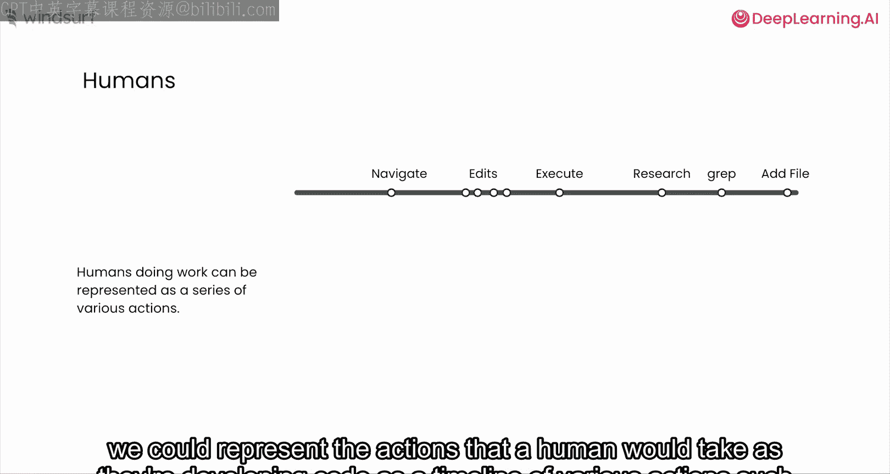
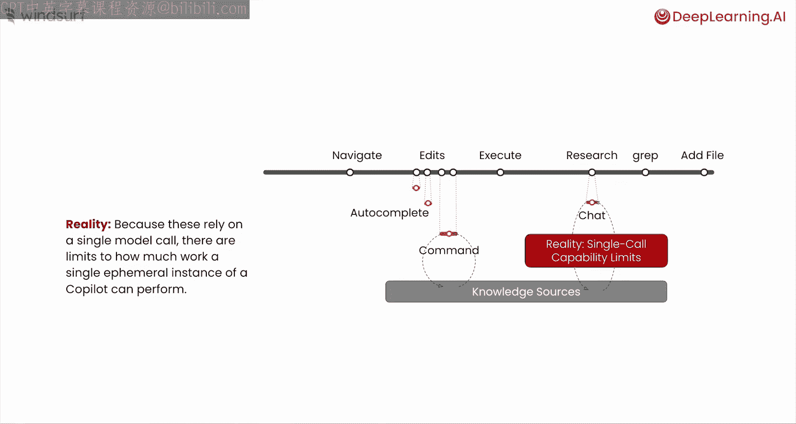
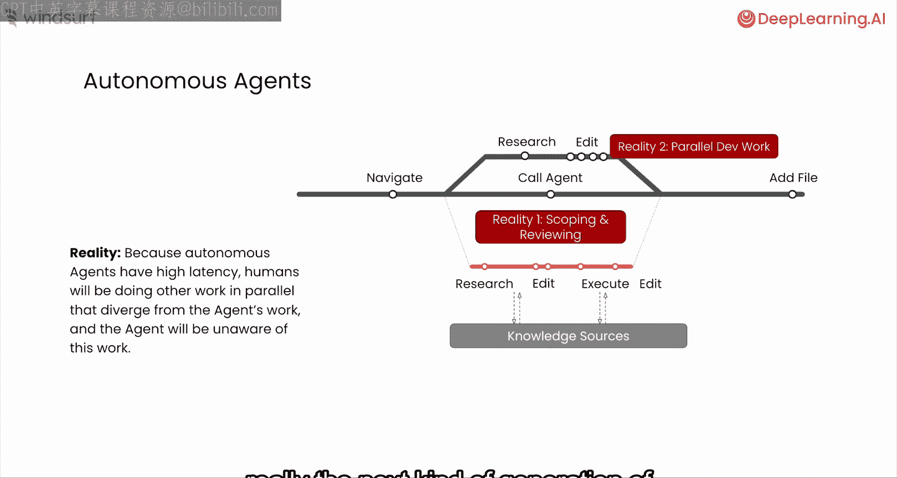
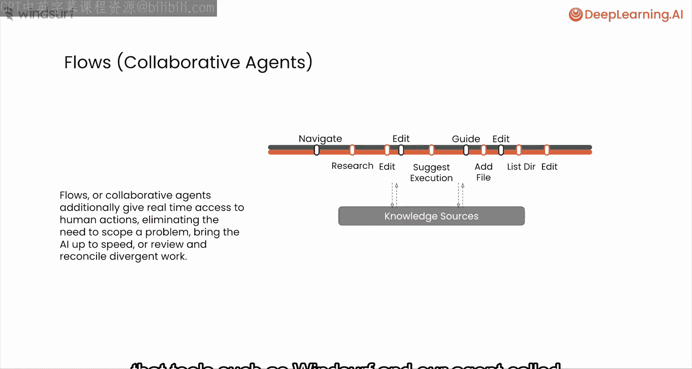
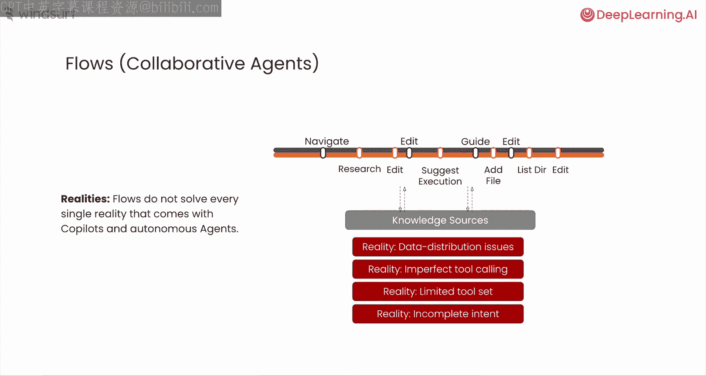
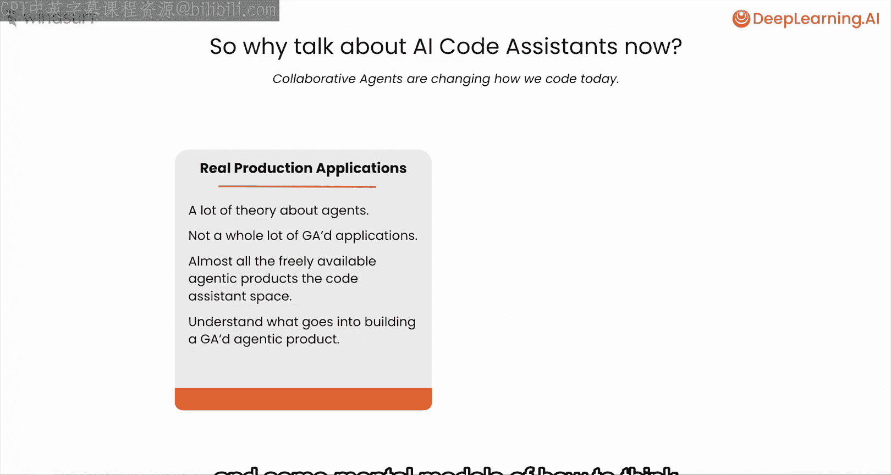
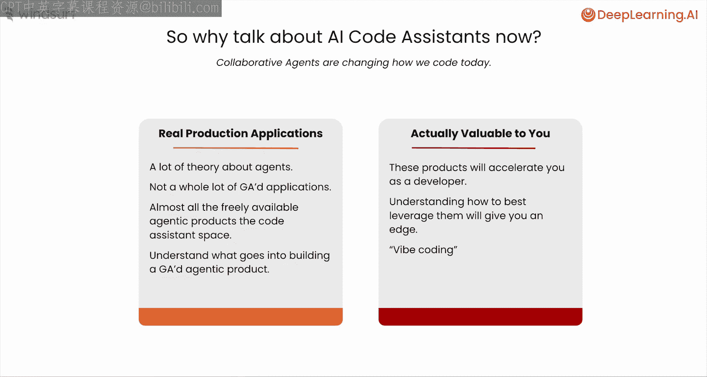

# 吴恩达《使用 Windsurf 的 AI 编程代理构建应用程序｜Build Apps with Windsurf’s AI Coding Agents》中英字幕 - P3：3.ai code assistant 101.zh_en - GPT中英字幕课程资源 - BV1aYXUYFE2D

Now that you built your first app using an AI collaborative agent。

 let us go back in time and look at the history of these tools and how we got here and separate some of the hype from the reality。

What's divein， let us start by understanding the AI code assistanceance landscape and think about mental models of how to think about these different types of code assistance and where the lines between hype and reality lie to set this up。

 we'll start from the very beginning before AI altogether when it was just humans we could represent the actions that a human would take as they are developing code as a timeline of various actions such as navigating their code making edits doing research when chat GT and other tools like Gitthubcopilot codium and cursor started coming out we started entering what I'd like to call the age of copilotlike assistance where instead of humans having to complete every single task。

  individual small pieces of the overall problem， such as making an edit or doing some research could be replaced by getting an autocomplete suggestion or asking a chat like experience a question This was clearly value additive and has propelled the industry forward over time these have gotten better and better by。

Saying access to private knowledge sources in the code world。

 this could be something as a private codeb The large language models themselves were not trained on these private code bases。

 but by giving access through methods of retrieval these AI assistants could give more grounded answers and responses and suggestions to the developer and this has made things even better combination of knowledge improve U Over time these tools have added more and more value The best way to think about these cop like tools is like a person just starting to learn how to code you can't really ask it to do a very longrunning task because it can only has a single call to an LLM。

But by reviewing it constantly， you can definitely get value and speed yourselfsels through。

But this idea that a single call to an LLM was the limits of these cop like tools。

 It posed a limitation to the overall amount of work that a cop like system could do。

 and that is why we started talking a lot about agents the first iteration of agents that were being discussed is this idea of an autonomous agent tools such as Devin from cognition fit underneath this mold and the idea is relatively simple instead of every single call to an LLM being an individual invocation that has to be reviewed by a developer we would have the AI system be able to chain multiple calls to LLMs and integrate access to tools that would change the state or give new inputs and information to the AI system and this in theory。

 would be able to allow the AI system to complete larger and more complex tasks。

They still have access to knowledge sources， just like it was for the coppit like systems。

 the best way to think about these autonomous agents is like an intern or a junior engineer where you need to still scope out the task very clearly for them and after they complete their work you have to actually go in and review all the work that it completes and so that is just part of the reality and one way of framing the idea of autonomous agents。

The other reality is that a lot of these autonomous agentic systems。

 especially in software engineering， do take a lot of time and so anyone who has worked with another intern or junior developer knows that there could be some parallel development work going on between you as a developer and the AI agent and so after this idea of autonomous agent。

 really the next kind of generation of tools is this idea of collaborative agents。

 which I might refer to as flows throughout this lecture and others the basic idea behind flows is to treat the AI instead of an intern or a junior engineer that you delegate work to treat it more like a pair programmer and the beauty of treating it like a pair programmer is instead of having to perfectly scope out work and review a bunch of work from an agent it is kind of this back and forth mindmdlike experience where any actions that the human takes in。

 for example， the IDE can be reasoned about by the agent and any of the work that the agent does can be reasoned about。

By the human of course still have access to knowledge sources。

 but this combination of knowledge sources， tools and the understanding of what each other is doing creates this kind of new experience that tools such as Winsurf and our agent called Cascade really kind of build upon in terms of paradigms but that being said it's important to still keep a reality of what these tools are capable of doing while there might be a lot of hype about the capabilities of AI systems and AI agents for software engineering the reality is these flows have some of the same kinds of issues and downsides as any of the other kind of agenttic or non-ageenttic systems that came before it these are all using large language models under the hood that have data distribution issues not every single language or framework is equally represented in the public corpus of data that these models are trained upon there might be imperfect tool calling there might be limited tool sets that don't fully match all the different things that us as a human could do or a developer could do and the reality is there's。

Always going be some incomplete intent that these agents won't have that conversation that you have at the water coololer with the coworker is never going to be something that the agent will be fully aware of。

 so you can't expect the agent to know absolutely everything。

 And so therefore guiding it to the ability that you can doesn't improve the performance So this all leads to the question of why should we talk about AI code assistance today。

 really is two hals。 The first is these are available for use right now there's a lot of theory about agentic systems but not too many applications that any individual are able to freely use on their own time。

 And so we can use this time to understand really what goes into building an agent product that is generally accessible and some mental models of how to think about these products underneath the hood and of course the other half is that this is a tool for software engineers So you as a developer can understand how to best leverage them which will give you an edge in your development。

