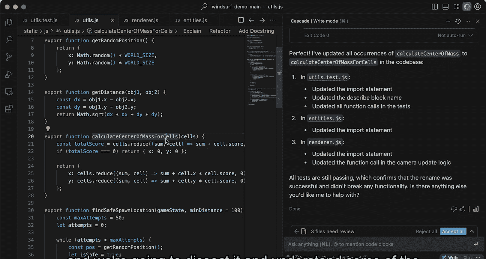

# 吴恩达《使用 Windsurf 的 AI 编程代理构建应用程序｜Build Apps with Windsurf’s AI Coding Agents》中英字幕 - P4：4.fixing-tests-automatically.zh_en - GPT中英字幕课程资源 - BV1aYXUYFE2D

In this lesson， you will use the AI agent to analyze and resolve issues in some JavaScript code。

 and in the process youll see a lot more details of how the agent works。Let's get started。

In this demo， we are going to be doing tasks on a jascript repository using frameworks such as jest for testing。

 Don't worry if you're unfamiliar with JavaScript or these frameworks。

 the point of this demonstration is to show that you're actually able to iterate with an agent on code bases that you might not be familiar with。

 So as you can see， there are some code here and。I'm going to ask Cascade to actually help me debug and fix some issues that are in the code base。

 So to start， I'm this Ask Cascade。fiix。Or run， all just tests。In this repository。

 and I'm going to point out a few different things that Cascade is doing at more detail as we go along。

The first thing is Cascade is going through the repository and understanding how we even need to run these tests。

 so it's going in it's analyzing existing knowledge so as awareness of the existing code base。

 It has tools such as the ability to suggest terminal commands so I can go out there。

 run the tests itll be able to analyze stack traces and say， hey。

 there's a failing test would you like to investigate it so I can of course。

 have a conversation with it similar like you would with any chat like experience in this case it's an agent that has taken multiple steps by itself independently。

So I'll just say yes。And now， Cascade will take multiple steps and multiple tools。

 similar to a human。 Again， it will use the contexts awareness to analyze both the test code and the code affecting the test。

 It will reason about what the issue might be。 Then it will use tools to actually make edits to the files。

 So in this case， it realizes that the issue is actually with the test case itself。

 So when in and make that edit。 Itll again suggest me the command to run tests。

 And now all the tests are passing。 So in about a minute。

 without in a code base that we didn't really know a whole lot about。

 the agent has helped us resolve errors in our tests。I'm going to accept these changes。

 but I want to do one more thing to highlight another capability of cascade within Winsurf。

Maybe I go to the definition file。And I say， in reality。

 I want to make this function name a little bit more descriptive。 I'll just say four cells。

 I can now go back to Cascade， and I can just say， continue， update all call sites。

 Note that I didn't specify the change that I made。

 but because Cascade is attentive of the actions I'm taking in the rest of the editor。😊。

It's going to be able to notice the change that I just made and then take action accordingly。

Cascade has gone out， it's look through the files， update all the call sites。

 and that will make multiple edits across multiple files。

 which is something a lot of AI code assistants that only have single LLM calls would be unable to do。

After making all the edits， Cascade can suggest us to rerun the tests。

 verifying that the tests still pass and all of the call sites have been updated accordingly。

 So this was a really short demonstration， but I highlighted a lot of the core pieces that make cascade incredibly powerful There's an understanding of the existing code base。

 there's a whole different set of tools that are utilized to take action and investigate and verify the work that it's doing and also clearly understands a little bit of the intent that I had as a developer when I was interacting with a text editor。

 So next we're going to take this example and we're going to dissect it and understand some of the mental models of how such an agentic system works。

😊。

