# 吴恩达《使用 Windsurf 的 AI 编程代理构建应用程序｜Build Apps with Windsurf’s AI Coding Agents》中英字幕 - P5：5.how-a-collaborative-ai-code-agent-works.zh_en - GPT中英字幕课程资源 - BV1aYXUYFE2D

Now that you've seen the agent in action more deeply。

 let's learn about a few mental models that we can use to dissect and understand how the agent works under the hood。

 Let's dive in。The main purpose of this lesson is to understand the components of what makes Cascade。

 this collaborative agent really powerful， independent of all of the U X and pretty features that come with it。

 Many people have likely seen some version of this classic agent loop。Essentially。

 the agenttic system will get some input prompt from the developer。

 It will go to some large language model that acts like a brain to essentially take that input prompt and reason。

Out of all these different tools that I as an agent have， which tool should I use？

This could be a search tool such as GrP or embedding search， it could be a tool to edit a file。

 it could be a tool to suggest a terminalmo command。

You saw all of these tools in the demo and then after the tool take some actions。

 the large language model will again reason， okay， given the inputs and the tool that was just called。

 what should my next action be， should it be calling another tool in which case it will continue this loop until finally that large language model that acts as a brain。

Besides that， hey， we're done calling tools， it's time to go to end state。

 end my action and go back to the user。 This is the classic agent loop where the large language model is used as a reasoning agent for tool calling。

And it's really clear then what exists as two important components of an agententtic system。

 The first are the tools， what are all the actions that can be taken and how powerful are those tools for each of those steps and the second half is the reasoning model and today the state of the art for deciding what tools to call and how to call them the inputs of those tools given all the relevant information that the large language model has。

 are these generally available foundation models from model providers such as open AI and Anthropic but these don't actually capture the full set of axes that you could use to improve and agententic experience like Cascade the first one that I want to mention is the idea of context awareness。

 we touched upon this a little bit earlier when we talked about how improving access to knowledge can improve and ground the results from AI systems。

 But there are few different ways to think about context awareness as a problem The first are the sources What are all the relevant sources。

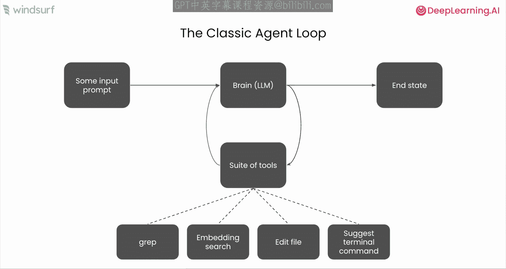

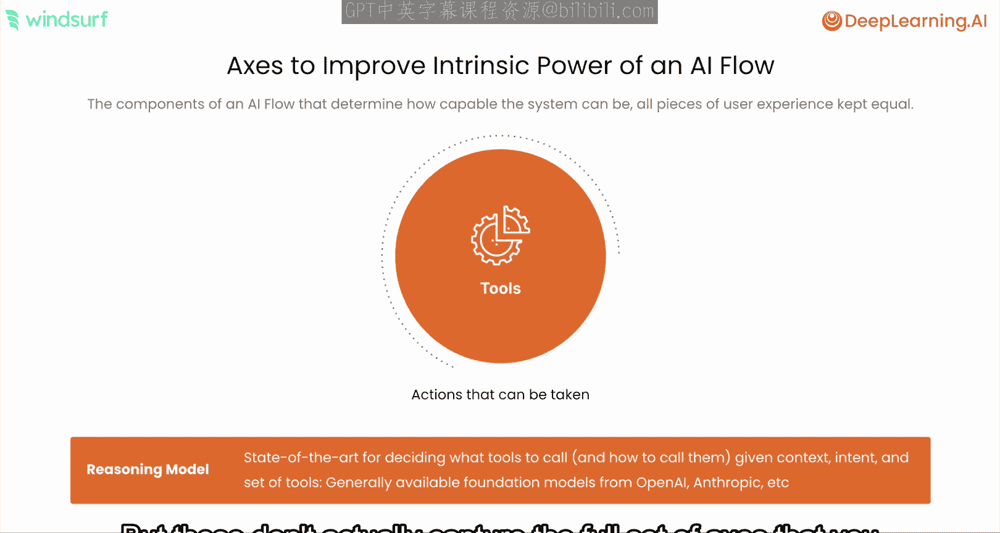

knowledgeledge for the task at hand for something like writing new code that， of course。

 includes existing code in private repositories， but it might include things like documentation or tickets or Sck。

 These are all various sources of information that could help ground the agent in its decision making process。

 The other half is parsing。 It's great to have access to data。

 but how are you actually reasoning over that data I there structure or implicit information of that knowledge that can actually improve the ability to retrieve relevant information from large corpus of information。

 and we will talk about this a little bit more in detail in a couple of slides。 And finally。

 is access。 This is a little bit less from improving the quality but an access of context awareness to be aware of especially when we're thinking about large organizations that might have access controls over certain pieces of knowledge。

 AI should not give access to knowledge that would be otherwise unavailable to a particular user The other component of an agent system that isn't fully captured by that agent loop is the idea of。

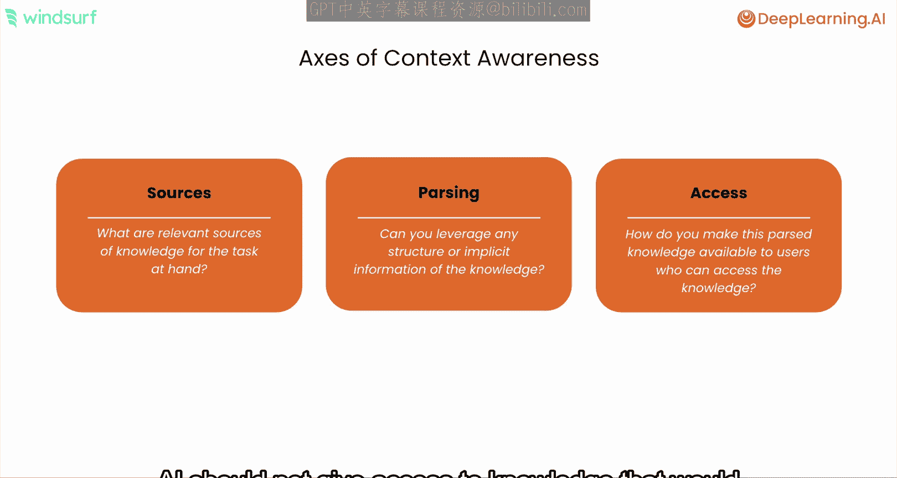

A understanding the actions that the developer is taking implicitly allows the agent Gentic system to understand what needs to be done。

 This really allows for that collaborative agenttic experience or that flowlike experience If context awareness is pulling all of the relevant explicit knowledge the idea of tracking whether a developer opens a file or perform some navigation of their ID or makes an edit in a file。

 all that implicit information that we get from those actions being taken can also be used as inputs into the LLM to reason about what tool needs to be called next or whether we're done calling tools we can actually see the value of the combination of context awareness and human action tracking by looking at other AI modalities that aren't just the agenttic system。

 For example， we could look at the classic autocomplete functionality where the AI suggests a few lines of code at the cursor position to complete so that you as a developer don't have to type it out from scratch。

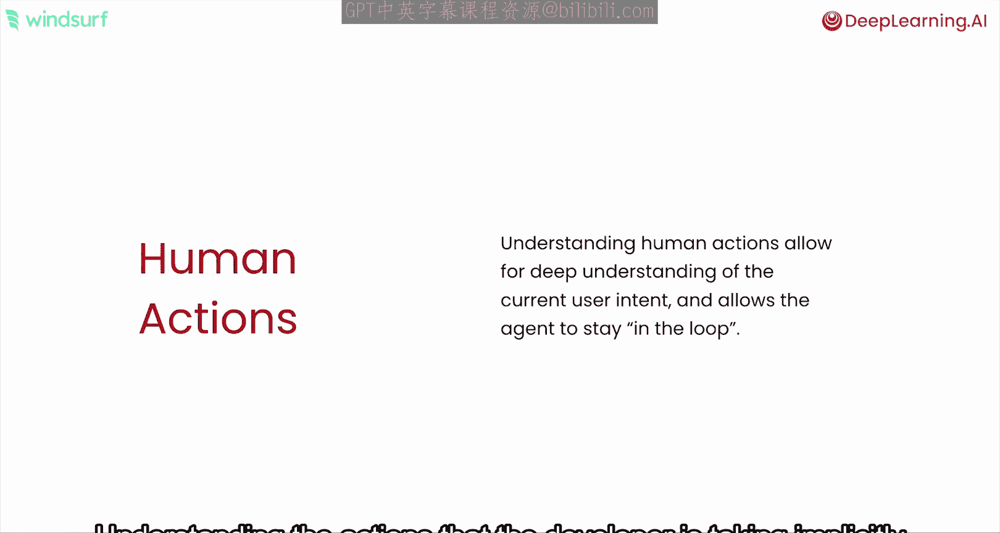

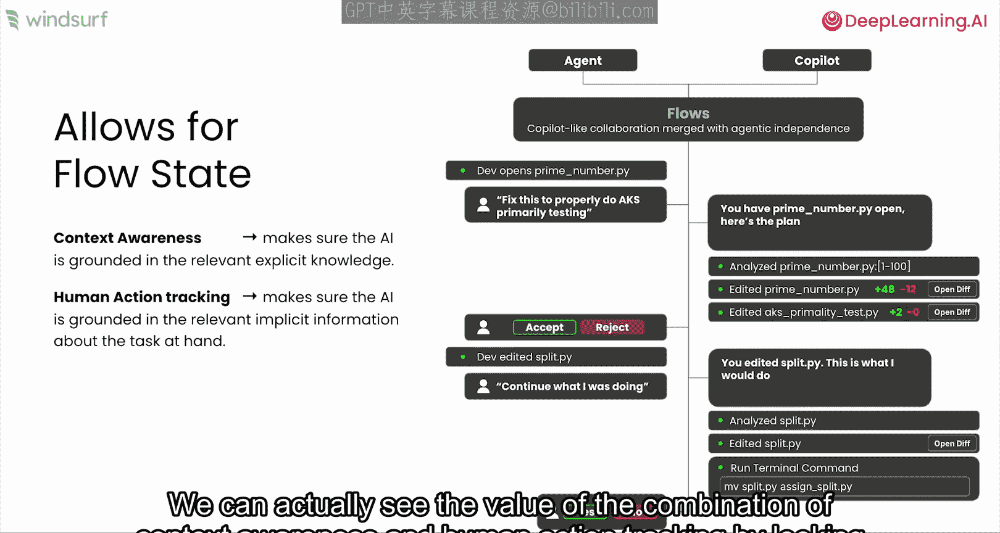

This helps a lot in writing out boilerplate。 This graph shows a series of different experiments where we change the levels of context awareness and human action tracking that the model has access to。

 So in all of these examples， the model is exactly the same。

 Allward changing is the kinds of inputs that we're providing to it。

 we'll take the baseline performance of autocomplete to be using just the currently open file as context to the LLM to make the autocomplete suggestion。

 If you start incorporating intent， which it may include what other files and tabs are open in the IDde。

 the quality of the autocomplete results actually increases by 11%。

 that's very clearly shows that by incorporating intent and human action tracking。

 you can create better results， even with the same models。 if we try another experiment。 for example。

 let's take embeddings of the entire codebase naively chunk it and then do simple embeddingbased retrieval across the whole repository。

 It's also better than the baseline。 But one thing to notice and might be a little bit counter。😊。

Intuitive is that it actually performs worse then if you only use the intent of the open files and tabs。

 which actually points really importantly to the parsing capability of the context awareness system。

 because if you change the parsing from just naive chunking and simple retrieval just based on embeddings to a system where you use things such as abstract syntax tree parsing AST parsing。

 custom code parsers， smarter chunking and more advanced retrieval where we're not just looking at embedding-based retrieval。

 but looking at heuristics and other structure of the codebase such as imports or nearby files if that's the change that you make。

 you can actually massively increase the performance of your system over the baseline。

 so this is really just to highlight how important not just the tools and the model are to an agent systems。

 but also how important context awareness and understanding the developer's intent is as well。

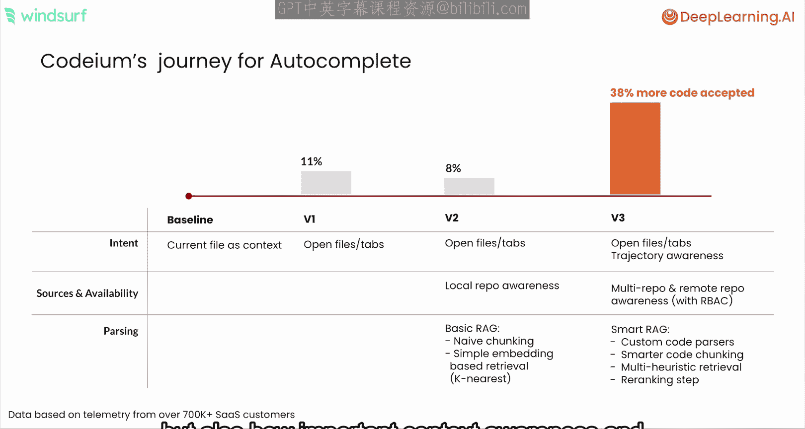

So in totality， context awareness tools and human actions become the axes in which different agents experiences differentiate from each other。

 especially since the reasoning models are relatively the same between tool to tool。 Of course。

 it is also important to talk about the tools a little bit because the tools are the actions that the agent can take in between the reasoning steps。

 And if you have higher quality tools， you will be able to take higher quality actions and therefore get to better results quicker。

 There's really three main categories of tools。 and this is another model of dissecting what goes into an agenttic system。

 The first is the category of search and discovery tools。

 The idea that you first kind of need to get all the relevant information to even make changes in the first place。

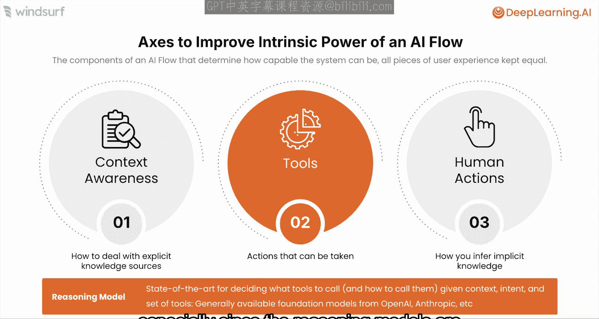

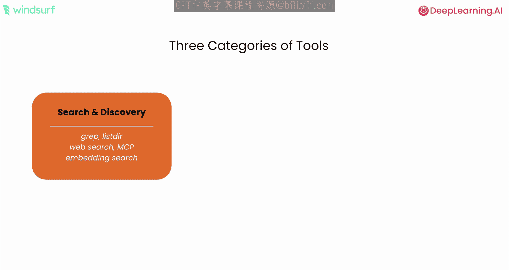

The second are tools that allow us to change state of the world。

And the final is verification to check that any changes to the state actually improved the overall system and got us closer to the task at hand and if you really think about it。

 this is kind of how humans also do work right when we start doing a task we look for all the relevant pieces of information either in our code base or online or elsewhere well make some changes and then we will compiler code we'll run our code and we'll look at results to see is it exactly what we wanted it to look like and if not we start the process all over again and so in a very similar way we can think about tools for an agent within these categories。

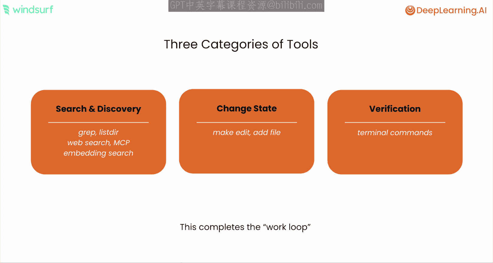

So putting it all back together again， really， it's this combination that makes this kind of collaborative。

 agentic experience feel very， very natural。😊。

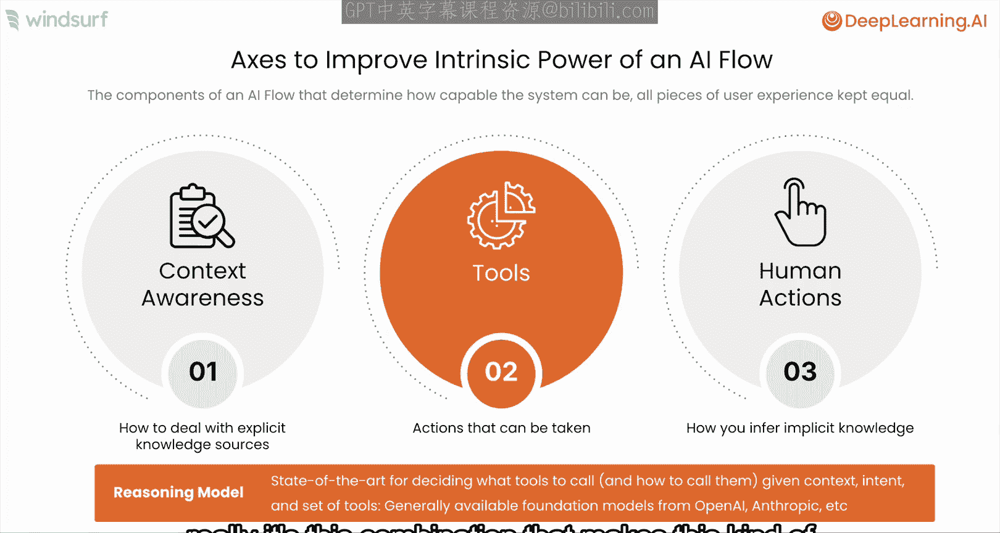

Like， say you want to make a modification。 You made a modification to a class and now you want to make that same modification to other classes in the same directory。

 This is relatively a boilerp task。 but if there was a pair programmer or a human prayer programmer right next to me who has been observing the work that I've been doing。

 I could just tell them， hey， do the same thing in similar places in this directory and thinking about the collaborative agent again as a pair programmer。

 you can see how these different components help assist in making this possible。 First。

 the idea that the agent has been observing what the developer has been doing will make it able to understand that the quotes same thing refers to the recent edit that I had just made access to tools will allow the agent to find the relevant files in this directory and then later use edit like capabilities to make the changes and the context awareness will allow the agent to reason whether or not classes are actually entities that are in a similar place as the class that I just modified so。

😊。

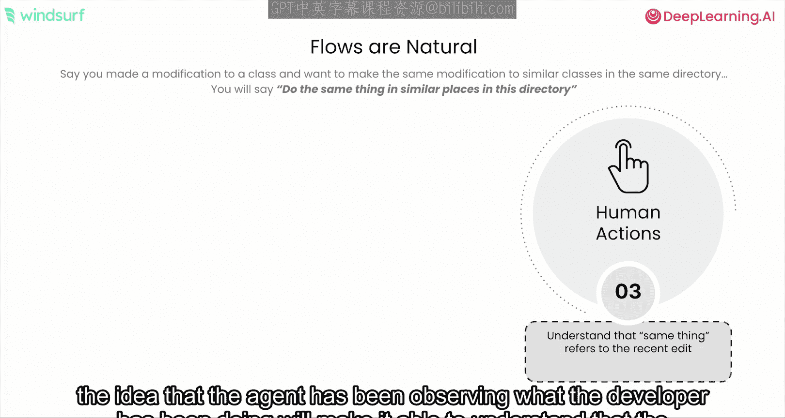

It requires all three of these components coming together to create this experience working with an agent that would be similar to working with a pair programmer as if it was a human。

 So just some final takeaways。 context awareness brings in explicit knowledge。

 Human actions will bring in the implicit intent。 The tools will then take actions。

 combining this explicit knowledge。 the implicit intent。

 and it will do this across search and discovery， making changes to state and verification。

 and then at the end of the day， the LLM is used for combining all these to choose what are the right tool calls to be making at the appropriate times。

 but this is common across different agentic system today。

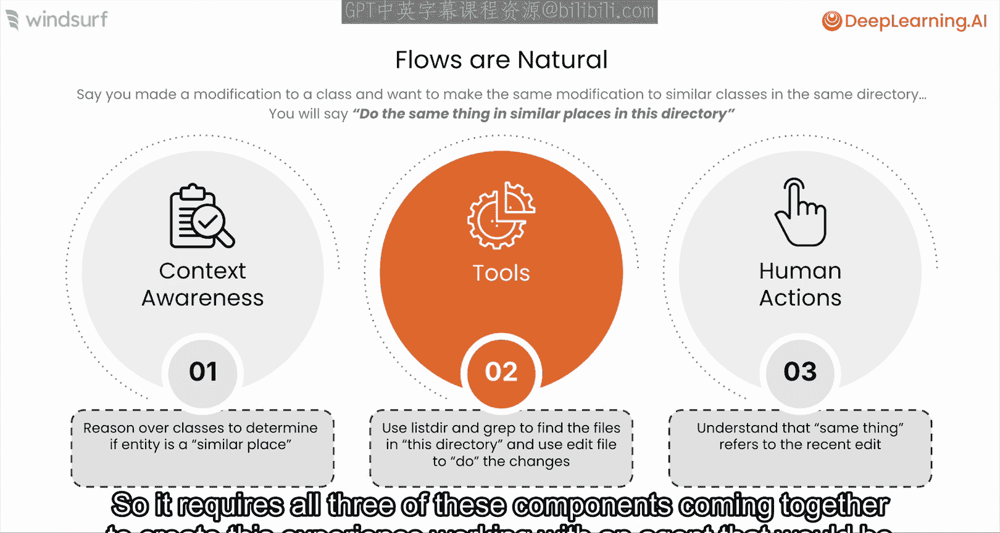

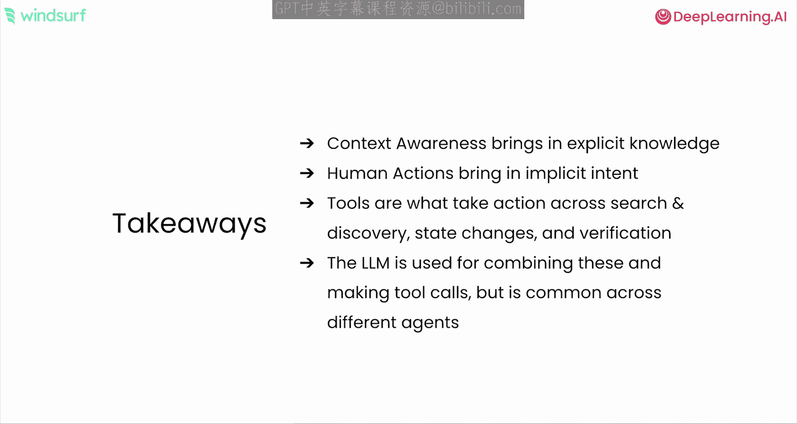