# 吴恩达《使用 Windsurf 的 AI 编程代理构建应用程序｜Build Apps with Windsurf’s AI Coding Agents》中英字幕 - P6：6.search-&-discovery-for-ai-agents.zh_en - GPT中英字幕课程资源 - BV1aYXUYFE2D

In this lesson， we will do a mini deep dive into the problem of search and discovery for AI agents。

 which actually requires new paradigms， questioning of benchmarks and novel approaches to maximize the impact of the agent at the end。

 Let's dive in。 We're going to spend a little bit of time talking about search and discovery because it's actually a very interesting problem in this agentic world and a place where we've made a few innovations ourselves。

 First， let's start why search and discovery even interesting for code。 Well。

 code is very distributed because of frameworks， libraries， abstractions。

 Not all the relevant information that you need lives in the exact file you're making edits to。

 It's often incomplete。 You need more than just existing code to write new code。 You need docs。

 you need tickets。 You need to search the web。 and it's inexact。 As we all know。

 there are many ways to do the same thing。 And so a cookie cutter approach and response。

 probably does not cut it if you want to get the proper way to build something in your particular code base。

 The real bottom line of search and discovery as a problem is that if we're only retrieving。😊。

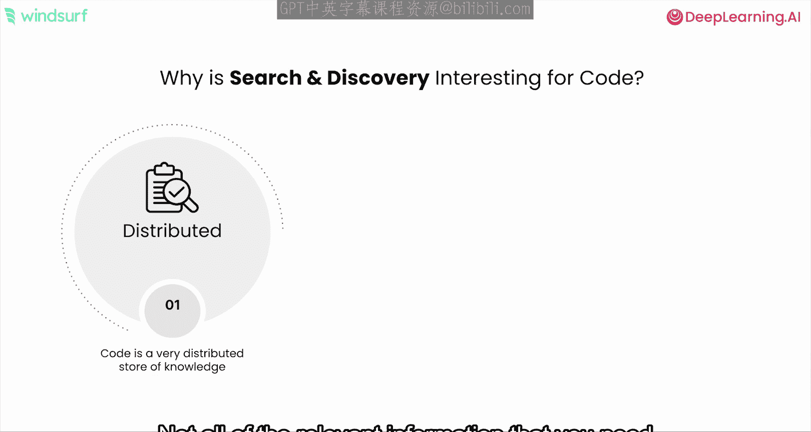

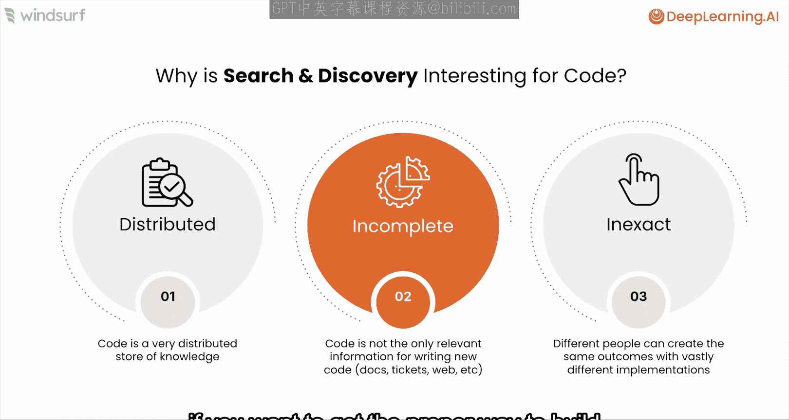

Incorrect or not valuable information， we're only going to get incorrect and not valuable results from our AI agenttic system。

The state of the art today is retrieval augmented generation or Ra。 And at a very basic level。

 we start with a question from the user。 a prompt。 there is a retriever that res the relevant context that is necessary to pass into the large language model。

 along with the question and the task to get a response。

 This is how we generally think about retrieval at a very abstract level， But if we think about it。

 this is all for the coppitlike systems or assistance。

 we only get a single call to a large language model。

 the agent approach actually fundamentally changes this because instead of having to iterate a lot on that retrieval to make it more complex and even more accurate because we only have one shot at the large language model and therefore。

 only one shot at the retrieval。 the multistep agentic retrieval approach。

 means that we can actually have multiple shots at retrieval。

 And this is actually very similar to a human。 If we go out and we search for information that could be relevant and it doesn't actually look relevant。

 we go out and we do another search。 and we keep on going until we have all the relevant information before we。

😊，Take any actions。 That's the same kind of way that we should think about it in terms of any agent gen approach towards the search and discovery problem。

 So maybe the retrievers don't have to be super perfect。 but we need to be able to iterate on。

 And also importantly， all the retrievers don't have to be the same。

 We could have different retrievers for different kinds of tasks that we might need to do in the overall search and discovery problem。

 So what are some of those kinds of tasks and tools that we might need to have。

 There are certain tasks where we know what we want out of corpus information。

 and there's a rule for retrieval。 something like Gep。

 there's certain kinds of search and discovery tasks where we kind of know exactly what we need to get。

 but we just don't know how to get it。 maybe it's I need to do a web search because I know there's an example for a contact form object out there。

 I just need to figure out how to get there。 And the third category is usually kind of vague where I just want all the relevant information to do a task。

 Don't really know exactly what it is， but I know my overall outcome is to build in this case。

 a new contact form object now。

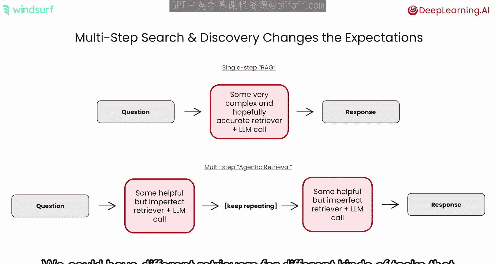

probably talk about each of these at detail。 But for the purposes of course。

 Im want to talk about some of the ways that we innovated and added some new kinds of tools to category 3。

 So let's first understand category 3 a little bit more if I just want to build a new object and just want all the relevant information。

 Wo actually kind of neat and the example trying to build a contact form for my particular code base I might need to pull in from internal utility libraries I might need to look at external packages and documentation。

 other examples within outside of the codeb style guides。

 there clearly a lot of different snippets of information that I will need to synthesize in order to get a really high quality response for my particular codeb。

 So with that in mind， let's talk about state of the art today。

 The state of the art today for this kind of problem is embedding search and the really quick explanation of how that works is you have an embedding model that is able to convert objects This could be a snippet of code to a series of numbers。

 an embedding vector。 you can do this for all the。😊。

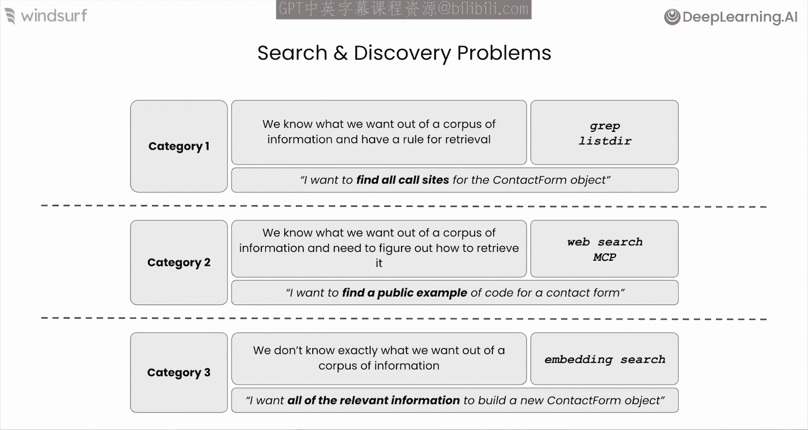

Existing snippets of code that already exist near codebase。Then at retrieval time。

 all you do is you take your current work， the current code that you're working on that context。

 you use that same embedding model to convert it to its own embedding vector。

 and then you compare the embedding vector that was created to all the existing embedding vectors to see what other vectors are close by in this ndimensal embedding space。

 The basic idea behind the embedding model is to convert text snippets that look similar to series of an embedding vectors that also are close together。

 And so if done correctly， when you do the retrieval。

 you're pulling in a bunch of snippets of code that are at least similar and ideally relevant to the work that you're currently doing。

 That's the basic approach。 But of course， this embedding base approach is not perfect because we're operating on embedding vectors rather than the rock text。

 we lose a lot of the nuances the original text snippets。

 And so even though we've played around with larger and larger embedding models and tried various approaches。

 there seems to be some kind of plateau on how good embedding。😊。

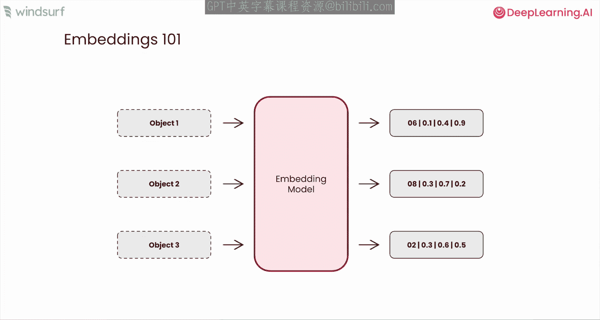

Is at retrieval。 But this is where some of the innovations and some of the unique approaches to this problem within windsurf and Cascade come to light because the first question we asked ourselves was。

 are the benchmarking results here even useful， because the reality is a lot of the benchmarks for retrieval aren't actually perfect for the problem of code。

 The way that these benchmarks work is that there's a corpus of information。

 and it acts as a needle in the haystack problem， am I retrieving one very particular piece of information from the overall corpus that exists in reality。

 just as we talked about all the different pieces that we needed to take in to build the contact form object。

 We actually need。😊。

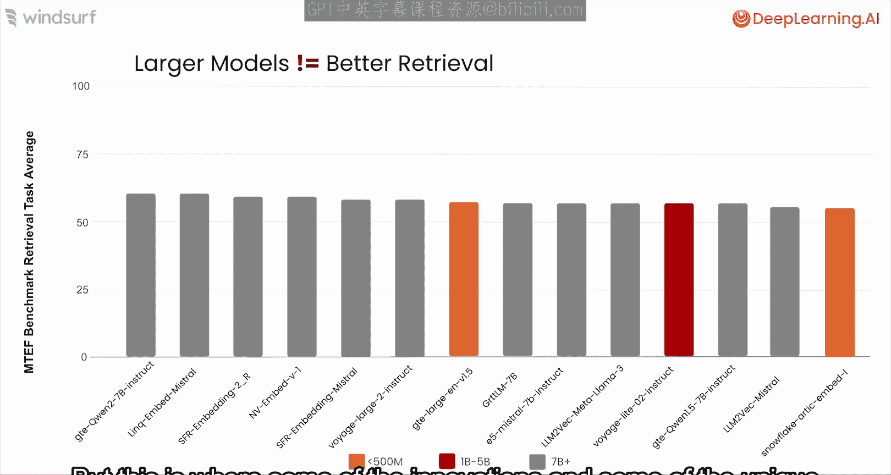

A lot of snippets of information in order to synthesize them to get the right response。

 So the needle in the haystack approach is actually not the benchmark that we particularly are interested in。

 We're interested in more of like this idea of if I retrieve 50 objects。

 How many of the ground truth of relevant objects would actually appear within those 50。

 and if I have a high recall over them， at least I have all the relevant information over a much larger corpus of information that exists that I would particularly need to complete my particular task。

 Of course， a benchmark like this， we needed to build。 So how do we build it。

 We looked on the public corpus of Gitthub repositories。

 And we realized that every commit message corresponds to a series of dis across multiple files。

 This actually is a match between what could be a query。😊。

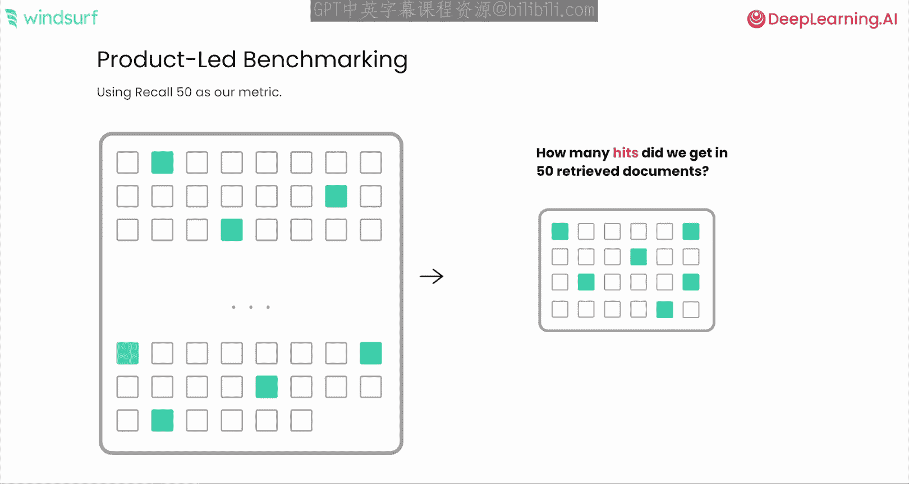

Which could be derived from the commit message。 And what could be all those ground truth。

 relevant snippets of code that we would need to retrieve。

 which would be all those di changes that exist in that commit。 So taking all this and。

Moving it around from the code base。 we can query for the commit message。 And we asked the question。

 did our retrieval method find all of the modified files。

 which would be all the relevant pieces of information if I wanted to actually do that commit or query ahead of time。

 And if we look at the results of embedding based approaches for this kind of benchmark。

 We will notice that really no approach hits over 50%。

 which means that embedding based methods have high false positive rates。

 especially on larger and larger code bases， and even half of all the necessary information for making a change is being retrieved in the first place。

 So clearly， we wanted to build a tool that was even better than this。 What was our approach。😊。

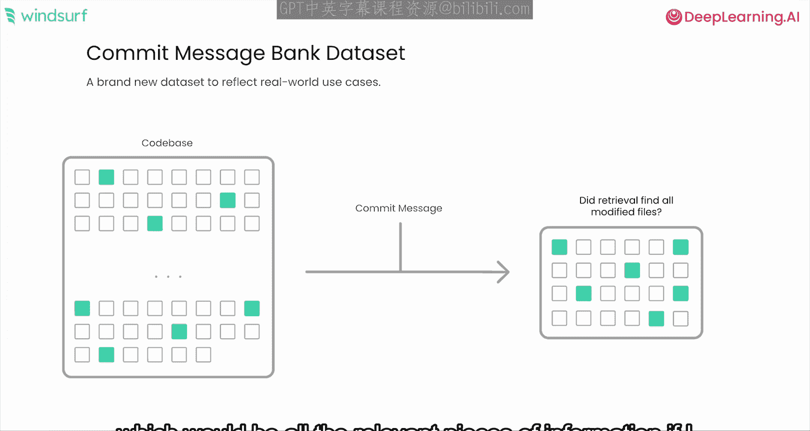

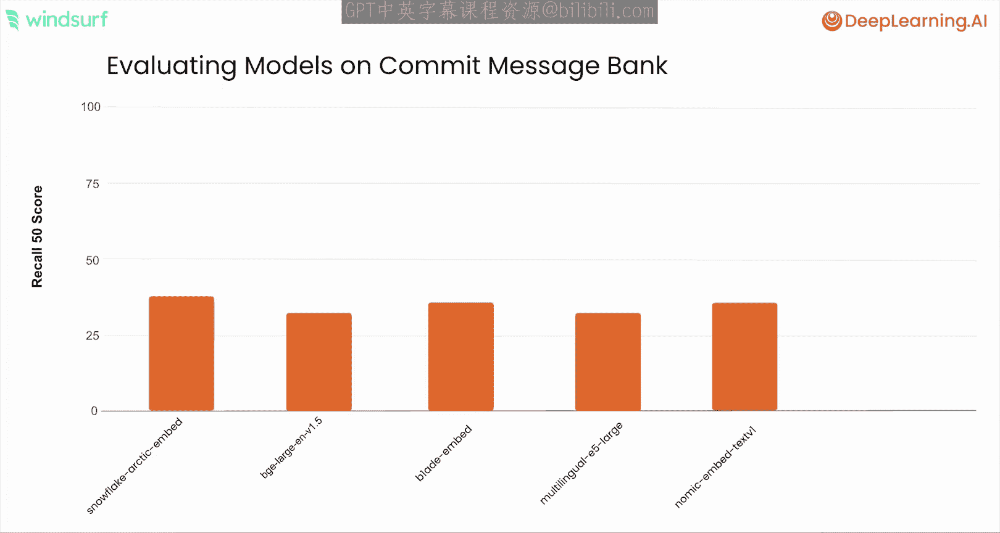

We use more compute。 Our approach for this problem is what we call ripide。

 And the basic idea is to move away from embeddings because as soon as we go into an embedding space。

 we lose that nuance。 Instead， we take the query， we take every snippet of code within the codeb。

 and we apply a large language model to ask the question。

 how relevant is this snippet of code to my particular query at hand。

 We run all those kinds of queries in parallel and then use that response of how relevant each is to rerank all the snippets of code within that code base。

 That level of reranking as you realize， has never， ever been applied to an embedding space。

 All this is being done with an L M based semantic search kind of retrier。 and unsurprisingly。

 that outperforms embedding based approaches on our recall 50 benchmark。 And again。

 this is a single tool in a multistep retrieval process。 It's still not perfect。

 But by making a tool that is significantly higher quality on retrieval and combining it with the multistep paradigm of retrieval。

 we now have a method assertion。😊。

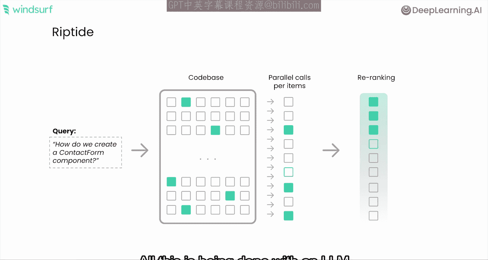

That would allow our e system to operate over large code bases。

And so some final takeaways definitely think about multistep retrieval as opposed singlestep retrieval now that we're talking about agents。

 think about all the different breadth of potential tools because you don't have to have a single retrievetr method。

 you can have multiple retriever methods， Que the benchmarks and question constraints in order to develop new methods of retrieval to improve your agent system so now that we've done a mini deep dive on how search and discovery works particularly for cascade and code and agents。

 let's actually apply it on a large code base to do a couple of different tasks See there。

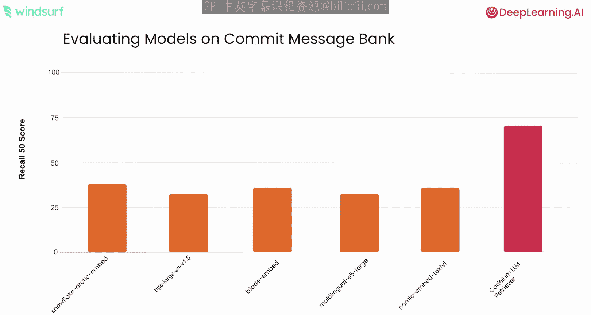

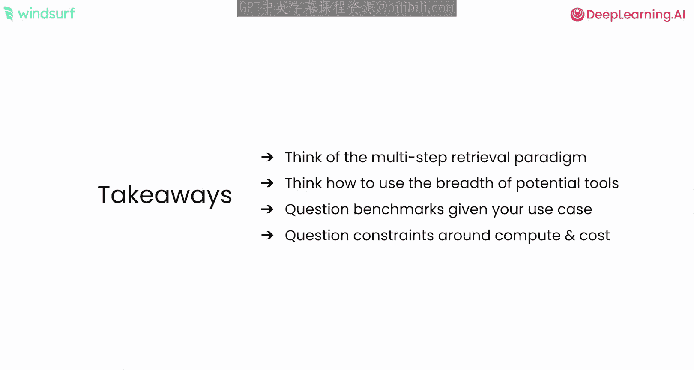