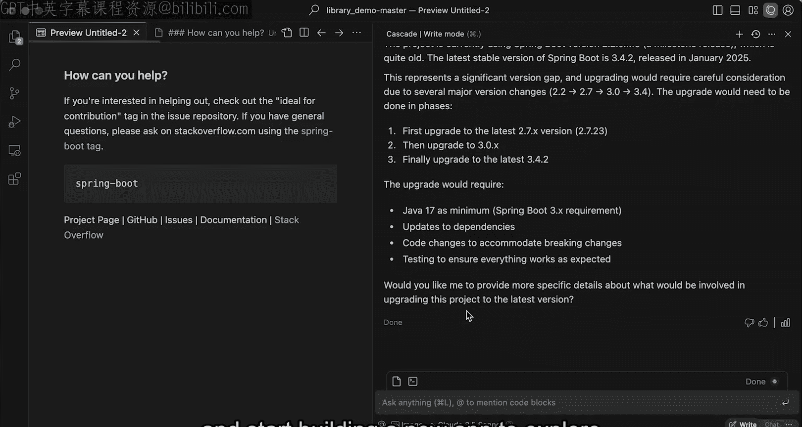

# 吴恩达《使用 Windsurf 的 AI 编程代理构建应用程序｜Build Apps with Windsurf’s AI Coding Agents》中英字幕 - P7：7.understanding-large-codebases.zh_en - GPT中英字幕课程资源 - BV1aYXUYFE2D

In this lesson， you will apply and see the power of these search and discovery approaches when using the AI agent to complete a couple of different tasks on a large production codeb。

 Let's dive in。 Great， in this demo， we're going go on yet another language in another repository just to show the breadth of what cascade is capable of doing specifically on large repositories using some of those search and discovery tools that we just talked about。

 So this is a repository with a lot of Java code， about 100000 lines or so across many files and uses a lot of different frameworks and packages。

 things like groovevy and spring boot。 And let's say I am a new developer that is onboarding onto this code base。

 This would normally take a while， but with some of those powerful search and discovery tools that we talked about。

 Cascade is able to help speed us up。 So I'm going to go to Cascade and I'm going to ask it the question。

😊。

Explain。What the code inm tag the entire source directory some 300 auto fileses。Does。

Let's see what Cascade does。 So Cascade will use a number of the different search and discovery tools that we discussed。

 First， it will use the Ls tool to actually figure out what are all the top level directories。

 And over here， it did a ript call。 So as you can see over almost 3000 different code snippets were searched upon and assessed test for how relevant it is to the problem of understanding this code base then went particularly into the test directory to understand a little bit there another ript call again。

 you saw here， multistep retrieval there was multiple retrieval calls before we even tried to give an answer。

 And we go， it explained me in a pretty concise manner。

 all of the notable pieces that I need to know about this repository it even provides me some nice links。

Into the code base for me to look through again， I can always follow up with questions。

 So let's say I'm going through here and I say， yeah， the book management is interesting。

 I want to learn more。Explain me more how the book management。Happens。

This is a conversation where the previous part of the trajectory and the previous part of the conversation is also incorporated。

 but as you can see， we will do another ript call that is more looking at the relevance for this particular new query。

So you can see we're doing multiple of these search and discovery。

Tool calls before coming up with an answer to the question。 and again。

 comprehensive explanation with tons of citations back into the code base that I can click on。

And read up and understand myself。So that's the power of these。

Powerful search and discovery tools on real production code bases。

 but I'm going to show yet another application of search and discovery in different kind of tool。

Let's say I actually want to perform a migration on this。Let's do it on Spring bootot。

I will ask Cascade what version of spring boot？Is being used。And what is the most recent version？

The first half of this question is going to require。

 understand the code based in the second half of the question will likely have to go out to the web。

So it's going to do analysis。Figured out what the current Spring move version being used is。

 and now you can see that web search is happening。We're going out to the web Cascade。

 it does a search for a latest springboot version， it then takes the results。

 creates an outline that I can actually both go and view the page。

 or I can view it in my editor exactly what the text is that it's analyzing。

And it's giving me the information that wouldn't be present in the pre trained model。

 and it's even telling me， hey， there's a significant version gap to require multiple version changes。

And is going to start guiding me towards a migration process。

 I'm not going to go through the full migration， but this highlights in this demo a number of the different search and discovery tools we saw the LS tool being used。

 ript being used， web search being used。Each time in a multistep approach。

 and this is what allows agenttic systems to address some of these more complex long running tasks。

 hopefully this is exciting to understand exactly how these powerful search and discovery tools can be used on a production codebase。

 but let's switch gears and start building a new app to explore a lot more that Cascade has to offer。

