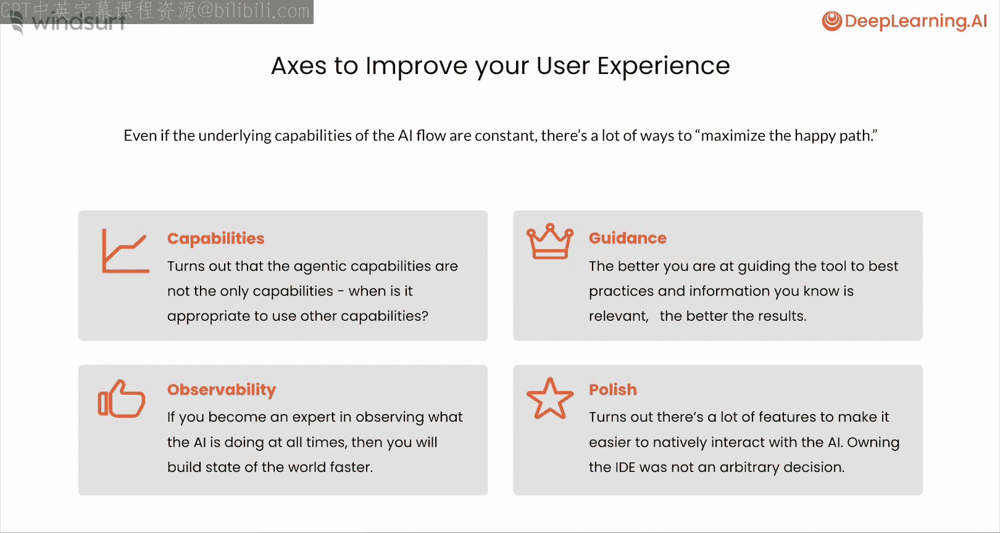
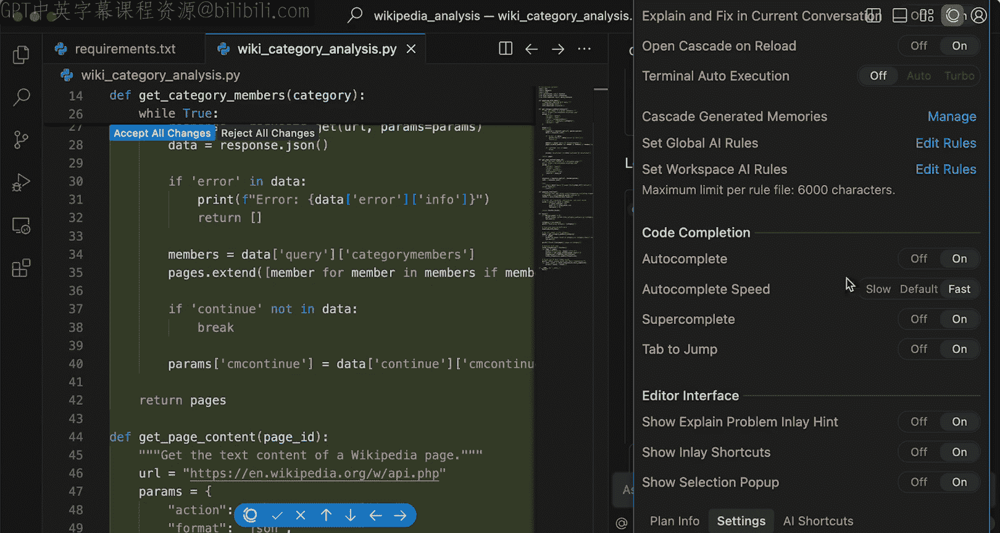
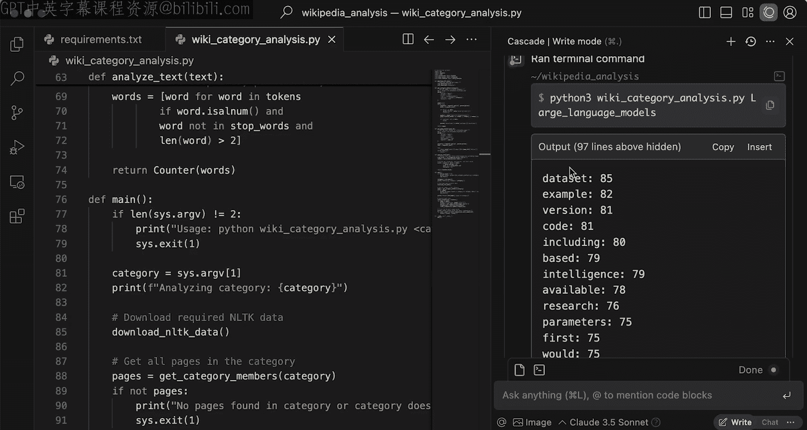

# 吴恩达《使用 Windsurf 的 AI 编程代理构建应用程序｜Build Apps with Windsurf’s AI Coding Agents》中英字幕 - P8：8.wikipedia-analysis-app-–-data-analysis.zh_en - GPT中英字幕课程资源 - BV1aYXUYFE2D

In this lesson， you will use the collaborative agent to start to build the data analysis pieces of a larger Wikipedia analysis app along the way。

 you will learn the basics of how to guide and observe the AI agent as it does its work。

 Let's get started。Before diving into building the app， we'll cover one final concept。

In the earlier slides， we talk a lot about all the different pieces and components that make a collaborative AI agent like Cascade intrinsically very powerful。

 things like context awareness and tools and human actions。

 but it's also important to think about the axes that improve the user experience independent of those underlying capabilities。

 So even with all those things that kept constant。 there's still a lot of things and lot of aspects about the tools that can make the UF really。

 really good。 And it's important to note these because I'll point them quite a bit as we start building out the Wikipedia analysis app。

 The first is capabilities。 We'll be using cascade a lot。

 But it turns out that these agentic capabilities are not the only capabilities that AI native I like Winsurf provides。

 So when is it appropriate to use some of these other capabilities。

 there's a lot of places of guidance while Cascade has the ability to independently go out out and retrieve the right information。

 turns out that the better you are giving some amount of guidance to the AI so that they can focus。😊。

Right places just like a peer programmer， they will do a lot better。

 So how can you do that effectively with cascade observability。

 Of course now the AI is capable of doing a lot more than just give a few lines of an autocomplete suggestion or respond to a single chat message。

 So if you're an expert in observing what the AI is doing at all times。

 then you will be able to keep up with what the AI is doing and maintain state and make sure that you're doing larger and larger task effectively。

 and finally， there's just a lot of polish。 there's a lot of helpful buttons and shortcuts to make sure that you're natively interacting with the AI in the most optimal manner。

 So our decision to own the I surface was not an arbitrary decision。

 There's a lot of polish in a lot of UX that we thought could be special。

 So with that let's dive right in。

Great， so we're going to start with a completely blank project called Wikipedia Analysis。

 and we're going to build this from scratch。In this video， we're going to do some data analysis。

 The motivation behind this app came from myself and a bunch of my friends at the office playing a game called catfish in this game。

 really short， you're given all the categories of a Wikipedia page。

 And you have to guess the Wikipedia page that it corresponds to that set of category that just got me thinking if I was to try to learn about a new kind of category of information。

 What would I need to do。 what kind of basic terminology。

 what I first have to learn before I really understand that topic。

 And so what we're going do is we're going to try to use the Wikipedia information taking a category and understand what are the frequency of words that appear across all the pages that belong to that category and that will give me a good place to start my work。

 So I'm going to start with a pumped like this Just copyied it in right here。

 I'll read out loud write a script that takes in a Wikipedia category。

 a command line argument and outputs the cumulative frequency of noncommon words across all the pages in that category。

 And then run it on a。😊，Cry， one of my favorites， large language models。

 And I specified to use a media Wiiki API。 Before running this a few things to point out here。

 Not that I was relatively specific in exactly how well my inputs and outputs look like。

 I specified certain APIs that I wanted to use。 It is important to still be clear to the AI。

 especially if there is no context that already begin。 If you start with a really vague statement。

 they I might do something that is correct， but unexpected， Again。

 think about this like a pair programmer。 If you wanted to pair programmer start some work for you。

 what would you have to tell it to do。 A few other things to point out about the cascade panel before I start the work。

 As you can see， I'm currently using Cla 3，5 sonnet for my reasoning model。

 you could actually choose a number of different models that are available to you。😊。

But let's just get it started， so I'm going to click enter and let Cascade start to go。Great。

 before I click on the installation command for the requirements at TxD。

 let's point out a couple of features in Winsurf to help you observe what AI is doing。

 The first is something we've used actually earlier。

 which is this open di button because edits can happen across multiple files being able to click opendff and look through the changes that cascades being made is great。

 It's important to still review the changes that the AI makes the other thing you'll notice here is what we call the cascade bar。

 This is the way to essentially build a reviewflow directly into the editor。

 So if there is multiple changes within a file， you could use the up and down  errors。

 and you can use the right and left arrows to actually go from file to file where there are edits I can accept these changes at the individual block level the file level or across all files。

 but now that we've done some observability， let's continue the work here。

 So I first need to install the requirements at TXD。 Soll click accept。😊，Note here that。

My environment actually uses Python 3 instead of Python P3 instead a pit and so。

Cascade is able to recognize that and course correct accordingly。But while it continues。

 maybe this is something that I just want Cascade to always know as I'm doing my work。

 I don't want to always figure out that I have Pip 3 instead of Pip。

So I'm going to show the first kind of method of guidance here。

 which is if you go to the Winsurf settings tab on the bottom right。

 you can see there's a lot of different settings， but I'm going to go into this one called set global AI rules。

 These are rules that Cascade will listen to as you're working。

 no matter where you're working Of course， the repository rules are for particular repositories。

 but I can just say here， use Python 3 instead of Python。

Pip3 instead of tip， something like that。And now Cascades should be able to follow these instructions every time I ask me to do something and we'll verify this in a few moments。

 but let's continue to see what a cascade' is doing so here it is saying okay。

 let's now run it on that large language malls category。And we'll let it go， as you can see。

 it's starting to go and it's starting to process。All of the different pages on Wikipedia that follow the。

Large language models category。 You can notice that we truncate the outputs。Just for space reasons。

 but Cascade is actually using the IDde's native terminal。

 So by clicking this little button over here called go to terminal， you can actually pull up。

The full execution。Within the terminal pane in the editor。 so I can go in。

 and even though I only see the last few， I can see that some of the most common words to no surprise are things like model。

 models， language， Open eye chat EBT。 So already we can kind of get an idea that yes。

 if I was to learn about large language models， these are some terms that I probably need to get to know。

So that's great。It's successfully built out a data analysis。That is exactly what I want to do。

 I'll go ahead and accept all changes。 It's important to accept changes as you go along。

 rather than just accumulate at its over no。 So I'm just going to accept all the changes。

AndCl the terminal。Let's actually go ahead and actually check the fact of that global rules that I had set earlier to do this。

 I'm going to use a different functionality。 I could ask to check this within my current cascade conversation。

 but it important to maintain some amount of separation， bring conversations that are different。

 So I'm going to start a new conversation with cascade here。

 I can ask the same command as it needed to do before。 install the requirements。😊，That TXD。

 if it hasn't learned anything， it would just use P instead of P3。But， instead。

Is using those global rules that we specified to directly use PI3。

 so this is an example of how just setting some rules will allow Cascade to always kind of follow general best practices about your environment or how you do things。

Ofour， in this case， everything is already set up to go back to my original conversation。

 I just to go to the past conversations and go back and I'm back into my original conversation。

 In this lesson， you use cascade to build the entire analysis part of your application using a Wikipedia API to pull all the relevant data。

 parse it accordingly and result of frequencies And along the way。

 you were able to use a number of the features within the windsurf IDde in order to guide cascade and to observe what it's doing in the next section。

 we're going to add caching to the system because I don't want to rerun this analysis every single time I'm iterating on my application。

 So see you there。😊。

