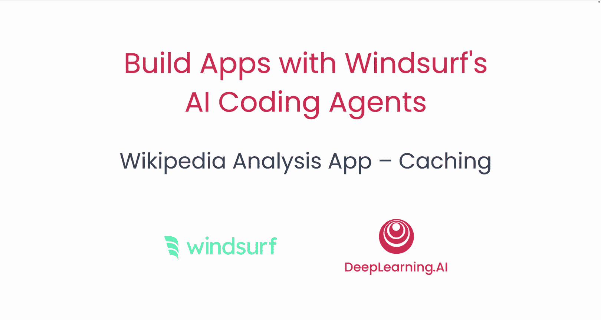
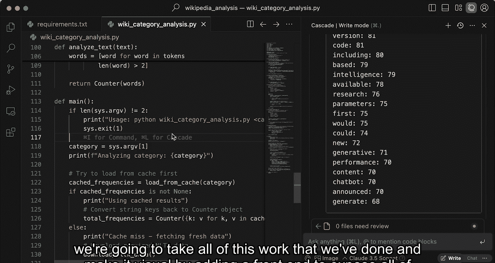

# 吴恩达《使用 Windsurf 的 AI 编程代理构建应用程序｜Build Apps with Windsurf’s AI Coding Agents》中英字幕 - P9：9.wikipedia-analysis-app-–-caching.zh_en - GPT中英字幕课程资源 - BV1aYXUYFE2D

In this lesson， you will add cashching into your Wikipedia analysis S， but more importantly。

 you will learn how to get back on the happy path when the AI agent does something slightly unexpected or unintended。

 Let's dive in。So here's where we were at the end of the last lesson。

 we built all of our frequency analysis， but one thing I want to add before I start building the rest of my application is some caching because it did take quite a bit of time to actually go through the hundreds of pages that corresponded to large language models。

 so I just want the results to be cached if I'm using the same input so as I'm changing the rest part of my applications。

 there's no issues。 so to do this， I'm going to use this prompt。Create a local cache。

 so we aren't rerunning retrieval logic， same category， exactly what we just mentioned。

Let's see what Cascade does。Yeah。Great， seems like Cascade made multiple edits。

I can use the cascade bar to actually go through from diff to diff and read through and understand the code changes。

Let's run this， of course， the first time that runs。

 actually as we go through each of the files again。Let's look at the cache。Okay， seems like it。

Didn' it really do exactly what I wanted to do。All it did was it figured out what the page I Ds were for each of the different pages。

 That's not actually what I wanted。 I wanted a cache all to results in my script。

 And if I actually go。Back up to my query。You'll see that I was a little bit vague with this， right。

 technicalically， it is caching something about the page results for that category。

 but not what I really wanted。 I wanted the cached results of the overall processing of the script。

 And so there's a couple things that I could do from here。

 Even if I have accepted all the changes in the file。 There's still two things we could do。

 We could either go into Cascade and ask Cascade to walk back all the changes and then try to make some new edits and try to fix it and maybe get ourselves in a little bit of a mess。

Or we could use a handy functionality where if you hover over a message， you can revert to the step。

 And what this revert will do is it will revert the whole conversation history and it will revert any of the changes that were made to files throughout the process。

 So if I click revert。All the caching logic in the weak category analysis file。Went away。

 So that essentially can help keep your conversation history very clean and not have a whole lot of back and forth trying to unstick the agent。

 which might just confuse it later on as it's using that as context in its future conversations。

 So reverting is a really helpful functionality to get yourself unstuck。 So let me delete this cache。

 We don't need it anymore more。😊，And let's change this prompt a little to be a little bit more specific to what I wanted to do。

 So now I'm very clear that I want a local cache of the script results。

 and I just don't want to rerun even the processing logic again for the same category。All right。

 first it wants me， I should create the cache directory， that's fine。Alright。

 so some changes were made。 Let's try it out again。

 it'll first have to go through all the different files for the first pass。

Let's look at what the cache looks like now。Great， cache actually has exactly what I wanted to have。

 which was the results of the script， so if I write it again。

But the results come significantly quicker。 So in this， we were able to build some caing logic。

 Again， I can use a cascade bar to actually look through all the changes。😊。

Make sure that everything actually is what I expect it to be and that I understand the code。

 I can accept it at the individual block level， I can accept it at the file level。

 but more importantly， in this lesson， you learned how you can unstick yourself when the AI does something you kind of don't expect it to do So use that well to keep a really healthy conversation history between you and your AI pair programmer in the Lex lesson。

 we're going to take all of this work that we've done and make it visual by adding a front end to expose all of these results in these frequencies in a pretty manner。

 See you there。

