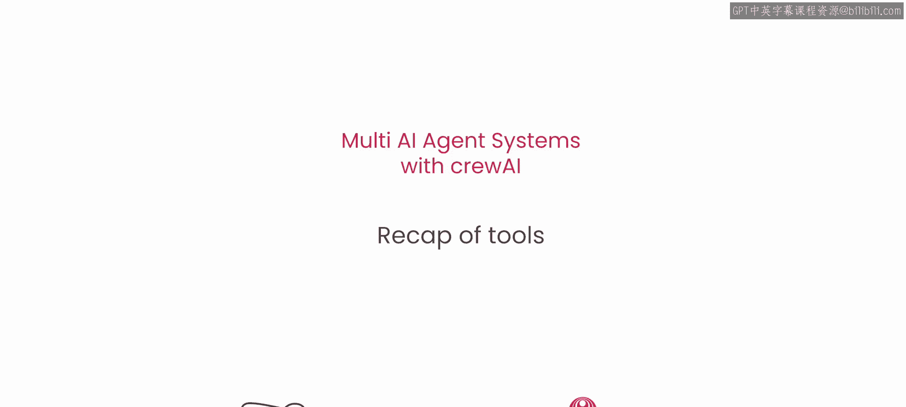
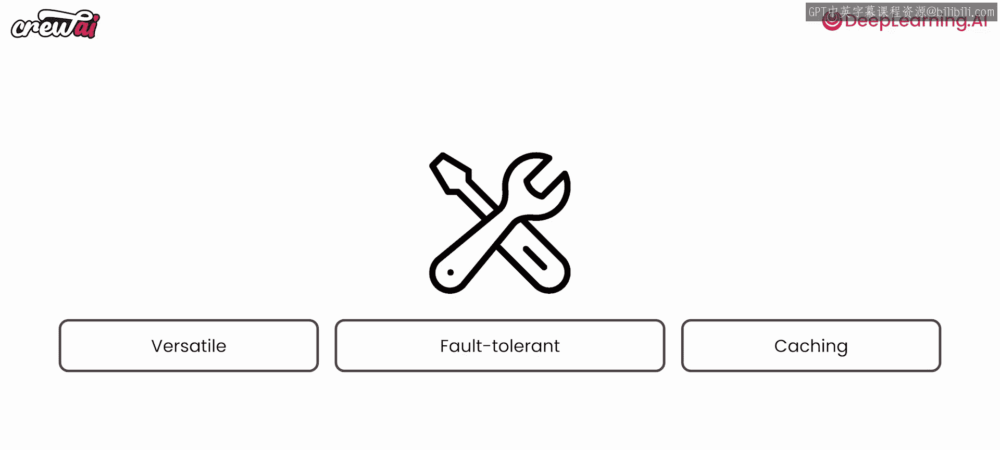

# 吴恩达《使用 crewAI 的多人工智能代理系统｜Multi AI Agent Systems with crewAI》中英字幕【短课英文均可关闭／拖拽】 - P10：9.recap of tools.zh - GPT中英字幕课程资源 - BV1GZ42147am

Okay， let's reamp what we learned so far。 We talk about how tools are such a key part of agents because they are what allow you to connect your agents to the external word。

 so you're gonna view toolss and use existing tools to call APIs to integrate with your internal systems to do some computational it's a translation layer that allows your agents to communicate with existing programs that you might have but in order for these tools to work properly。

 you need to make sure they're versatile， you need to make sure they fault tolerant and need to make sure that they have a caching strategy。

 if you make sure that you're using those three qualities on all the tools that you use。

 you then have a system that is more reliable So make sure to watch out for that when you're choosing what toolss are going to use or building your own tools keep in mind again that because we're using query AI you can。

Not only use the tools that a queryI offers itself。

 but you can also use all the tools that Lnking offers so you have a huge range of tools that you can start with。

 Allright， we're going to wrap this lesson here you're doing amazing Keep at it。

 you're going to love our next lesson because you're going to talk about even more interesting stuff that is going to unlock a more use cases so I see you on your next lesson。

