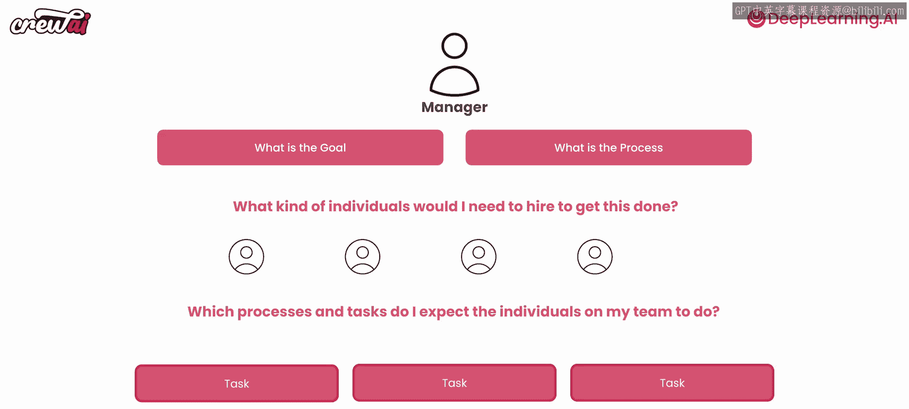
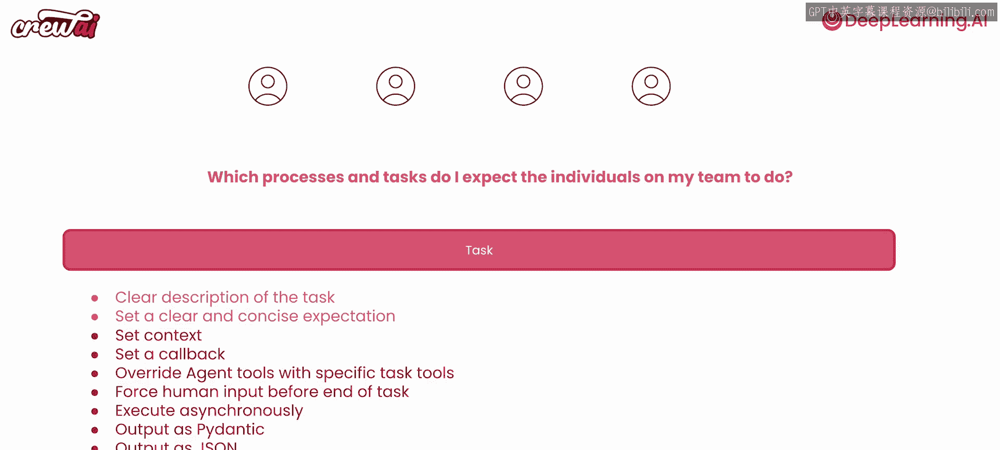

# 吴恩达《使用 crewAI 的多人工智能代理系统｜Multi AI Agent Systems with crewAI》中英字幕【短课英文均可关闭／拖拽】 - P11：10.key elements of well defined taks.zh - GPT中英字幕课程资源 - BV1GZ42147am

Okay， so we just built an amazing crew。 by now you're probably getting excited and I am as well。

 but we can take a step further in this lesson， we're going build a multiag system that's going to be able to help us plan an event。

 Think about a meetup or a conference， whatever it might be。

 This agents are going help us to find venue， do the planning。

 planning around the catering and everything that comes with that。

 So let's jump into it and see what that looks like。😊。

Welcome to our next lesson and in this lesson we're gonna be talking about tasks。

 I'm super excited about this one。 We talked about so many things already and this is another great topic for us to dig into because at the end of the day if you think about your agents they are performing tasks so tasks are a cornerstone on multiple agent systems as well。

 So when you talk about tasks I want to bring back something that we talk a few lessons ago the manager analogy you might remember that we discussed that this manager mental framework to create agents where you put yourself into a manager shoes and you think about what would be the people that you would hire in order to do a series of tasks or the job that you're trying to accomplish and then you kind of use that as a starting point to define what would be the roles。

 the goals and the backstory of your agents So you need to have a very good understanding of。

the goal that you're trying to accomplish and you also need to have a very clear understanding of what is the process throughout to achieve this goal So with that in mind。

 you're gonna to have a clear understanding of the people that it would hire and those would be your agents but now I want to be on top of this analogy I want to expandend this mental model to how you think about your tasks because whenever you hire someone to do something you also cease to think about how you're going to delegate work to them especially if it's more of a junior person。

 you want to make sure that you're very explicit about what you expect that they do and what is the expected result so I would say for you to build great agents you should add that to your mental model as well so ones that you think about what are the people that you would hire to get that doing think about what processes and tasks I expect individuals on my team to do and you can use。

Da to create the tasks。 and whenever you're creating a task again。

 you need to have at least two things top of mind。1。

 a clear description of what is the task and two set a clear and concise expectations again。

 to go back to your analogy last thing that you just hired a junior engineer to work on your team in your task with coaching this person。

 It's their first day on the job you want to give them a specific task to work on。

 you want to explain that task very truthfully and then you want to make sure that you say what you expect them to do。

 So careerI kind of forces you to think that way。 because career I make sure that it's mandatory for you to set at least two attributes on every task that you create the description and the expected outcome and that is use it to build better internal prompts。

 but that also apply。

To any other firm we called there you will get a better result if you go the extra mile and explaining what is a task and what you expect your agent to do other than that。

 there is a bunch of other things that you can sat on the task query I you offer a bunch of hyperparameters that you could use like setting a context or setting a callback or overriding the agent tools with specific task tools force human input kind of like making sure that before the agent finishes the work。

 it stops and asks you how you feel about it so you can give further instructions also we can talk about execution these tasks asynchronously or outputting their results as pantic objects or jason objects or even outputting them as a file or writing these test is in parallel so you can see how there is a bunch of options when you're talking about tasks in here and you're going need to take all that into account depending on how complex your mochi agency。

Tm is crew offer all these options and you're going to find a bunch of them in other frameworks as well。

 maybe not all of them and maybe in the different shapes and formss。

 but at the end of the day it's all about how you can set up your agents for success to perform their tasks super efficiently so with that in mind let's jump into code real quick。

