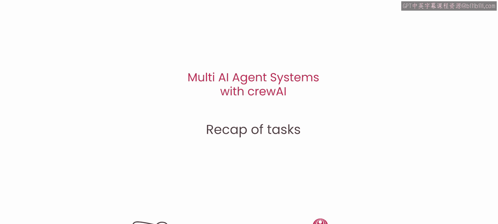
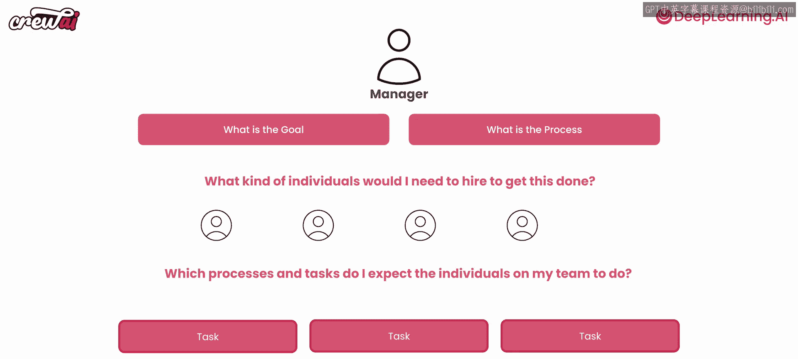

# 吴恩达《使用 crewAI 的多人工智能代理系统｜Multi AI Agent Systems with crewAI》中英字幕【短课英文均可关闭／拖拽】 - P13：12.recap on tasks.zh - GPT中英字幕课程资源 - BV1GZ42147am

So let's do a quick recap on everything that weve learned so far so we learned that this mental framework for creating agents is super helpful because it helps us to understand what are the agents that are going to create it also what are the tasks that we expect them to do we also learned that when we're thinking about these tasks we should be very much thinking about what are the clear descriptions and what is the clear expected output that we want to get for each and every one of them and we also got the chance to master around with a lot of those individual attributes that the tasks offer from parallel execution to output JN to use Pent and a lot of different interestinging stuff you're going to get the chance to play around with how those different arguments as you build the systems yourself in the future but I hope this was a good way to showcase how powerful the systems can be so I really appreciate you sticking by。

In this lesson and going through this， I think this is a turning point where you kind of start to build really。

Production gigs， agents where you understand how they work。

And it's only going to get better from here forward。

 so congratulations for you for sticking around and being learning about this。

 I would say pause the video a little bit， go back into the Gter notebook， change it a little bit。

 see what results you can get from it it's going to be a lot of fun and I see you in the next lesson。

