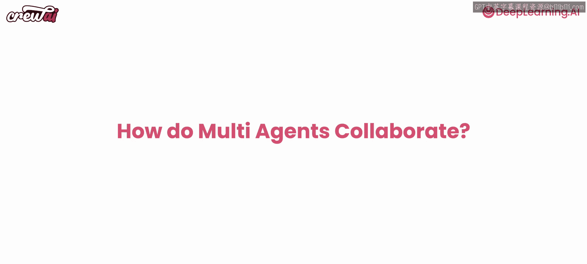
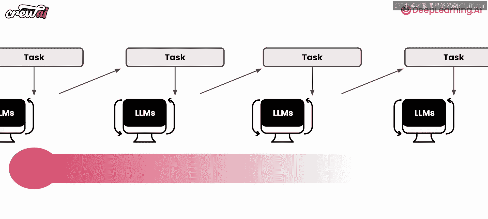
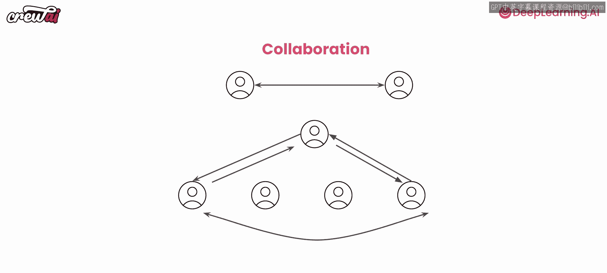

# 吴恩达《使用 crewAI 的多人工智能代理系统｜Multi AI Agent Systems with crewAI》中英字幕【短课英文均可关闭／拖拽】 - P14：13.multi agent collaboration.zh - GPT中英字幕课程资源 - BV1GZ42147am

Okay， in this lesson， we're going to dive into agent collaboration。Multiple agent systems are great。

 but they really shine when you can get the ability for these agents to talk to each other。

 There are so many different ways that you can get agents to collaborate when they're trying to achieve certain goals and you've got to pick and choose。

 what are the right ways to assemble your team together again， think like a manager。

 you won't always structure your team the same way。

 So right now we're going to dig into that and understanding how we can get these agents to collaborate in so many different ways。

 Wecome to our new lesson。 I'm so excited that you got to this point。

 We're going to be talking about a collaboration and we're going to talk about one specific example。

 that is so cool。 and that's financial analysis We have B companies。

 I'm talking about Fortune 500 companies that are using crew AI to do financial analysis。

 So this is a very common use case where you're going to probably。😊。

See out there as you start to interact with more people that are doing moyag systems in the real world。

 So let's dive into that how moy agents collaborate we're ready saw this happening to like or crew by scene like one agent pass the test to another。

 but that is just one way there's so many other ways that moy agents can collaborate So let's go back to when we started。

 we just that the initial steps throughout agent collaboration where you can have one agent finish a task and then pass its output into the next and we already know that we can do that in parallel as well and this is great for certain kind of workforces but similar to how you wouldn't necessarily arrange the same team the same way for all the tasks that's also true for agents So you depending on what youre trying to achieve you might want to organize your agent。

Differently， you might still have the same agents， you might still have even the same tasks。

 but you might want them to operate through a different process because of this。

Process brings some consequences， for example， so for this processing specifically。

 if you're talking about doing things sequentially， you have some consequences。

 the most common is the fact that the initial context will slowly fade away as the tasks get passed from one agent to another and again。

 that's okay for some cases but not for all of them。

So queryI offers some flexibility around that similar to other frameworks， but in this case。

 it's very explicit about it。 So let's talk about processes。

 all of our agents so far have been working mainly in a sequential process we did experiment with parallel execution but most of them are just performing tasks sequentially but there are other ways that you can perform tasks using careerI other big one is hierarchical there's a lot of benefits for it first is that you get a single point you got a manager that always remember the niche go and that automaticallyally delegates their work to the other members and the other agents in the screw and not only that but also reviews the result as this agents wrap their work and can ask for further improvements if necessary and the cool thing is that you get to create this agent manager yourself so you can see here。

How different process gives you a completely different way to perform the same actions if you really want to and it's just one single line change that would allow you to do that。

 but you don't need to stop there you can also do some of what we did with a synchronous execution so independently of the process crew AI will also offer you the ability to execute certain tasks in parallel and have other tasks。

 wait for them to be finished it if necessary so despite of the original schemas crew allows for agents to fully cooperate and go off any predefined paths if necessary to fulfill the tasks at hand so they can delegate work to each other they can ask questions to each other。

 you can have a manager that reviews the work， you can have tasks that happen in parallel there's just so many options in terms of the collaboration itself you can have agents ask questions and delegate work to each other。

Youre already talking about this， but this happens independently of the process that you choose meaning that even if you choose to use hierarchical process where you have one manager delegating work that is still means that the agents beneath it can delegate a work between themselves so thats still true and allows for more diverse outcome so let's see some practical examples of this let's jump into our juture notebook real quick。

