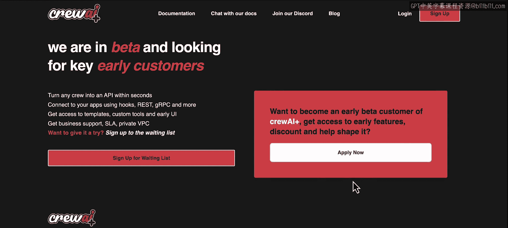
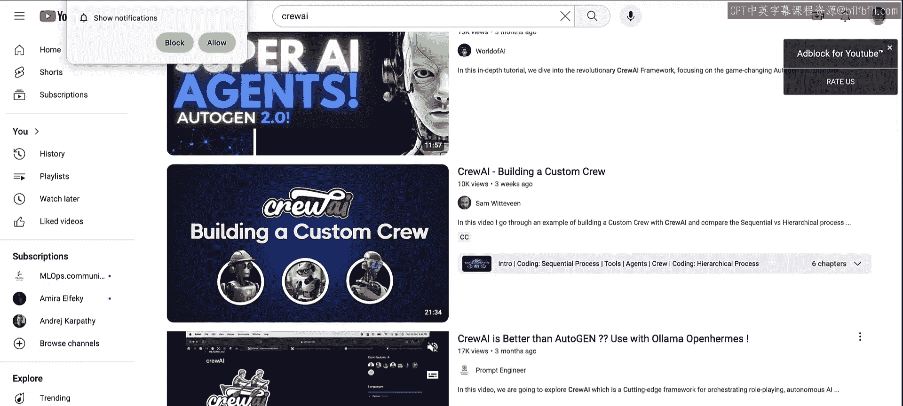
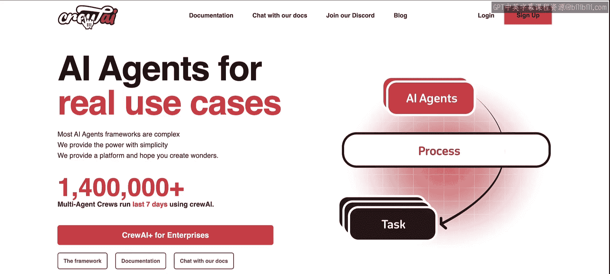
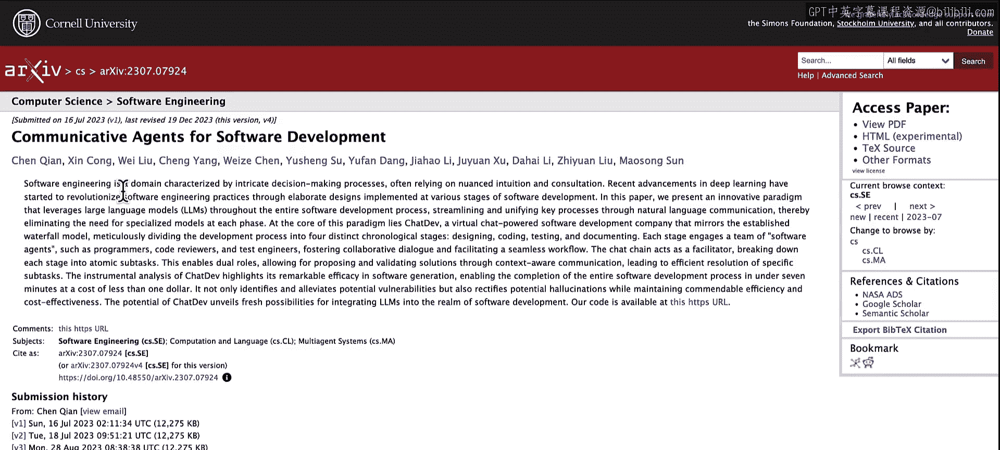
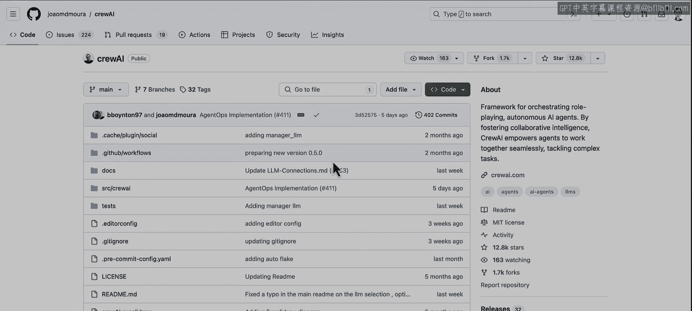

# 吴恩达《使用 crewAI 的多人工智能代理系统｜Multi AI Agent Systems with crewAI》中英字幕【短课英文均可关闭／拖拽】 - P17：16.next steps.zh - GPT中英字幕课程资源 - BV1GZ42147am

So what a trip it has been。 It has been a pleasure to have you all the way to disperse。

 You learn a lot about Moch AI agent systems。 By now。

 you're able to put these agent systems together yourself。 So let's look on what are the next steps。

 Where do you go from here。 What else can you learn。 What are good resources out there。

 So let's get into it。😊，Alright， so you came this far， you learn a lot about multiple agent systems。

 you learn about how to use them together and reuse query AI to the entire course to build all these examples。

 So by now you might be wondering how I do more where I go from here Well。

 let me show you a few resources that you can tap into so you can actually go at query AI docom to learn more about query AI and you're going find a bunch of interest resources in here。

😊，A few ones that people really like is the documentation and you can do that by clicking on this link over here and that will take you to the crew AI docs where you can get very specific around the core concepts。

 the specific attributes and even having access to some how to guides but you can go beyond that you can also chat with or docs if you click in here you're gonna get access to a custom G called crew AI assistant that will help you to put your crew together。

 This assistant knows everything there is to know about career AI so you can ask it about the agents。

 the tasks， the processes and even ask it to write some of the code for you。

 So this is gonna be a great research for you to iterate on it faster and just make sure that you can build your crews super fast other than that in case you're wondering on how you can use crew AI in a production study don't be afraid in checking crew AI it's our enterprise。

For companies that are trying to deploy the systems in a production setting right now。

 we are working with early data customers So we're kind of like handpic who we want to work with。

 but hey we're very eager to hear all the use cases so if you believe you have a great use case and you would like to deploy that in a production setting click on apply now and reach out to us and we're gonna to be eager to onboard you into our platform in our platform I'm going to show you some of the things that you're gonna to get access to so if you get access to career AI+ you're going to be able to transform your crews into APIs in a matter of minutes without having to change anything in your code so you're going be able to push it to Github select a repository and any environment variables that you want like specific models that you're using or your Serp API key whatever it might be in nottra data you're going get an API that you can now use these API。

It's going to be hosted in the private VpC。 It's going to use SSL。

 It's going to have auto scalinging everything that makes it ready for production use case And this is just the tip of the iceberg you can kind of see here in the other menus are the other features that you can get access through inque AI+ So if you believe that you're ready to bring your crews into production and deploy them at a larger scale this is a great place to go if you're looking for other resources where you can learn more about query AI I would definitely recommend you check YouTube we have a huge community that have been putting out a lot of videos on query AI so you're going to find career AI videos for days where you can learn about specific use cases you can learn about how to build more complex settings。

 how to integrate it with G Mitro and many other use cases so don't be afraid of really going in there search。

😊，YouTube and learning more about how to build career AI in production。

 It's definitely a great resource if you're trying to learn more。

 Another thing is if you are wondering about a lot of those concepts that we discussed on agents role playing and communicating and collaborating。

 There's a bunch of papers out there that highlights the benefits of doing that versus regular prompting engineering or all the other techniques。

 One paper that I recommend is the paper behind chat do。

 you can definitely dig into that and see how agents are able to talk to themselves are able to tackle way more complex problems in a way better manner。

 So definitely recommend this paper in case you want to dig into that a little bit。

 Don't be afraid to join or Discord community as well on our website you're gonna to find a link right in the top called join or Discord by clicking on that。

 you're gonna to access thousands of people They're talking about C AI。

And how to build with it。 So among everything that I just showed you。

 you should be good to go and start to really putting your excuse the tasks and build multiple agent systems for production today Another great resource is the actual framework。

 You can go into Github and see how the code that power screw AI。 So feel free to go in there。

 check the issues， the pull requests and contribute if you feel like it。

 there's so many good resources in here and so many people that are eager to help you。

 So make sure to check out the code and if you find a bug。

 please let us know and feel free to contribute to it。 Thank you so much。😊。

