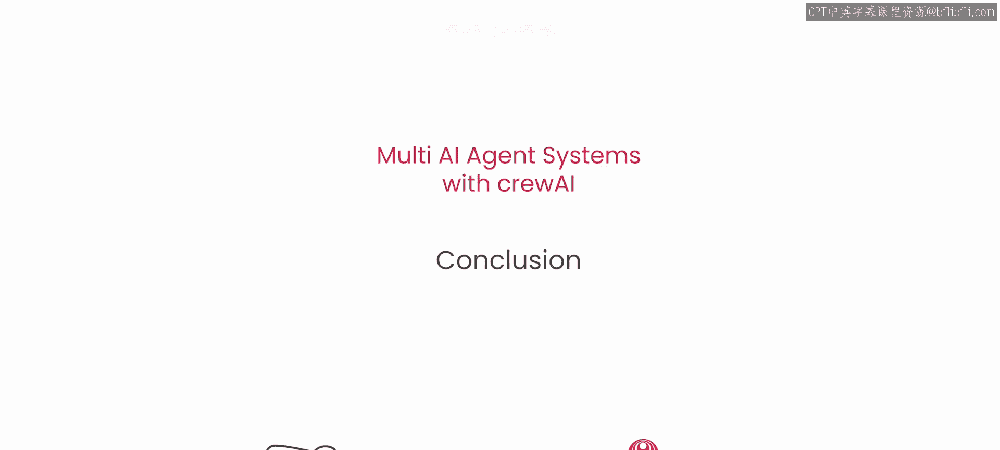

# 吴恩达《使用 crewAI 的多人工智能代理系统｜Multi AI Agent Systems with crewAI》中英字幕【短课英文均可关闭／拖拽】 - P18：17.conclusion.zh - GPT中英字幕课程资源 - BV1GZ42147am

Whoa， what a trip was that we just learned a lot you by now know everything that is to know about how to build multiple agent systems。

 you're ready to get these cus and go out there and build actual production systems that are going to be useful for yourself and for the businesses that you're working with。

So I want to first of all commend you for coming this far and say that you should be go out there and actually putting the skills into use A lot of what you learned in this course is how businesses are going to be built in the future。

 So make sure to give it a try to hone in these skills and to put them into use。

 If you always have a question or anything。 feel free to reach out I'm always one message away。

 So congratulations and I catch you online have a good one。😊。

