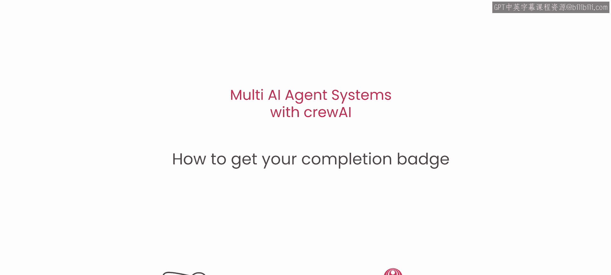
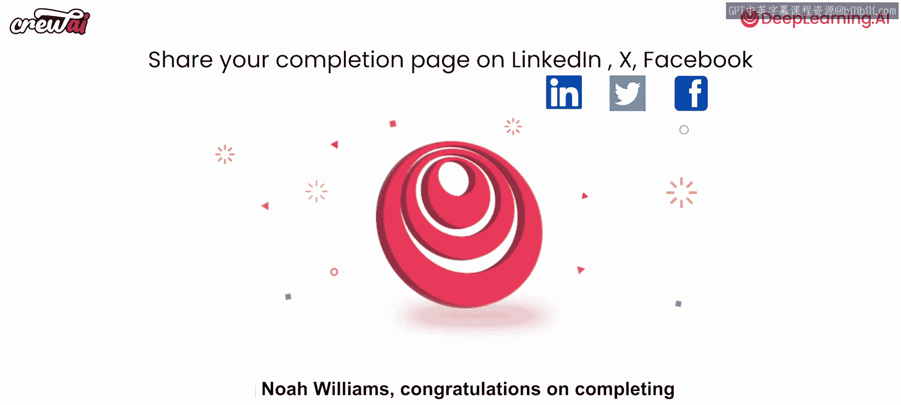
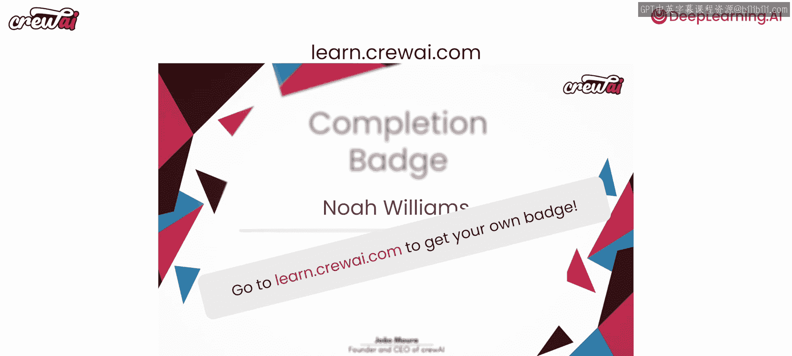

# 吴恩达《使用 crewAI 的多人工智能代理系统｜Multi AI Agent Systems with crewAI》中英字幕【短课英文均可关闭／拖拽】 - P19：18.get badge.zh - GPT中英字幕课程资源 - BV1GZ42147am

Congratulations， you've just finished our course on Mootyag systems。 And by now。

 you learned a lot about how moyag systems works and how to build them yourself。

 So I want you to take a screenshot of your course completion page and share it online。

 make sure to tag me query AI and deep learning AI and'm gonna make sure that we retweet it。 Also。

 maybe one of our agents might reach out and reply to you if you w to get a badge for this course。

 you can go to learn query Ai do co and you can apply to get a badge there that you can add your LinkedIn to your social profiles to show how you can build moyag system again。

 all you got to do is go to learn about query Ai do co Don't forget to share it online and I catch you later。

😊。

