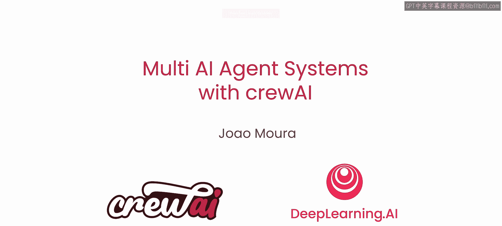
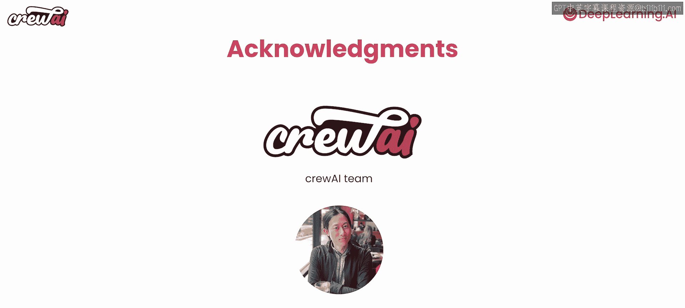
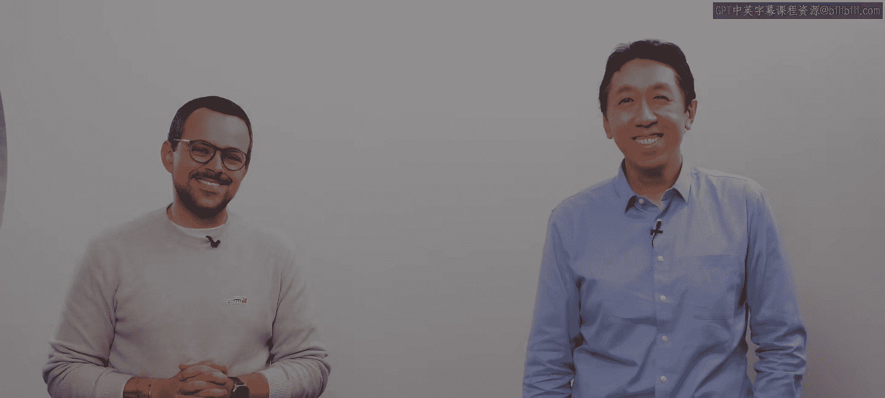

# 吴恩达《使用 crewAI 的多人工智能代理系统｜Multi AI Agent Systems with crewAI》中英字幕【短课英文均可关闭／拖拽】 - P1：1.introduction.zh - GPT中英字幕课程资源 - BV1GZ42147am

Welcome to multiaiI agent systems with C AI， built in partnership with C AI and taught by his founder and CEO Joe Mora。

 I think AI agent workflows will be a key driver of AI progress in the near term Multi-agent workflows let you break down the complex tasks into subtasks that can be executed by agents。

 each of which plays a particular defined role， for example。

 if your goal is to get a research report written， the roles might be researcher。

 writer and fact checker or if you want to get a website bill。

 perhaps the role could be a web designer software engineer and testing engineer。

 I've really enjoyed using C AI myself and I'm delighted as creator Joe is teaching this course Joe had created career AI when he needed a tool to build better agents to help him write LinkedIn posts and she has a lot of experience designing workflows for collections of agents to execute。

Thanks Sandra， really， I'm excited to work to you and your team and this is and has the potential to enable engineers to build great things In this course。

 you learn the major building blocks for agent systems with an emphasis on multiag systems building blocks you learn include roleplay to use memory。

 guardrails and collaboration and you use these components to build a collection of agents to customize a resume to job description and to perform financial analysis and also to perform event planning as part of assembling your agent workflow。

 you also define how these agents cooperate which ones are able to delegate to other agents to perform certain tasks like research and whether certain agents should execute their past in parallel or in series or in hierarchical fashion with a manager agent delegating to a number of worker agents Joe will go through these concepts。

😊，AI Open Library this course will help engineers trying to understand how to build AI agenda applications and how they differ from regular applications that we have been building up to this point。

After watching this， you will be equipped with you need to build multi agent systems and ripap out the benefits from it。

 I like to think of good moyag systems design like being a manager You are now promoted into this manager of agents and get to identify the goals and the various roles that will work together to achieve those goals and also define clear expectations for what a success looks like。

 It's a very interesting mental shift from regular engineering。

Yes indeed many people have worked to create this course I'd like to thank the whole true AI team and from deep learning AI Eddie Shu had also contributed to this course The first lesson will give you an overview of AI agents and also an overview of the rest of the course so make sure to stick around。

So let's go on to the next video and dive into the key building blocks of AI agents。

