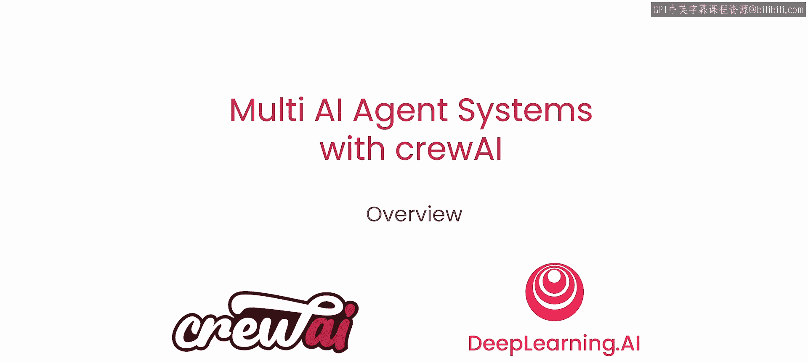
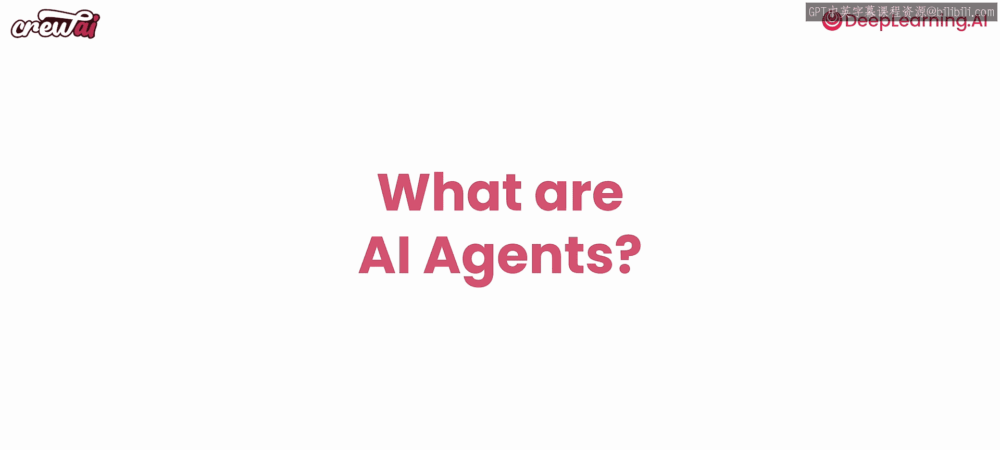

# 吴恩达《使用 crewAI 的多人工智能代理系统｜Multi AI Agent Systems with crewAI》中英字幕【短课英文均可关闭／拖拽】 - P2：2.overview.zh - GPT中英字幕课程资源 - BV1GZ42147am

First of all， congratulations on signing up for this course This is going to be great。

 I'm so excited to dive into this with you we're going to learn everything that is to know about agents and in this first lesson we' are going to understand what to make them take how they work and even look at some of the examples that we're going to do together throughout the entire course so let's dive in real quick。

😊。

So in this course， we're going to talk about so many different things， so many interesting concepts。

 I want to just highlight a few so that you know what you're going to see。

 We're going to be talking about role playing， we're going to talking about agents they are able to focus to use tools to cooperate with each other。

 We're going to really dive into how guardras are crucial to make agents work and how memory can make them so much better。

 we're going to talk about how the different ways that agents can collaborate。

 not only working sequentially and hierarchically but also asynchronously there are so many different options so make sure that you stick around because we're going build a lot of different crews through all the different lessons。

 A crew is a team of AI agents working together。 Each with their own defined roles。

 Don't worry if you don't know what this means。 That's what this course is about。

 We're going start with an overview。 We're going to build a simple research and write crew。

 but we're going to go out the way to build more complex。😊，Building a customer support crew。

 a customer outreach crew， an event planning agent system in a financial analysis agent system。

 And then to wrap up， we're gonna build our most complex crew yet a crew that is gonna be able to tailor made your resume to any job posting out there increasing your aunt of getting an interview So make sure to stick around for that because honestly things are only gonna get more interest from here out。

 So what we will build in this likes look at this full stack engineering job posting So you can see there is a bunch of interesting stuff in here。

 if you look close at the job description you're gonna notice that they're basically looking for a full stack developer they want someone that nails both front and back end and there is a bunch of like actual criteria in there。

 they want you to be able to write APIs and to have experience with databases and now that。

 So this is what。NoA's profile looks like I'm not going to read over it。

 but let's highlight some of the stuff。 You can see that Noah is trying to highlight how he's a good leader。

 So he mentioned how he has excelled in leading teams both remote and in an office he mentions some data science and machine learning and he also mentions about deploying scalable AI solutions that is nothing to do with the actual position that Noah wants to apply。

 but if you dig in there， you're gonna notice that Noah also has some of those skills you can see that mentions there that Is Ruby Python jascript that it has been a software engineer for 18 years so there is definitely enough things in there that kind of could explore and make NoA qualify for this position。

 So how do we make sure that we help NoA to highlight out that in his resume so that he increases his odds of getting a natural interview for the position that he。

Does ones to apply。 Well， you can use agents to do it In our case， by the end of this course。

 you're gonna be able to put together a multiagent system that does that in that we do that by leveraging four different agents it's gonna to have a tech job researcher a personal profile for engineer a resume strategist for engineers and an engineering interviewer preparer together those four agents will have a few tools that they're gonna to be able to use from searching the internet out the way to do rag over your resume everything to kind like help in this case or friend Noah but yourself as well to make sure that you're highlighting the right skills for the job。

 So this is what the new profile looks like。 let's compare both for a second。

 So in the second one you can see that it was highlighting a lot of his leading experiences。

 But now in the second one， it's kind of like doubling down on the other skills that he has but a better match the job that he's applying to。

You can see that we mentioned ja Python Ruby， we also mentioned Ui UX。

 you mentioned how he knows HTML and CSS it's everything in there so it's still the same profile and the same S set but framing a way that now better allows them or in this case allows N NoOAA to get the interview that he desires so stick around if you w to do this because by the end of it you're gonna to be able to build not only this but way more complex groups of moy agents then you're gonna to be able to do a bunch of automation for you All right so what is a automation if you think about what automation used to be like before it was something completely different in the past you would say hey I want to go from point A to point B and you can write code to automate that and then what happens is that as edge cases appears you start to kind of make that a little more complex you start to add a lot of conditions and ifs analysis。

There we're like well， if X do C， if Z do D， and you can see how these things can become quite complex。

 especially as you start adding more and more edge cases So in the old days whenever you're trying to do automations。

 what you end up with is this very complex codeb with a lot of different conditions and edge cases and you just can never cover it all。

 the beauty of agenda automations is that you don't need to drown the map you can show the options so it's fundamentally a new way to write softer Allright so in regular application you have stroke inputs so you know exactly the data that is get into your application you understand if that's a string if that's an integer if that's a float you have a very clear understanding of that and then you also have a very clear understanding on what is the mathmatic that you might be doing with that。

Any other aurrisistics。 So you know if you're multiplying those numbers together。

 if you're interolating their string， whatever is happening in there。

 you have fully control and understanding of what it is。 and because of that。

 you also understand what is the output， you know if the output is gonna to be another float or another integer or another string。

 you can replicated and that's the beauty of regular engineering， but with this new AI applications。

 you have something else differently you have a fuzzy input。

 meaning that you don't know what the user is input into your application。

 So you know that is a string because we're talking about an LLM。

 but you don't know if it's a string that represents tableular data if it's a markeddown if it's a regular text or if it's a math operation and then the transformations are also fuzzy because theyre LLMs you don't know if the LLM will decide to transform this into a list。

Or if it's write a full blownown paragraph。 And because of that。

 you don't know exactly what the output will be because it can take different forms and shapes。

 depending on the inputs and on the transformations。 But that's the beauty of it。

 There is a place in the world right now。 where this fuzzy applications make way more sense the regular existing software applications。

 So that's the main reason why people like chat G so much。 If you think about chat G。

 that's an AI application with fuzzy inputs。 you don't know what your user is putting in the chat。

 It's also fuzzy transformations。 you don't know what the LLM will do with that data。

 And it's also fuzzy outputs。 you don't know what will be the final output。

 what will be the final response for that user input。 And that's why people love it。

 because it's something they can relate to。 If you think about the word as we have today。

 The word is a fuzzy place。 So this is the beauty。😊。

AI applications is that it's available too that has its merits and places where you want fuzzy applications and where you want strong typed applications and each one has its merits in its place depending on the software that you're trying to build So let's look at some actual example here。

 let's talk about data collection and analysis and if you have been working engineering for a while。

 we are probably familiar with this。 your company probably has a website that captures leads data through a form and those leads eventually go into your sales team that are going to try to make them into customers。

 So this is very usual for most of the businesses out there。

 And the way that this leads become customers is by prioritizing them and there's a bunch of ways that companies use to do that so you have your form and you capture information about this company through that form and then go through an automated process of classifying these leads where you might。

At some data points like hey， is this company a big company has more than 10 employees。

 I this company located in the US or is this company located somewhere else And depending on the answers for those questions。

 you might give a different score for these companies or treat them differently on your sales process So this is regular data analysis and data collection。

 but it turns out that now that you can use motiag systems。

 you can go beyond that and you can go even further。

 So let's try something different let's think how a crew of AI agents could actually help us here and do something that's better than what we have been doing through the past few years。

 let's add a crew of AI agents on the lead generation process So what you can do now instead of having how those if analysis analyzing like specific data points for the companies。

 you could have this AI agents do research to go out there and do data collection in those research can be。

Searching Google can be searching online can be searched on an internal database or internal data that you might have whatever you want any place where you can find more information about these companies then you can also have this agent drawn comparisons between these companies and companies that you already have on your data companies that you're already talking to companies that turn down to be great customers and then you can also have this AI agents do some scoring so they can actually score this company and making sure that this company has a score that you can actually prioritize and decide to who you're gonna be sending it to and then the final point is coming up with talking points so not only doing the research the comparison the scoring but also getting ahead and making sure that you know what are the topics that it should bring up when you go out and reach out to this customer and what that conversation should look like and now you can take that and send that to your sales team and you have a way better data。

s to work with than the one used to have before So this is a great example on how regular automation can actually become way better by using agent automation al right so we talking a lot about agents so far we talking about a lot of different types of automations but in the end of the day what are agents so let's talk about that for a second and step back。

😊。

