# 吴恩达《使用 crewAI 的多人工智能代理系统｜Multi AI Agent Systems with crewAI》中英字幕【短课英文均可关闭／拖拽】 - P3：3.AI agents.zh - GPT中英字幕课程资源 - BV1GZ42147am

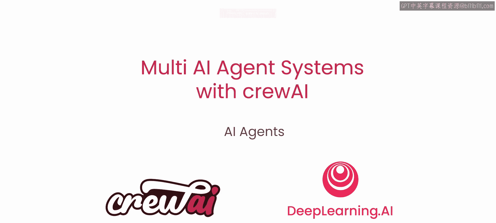

So you probably know LLMs， right， They come with all those different shapes and sizes and forms。

 and there's a bunch of different vendors。 you have open AI， you have hugging face。

 you're having alema， you have a bunch of different options to tap into this。

 And why those LLMs do is predict the most likely next token。

 what happens is if you try to chat with some of these LLms。

 you're going to quickly realize that you're going to end up having like a regular prompting experience similar to when you get with chat GptT where you kind of got to give feedback to it to make sure that through the interactions between you and this LM。

 you get the results that you need。 All right， so let's see this chatt for a second to see how exactly does that interaction works。

 And why it could be better if we use it agents。 So in this case。

 let's ask chat GptT to help us create a marketing copy。

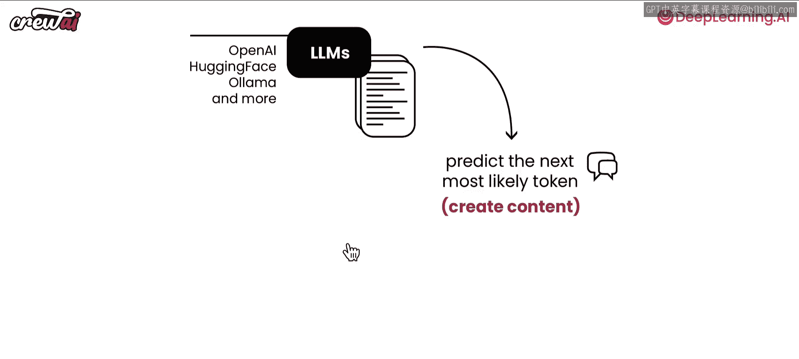

For Cr AI， a platform for building AI agent。So in here you can see that as regular。

 chat GT is gonna start to write it down what should be this copy， but it turns out to be too long。

 I don't necessarily want something this long。 I want to make sure that it's a smaller something that I maybe be used on an Instagram post or whatever it might be。

 So now I get a chance to provide some feedback and say like hey， this is too long。

 let's summarize it So was that you say that you can see that it starts to get better but the only reason why we can get not only GT。

 but any LLm to get a better results is true interaction is the iteration between the user and the LLm and the feedback that you provide it to it that allow it to kind of correct its wrong and get better result。

 So what you quickly realize here is that through to interactions you can get a better results。

 But you quickly become a blocker。 You gotta be in there like answering these questions and。

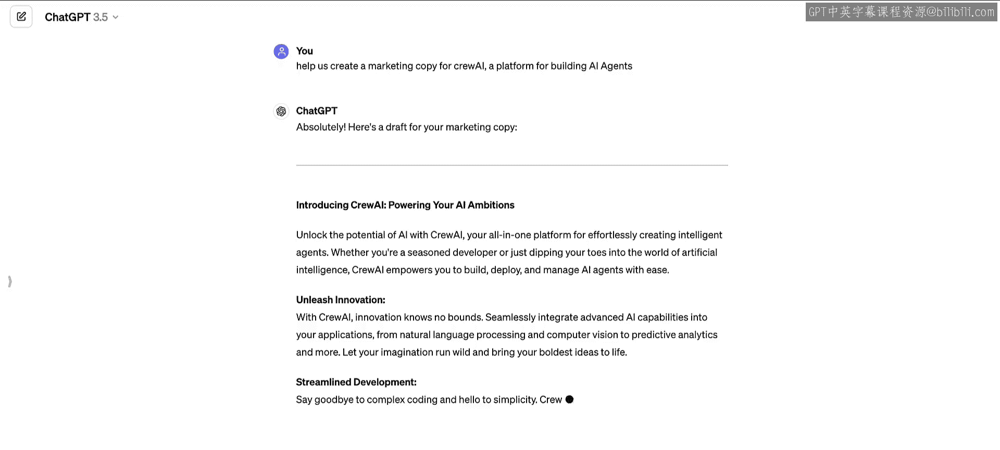

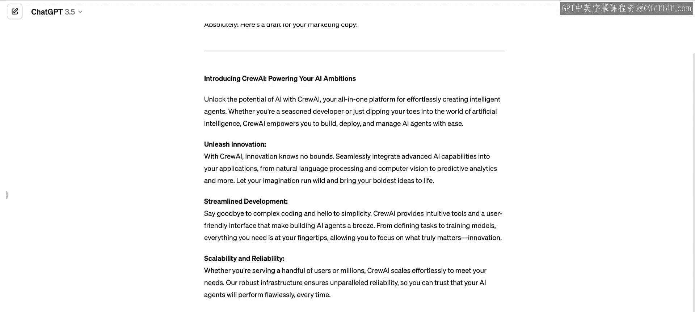

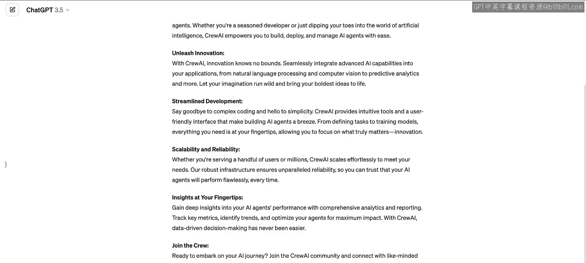

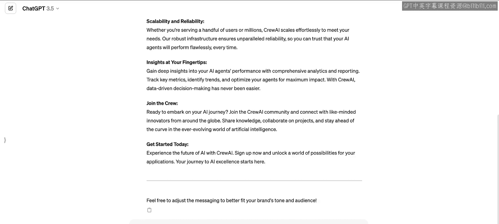

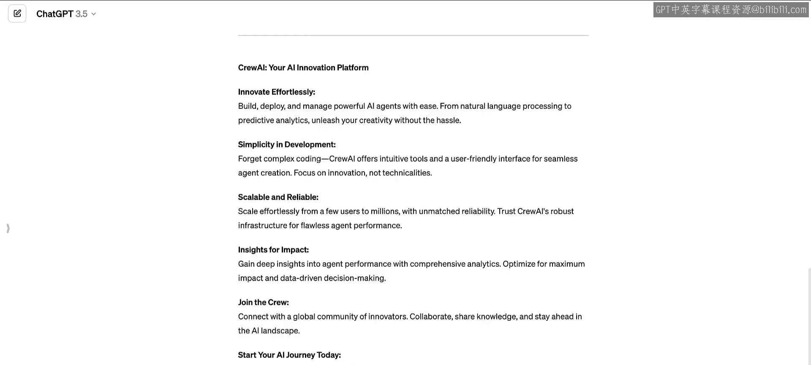

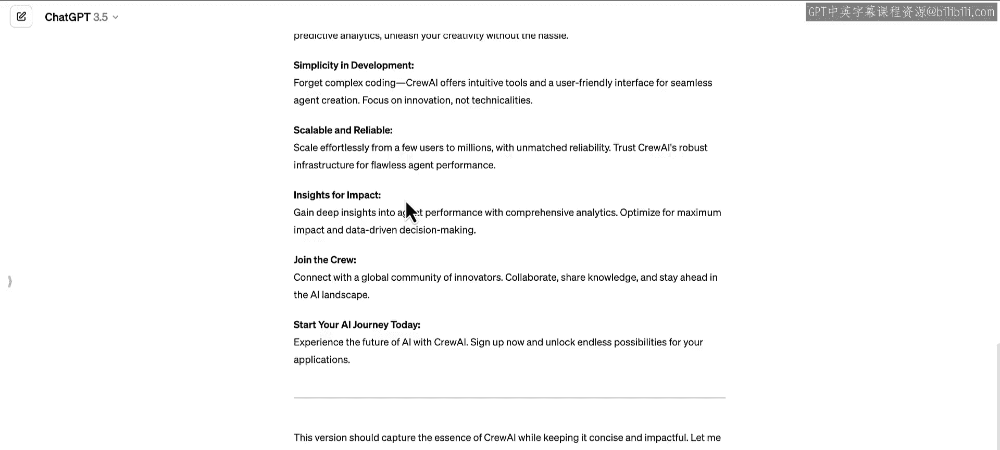

it in order to get good results So it's not a free you want to do other work is just like you but AI agents actually can break up that and allow you to do other work while allowing the LLM to operate autonomously and the reason why we can do that is that because these LLMs were training so much text and they understand text。

 they create a state where they kind of have cognition and by that I mean that they can reasonably react。

 they can choose between A and B and left and right because they can put words together in a way that makes sense so when you achieve that state if you can have the LLM to kind of answer some questions and an agent is born So the agent is born when you get these LLM to engage inner thinking process throughout it ask questions and answer the same questions itself to the point that it can move。

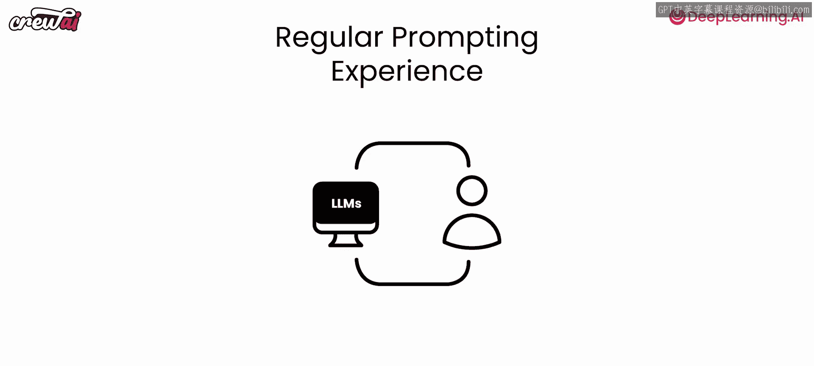

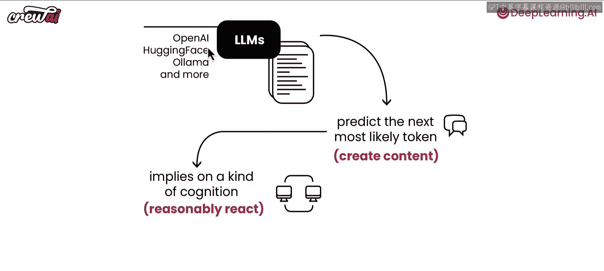

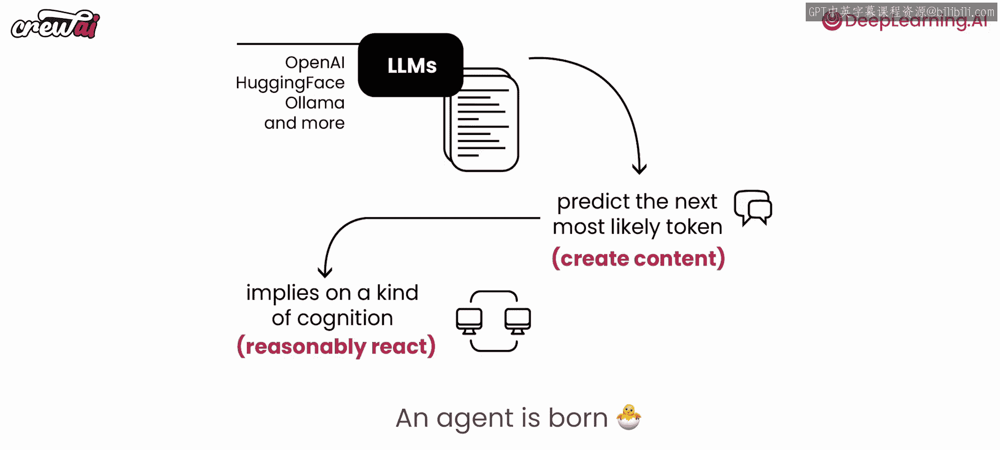

One and get a better by itself。 So once that you get into that stage。

 it allows you to pass a task into this agent and throughout this thinking process。

 this agent can then come up with a better answer it's not the first answer that it would have given you but it can then think true when optimize the answer up to the point that satisfies itself and then spits it out but there is one thing missing here。

 a B component that make this agent super powerful and that's the ability to use tools Other frameworks might call them ss or capabilities but what they allow you to do is to your agent to interact with the external word it allows your agent to do more things that doesn't necessarily would be able to do itself it could be calling an API it could be posting something it could be gathering a data point whatever that might be and this this is a fully flged agent。

So let's talk real quick about what are multiagent systems So multiagent systems grow on top of the agent behavior that we just described where instead of having just one agent you can now can have multiple of them So whenever you task an agent with something this agent can also task another agent with another task and in the end you get one single final answer but you might be wondering what are the benefits of having that instead of having one single agent Well I will name a few but we're gonna dig into that in further lessons the first thing here is that you can have each agent be customized to do one single thing and do it well you can have one agent for example being a researcher in another agent being a writer so that allows your agent that is a researcher to focus on doing one thing and making sure that finds all the sources that check all。

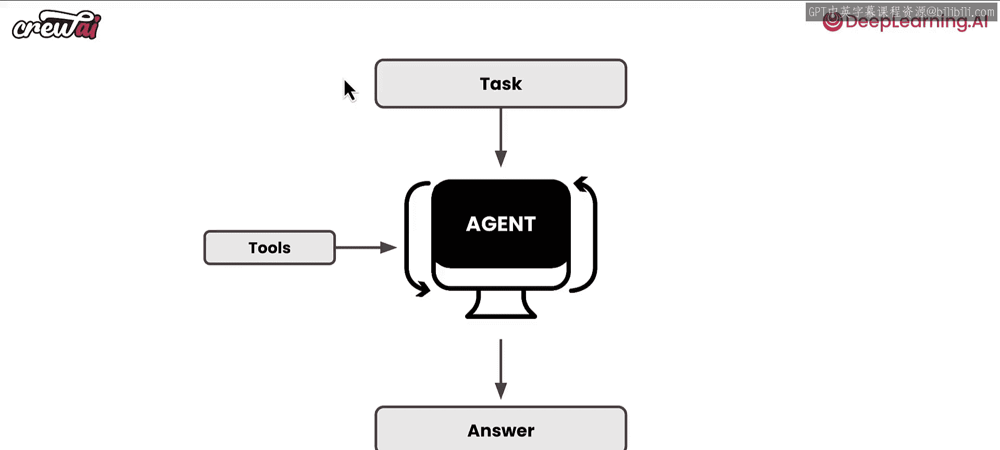

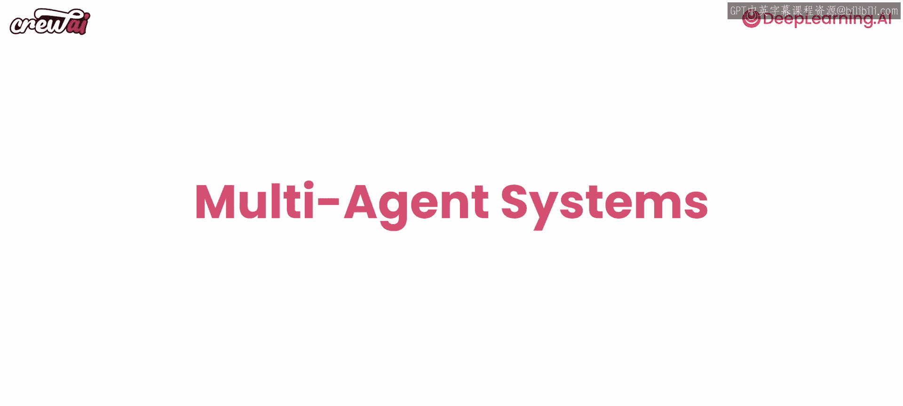

sourceurces that include all the sources and your writer just use that in order to create the most amazing material ever and the other good thing is that because you have multiple agents。

 you can have them run from different LLms so you can have your researcher running on Letry while your rid running on G4 you can also have your own fine tune version model powering something of those agents so you can see how multiag systems can be so much more powerful than single agents because allows you to get very focused agents that will be able to achieve better results than if they're trying to do everything themselves when also tapping into this ability to use different models from different sources and we could keep going even when step further where you can actually say well now I want to multiple multiple agents but this is getting to mad so let's step back for a second and let's first。

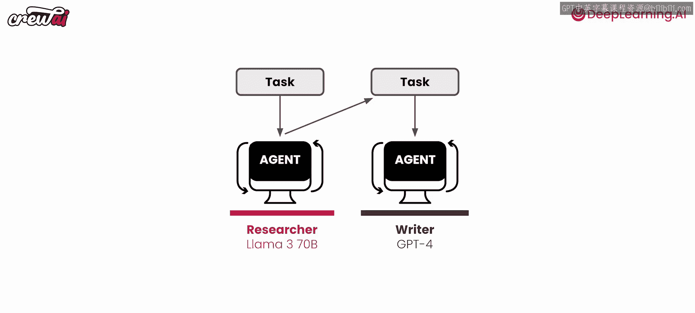

First multiagent systems for all the examples in this course。

 we are going to be using a super powerful framework。 It's called crew AI and it's open source。

 it's simple and it's designed for production use cases it also offers a platform to bring your agents into production but all the concepts that we are going to discuss here apply to all major frameworks out there。

 Before we jump into examples let's talk about what isque AI I want to take a solid moment to describe why all of the options that we have out there。

 we are using Ci on this course C AI is a framework and a platform and there's a few things that it offers that makes it super easy and super meaningful for us The first thing is it break all these concepts into very simple structures。

 so it makes super simple for you to pick up on them。

 The second one is that it provides a pattern to put these systems together so you don't need to think about how you're going to string all of this because it already kind of offers。

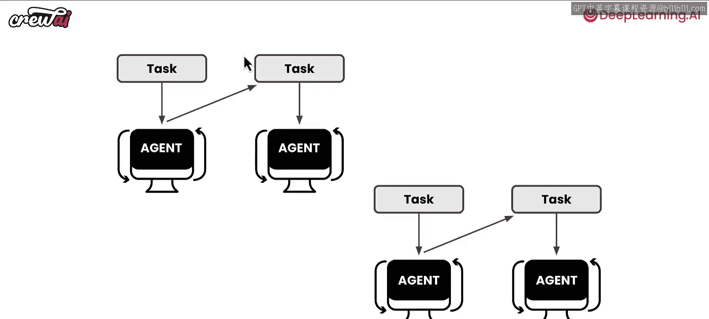

You an opinion on that。 The third thing is that it provides many tools and skillss that are ready to be used and we are going to use them throughout the course。

 the fourth one is that it gives you a module to build custom toolss or agents in some of our lessons we're going get to build some of those custom tools and you're going to see how helpful that is and also as a final touch point。

 it also offers a platform for bringing this agents into production。

 So whatever you're building through the course， you're going to be able to also deploy and production through the query A platform if you choose so Allright。

 so let's start looking at some of our initial building blocks。 In this case。

 agents tasks and crews we're going be diving into those and building our first multiagent system at the beginning of our next lesson So if you like what you heard so far if you got excited about any of the examples that you mentioned I recommend you to stick around because things are only going get more interested from here on。

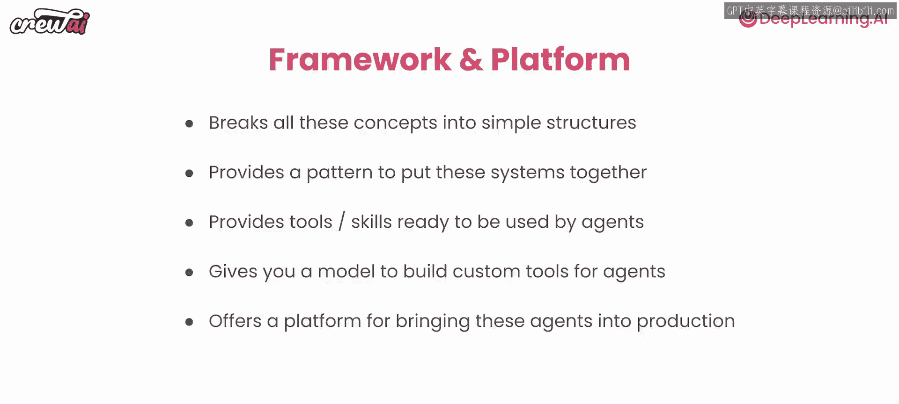

There's so much they're going to able to build with AI agents that I promise that they're going to be pressed by the end of this course it's going to allow you to automate parts of your life。

 automate parts of your job and honestly lock a lot of potential so I hope you stick around for our next lesson where we're going actually build our first multi agent systems ourselves and I'm going guide you throughout the way so thank you so much and I see you in the next lesson。

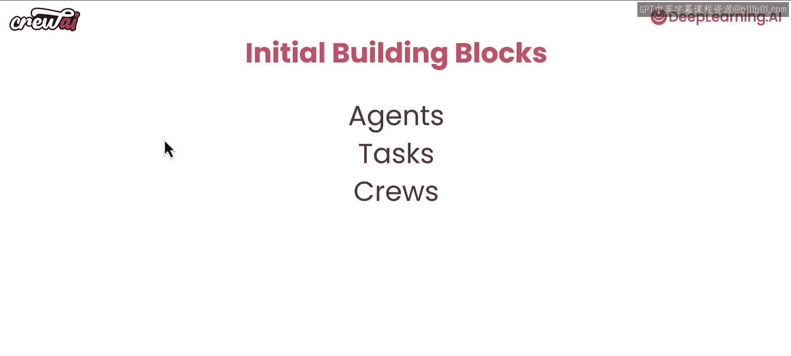