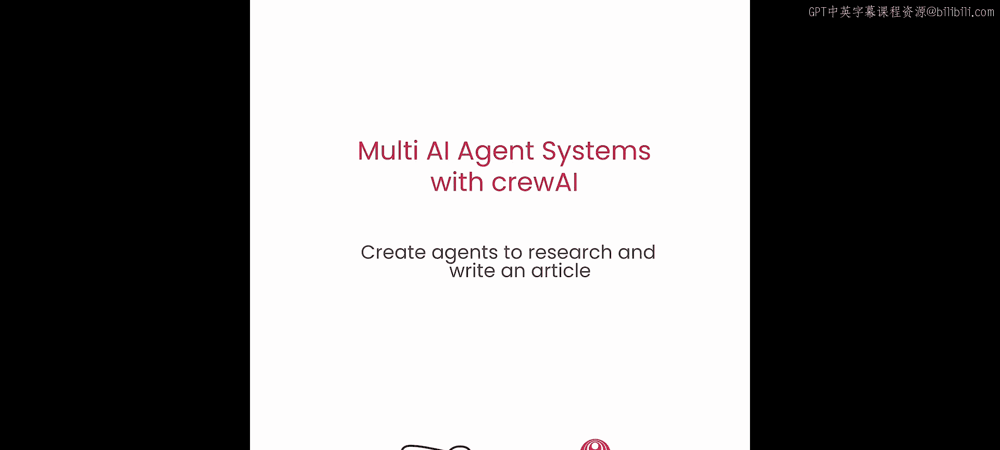
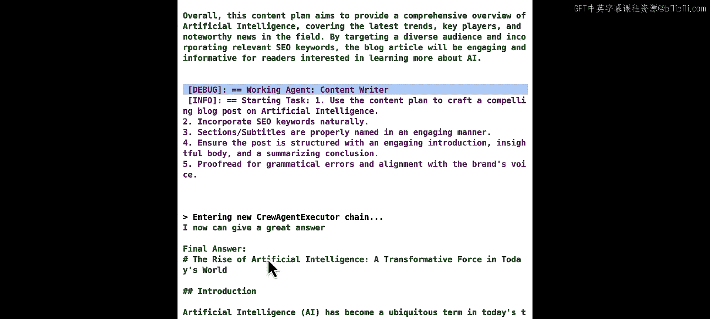
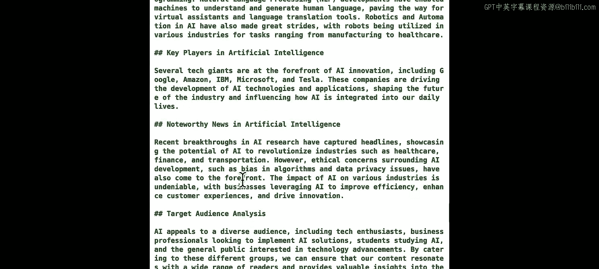
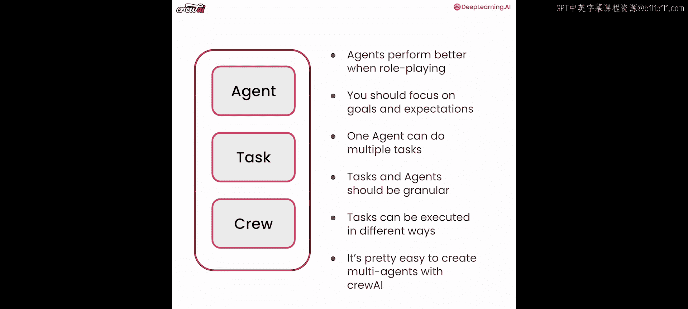
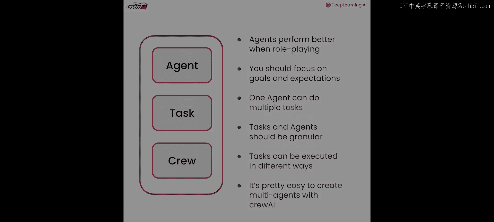

# 吴恩达《使用 crewAI 的多人工智能代理系统｜Multi AI Agent Systems with crewAI》中英字幕【短课英文均可关闭／拖拽】 - P4：4.L2 Create Agents to Research and Write an Article.zh - GPT中英字幕课程资源 - BV1GZ42147am

Alright， so you learned a lot about agents already。

 You now understand a little more about how they work， what they're meant for。

 what to make them antique。 Now， let's get our hands on and actually build our first multiag systems ourselves。

 For this one。 We're going be building a crew that is able to do research and write an article for us。

 You're going to see how this agents work together and how you're able to create something that's super valuable。

 true multi agent collaboration。 So we stick around， You're going really like this one。

 Let's dive into it。😊。

Alright， I'm super excited about this。 we're going to be talking more about how to actually build multiple agent systems。

 I honestly believe this is the future。 It's going to be a key part of how businesses are going to be viewed in how engineers can drive an immense impact on your jobs in your career。

 we' are going to start by looking at how we can build our first multiagent system and we're going to try to do things simple。

 I'm going to start by just copying some code in here。

 making sure that we don't get any warnings along the way so we' are going to start by importing the three main things from C AI We're going to import agent task and crew those three classes are the main important part from QI and how we are going to be building those multiag systems now that we have imported them We got to choose what is going to be the LLM that is going to be the brain for all of our agents。

😊，In KoreaI， you can choose your agents to be run from different LLMs and by default。

 they all run from G4。 but in this case， let's make sure that they're running from GT3。

5 Tbo and you can do that by theing environment variable called open AI underscore model underscore name and in there you can add the name of the model you're going to sit down the road that you can connect your agents to any LLMs out there that are not necessarilycess open AI you can use localcom models you can use any other major providers out there So for this let's make sure that we are using GT3。

5 So let's start by creating our agents agents are the corner piece of how we're gonna build the moy agent systems So for this use case we're going build three different agents We're going have a planner a writer and an editor these three agents together are going help us come up with amazing technical articles So how do you create an agent Well it's pretty straightforward。

Basically create an instance of the agent class when creating that instance。

 there are few attributes that you really care about， namely the role， the go and the backstory。

 so let's look into that for our planner we want to make sure that we set a role that matches what we want it to do so we're gonna keep it simple and we're gonna say it's a contentvent planner you're gonna notice that in the following up lessons。

 we might do a more complex roles and goals but for this one let's keep things simple Now let's set up a go for this agent The go for this planner is basically plan engaging and factually accurate content on a given topic。

 You notice here how we are interpolating the variable topic within the go。

 you can do that in the role you can do that in the go and you can also do that in the backstory and I'm going show you how that playss a role on actually running this agent down the road so now let's set up back。

Story to the planner agent So if you look at this， you might be wondering why are we going to the trouble of setting up the row that go in the backstory。

 One thing that you're gonna to learn in future lessons is the fact that agents perform better with row playing in this case you can see that the agent playing as a content planner so as much context as we can set in terms of like what kind of agent it is。

 the better because it's gonna to conform to what we expect。

 So now I'm going set up a couple other attributes。

 namely when that say that this agent is not allowed to delegate work to any other agent and also making sure that it's ver so we can see how this agent runs in its inner thoughts。

 don't worry about those two attributes for now we're gonna get into them later Allright so now that we have our planner here。

 we can create this agent and there we go we have our planner agent ready to go。

Let's move on and create a writer agent that's gonna be responsible to actually write the content based on top of the research that the planner did。

 So in here you can see that we are doing a similar thing。

 This agent also has a role also has a go and also has a backstory and you can see interpolation happening on multiple fronts but all the interpolation that is happening is around the same variable called topic and we're going to see how that plays a role in here by the end of it。

 so let's create a writer agent now let's create a final agent for the screw and this agent is an editor the editor is basically responsible to review the content。

 make sure that things are correctly formatted that's good and it's ready to go so let's go ahead and create that editor agent as well with that done we have three agent but we have no tasks and nothing to guide them so let's now create a task for each one of these agents。

Create the task is as simple as creating the agent。

 You ability to create an instance of the task class so in here you can see that you can just type task and the task expect at least three attributes the description。

 the expected output in agent So the description is actually why do you expect the task to be what do you expect the agent to do so in this case this is the plan task So we expect our planner agent to look at the latest trends and look at the key players in making sure to create like a content or a research that we can use to actually write it down the other argument that we expect in here is the expected output and expected output here。

 the first for the description because it kind of acts as a forcing function to force you to think exactly what you want to get out of the task。

 what you want this agent to produce as a final outcome in here。

You can see that we are being very descriptive about it。

 We are saying that we want a comprehensive content plan withouting audience analysis。

 Seo keywords and resources and then the final thing that we need to do is actually assign an agent to this task So in this case the agent that we're going to be assigned to this east or planner agent and with that we created our first task Now let's move on and create our right task it's very similar but again different arguments。

 a different description in a different expected output and here you can see that the expected output for the right task is actually the actual blog post and we want to be writing as markdown having multiple sections and each section having between two or three paragraphs So with that we are ready to go because we have our two initial task Now let's create our final task this task a little bit shorter。

It's the added task。 This task is where the actor comes in and kind of proofreadread the blog post。

 making sure that the content is right， making sure that we have the paragraph that we need and that the thing is high quality so we can also go ahead and create that task So right now we have the agents and we have the tasks。

 we just need one way to mash those together。 and that's where the third element of crew AI comes in and that is the crew crew basically puts together agents and tasks。

 So they can operate as a unit。 So here you can see that we set three attributes。

 The first attributes is a list of the agents。 the second one is a list of the tasks and then we have a verbose mode that allows us to see how this crew is executing and look at some of its logs。

 One thing that I want to call out is that by the full a crew operate。Sequentally。

 meaning that one task is going to be executed after the next because of that the order of the tasks when you create the crew。

 it's important given that the output of one task is going to be sent as part of the input for the next so you really want to make sure that you get that right We're going to learn down the road that that's not always the case and you can have a way finer control on what order you want those tasks to be executed if you want a tasks to be executed in parallel or if you want to be executed higher articulate it's all up to you for this initial use case though。

 this is going to work great So how do we actually get or multiag system run one thing that I want to highlight here is this verbo setting being set to two depending on how you're setting up per crew you might want to be able to see a certain level of grnler logs So in this case you can set your verbos node。

Betweenen one and two and that will define how much verboity you're going to see on your logs if you're going to see all the logs that are possible or just a subset of them in this case。

 because we really want to see what is happening behind the scenes we are going to set the highest number possible in this case number two So now we have our agents and we have our tasks So how do we get it run。

 how do we execute this mochi agent system It's pretty straightforward we use the crew do kickoff method so you can do this by long kickoff and then passing input dictionary into the kickoff method in this input will have all the variables that you interpolated throughout your tasks and agents So this is where the topic thing came into play So you remember how we interpolated this topic variable throughout our agents when we first declare them up here Well now。

We're kicking off our crew。 We can actually set what is the word that we want to actually replace in all those different places。

 So now let's kick off our crew and see how that goes。 So from the get go。

 you can see that the content planner starts off and it's starting its first task that is prioritized the latest trend keep players and noteworth news on artificial intelligence because that's the topic that we set so we can see here that it already did that gave us an outline of what should be this artco about what should be the main topics that should include on it So now we can see that our new agent kicks in or content writer and it uses the previous information。

 the research that was made in order to put together a markdown blog post so you can see here how it's writing it out down for us Now the al come in proofreads and review and make。

That it aligns with our B's voice and that it looks great。 And by the end of it。

 we should have a full flged post for doing that。 I'm gonna be using this markdown helper。

 So once that you do that， you can plot the mark down here and we can see what this article looks like。

 It's called a riseise off our official intelligence， a transformative force in today's word。

 and you can see that it has subtopics and each subtopics has some nice content into it。 Alright。

 so now we have our agency doing the work for us and you can do it too。

 So I invite you to come in here and write the topic that you want your agents write about and you can execute this code and see they come alive and write this blog for you。

 So congratulations。 This is your first multiag system and works great。😊。

Now let's talk about other use cases So throughout this course we're going to use career AI for all the examples and you're going to probably find yourself looking at our docs at some point。

 So let me go ahead and tell you all the documentation that you find on career AI is actually written by a crew So this is another great practical use cases that showcases how moag systems can help you with engineering work as well where we don't have anyone on our team writing docs anymore because now we have a moag system that does that for us So I would definitely recommend you to think about all those different use cases that you could apply those moyag systems into let's do a quick recap about everything that we learned so far before we move on the next lesson so we now understand what are agents the LLMs that can like talk to itself they have inner taught process and they can receive tasks and use。

In order to give way more complex answers that they would be able to do otherwise。

We also learn that you can have multiple agents hooked up together so that one agent can pass tasks to another agent and by doing that you can have specific agents that are great in one single thing we learned the three main pieces and the corner pieces of queryI we learn about agents tasks and crews and we now know how to put them together。

But there are way more things that we learn through all this First。

 we learn that agents perform better when rowplan。2。

 you should focus on goals and expectations wheneverever you're creating your tasks in your agents。

 you need to make sure that you're setting up in a way。

 they know what they're doing and they know what is expected of them3 one agent can do mopo tasks if you want to In our use case we had one agent for every task but we could go beyond that。

 We also learn that tasks and agent should be graler。

 You can see how we focus each agent on one very specific thing。

 and we also know that tasks can be executed in different ways。

 we talk about tasks being executed in parallel or sequentially or higher articulately and we are going to dive into that in future lessons and we also talk about how it's pretty easy to create moyag systems with career AI So thank you so much for sticking around and learning more about moag systems in this lesson I'm looking forward to see you in the next one where we're going to dive even。

deeperper into how to build these agents and making sure that we are taking full advantage of them and their tools。

