# 吴恩达《使用 crewAI 的多人工智能代理系统｜Multi AI Agent Systems with crewAI》中英字幕【短课英文均可关闭／拖拽】 - P5：5.key elements of ai agents.zh - GPT中英字幕课程资源 - BV1GZ42147am

Let's talk about some of the concepts behind moy agents because so far we're able to put together a moyag systems ourselves。

 but we want to make sure to understand why to make them great so what does make an agent great Well there is at least six elements that make an agent a great agent the first one is roleplan。

 the second one is focus the third one is tools， the fourth one is cooperation the fifth one is guardrails and the sixth one is memory a lot of that is what to make good employees as well you're probably good at a job because they're able to focus because they're able to use the right tools because they're able to cooperate with others because there are certain guardrails and you should have good memory so let's dig into each one of those and talk about how this comes together to help this agent to be better so let's。

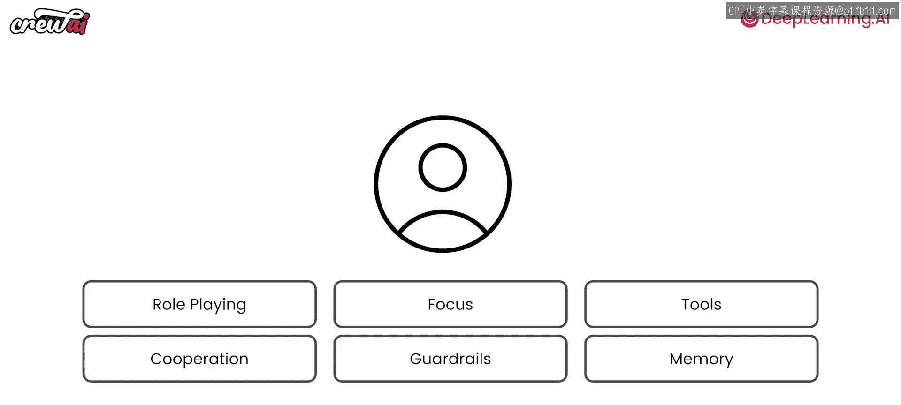

Roe play， so the first thing is role playing row playing can make a huge difference on the responses that you're going to get from your agents。

The ability for them to kind of like just take the shape or form or a function for something else。

 will have a direct impact on what kind of answers you're gonna to get and kind of like what you're going for So here's a quick example on how that plays a role even on a chat setting but it plays an even bigger role once that you're doing on an actually a system where there's way more message going on。

 But in here I just ask chat GT to give me an analysis on the Tsla stock。

 and then I ask the same chat GT to do the analysis on the Tesla stock。

 but now I just set some context for H2 row play into saying that you are a thing where approved financial analyst So let's see the difference between those two answers。

 The first answer you can see that it basically mentions about manufacturers it kind of talks about financial performance but the second one you can see that is already digging。

Into it， talking about Nasdaq， talking about like the actual Tsla stock and talking about Ev manufacturing market and you can see throughout the response that I'm going to spare you from seeing here how that it play the role on the response overall So this is just a tiny example not saying that it's better or worse but the role。

 the context that you set for your agent does have an impact on how it's going to respond。

 So my call out here is to be mindful as you're creating this agents to make sure that you're setting the appropriate roles。

 the appropriate goes and the appropriate backstories because then we play a role on the kind of resultss that you're going to get。

 But let me step back for a second because I want to count out one thing。

Realize how we use FNRA in our contact setting。 We could have just said that this chat is an actually financial analyst and that's it。

 But by choosing the fingerer keyword， we're helping direct the LLM to give a certain type of answer。

 So in here you can see how being careful and mindful about how you choose the role。

 the go in the backstory and the keywords that go into that allows you to get better results out of them。

 we actually have customers and users using crew AI worldwide。

 they're applying similar concepts to get better results out of their multiple agent systems So I would be mindful about when you're setting the roles and the goals and the backstory to make sure to use keywords that will actually help you and we'll get you better results。

 Allright， so we talk about roleplan。 Let's talk about focus Focus is another big thing。

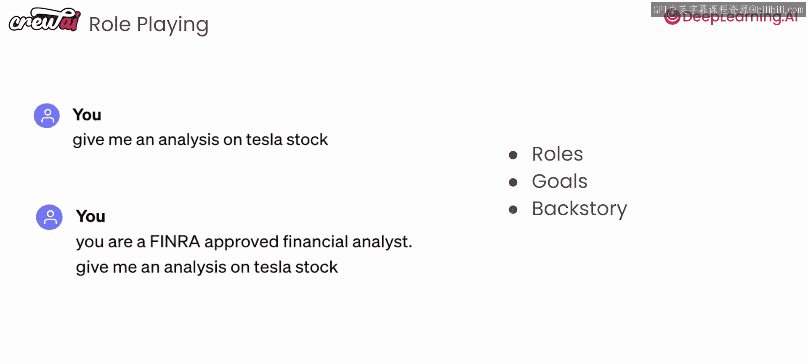

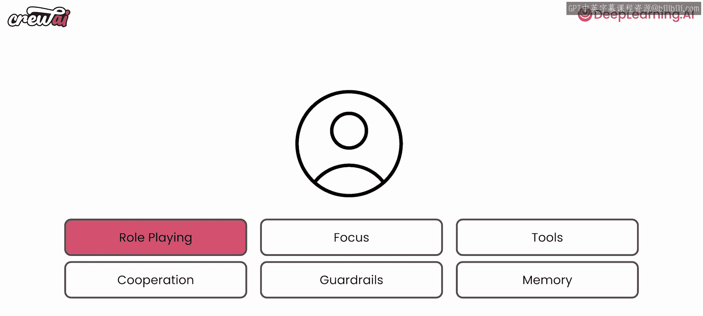

And I'm not talking only about context windows we know nowadays that LLMs have longer and longer context windows and you can leverage that in order to produce amazing content and to also import a lot of content but the one thing that becomes clear throughout many researchers is that if you mix things up too much doesn't matter if you're talking about too many tools or if you're talking about too much information or too much context your models can lose important information and also open up opportunities for more hallucination so another thing that makes agents great is their ability to be focused and when I say that I mean focus on the amount of the tools that they gather focus on the amount of content that they get send and also focus on what they're actually trying to achieve you shouldn't rely on one agent to do it all but instead many agents that work better to gather we have seen this in the industry people that are using createI。

Out there have way better results when they are using multiple agents compared to when you're using one single agent throughout many different verticals。

So all right， we know that agents work better when they're roleplay and when they're focused so what about tools that's another common thing people tend to try to give a lot of tools for their agents and that can get confusing you can overload your agents with too many tools so they're gonna to have a hard time to choose a tool they might end up not using a tool that they should and you might end up having even bigger problems if you're using smaller models because then they're gonna to get even more messy not being able to distinguish what is the tool。

 what is the context what they're trying to achieve because these smaller models are also less capable in general so another rule of thumb that we tell for everyone that is usingque AI out there is to choose the tools that you're going give your agents you want to make sure that you're providing them with the key tools to do the job that they need the same way that you would do if you're hiring someone or if you're getting someone。

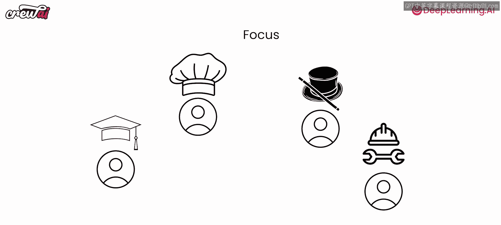

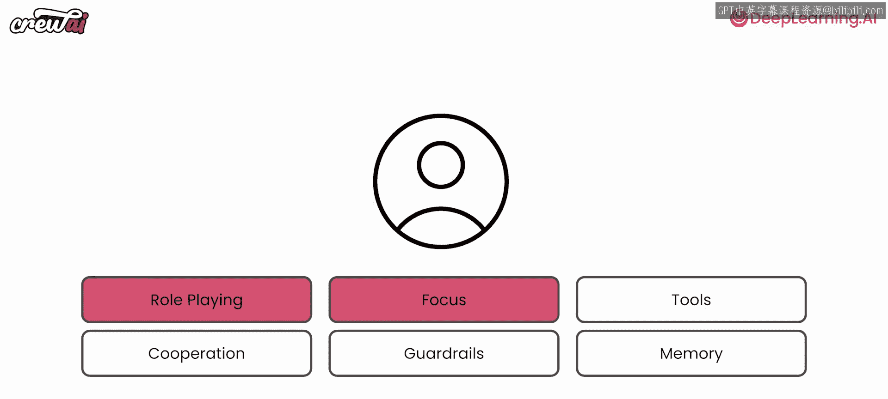

You on your team All right so we already know that agents now are great at role playing focus and using tools Let's talk about cooperation because that also is another thing that make a huge difference for agents ability to cooperate and to balance ideas off each other makes a huge difference on producing better outcomes the same way that when you're talking with chat GptT The process of having a conversation and giving it feedback helps you to produce better outcome the ability for this agents。

 they're now role playing to talk to each other and simulate that same chat behavior creates a better results they can basically take feedback from each other they can delegate tasks to each other and by doing that produce a better outcome so doesn't matter if you're using crew AI or any other framework out there you want to make sure that our agents are set up to being able to collaborate with each other the next。

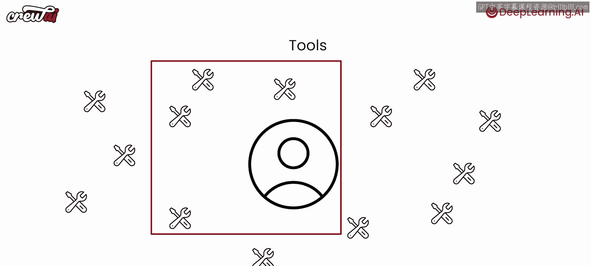

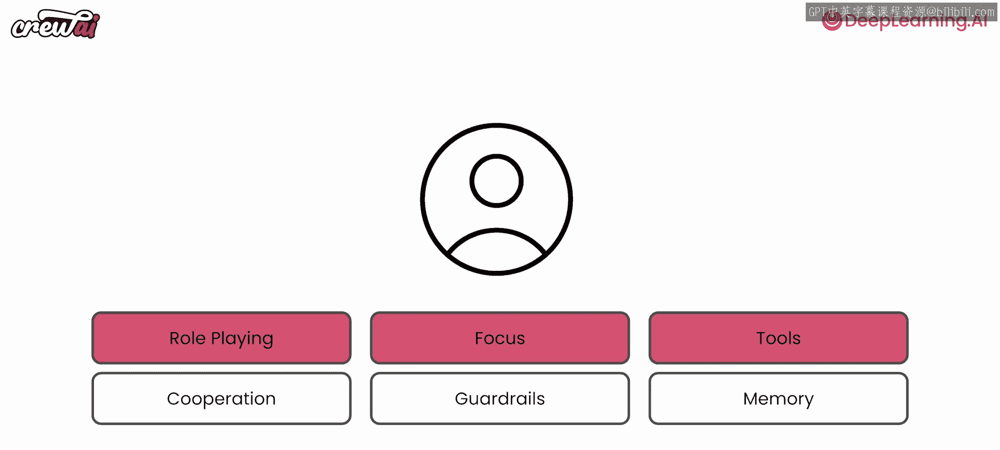

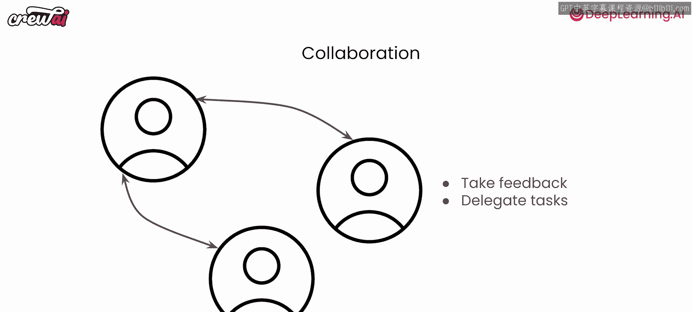

One is guardrails and guard railils is so important because remember that we are now talking about AI applications and we have talked about this in the past AI applications imply on fuzzy inputs fuzzy transformations in fuzzy outputs that means that you don't necessarily will get strong typed resultss but that's okay because that's part of the application that it doesn't mean that you want hallucination though or that you want your agents to get stuck on random loops or using the same tools repeatedly or taking too long to give an answer that was actually a problem that we had early on on the first versions of Q AI where agents would be stuck trying to use the same tool over and over again。

 especially if they're using open source small models but we fix that throughout many iterations we implemented a series of guard railils that prevents your agents from derailing and nudge your agents。

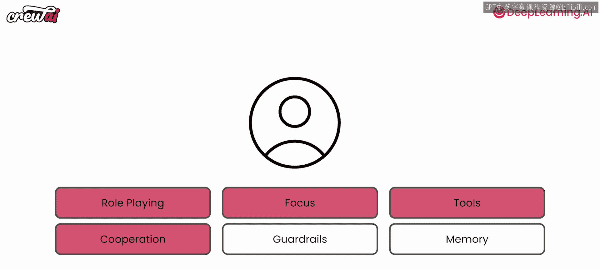

We on track and most of those are implemented on the framework level so make sure to check whatever framework you're using I can tell that a queryI has a bunch of them。

 but it's also something that you want to consider when building custom2s as we are going discuss later in this course but this guardrails are gonna make sure to prevent hallucinations it you also make sure that you get a reliable and consistent results throughout your booty agent systems All right now there's just one last thing to talk about memory memory can make a huge immense difference on your agents if anything it can make more difference than all the other things combined Me is the ability for your agents to remember what it has done and not only that but to use that to inform new decisions and new executions the ability to recollect what they did in the past learn from it and apply that knowledge into future。

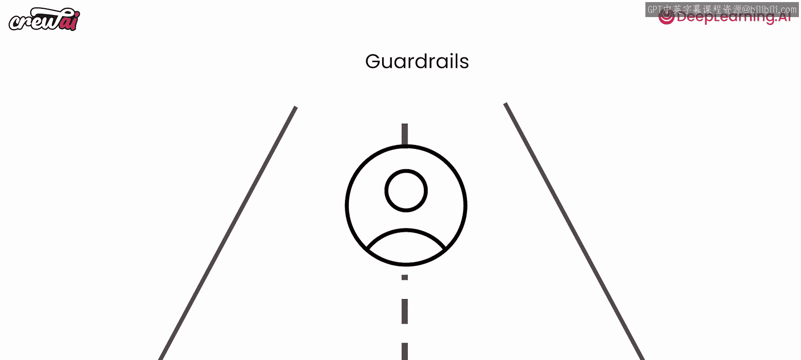

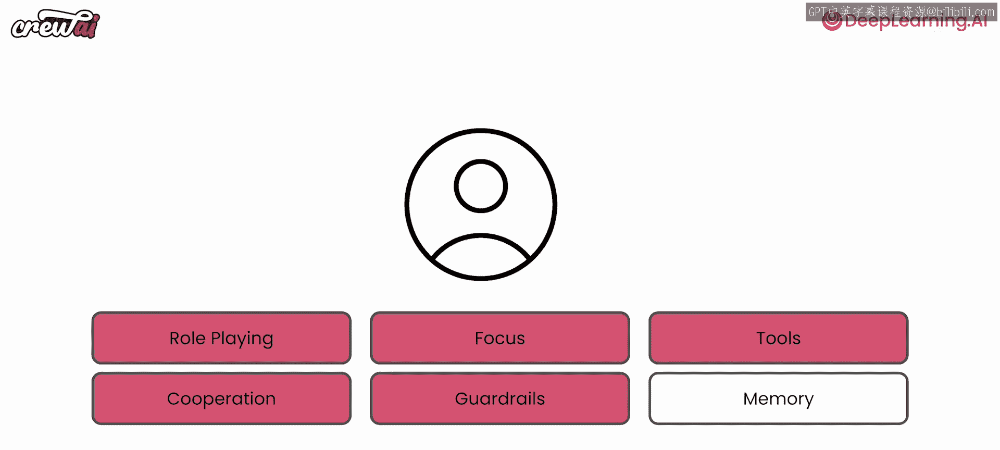

Ex some framework will offer different types of memory and different types of implementations for it in the case of crew AI because we are using this our agents will get three types of memory for free out of the box longter memory。

 short term memory and entity memory short term memory is a memory that leaves only during the crew execution every time that you run a crew and you kick it off it starts from the blank this memory is useful because as different agent try to accomplish different tasks they store different things that they learn in this memory and this memory is shared across all the agents meaning that an agent number two or an agent number three can tap into learnings from agent number one so the shortterm memory。

 something that helps to shared context during the crew execution so that you get better outcomes Now let's talk about long-ter memory。

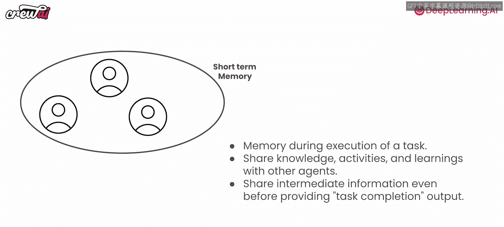

As the name suggests， long-ter memory leaves even after the crew finishes so that memory is stored in a database locally and that allows your agents to learn from previous executions so every time that your agent completes a task it selfciques itself to learn while it should have done better or what are the things that should be there that are not and it stored that information so that it can tap back into that when it's running once again and then use this knowledge to produce better and more reliable outcomes the entity memory plays a role in here as well as it's also shortleve it so it's only needed during the execution it stores what are the subjects that are being discussed so if your agents trying to learn something about a specific company it might store that company as an entity and its understanding of this。

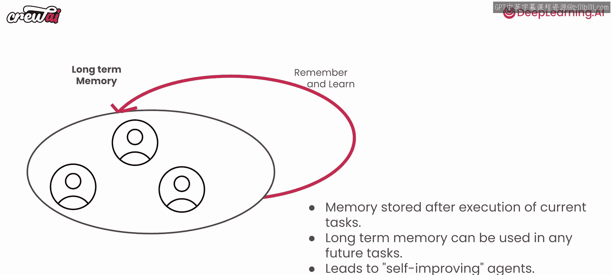

In this database as wellSo together entity short and longterm memory plays a role on helping our agents to get more reliable outcomes If your agents didn't have a memory。

 you would probably get as slightly different results every time that you run them。

 but because they do， you not only get more reliable ones。

 but you also get increasingly better ones because they learned from their mistakes。

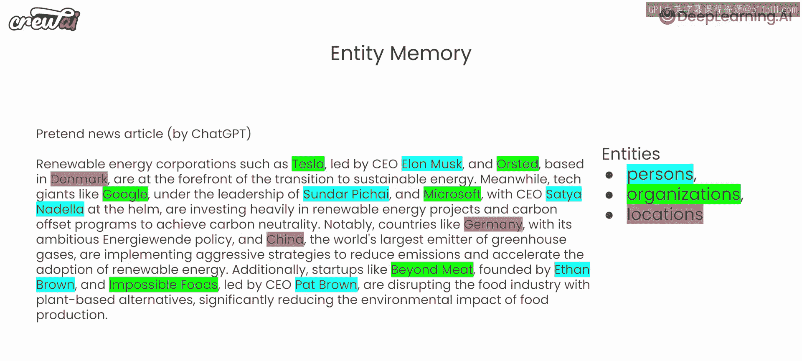