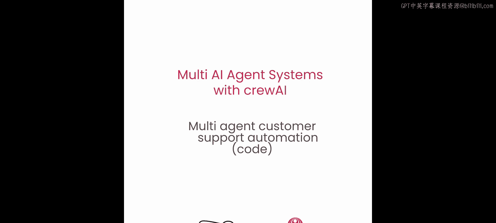
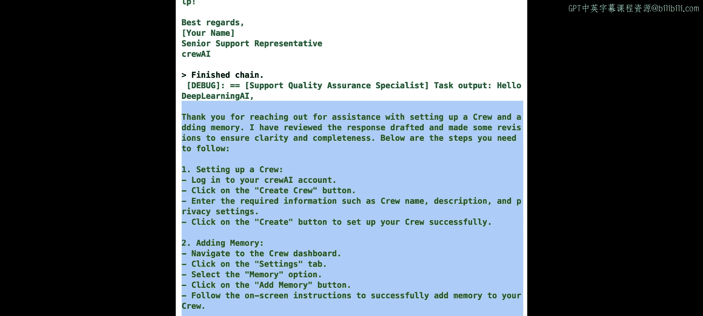
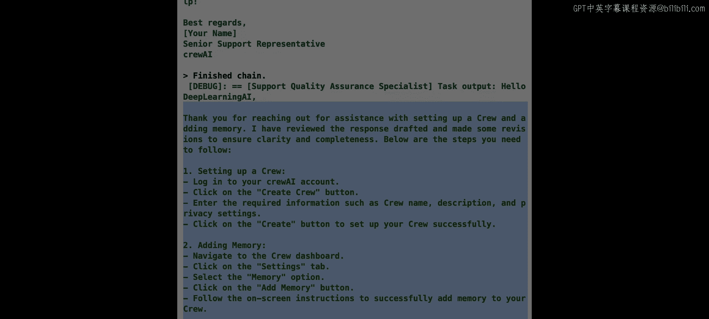

# 吴恩达《使用 crewAI 的多人工智能代理系统｜Multi AI Agent Systems with crewAI》中英字幕【短课英文均可关闭／拖拽】 - P6：6.L3 Multi-agent Customer Support Automation.zh - GPT中英字幕课程资源 - BV1GZ42147am

Okay， by now， you're starting to notice， you're seeing how these things are coming together， right。

 you can see how you can build these agents and how they work and how can they be super helpful。

 So let's start to expand on that。 Let's start to think about what other use cases。

 What else can bebu in this lesson we're going to be using moy agent system to help with customer support automation。

 So it's a different use case， but a very interesting one。 Stick around。

 I'm sure that they're gonna to like this one。 Let's dive into it。😊。

Alright， welcome to this lesson。 I'm super excited about this one because we're gonna to be talking about how to use moy agents for customer support automation。

 and that is such a big use case。 If you think about customer support feels like a no brainer to have AI agents to help our customers to have just a better service and being able to tap into all of the docs knowledges and help center in order to provide very meaningful answers to these people that are trying to use customer support。

 Let's try to do some code and see how that works。 again。

 I'm going to start just doing some boilerplate code to make sure that warningase doesn't get in way and I'm also going to import the same components that we learn on the last lesson where we bring the agent the task and the crew classes into this。

 For this example， we are going be using GT3。5 Trubo once again。

 So let's go ahead and set that environment variable。😊，Alright。

 so now let's dive into agents and how we can make them great。

 how we can bring everything that we learned into the slides into actually creating these agents。

 So window that agents are impacted by the role playing the focus， the corporation。

 the tools the guard rails and the memories。 All right so for these use case。

 we are going to be building a support mo agent system the go is going be to help supporting customers that might have in about a product。

 So the first agent that we are going to create is a support agent。

 So the support agent should be straightforward， you can see here that the role is a senior support representative。

 you can see how we use the keyword senior here again。

 to imply that we expect answers they are a little bit more polish it than what you would mostly get out of the box for the go we also mentioned that the goal is to be super friendly and helpful So that will also。

😊，Play a piece on every step on the process。 and for the backstory we tell this agent works at crew AI and theyre helping a specific customer。

 you can see the interpolation happening here again。

 trying to answer a specific question but that agent alone is not going to help us。

 we're going need another agent as well。 So this other agent is going be a support quality assurance agent。

 So let me copy that and paste it here。 So this agent exists to help the support agent by fact checking everything that it says and making sure that is the best response possible for this customer。

 All right so now we have both our support agent in our support QA agent。

 So far we can see how we're doing very focused approach here where we are prompt to the agent to be very much getting into character of their role。

 You can also see how one agent is not allowed to do any delegation because were。

allow delegation to false， but we are not doing that for the support quality assurance agent That means that this agent can delegate work back to the original support agent if it decides to so this is an important trait for your QA agents make sure that if they find something that doesn't fuse Ryan they don't necessarily need to fix themselves but they can actually delegate it back to another agent that might be better suited to do it because either has like the right set of tools or the right set of backstory goals and roles so you might be wondering when exactly an agent decides that's reasonable to delegate work to another or to ask question to another。

And this is some of the differences between regular engineering and AI engineering AI applications again。

 they have fuzzy inputs， fuzzy transformations and fuzzy outputs。

 meaning that they don't necessarily follow the same pattern all the time。

 So in this case we are relying on the brains， the LLMs to make a conscious reasonable call on when to delegate and when not to delegate how that goes back to the fact that these models have a level of cognition because they understand language。

 so depending on the customer inquiry， they might understand that it's worth delegatelegating and to do more research。

 but if it's more simple inquiry that demands a simpler answer。

 you might not want to delegate it back so this is not something that you necessarily will have full controloff but you don't really want to that's the magic of AI apps。

IsThe ability for these apps to react on runtime on how they're going to handle with the information that they're being handled that so make sure to keep that in mind that allowing an agent to delegate work and ask questions don't necessarily imply that it's going to do it every time but that instead we give it the option to do so if it could chooses to so this is one way on how you can get your agent to collaborate together in a great example on how collaboration helps with better quality responses So this is a very common pattern that we see throughout many users on Q AI usually having a final agent that is kind of like a quality assurance agents helps a lot and go a long way because they can do a final pass on whatever you want to do writing a blog post entering a customer whatever it might be so I do recommend you considering adding a QA agent。

sorts into whatever mochiag systems that you do and that does tends to perform better than regular regular agents without it。

 so far this is a great example of rowplan focus and cooperation Allright so now let's move on and talk about tools guardras and memory for that we're going to be using crew AI tools So query AI also has a tools package with a set of tools that you can use。

 They have simple ones like the ones that allow you to search the internet to more complex ones that allow you to do full rag over Github if you want to or websites There's many that you can explore but we're going stick with some of the simpler ones in here。

 we're going to use the Surper dev2 we're going use the scrappe website tool and we're going to use the website search tool Surper dev2 basically integrates with Sper。

It's an external service that allows you to search Google Scpe website is a simple scraper that allows your agent to access a given URL and extract the contents of that in the website search tool is actually doing rag over a website if you don't know what rag means is doing a semantic search over the content off that website So in here you can see that we are importing the query AI tools package and then these three classes from it so let's go ahead and run that So this is a great place where you can also think about other tools so we're not gonna talk about creating our custom tools right now but this is a place where you could bring like tools that load customer data that tap into previous conversations or that load data from a CRM checking existing bugs feature requests or ongoing tickets How useful tools that would help this agents to。

Provide better answers to the customer inquiry so you can see here on how you should be thinking about what tools you should provide to your agents in order for them to provide meaningful responses。

 All right So for every create AI too there is a few different ways that you can use it。

 let's say that we want to use the Surper dev2。 This is the only thing that we would need to do create an instance of the Surer dev to and we assign that into a variable and we should be able to use that。

 we can also do the same thing for the scrap website to where we create an instance of that。

 and now we have that tool and we can assign that to an agent or to a task。

 but another interesting feature of C AI is that you can also be more specific about how you want this tools to be used it。

 So let's say that in this case， I want my agents to only search the crew AI docs So I don't want it to be able to scrap。

Any website out there， but I wanted to scrape specifically one single page off our documentation so I can actually do it when I instantiate this scrape website to I can set an optional argument called website URL and in that URL I can set a specific URL that I want this to to be able to scrape so here is a great use case where you can see that you use the same two but one two would allow your agent to scrape any URL that becomes aware of as long as the agent themes that scraping that URL would be beneficial the second one allows your agent only to scrape one certain URL and not every URL that it finds so you can see how this can be very versatile as you're building your agents For now let's focus only on our docs search to and you see what。

Agents can do with that。Alright， so now we already understand how we can bring tools into this。

 so how we assign those two， how we give our agents those tools there are basically two different ways that you can give your agent tools you can give them at the agent level or you can give them at the task level what that means is that if you give your agent a two that tool belongs to the agent it can potentially use that two for any task that it performed but if you give it to the task that means that the agent will only use that data tool when performing that specific task so an easier way to put this is that task tools overrite the agent tools so an agent might have 10 tools at his disposal but when performing a given task if that task only says that it has three tools at his disposal then the agent will only use those three tools so let's start by creating or first。

The first task that we are going do is the inquiry resolution task so in here you can see that we are playing even more with the interpolation where we are saying hey。

 this customer just reach out with a super super important ask Here's the inquiry the person that works that this customer is the one that reach it out。

 make sure to use everything that you know to provide the best support possible you must strive to provide a complete answer so you can see here how this looks like more regular prompting。

 but we are using that interpolation in a lot of different ways and then again we come with an expected output with very clear instructions on what we want to get back from this agent and we provide the tools in here So the tools is just an argument within the task and it's an array that include all the tools that you want to be available when the agent performed this task In this case it's only one to or。

Doocks scrape to。 So let's go ahead and create this task。

 Now we're going create our new task that is going be the task that the QA agent will use in order to review the work that the support agent did。

 So it's a similar task that doesn't use interpolation。 but rechecks what the agent viewed。

 you can see that in this case， this task has no tools at this disposal。

 meaning that the QA agent when performing this task won't be able to look at our docs。

 it's poorly assessing what is the actual response that the support agent wrote。 Allright。

 so now we got our two tasks that were created。 That's great。

 so let's put our crew together create our crew and in this crew we're going to bring our two agent。

 the support agent and the support quality assurance agent and also the two tasks。

Inquiry resolution and quality assurancesance review task and also you notice that we're using memory for this one So using memory with crew AI it's super easy。

 you don't have to worry about it you don't have to think about it too much you can set this one single attribute on your crew and that enables out those memories for you the shortter memory。

 the long-term memory and the entity memory so you don't have to configure anything other than set this one flag and everything works out the box so let's now focus on executing the screw so that we can actually get some results from it。

 in order to execute the screw we need to pass inputs to it we need to overrite all those interpolations that we did in the tasks in in the agent's definitions so in this case we had three main interpolation variables we had the customer。

 the person and the inquiry。Here we're saying that the customer is deep learning AI the person that is asking the question is Andrew the inquiry is it needs help setting up a crew and kicking it off and when I make sure that it's using memory to set up that a crew can the agents provide some guidance and actually help Andrew with that let's see how our agents do in trying to help Andrew so from the gago you can see that or senior support representative is kind of like kicking things off it's hard to look into the issue that Andrew brought up you can see here the interpolation play its part where deep learning AI it's kind of like popping up in the task so we can see that the agent now decide to read the website content and it's actually looking into the documentation that we provided it with so with the access to that documentation it's learning everything about crew AI and how to create this agent。

how to create the crews and how to kick it off and then it comes up with an answer in this answer you can see that's super polite It say hey hey dear Andrew。

 thank you for reaching out for assistance and then goes on into explaining how to install both crew AI crew AI tools how to create the agents and then how to create the crew with the memory and everything with an end you can see that once that this work is done we now have our next agent the support QA specialist kicks off to make sure that this is the best answer possible so in here you can see that it then really likes some of the responses so decides to delegate the work back to the coer asks us to review and revise the response to ensure that it's comprehensive accurate and friendly so now if rewrites being a little bit more friendly on the response you can see that it's more direct is basic。

s like this is how you set our crew and this is how you add memory because those were the specific topics that And originally asked for。

 So you can see here how the answer looks way better。

 and now we should be able to get back to Android with that you can see that the agent still is not super fan of that So we decides to ask a question to the co again to confirm if those are all the steps to create a crew and to add memory and if there' is nothing that is missing in there。

 So this agent kind of gives like more information around anything that might be helpful And after that it puts together a final answer and the final answer says how deep learning AI Thank you for reaching out for assistance in setting up a crew in adding memory I have view the response rapid and made some revisions to ensure clarity and completeness below is the steps that you need to follow and then goes on with the steps to create the crew and to add memory to that So now this is something that we。

act send out back to Andrew make sure that it has all the information that it needs and there we go we created a new agent system that is now capable of collaborated so two agents are delegating and asking questions to each other they are using memory so they remember what they are doing as they are doing and they are very much going into their roles by using rolling playing so you can see how those elements that we talked about in our slides being played at here at real time so let's go back at our slides real quick。

