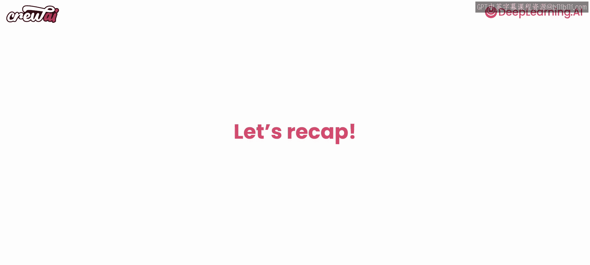
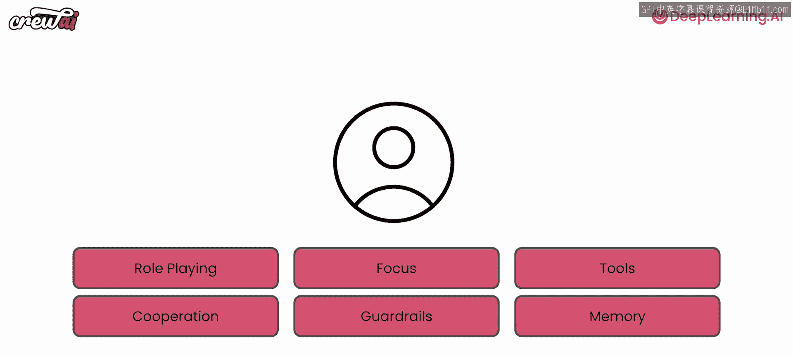
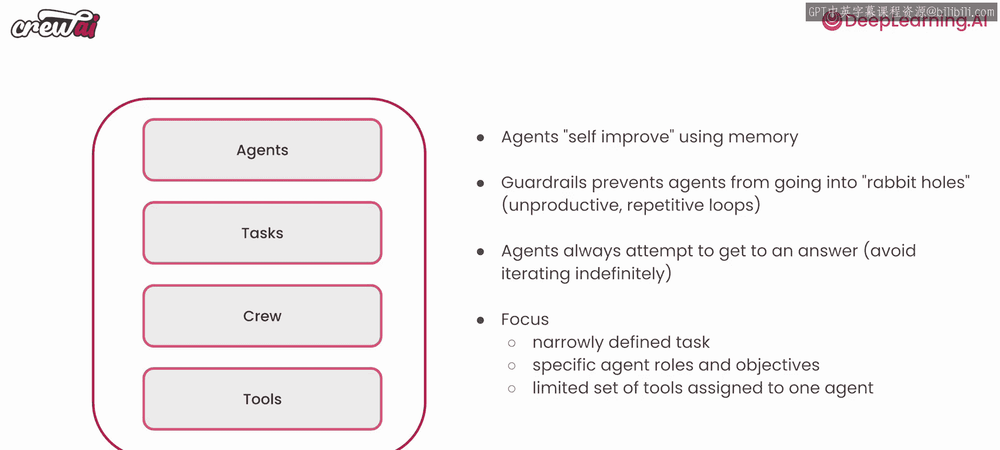

# 吴恩达《使用 crewAI 的多人工智能代理系统｜Multi AI Agent Systems with crewAI》中英字幕【短课英文均可关闭／拖拽】 - P7：7.mental framework for agent creation.zh - GPT中英字幕课程资源 - BV1GZ42147am

So I want to share Men framework with you for the agent creation。

 I think it's super helpful because if you look at the agents that we put together right now。

 it work at great， but what about when you decide to put together other agents and other moy agent systems how do you make sure that you're creating agents that are the best thing they could be so I have a mental framework that I like to share and I think will be super helpful to you so the framework is to think as a manager honestly there is a very high correlation between being a good manager and being able to create great moy agent systems because managers are conditionally to think about what is the goal and what is the process so whenever you're creating your multiple agents crews or your mo agent systems I would say think about exactly what is the goal that you're trying to accomplish and then what is the process that you're trying them to follow if you think like that you're going to then start to think。

About what are the people I would hire to get this job done so that's the thing you want to be asking yourself if I had to hire people to do this。

 what would be the people that I would hire so once that you get that answer you may know what agency need to be and more than that you're gonna know exactly what should be their roles what should be their backsties。

 what should be their goals because you know who would you want to be working on these things so let's talk about some examples。

These are some examples that are not necessarily the best。Like if you want to create， for example。

 a use case related to HR， you don't want necessarily only a researcher。

 you want an HR specialist and that plays across all the examples that were gonna to see throughout this course so better examples would be an HR research specialist instead of just a researcher or a senior compwriter instead of just a writer or proven analyst instead of a financial analyst so I would recommend you to really think about what are the keywords what are the actual people that you would hire to do this and then once that you have those people in mind。

 think about what would be their goals， what would be their roles， what would be their backstories。

 those are the agents that you want to builded and in the community that uses for AI we noticed that the people that get the best results are the people that really think about agents in that way。

 they think about what would be the people that they would hire to do。job for them。 Allright。

 let's do a quick recap to see everything that we learned this lesson。 First thing。

 we learned that agents do a better job if they have a few things they are doing roleplay。

 they have focus， They have the appropriate tools。 Theyre allowed to cooperate。

 they have some guardrails and they also can leverage memory。 All right。

 we also learn some other stuff。 We learned that agents are able to selfimp by using memory。

 We also learned that crew AI prevents our agents to get into rabbit roles by making sure to rest steer them in the right ways。

 We also learned that agents we always attempt to get you an answer and we also learn that smaller tasks and focus agents perform better than bigger tasks and agents that have too much on their hands。

 Also focus tools plays a huge role on that。 And we're gonna be talking about tools next。

 So thank you so much for sticking around。😊。

For this lesson honestly it has been incredible to go over this with you I hope you're having as much fun as I am and stick around for the next one it's gonna be super fun we're going to start talking about toolss and guess what twos is what unlocks a lot of the fun use cases so I see you in the next lesson。

