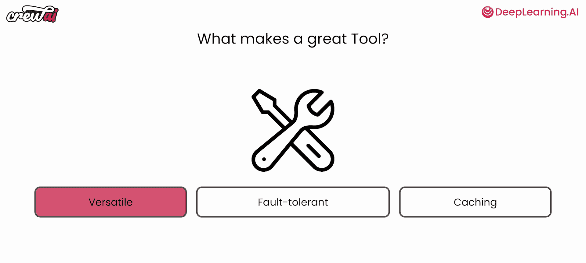
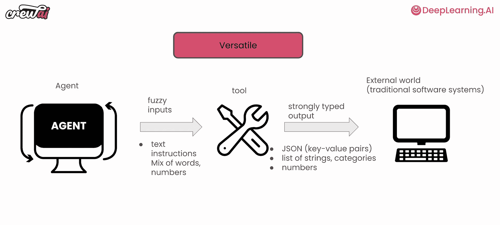
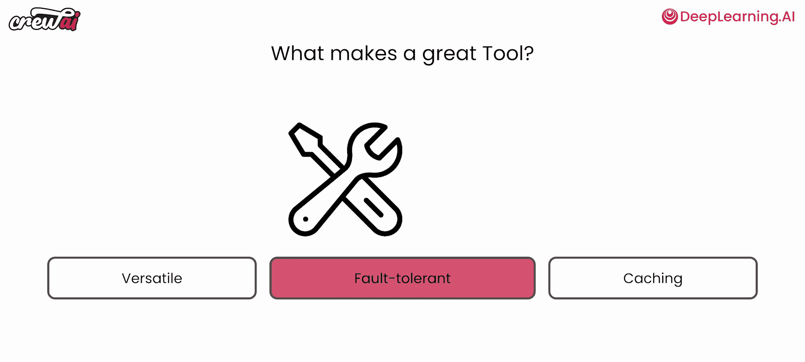
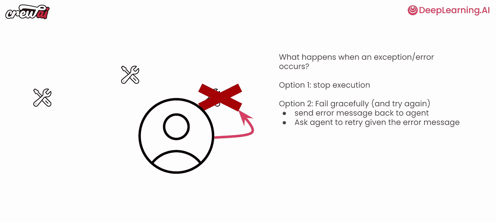
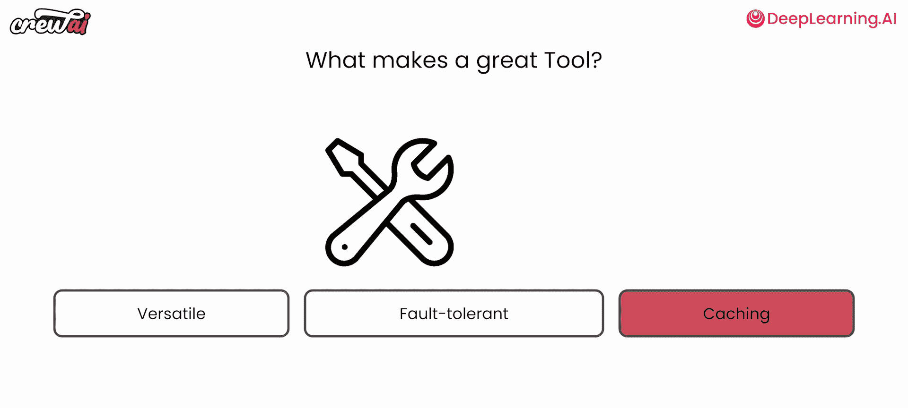
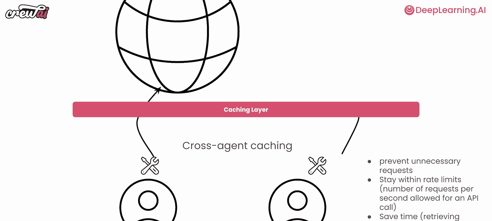
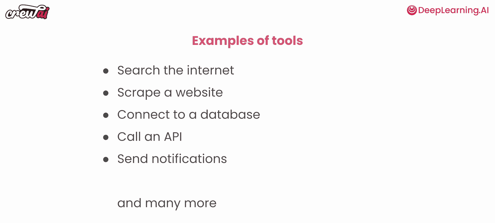
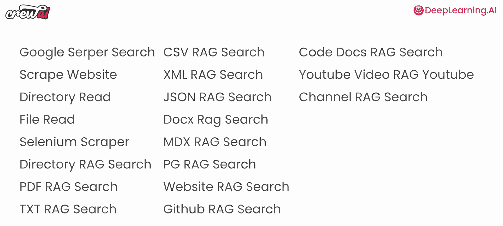
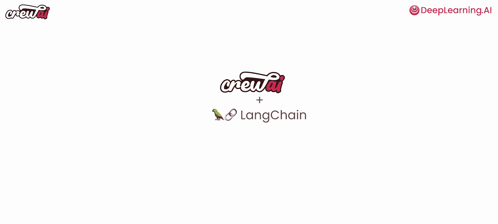

# 吴恩达《使用 crewAI 的多人工智能代理系统｜Multi AI Agent Systems with crewAI》中英字幕【短课英文均可关闭／拖拽】 - P8：7.key elements of agent tools - GPT中英字幕课程资源 - BV1GZ42147am

好吧，那是什么？我们刚刚为支持构建了一个超级有趣的团队。但事情可以变得更加有趣。在这节课上，我们将使用工具来构建一个客户拓展活动。这将非常有趣，因为销售是多智能体系统非常常见的用例。

那么让我们快速了解一下。欢迎回到我们的新课。我们正在谈论工具。工具是克鲁 AI 以及任何多智能体系统中非常重要的一部，分。工具是让你的智能体与外部世界沟通，走出仅仅相互聊天，的泡沫，实际执行行动。

对你的流程、系统、用户和公司产，生实际影响。所以这是让智能体变得出色的超级关键部分。那么什么使一个好工具？什么使一个工具与另一个工具区分开来？嗯，我们从使用克鲁 AI 的许多用户那里发现，至少有三件。

事使一个工具与其他工具区分开来。多功能的工具、容错的工具和实现缓存的工具。我们现在就来谈谈这些话题。那么对于一个工具来说，多功能意味着什么？

嗯，首先，一个工具需要能够接受不同类型的请求。工具是具有模糊输入的 AI 应用程序与具有强类型输入的，外部世界之间的连接。所以你的工具需要足够多功能，以便它能够处理大型语言。

模型可能向它们抛出的不同事物。所以克鲁 AI 支持将这些参数转换为正确的类型，并且它，们可以处理来自你的智能体的不同细微差别。但如果你自己在构建一个工具，你想要确保无论大型语言。

模型以何种方式向你发送信息，你都要妥善处理它。你想要将其转换为适当的类型，这样你才能实际使用它。

所以制作一个出色工具的一个重要部分是确保它是多功能，的。它可以处理不同类型的输入。

第二件事是要有容错性。这是很多早期使用人工智能智能体的人意识到的一件事，当你的智能体将信息传递给你的工具时，事情可能会出错，你会得到异常。如果你莫名其妙地得到异常，而你没有正确处理它们，你就。

会在那里停止你的团队，因为这会停止执行。而你不想这样做。所以你想要确保你的工具能够优雅地失败。这样万一出了问题，它们可以自我修复。团队人工智能实际上默认就为你实现了这一点。

所以即使在运行一个工具时出现异常，而不是停止执行，它，会将该消息反馈给智能体，以便智能体可以对此采取行动，也许是输入的问题。也许智能体应该发送不同类型的输入。也许智能体遗漏了一个必填参数。

或者也许只是另一个问题。但重要的是你的工具应该能够自我修复，并且应该以一种，不会停止智能体执行的方式优雅地失败。这是我们在很多地方都看到的情况。当你大规模部署这些智能体时，尤其是在企业公司中，你的。

智能体将处理各种文件和各种文件及信息来源。所以你要确保这些工具能够处理所有这些情况，并且能够，处理看到它们意料之外的东西的时候。实际上，我们在一些最大的用户那里看到过这种情况，他们。

在分析大量的金融文件。有时数字可能不是最容易读取的，或者文本可能不是最容，易解析的。那很遗憾。你要确保你的工具能在这方面稍微发挥点作用。

好的。所以你有一个多功能的工具，还有一个容错的工具。这意味着你完成了很多这样的工作。那缓存呢？缓存是让这些工具在现实世界中有价值且可用的关键。

无论何时你有一个工具，大多数时候这个工具被用来与网，络通信。所以它会调用不同的应用程序编程接口。它会调用不同的服务。有时会是内部服务。其他的会是外部服务。每当那个调用发生时。

你要确保你在考虑花时间去做请求，并且除非必要否则不做请求。所以有一个防止不必要请求发生的缓存层对于确保你在构，建最优团队至关重要。所以你要确保你不仅有缓存，而且有一个智能缓存。所以在克鲁 AI 中。

我们提供跨代理缓存。这意味着如果一个代理试图使用具有给定参数集的工具，而另一个代理试图使用相同的工具和相同的参数集，即使，它们是不同的代理，它们实际上也会使用一个缓存层。所以第二次他们尝试使用工具时。

就不会进行那个应用程，序编程接口调用了。这就有很大的不同。这可以防止不必要的请求。这可以避免达到速率限制、不必要的消耗，还能节省执行，时间，确保你的机组和你的多智能体系统运行得更快。

所以在你构建需要大规模运行的机组时，缓存超级重要。

工具的一些例子是什么呢？嗯，有一堆我们可以谈论。有像在互联网上搜索或抓取网站这样简单的。我们实际自己用过的工具。但不止于此。你还可以连接到数据库。你可以调用应用程序编程接口。你可以发送通知。

还有很多很多。所以你可以在这里看到工具是多么重要的基石。在所有的框架中都是如此，包括 Crew。AI。

所以在 Crew。AI 中，工具是非常重要的一部分，Crew 一开，始就提供了一堆你可以使用的工具。所以在未来你有时间构建自己的工具时，一定要查看 。

Crew。AI 的文档，在那里你会找到所有现有的工具的文档，还有，另一件需要强调的重要事情是，Crew。AI 支持所有 ，LinkChain 工具。所以 LinkChain 也提供了大量现有的工具。

你可以马上用它们与你的机组一起使用 Crew。AI。所以只是另一件要强调的事情。但这就够了。

