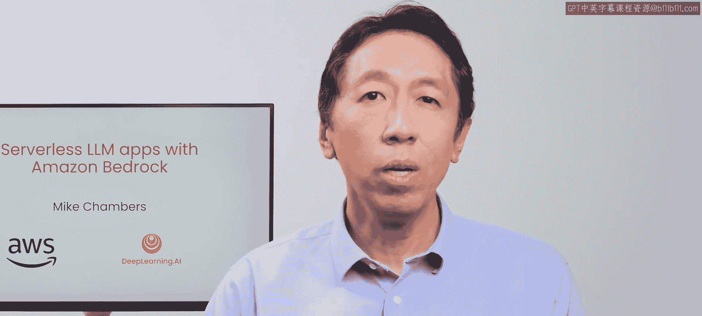
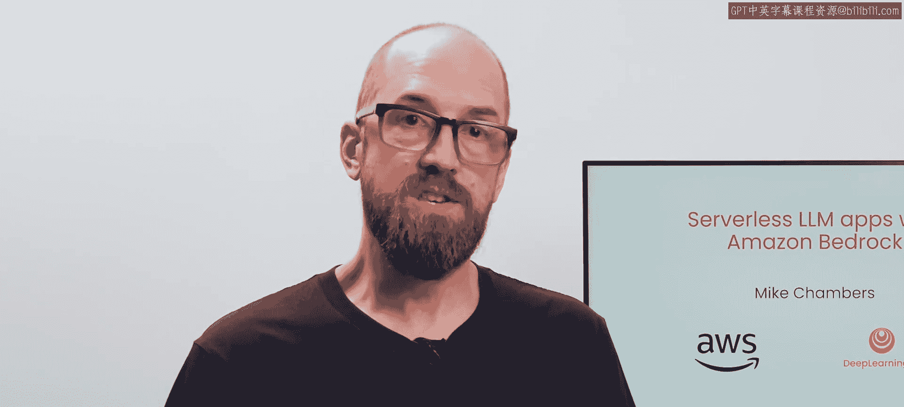
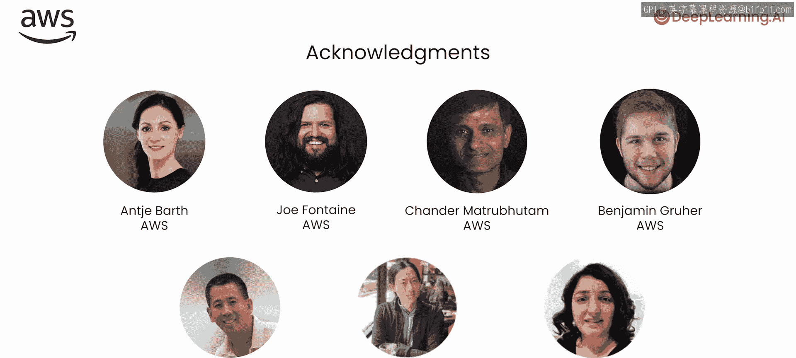

# 吴恩达《使用Amazon Bedrock构建无服务器LLM应用程序｜Serverless LLM apps with Amazon Bedrock》中英字幕 - P1：L0.introduction.zh - GPT中英字幕课程资源 - BV1X1421Z7w9

Hi and welcome to this short course on serverless OOM apps with Amazon Brock built in partnership with AWS and taught by Mike Chambers。

 Thanks， Andrew， it's great to be here。 Let's say you're working into prototype an OOM based service to help a customer service departments to summarize its customer phone calls。

😊，This is actually a real application and a common use case that many companies have been working on。

When building the initial prototype， you might manually download an audio recording of a call that's been recorded with permission。

 then run automatic speech recognition or ASR software to transscribe it to a text file。

 and then send that text to an LOM to summarize it and finally store that summary in the searchable database。

But there's a lot of work to manually connect all these steps together。

 And this is also a repetitive process that you might want to automate so as have your software be automatically triggered to run whenever a new customer service call comes in。

 This is as opposed to constantly rerunning your code by hand each time a new call comes in。

To connect AI services like ASR to your own application and also to automate this workflow。

 you can use event- drivenriven triggers that will run the workflow whenever new audio files get uploaded and deploy this entire workflow so that it runs on its own That's right In this course you'll connect an LLM to other AI services In this case automatic speech recognition to enable the LLM to process data that isn't already text such as audio recordings of dialogues between customers and your customer service representatives and you'll deploy this with a serverless architecture as opposed to a traditional server-based architecture Usually you'd have to do a lot of work beyond building the app to deploy and maintain the app like spinning up machines and installing dependencies Then there's even more work with the ongoing maintenance of that system adding security patches。

 updating the dependencies and so on。😊。

By starting off with a serverless architecture， you can save yourself a lot of time and effort as you iterate on your app。

😊，You'll use Amazon Brock which gives you access to a wide range of foundation models and also the ASR service Amazon transcribe you'll connect these services into a workflow that triggers an LLM via AWS Lambda to automatically run once new files are uploaded to the cloud storage service S3 the audio sumization use cases just one example but you will use the tools and concepts into course integrate your LM with other AI services into a pipeline they can essentially run onzone as input data comes in Many people have worked to make this course possible I'd like to thank on the AWS site Ana Baf。

 Joeill Fonine， Chandnda Matha Bruham and Benjamin Grwer。

And from Vcarium， who helped with the Jupiter Notes， David Lyin， finally， from Deepleer AI。

 Eddie Shu and Dila Eadine have also contributed to this course In the first lesson。

 you'll get started with prompting an LLM using Amazon bedrock and explore how it can be integrated with other AI services。

That sounds great， Let's go on to the next video and get started。

