# 吴恩达《使用Amazon Bedrock构建无服务器LLM应用程序｜Serverless LLM apps with Amazon Bedrock》中英字幕 - P2：L1_Your_first_generations_with_Amazon_Bedrock.zh - GPT中英字幕课程资源 - BV1X1421Z7w9

In this lesson， you'll use Amazon bedrock to prompt a model and customize how it generates its response。

 You'll also explore how you can integrate anLms with other services in order to build a data processing pipeline So let's jump in and our notebook environment already has access to the AWS services through the security configuration of this environment So we can just start writing code and start integrating with AWS services and Amazon bedrock。

 And the first thing that we need to do when we're working with Python and with Amazon is to import the SDK for Python。

 which is Boto3 So I'm going to import Boto3 and run that cell just to load the SDK and all of that necessary code in order to be able to work with AWS services。

 So let's go and use the Boto3 SDK to connect with Amazon bedrock and make our first generation So to do that we call on Boto3 and then we create a client object。

😊。

And that client object we give it the name of the service that we're looking to connect to。

 So in this case， it's going to be bedrock， but it's bedrock runtime。

 So I type in bedrock runtime Now there is a bedrock client as well and we'll look at that a little bit later on but the bedrock runtime client is the one that we need in order to be able to make generations and then we need to tell it the region that we want to use for this particular service so we do that by typing in region name and then we're going to give it the name of a region now we need to make sure that we're selecting a region which currently supports Amazon bedrock and that is a subset of all of the AWS regions in the world。

 So check the documentation to see which region you want to work with。

 but for this particular course and with everything that we do in this short course we're going to do it in US West and US West2 is the Oregon region and that fully supports Amazon bedrock but we just need to put that into a variable so let's put that into a bedrock。

Runtime。 So that's going to create our client object。 but let's just put that into a variable。

 So let's call it bedrock runtime and load that into there。 Now， if I run this cell。

 then the bedrock runtime client will be available to us right here。 So what can we do。

 How can we prompt Amazon bedrock。 Let's create a text prompt and then send that over to Amazon bedrock。

 So I'm just going to paste this in here， this is the prompt I'm going to use write a one sentence summary of Las Vegas。

 So just defining a text string there that's going to be the prompt that we send into a large language model and get it to make the generation off the back of this。

 So with that defined how do we send this then to the Amazon bedrock runtime end point。

 Well we need to create some keyword arguments that we're going to pass into the service。

 So let's just create ourselves little dictionary here and starts to build up all of the keyword arguments that we need to use。

 First of all， we need to set the model I So I can do this here。 I'm just going。

This in and we're going to choose the Amazon Titan text light V1 and we'll take a look at these in more detail a little later。

 but this is the model that we're going to use for now。 This is a large language model from Amazon。

 then we need to add in some other details to our keyword arguments So we want to put in the content type and the accept So the content type is the mind type of the data that we're going to send in the input in our request so we're going send a Jason structure and that is what the model is going to be expecting and then we can specify the mind type of the data that we're willing to receive back。

 Now by default， this will be application Jason as well In fact they'll both default to application Jason but I'm just going to say here that we're willing to accept anything that the model gives us back and that makes this code pretty portable so you could take this and work with it with other models if you wanted to Now the next thing that we need to do is we need to pass in a body or a body structure and this body is going to。

Include the prompt that we want to send。 Now， this is actually a Jason string that we need to put into here。

 And because we're working with Python。 and I don't want to write a Jason string by hand。

 I'm going to use the Jason library to do this。 And so I'm just going to hop back up to the top here and I'm going to also import Jason run that cell again。

 And now I can use Jason inside of my code。 So I'm going to say Jason and then dump that string。

 and we're going to put into here the contents that we want for our body。

 And so we can still sort of work in our dictionary format here。

 So let me just put in another dictionary here。 And all we need to put in here。

 and it's super simple for this particular first generation is that we're going to put in the input text and the prompt。

 So this is input text is our key and then we're going to put in the prompt which will just load in our single sentence prompt there write a one sentence summary of Las Vegas。

 And those are all of the keyword arguments that we want to pass into the bedrock runtime client。

 So let's。That up as some keyword arguments that we want。

 So I'm going to just load those into a value there， run this cell。

 And now I've got everything that I need。 So this is the magic line now that we're going to use to create our generation。

 So we're going to call on the bedrock runtime client。

 which is obviously the object that we created above。 And we're going to call。Invoke。Model。

And the invoke model it's all we need to do in order to pass those keyword arguments in。

 So let's go and pass those keyword arguments in。 We're going to put star star keyword as。

 and that's going to unpack all of these keyword arguments here into the input to the function。

 So we could， in principle， put all of this in here。

 But this just makes it a little bit easier to read by having it this way around。 again。

 that's all we need to do。 Let's go and load the response that we get back from that into a variable so that we can see it。

 And let's go ahead and run this。 So I'm just pressing shift enter on the cells to run them。

 I've just done that here。 and it's completed and it's returned。

 Let's have a look at the response that we get back。 So this will not actually be the text itself。

 but it's going to be a pointer to a streaming body response that has the data that we want。

 So we have to tap into this streaming body response。

 It's a fairly common thing that you'll see when working with the Bodo3 library and when you're interacting with those API endpoints from AWS is that you'll get this kind of streaming body。

Repon outputput。 so let's just write a small amount of code where we can unpack what this response looks like。

 So what we can do is we can work with the response object and we can get out of it the body。

 So we're going to grab the body which is I guess this part here and we're going to call read on that because we're going to read this Bo core response streaming body And so once we've got that out well we're going to end up with a Json structure。

 So we accepted anything。 but I will tell you right now it's going to be a Json structure that we're getting out of this。

 so let's wrap this in Jasonson load string。 So we can wrap that in that。

 and then let's actually just say that we want to store that then in our response body we're going to say response body equals all of this So we're loading out of this string So we're grabbing out of the response the body we're reading that body we're loading the Jason string and we're dumping that into this response body variable here。

 So let's run all of that and now we've got something we can actually take a look at So let's。

Lnk this into a cell and run this so we can see the output and yes， you can actually see it。

 And in there is the output text itself。 So there is Las Vegas is the 29th most populated city in the United States and just a little bit of information about Las Vegas So if I just format that a little nicer So I'm just going to dump that as a string out to the screen and put some indents in it so we can see it there we go So you can see here that we've got the input text token count So the number of tokens when it's tokenized the input string using the tokenizer for this particular titan large language model it's tokenized it and found nine tokens and we have our result here a result includes a token count of 27 and then the output text that we've got back from the model itself。

 Now this is really useful these token counts are really useful because the way that the model is charged when you're working on demand is token based So being able to see exactly what the tokenizer from the large language model is doing and how many token。

are in the request and how many tokens in the response is super useful We also have this the completion reason and at the moment it's saying completion reason finish and we'll come and have a look at that in a little bit more detail in a moment so if we just wanted to output just the output text of course then all we'd need to do is just run something like this so we can print the body response。

 we're going to dig into that and get the results。 the first result in the output text and if we do that then we get a clean sentence if you like。

 which is Las Vegas is the 29th most populated city in the United States and the most populated city in the state of Nevada。

 which I guess is a single sentence summary of Las Vegas I'd encourage you to pause the video and change the prompt to something else for example you could ask it to summarize a piece of text since later in a course that's what we'll be doing we'll be summarizing transcripts from audio recordings so we've jumped right in there and we've taken a look at。

Li bit in depth at how to make a generation with Amazon Brock using the Titan model。

 but there are more options when it comes to making this generation。

 So let's take a look at some of the generation configuration。

 So this time I'm going to put a prompt in of write a summary of Las Vegas。

 you notice this time I'm not saying a single sentence because I want to create a little bit more than just one sentence。

 So I run that cell。 And now I'm going to create some more keyword arguments。

 So let's go ahead and do， as we did before。 So I'm going to jump ahead a little bit here。

 and this time we're going to use the Titan text express version1。

 the light version that you saw earlier is the smallest and fastest model。

 the express version on the other hand is larger and can be better for more advanced use cases。

 So a couple of different Titan text models that we can use。

 we can talk more about these a bit later。 and the same content type and accept。

 And this time our body is going to be a little bit more involved。 So first of all， we're going to。

Ourselves up with the body。And get ourselves a dictionary to put in here。

 And in this case we're still going to do actually the J dumps。 So let me do this。

 So we're going to do the J dumps and let's just put some brackets in there and so the next thing that we're going to put in here In fact the data structure we're going to put in is called text generation config and this is going to allow us to add in some extra configuration details that you'll probably expect if you've worked with large language models to influence the way that the large language model will generate text So the first one that we're going to put in here is a maximum token count。

 So if I just put that in here so max token count 100 So this is the maximum number of tokens that we'll get back from the generation So it's not necessarily the exact number will get back but it's the maximum number So it's a way of limiting the generation that we're going to get back So the next thing that we're going to add in is temperature and so temperature influences how creative the output's going to be basically by constraining。

That random number generator， which is on the output of the large language model。

 And so we have that set here to a pretty typical 0。

7 and that's absolutely something that you can play around with depending on the type of generation you're doing and then the last one that I'm just gonna put in here is top P we're gonna have a top p of 0。

9 and again this is a way of constraining the number of options that the large language model has when it's choosing what the next tokens going to be as it iterates through and we're not going go into these kinds of settings in a great deal of detail in this short course if you want to know more about this kind of thing then look for the generative AI withms in the specialization course is on deep learning AI where myself and my colleagues went through all of this in a lot more detail So that's how we can pass in some of the configuration options there are more that you can add in here as well but this is a typical set of configuration that you'd send in for the Titan text express model So let's do the same things we did before let's make sure that they are loaded into。

Variable so we're going to call it keyword arguments or quags and then we're going to go and generate a response back。

 So let me do that here and I'm just going to paste in all of this in one go。

 This is exactly the same code as we looked at earlier in the notebook So we've got our response is going to come back we're calling bedrock runtime invoke model we're passing in all of those keyword arguments。

 then we're getting our response body out from the response that we get back by calling read on the body and then getting out of that the Jason data from the Jason string that we get back from the model and then we can see what that generation is going to be just by dipping straight into that and getting down to the output text and then we're just going to print that out so we're just basically shortcut all of the steps that we took before So I just run that and when we do we get this back Now this time again we asked for a summary of Las Vegas not a single sentence and so it's giving us a little bit more information about Las Vegas but notice something here it's actually kind of stop。

Mid sentence， as far as I can see there。 So let's go and see how we would be able to tell that。

 I mean it looks like it to me like it's finished mids。 But if we just get the actual raw data out。

 so we're going to look at the response body。 but rather than drilling into the output text specifically'm just going to take a look at the whole thing。

 So again， we looked at this before。 And you'll notice now the completion reason is set to length。

 And that means that the model has finished generating because it's hit the maximum token count。

 And you can see here we've got a token count on the output of 100。

 if you noticed that when we actually set the maximum token count。

 we set it to 100 So it's done that。 it's predicted all the tokens。 it's got to 100。

 and it's stopped because that's what we asked it to do。

 And so we've missed out some of the end of what it would like to have generated for us。

 So we can fix that up by going back up to here and maybe just giving it plenty more tokens to play with。

 Let's say 500。 I'll rerun this cell。

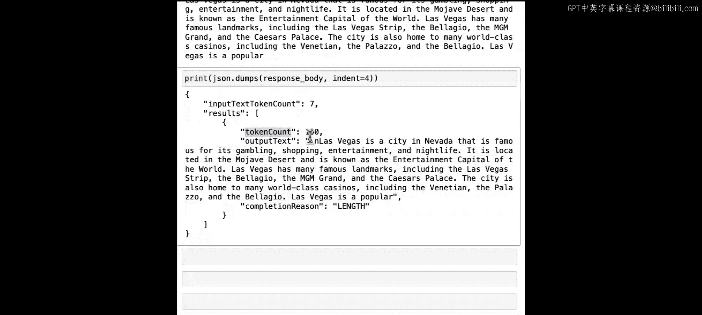

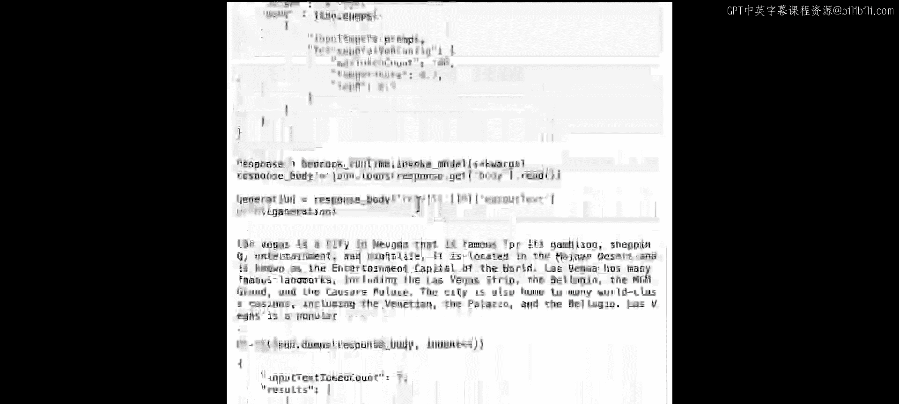

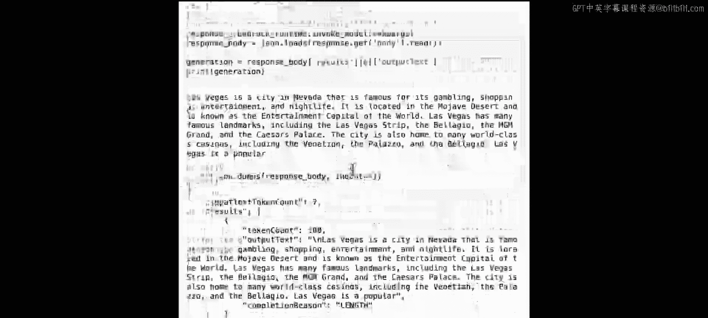

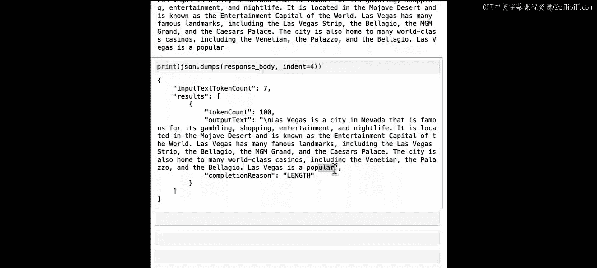

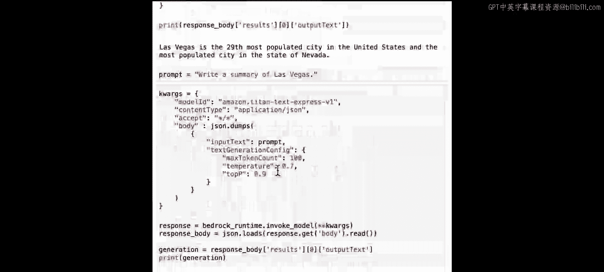

And then I'm going to rerun this cell and we should get a new response come back。

 In fact I'll rerun this cell as well。 So they'll both run one after the other。

 takes just a moment longer to generate more text but you can see now it's got plenty of space and it's finished with a full stop which means it's probably finished writing what it wanted to write So if we just look down here in the raw response body a completion reason this time is finish so it's actually gotten right to the end of what it wanted to generate and it did it in 304 tokens rather than the maximum of 500 which we gave it so that shows us how to make generations with the model inside of Amazon bedrock。

 It also shows us how to use some of the inference parameters or the generation configuration when we're prompting using the large language model and that's the basis which we need for most of the rest of the course and again before we move on from this point why not pause the。

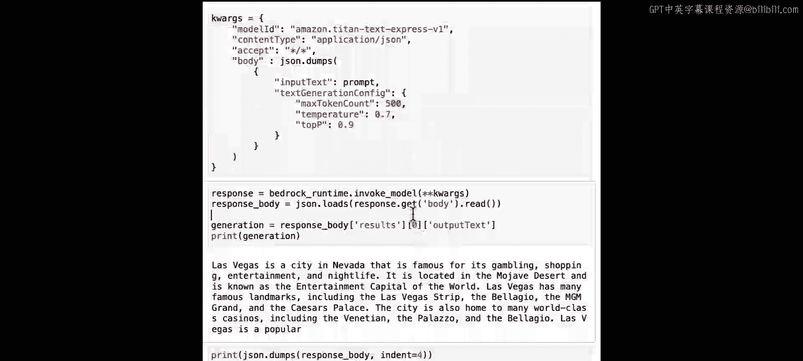

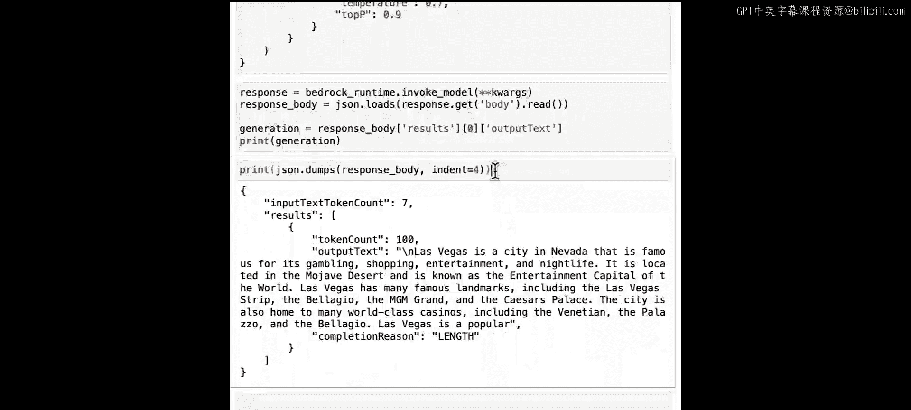

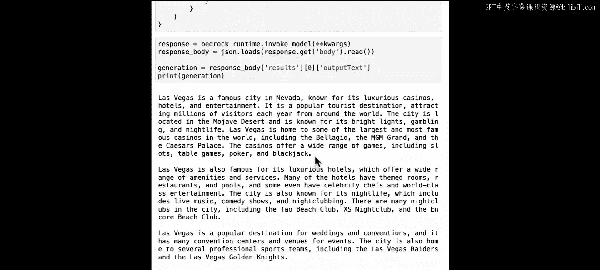

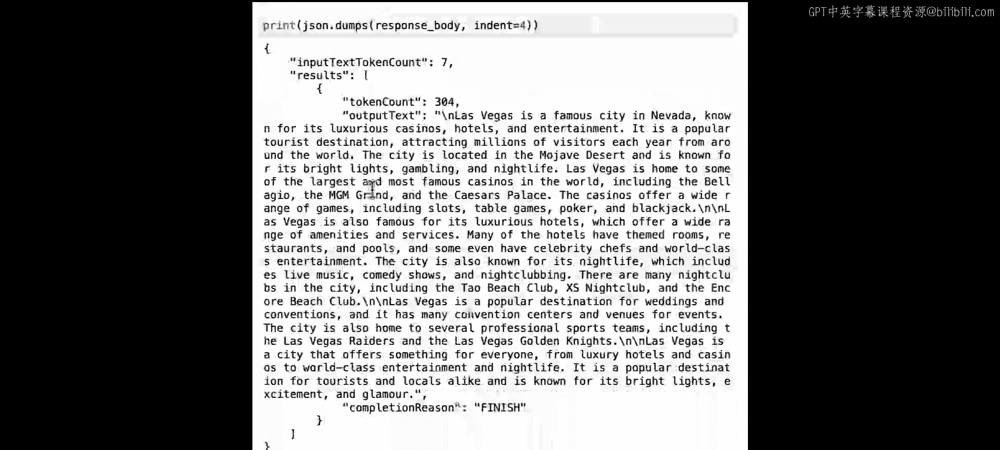

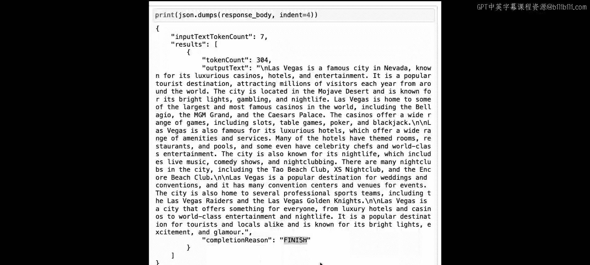

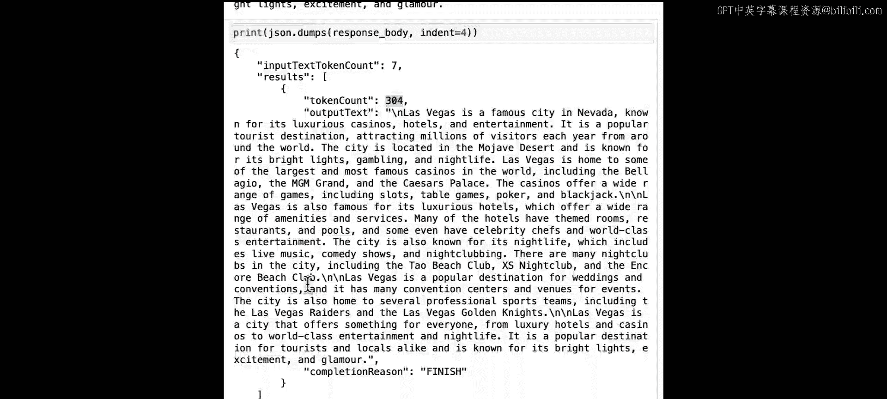

an experiment around with this。 You can change some of this code。 If it breaks。

 you can always put it back where it was just by getting the code out of the original source。

 So pause the video here。 I'll see you in a moment。

 What we are going to look at though is integrating Amazon bedrock and those large language models with other data sources。

 So working with other bits and pieces of data。 So let's take a little bit of a preview about what that will look like。

 And what we're going to do here is work with audio files specifically the recording of a customer service。

 So I can play this audio back for you now inside of this notebook。

 So if I just import iython display import audio and this is just stuff for the Jupyter notebook。

 This is nothing more than that。 but this is going to allow us to play the audio file in the notebook itself and we have an audio file inside of this environment。

 So if I just paste this code into here。 So audio equals audio file name。

's dialmp3 which is the file name。

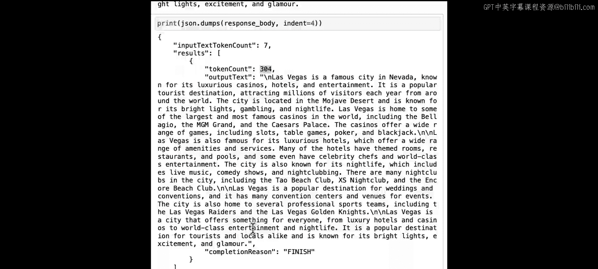

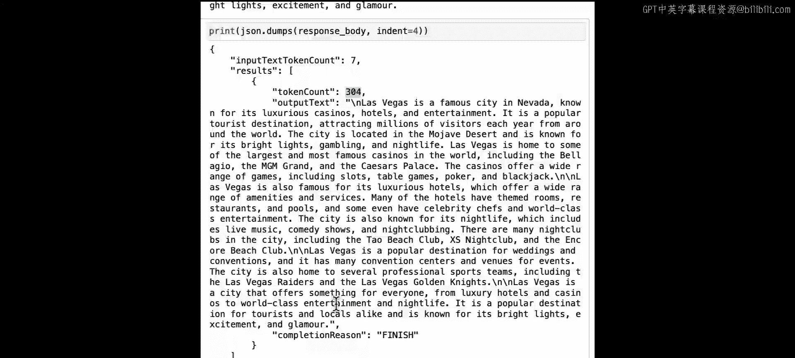

HaveAnd then if I call display audio， then it will show us a play widget inside of the notebook。

 So if I just run that， well there it is now I'm not going to play all of this audio file。

 you can do that in your own time， but let me just play the first 10 seconds。 Hi。

 is this the Crystal Heights Hotel in Singapore。Yes， it is。 Good afternoon。

 How may I assist you today。😊，Fantastic， good afternoon。 Okay， so you get the idea there。

 It's a customer service call between someone who's looking to book a hotel room and then the customer service representative from that hotel。

 So a very typical kind of conversation that you might record from a customer service center。

 and more importantly， there's a lot of data inside of there that we'd really like to be able to extract out and use and process and report on。

 So that's the kind of thing that we're going to look at here with the data processing pipeline。

 Now what we're going to do is we're going create a transcript from this audio file。

 and the transcript will end up looking something like this。

 So I'm just going to open up here a transcript do Txt。

 which is again on the file system of this notebook。 So if I just run this and well。

 let's print out the dial text。 then you can see probably what you'd imagine。

 but here is speaker0 high is this the Crystal Heights Hotel in Singapore。

 The file that we just listened to。 So this is a transcription。 So we're going to look at how we。😊。

Can create this transcription from this audio file and then we can take this transcription and we can pass it into a large language model and the way we start to do that is by doing some simple prompt engineering and we can look at a couple of different ways of doing that in this short course but here what I'm going to do is I'm just going to paste in this section of code here So this is setting ourselves up with a string we're using the python formatted string syntax here with triple quotes so that we can have a multiline string and we're saying here in this prompt the text between the transcript Xml tags is a transcript and then just have to scroll over of a conversation write a short summary of the conversation and then what we've done here is we've got transcript and then dialogue text and that dial text will get replaced with the actual dialogue that we have up above here because that's the name that we gave to this variable when we loaded it just out of the text file for the moment and then it finishes up by saying here is a summary of the conversation in the transcript。

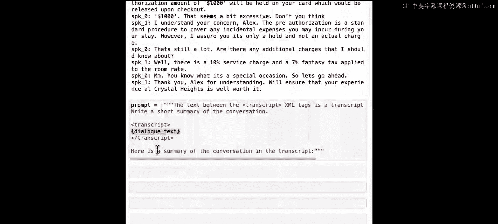

So basically giving the model， the large language model plenty of prompt space here to start to generate the summary for us or a summary of this particular conversation。

 So let's run this and then I can just quickly just print out this prompt。

 So if I just say print out prompt run that。 then you can see what you might imagine。

 So there is the template now filled out with the transcript between these Xml like tags。

 And this isn't necessarily something you have to do。

 but it's a way that you can indicate to the large language model that the data that's between these two tags is something which you've now essentially labeled。

 I've labeled it as the transcript of this conversation。 So if the conversation itself I don't know。

 starts to talk about transcript。 then it shouldn't get too confused about that and it should know that everything between these tags here is the transcript from the phone call itself。

 So it's a prompt engineering technique， let's just have a go with。

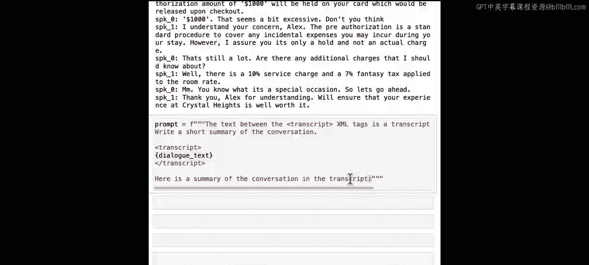

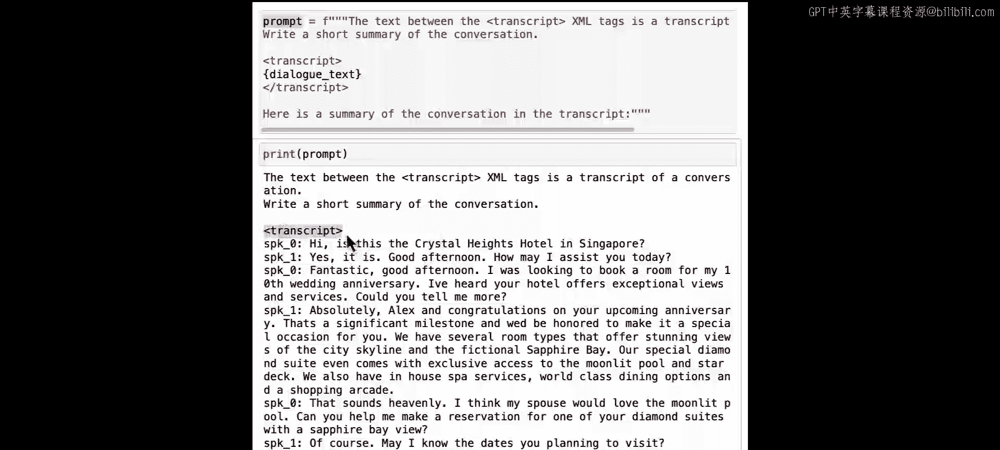

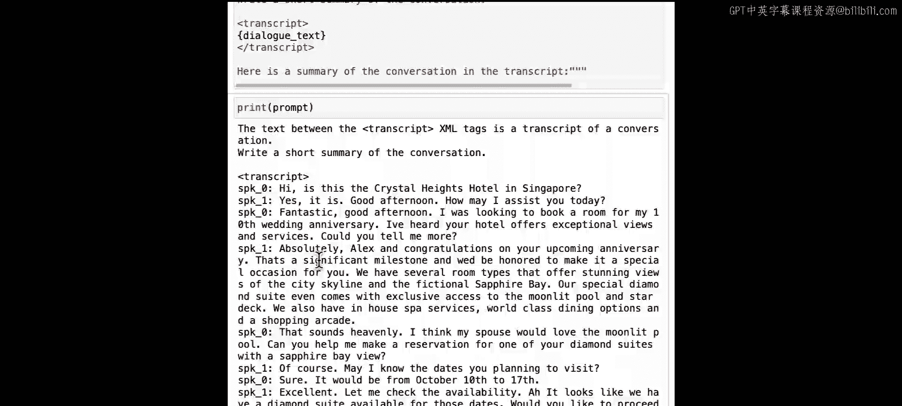

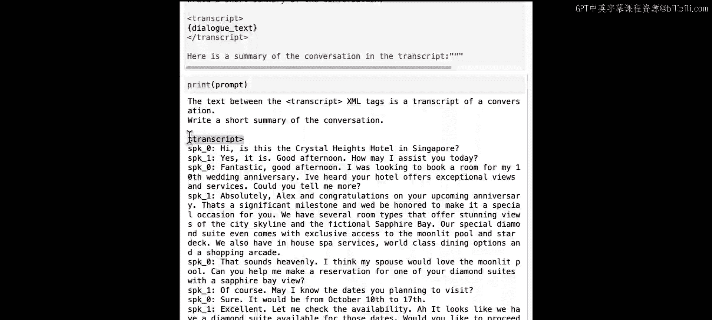

Sending that into the Titan text model。 So I'm just going to put my keyword arguments here。

 This again is exactly the same as we've seen before。

 My prompt now though is going to be from this prompt that we have defined up above and then let's go and get our response out from our Titan model by calling invoke model And then let's just go and add in a couple of lines where we can unpack that and get our generation and I guess the last thing that we need to do is print that generation out。

 So let's just put that in here and say here we go。

 So here's the generation here is the summary of the transcript of the phone conversation。

 So Alex is' looking to book a room for his 10th wedding anniversary etc etc。

 So we've been able to take the audio file， transcribe it Ex some information out of it。

 In this case， in a super simple way。 we'll look at a little bit more detail in subsequent lessons in this short course。

 And in the next lesson we'll take a look at how we can。

Aazonnscribe to take the audio that we've got from our recording in the call center and then extract the actual transcript out that we can then pass into the model as we've done here so we can dive in at a deeper level so when you're ready。

 I will see you in the next lesson。

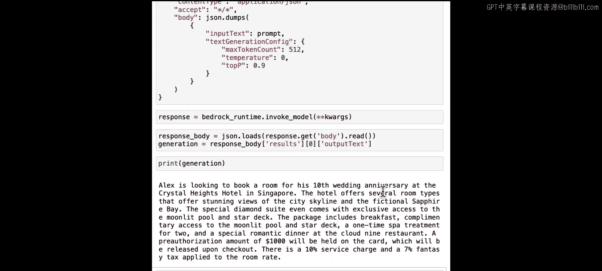