# 吴恩达《使用Amazon Bedrock构建无服务器LLM应用程序｜Serverless LLM apps with Amazon Bedrock》中英字幕 - P3：L2_Summarize_an_audio_file.zh - GPT中英字幕课程资源 - BV1X1421Z7w9

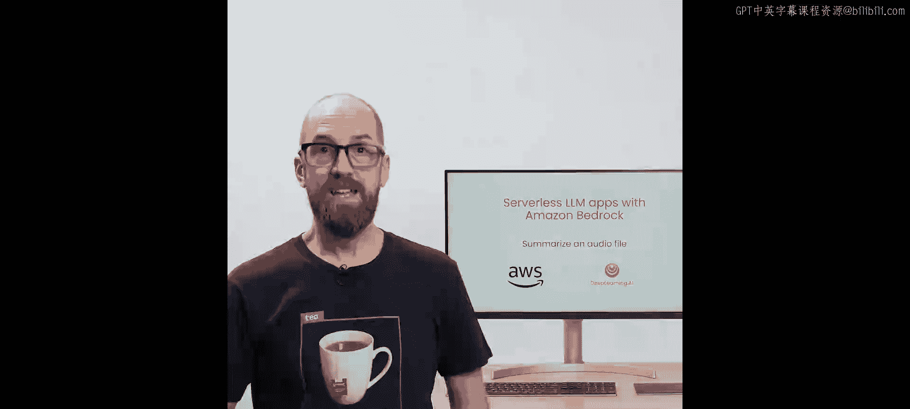

In this lesson， you'll see and hear how to take audio files of conversations between two people in this case between a customer and a company representative and transcribe them。

😊。

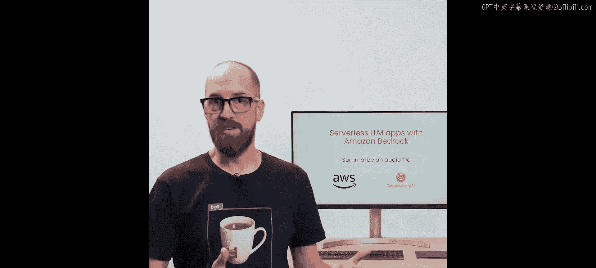

You'll then process this transcription and use an LLM to analyze the conversation。

 This architecture could be adapted to work with other audio sources。

 such as recordings of meetings or presentations or to transcribe audio from video files。

 So let's tune in。 And before we get going with the actual code。

 Let's just step through the process that we're going to follow in this lesson。

 So we're going to use Boto3 again， and we're going to set ourselves up with a couple of different clients。

 So not initially the Amazon Brock client。 We're going to connect to S3 and we're going to connect to transcribe and these services are going to form a very important part of the data processing pipeline that we set up。

 So with those services set up， we can transcribe our audio file。 We're going to do that。

 we're going to create a unique name for that。 We're going to then transcribe that audio file into a text output。

 Then we're going to need to take that text output and convert it into a text。😊。

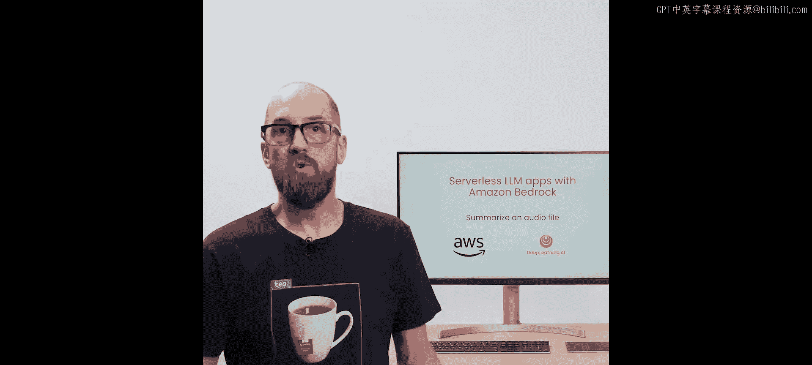

Format that we can use inside of the prompt and then send it to the large language model so it's a form of prompt engineering that we're doing where we're converting the data ready to put into that prompt and in this lesson we will actually send the transcription off to the large language model just to see the kinds of outputs that we can have and then in the subsequent lessons we're going to start building that further and further into our fully automated pipeline so let's just remind ourselves of the audio file that we're working with and I'll reimport the library that we used in the last lesson so that's the ipyython display audio control So I'm just going to run that line and then run a couple more lines that we've lifted again directly out of the last lesson where we're going to put a widget inside of our notebook which allows us to play dialmp3 So running both of those lines exactly the same lines as we had before little widget loads up and just really quickly let's remind。

What that audio sounded like Hi， is this the Crystal Heights Hotel in Singapore？Yes， it is。

 Good afternoon。 Okay so it's the dialogue between a customer calling up the hotel and then the hotel staff working on that call and working with that customer。

 So we've got this audio file and again this is inside of our local environment so this is running inside of the notebook server that we're using But what we want to do is we want to start moving to the cloud。

 we want to start moving to a serverless architecture。

 which is running for us in managed services inside of the cloud。

 And so the first thing that we're going to do is we're going to upload this object or so this file into the simple storage service So AWs is S3 service。

 the simple storage service So we do that using Boto3 again So I'm just going to import that now So the Boto3 library again is the SDk for AWs that runs in Python So let's run that cell so that it's defined and then we can go ahead and create ourselves some clients again again if you remember from the last lesson we do Boto3 client and then。

😊，That notation， we can create a client which will connect us to the various services which run inside of AWS Last time we did it for Amazon Brock and in this particular instance here。

 we're going to create a client for S3 and in the same way that we did last time we're going to point it to a specific region for this particular API endpoint and we're going to say the region name of US West2 just to keep everything consistent with the way that we're running these notebooks So let's store that in this S3 client object here So we've got S3 client and let's run that so now we have an S3 client defined so let's go ahead and upload the dialogmp3 into S3 we've got an environment variable that is been set and we can use the name that's set in that environment variable to get access to an S3 bucket which is already being created for us in this course notebook So I'm just going to import O into Python so that I've got access to the environment variables in this particular environment and the way we get。

cc to those environment variables is to call on OS do andviron and then ask for a specific name inside of the environment variables that it's got access to in this particular case we're going to look for resource S3 bucket name and this is just going to bring back a string So let's go ahead and store that string in this location at bucket name Of course all we're doing here is just pulling the environment variable out of the notebook environment and of course if you're writing your own code then you can go ahead and have this is a hard coded string or your own environment variable or wherever you want to get the bucket name from so let's go ahead and run that and now that's defined so the value that I have in here right now will probably be different from the one that you have in your running environment but as long as we've got the valid bucket name stored in there then we're happy So from there let's go and define a file name for our object that we're going to upload so file name in this case again it's just a string it's dial MP3 So we've got that defined for when we upload。

The object and it's simply this so we're going to take the S3 client， so let's say S3 client。

 which is the client object we created before， we're going to call upload。Underscore file。

 and then into there， we can add the file name。The bucket name。And then the file name again。

 And the reason why we're doing this is because we're pointing to the local file。

 and the bucket name and then the name we want to give the object once it's uploaded into S3。

 So we can go ahead and run this cell。 And so now our object is uploaded into S3。

 So now we're starting to have a cloudbased architecture。

 All right now we can create and perform a tran of this audio file。

 And to do that we're going to create ourselves a another client object。 So for this client object。

 we'll go to Bo3 again。 we'll load up our client。 And this time we're going to create a transcribe client。

 So transcribe。 So Amazon transcribe is the name of the service。

 And then we'll have our region name once more pointing to。😊，US West2 and again。

 we're just going to store that in a variable name and that variable name can be transcribe client just trying to keep some consistency there and I'll run that and now I've got my client defined and so now I'm going to use this service and send it a command and API command asking it to transcribe our audio file and we're going to tell it the location of that audio file inside of S3 So the transcription job needs a unique name so I'm going to use UUI in order to provide that for me UUI stands for universal unique Ientifier。

 It's a unique string of letters and numbers and that's what this UUI library helps us to generate So let's just import that library and so then let's create a string using UUI so we can build this up so we're going to have UUI and we're going to use UUI4 UUI4 is one of five methods for generating these unique identifiers UI。

4 is good enough what we need in this particular application This will output a long and hopefully completely unique set of characters before we can't use it like that though so we want to wrap that up in string so that we've got something a little bit more usable yet again and so this is getting useful we could use this kind of approach to get a unique name for the transcription job so what I'm just going to do is just put in the beginning of this that we want a job name to be transcription jobhen and then whatever this is lots and lots of different ways of concatenating strings together inside of Pyon this one will do for now so if we take a quick look at our job name then we've got a unique name that we can give to the transcription job right so let's get into the guts of how we actually call this and so we're going to call the transcriptionnscribe client and then we're going to call the method on that which is start transcription job so if we just give ourselves some space。

Here to put in some arguments so we can pass some details about this job So the first thing that we're going to do is we're going to pass in the name that we've defined so we're going to say that our transcription job name is job name up above then we're going to give it the audio file that we want it to work with Now this audio file has been uploaded again into S3 and we've got a bunch of variables that we've set previously about the location in S3 So if I just paste in this command here we're pointing to where the media is and we're saying it's a media file Uri and then we're doing this formatted python string here to show the location inside of S3 So this S3 colon forward the bucket name and then the file name or the object key is the way that we can specify exactly where that piece of media is so once we've got that we can add in a couple more settings here so this is our way of telling it the media format so we're sending it anmp3 file and then giving it an idea about。

Language so it is possible for it to detect the language automatically but we' just make it easier for it if we're telling it so we're going to tell it that this is US English and then we supply a bucket name for the output bucket and in this particular case we're going to use the same bucket as the input bucket for the output bucket so this is where we're going to deposit the output of the transcription job and it's really useful to define where the output of this job goes so that we can start to look at event-based architectures later on in the course and then finally we're going to put in a couple of settings here for the AI model itself so it's going to identify different speakers who are speaking inside of this transcription so we're basically telling it that we know that there's going to be more than one speaker and we want it to label those different speakers when it finds them and we're telling it to look for a maximum of two the transcription service can look for a maximum of 10 but just putting in two here means because we know it's going to be a conversation between two different people so this is all pretty much setup up。

We want to grab the response out from this call to this service。

 So let's go and store the output from all of this in response。

 And then we can go ahead and run this cell。 And before we move on。

 take a look at this code and make some adjustments to it。 So play around with it。

 tweak it a little bit and see what you can make it do。

 So maybe pause the video here and have an experiment So it took us a while to go through the process of building up that transcription job and you might notice that it actually returns immediately it hasn't necessarily finished yet。

 So let me go ahead and paste the whole of this next cell in I'm going to run it and then we're going to talk about what it has it's already finished by the time I've managed to do it。

 But if you just run this cell all this is doing is it's basically waiting every two seconds and going to check that transcription job to see if it's actually complete or potentially if it's failed for some reason。

 So when we start the transcription job It's sending a command to the service to go ahead and tran the file。

 but it's not coming back with the。outputput in response it's coming back with a pointer to the ongoing job Now this particular audio filele isn't very long。

 And so in the time it took me to go and copy and paste this piece of code in here it had already finished。

 but you can see the point if this is going to be a much longer transcription job then we might need to give it just a few more seconds a minute or two to run through all of that so this is just a simple loop as I say just pausing every two seconds to go through and look for the status and it gets the status by just looking at the client and then asking for get transcription job and then we pass in the name of the transcription job that we created previously and so it just goes to there and looks to see if it's finished or not anyway it has so we can go ahead and carry on with our code and we can take a look at the output of that transcription so let's import Jason so that we've got some Jason that we can work with so we got the Jason library that we can work with and let's go and grab back the text from the transcription。

So I'm just going to build up some code here and this is why essentially I'm going to paste this first line here so I'm basically going to check one more time to make sure that it's complete。

 That means that if we do run this code in the future then it'll only run if it's actually going to work if you see what I mean so let's then go and put in some values here I'm going to paste in the block here and there we go and this block is going to derive the transcription key in other words the file name that's inside of S3 that will have been created and the naming format is the job name and then do Jason so again another reason why we have that unique file name and then it's going to grab the actual object itself using our S3 client it's going to use get object and we're going to tell it which bucket and which key in other words which file name and it's going to be able to go and grab that particular object for us and then we can read that object so we're not even saving it to disk or anything we're just going to read it using that do read。

We looked at before from the streaming body return did the similar things that we saw in the last lesson and we're also going to run decode on it as well and then we should have our text there of course that text then is going to be a JO structure so we're going to load that and then finally we're going to have the transcript Jason object here so let's run that and then take a quick look just by dumping this into the cell and running it and we should see there we go we have the output from our transcription job and you'll notice that there's actually a lot of information in here and so we've got again the job name and then we've got the status that it's completed and then we've got the results itself and so we've got transcripts here and this is all of the text you'll notice how there is no differentiation between who's speaking in this particular part if we scroll down and down and down and down then we start to see some more information here so we've got speaker labels and we can see the different speakers so we have speaker zero and all of these different timestamps。

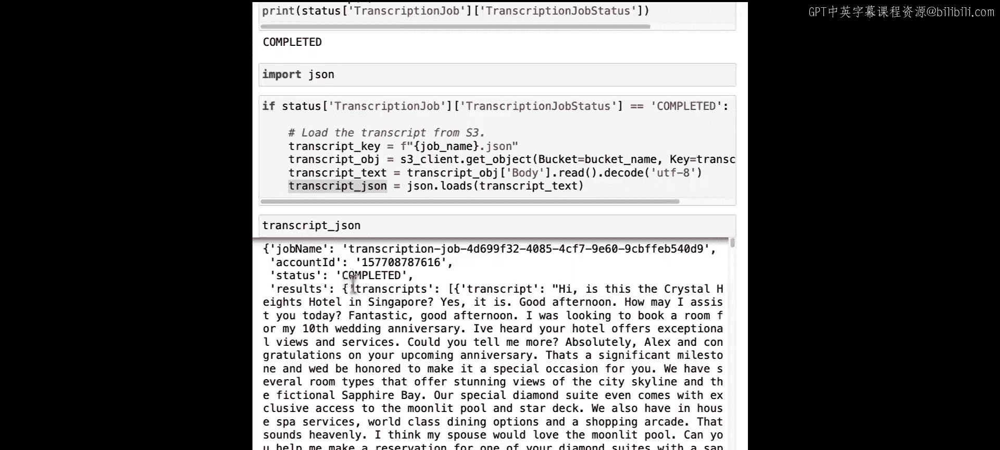

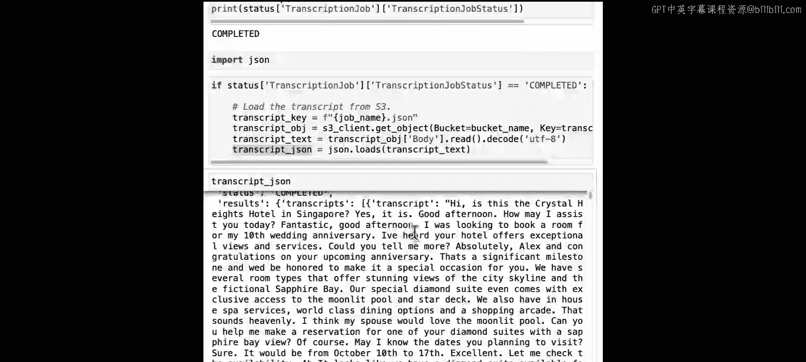

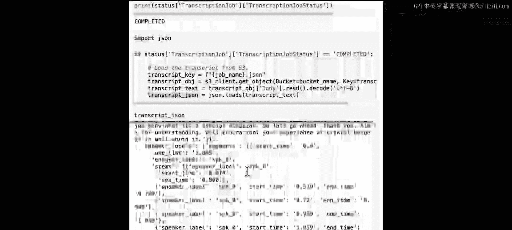

From when they were talking speaker one and timestamps for them as well If we scroll down even further。

 then we start to see a different kind of data here we go so you can see the individual words so let's have a look hi is this the Crystal Heights hotel and those words there are coming from speaker label there we go so speaker0 initially speaker0 said this and this and this and this and this so using this part of the output which is inside of items then we can get the particular word and who said it and we can start to build up the transcript in a format that we want to see and we want to use So let's go ahead and do that let me just get rid of this for one second and let's expand out this code that we were working on we saw and there that the information we were interested in was items which is inside of results So let's go ahead and。

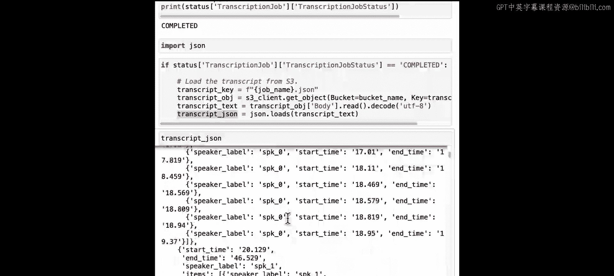

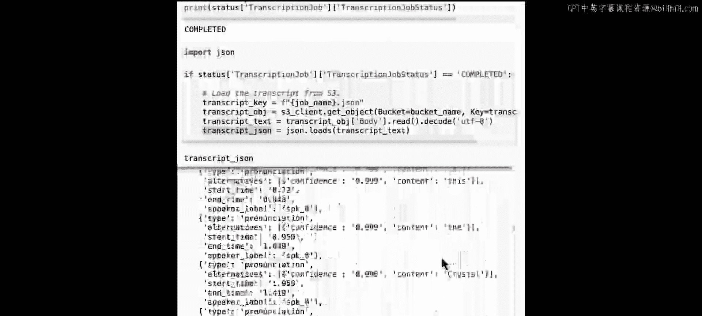

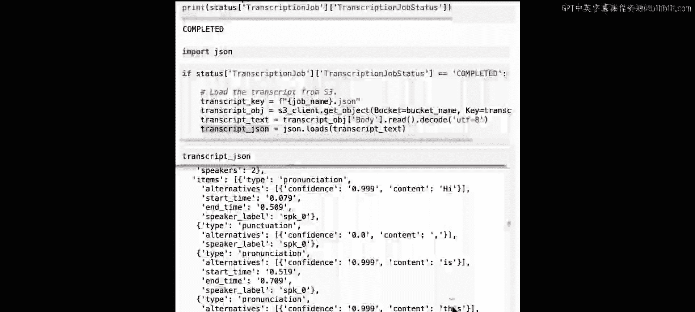

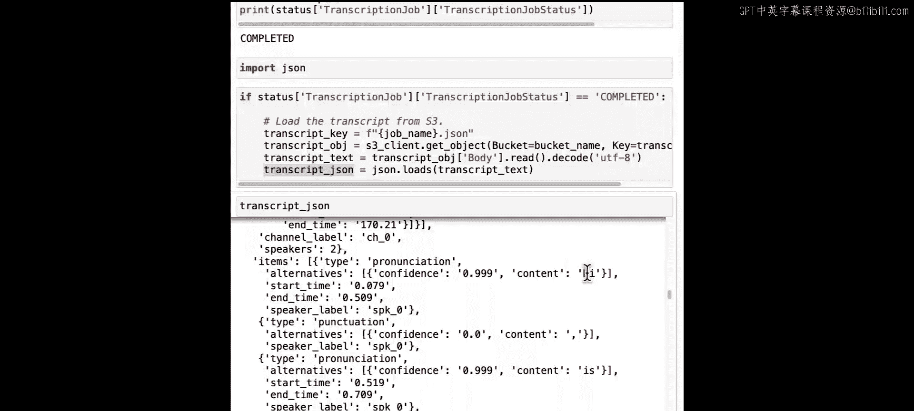

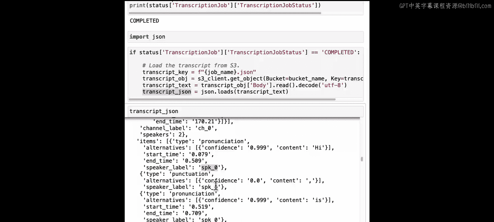

Pull out just the items。 And then let's just go and loop through those items。

 So let's say for item in items， we're gonna go and print the item。

 So this should get us a little bit closer to what we're after。 So just run that。

 And now we're straight into just this section of the document where we've got the individual words and who said them。

 So this is getting us a lot closer to what we want。 So instead of this。

 let's go and pull out the speaker label。 So the speaker label is here and we've also got the content itself and the content is the word。

 So we want the content， the word high and the speaker label of who it is。

 So those are things that are useful to grab。 So let's instead of printing that let's remove that and set up some a couple of variables for ourselves。

 So speaker label and content where we're getting that speaker label out， we're getting the content。

 which is actually inside of alternatives， as you can see it's the。

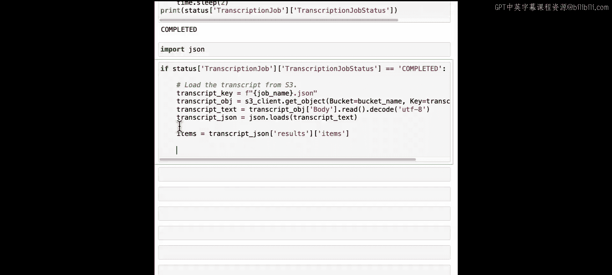

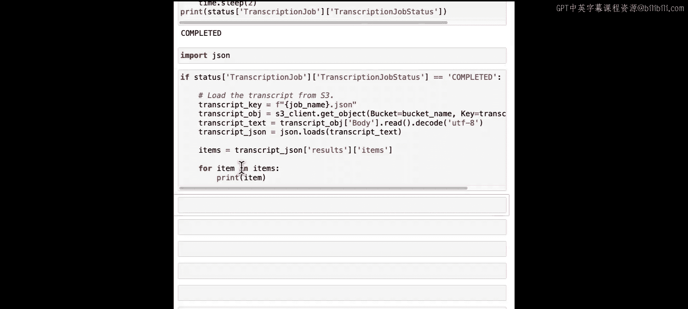

First one in the list and then content。 So that will give us the speaker label and the word which is said So that's useful again let's step by step through this。

 make sure that we're getting what we want to see。 So let's just print that in a formatted string and yes so we can see we're getting what we want here So the speaker and what is said we want to have just speaker0 and then the entire thing that speaker0 has said and then speaker1 and the entire sentence that Spea1 said so we just need to do a little bit more formatting of this code and then we can get that So let's set ourselves up a couple of variables up here before we get to the passing we're going to set up the output text So this is somewhere we can store the final output and we'll store the current speaker as well So we know who it is that's currently speaking and we can just traverse through this list and concatenate together the string for us So let's go and replace this line here with some code here which is going to look。

The speaker label that's come through and see if it is the same as the current speaker or not and if it isn't the same as the current speaker then we'll set it to the current speaker and we'll start that output line by using this formatted string and saying okay well this is the current speaker here and then obviously what we'll need to do is concatenate the rest of that content so we can do that by just pasting in this line here so output text we're adding to the end of that output text the content so this is going to loop through all of these lines it's going to look for a speaker whether it's different or not and it's just going to start concatenating these strings together now the other thing that I'm just going to add in here and it's one of those things that I'm just going to add in it's sort of like trust me this will help just to make sure that the formattings nice is just something to deal with some punctuation so you might have noticed when we looked through the different item types before we have got the words but we've also got some punctuation and so we're just going to strip the output from that and remove the trailing space。

And it's probably not entirely necessary actually seeing as we're passing this to a large language model。

 but for the sake of making it easier for us to read then let's do that。 All right。

 so with all of that together， if we run that cell again and now look at our output text then we should see that we've got our transcription looking more or less like it's in order now it's not printed out very nicely so let's just do some print brackets around that like this and now we can see our transcription coming together。

 So speaker 0 says what they say speaker1 then speaker 0 and through it goes So this is looking pretty good。

 the only thing that we want to do now is we want to save this transcript to a file because we don't want to just print it out on the screen。

 So just by using the open command from Python we're going to save this into a text file locally and we'll use the job name again as a unique identifier locally for this particular text file。

 So let's run that So with this code， obviously there are bits in。

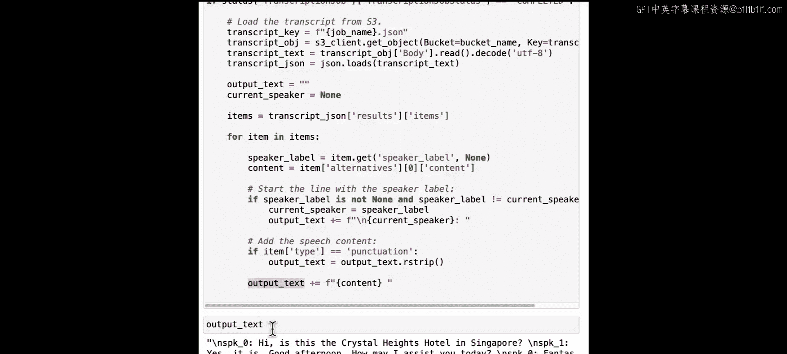

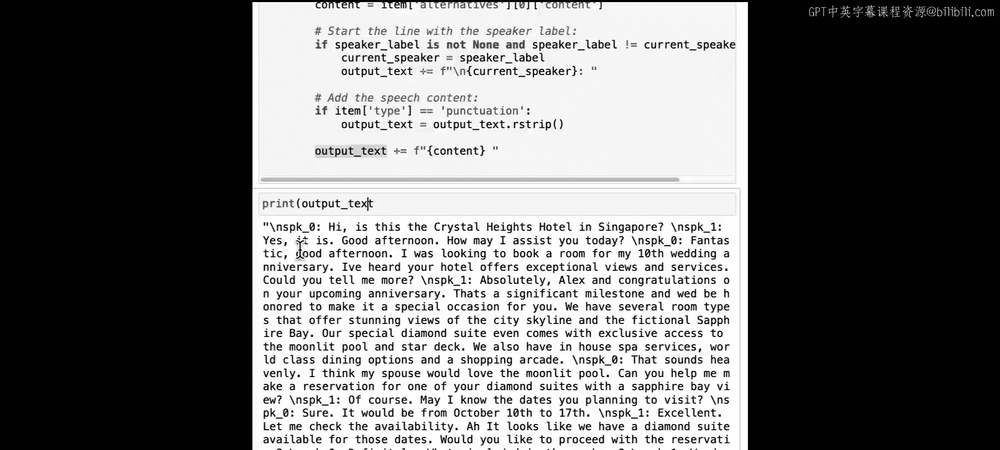

that we could actually change So if you'd like to have a go at doing that， then pause the video now。

 change some of those bits inside of the code， see what difference it makes and when you've had enough then unpause the video and I'll see you in a moment we're going to called Bo3 we're going to go to client and we're going to go ahead and load the bedrock runtime so that we can make some inference or make some generations with our model let's remember to put in our region name and we're going to put in US West of course again and we're going to save all of that into a bedrock runtime variable so let's do that and run that so now we have a bedrock runtime client ready but we do need to actually sort of following through as though we hadn't saved it to the disk I suppose so we're working with this as a sort of standalone piece of code I'm going to just put some stand Python in here to open up that file name and read that file in to a variable that we're going to call transcript So again just sort of。

Simulating if you like that we hadn't done the previous step or that previous step had happened at a different time。

 So we've now got our transcript loaded in。 Okay so let's go ahead and prompt with this。

 Now we looked at a way of doing that in the last lesson where we just did some fairly simple string concatenation to put a simple prompt together and get a summary of this transcription。

 this particular case， I want to do something a little bit more sophisticated than that。

 So in previous examples you've created prompts within strings within your code and there are many ways to do that in Python such as basic string concatenation and F strings but for production cases such as here in this serverless cloud architecture and in this course it can be more helpful or more manageable to define a template in a separate file in this case。

 we're going to use G， the gingertlating library and by doing this and defining the template in a separate file you can look to apply version control specifically to the template。

By doing so separate out the prompt which might be being codeveloped by the business user from your application code。

 This makes it possible to modify the prompt and to swap in different prompts during production So whilst the codes actually live and so what I'm going to do is I'm going to use this magic notation with Jupyter notebooks and we'll see this again in a later lesson as well where we're using this right file and then we're giving it a file name and so if we do that then any text which we enter into this part of the cell down here when we run this cell it will save that text into the file name which is written here in this case would be prompt template do text So I don't want it to be just text I want this to be obviously the template for my prompt So I'm going to paste in something here and we can step through this and take a look at the way it fits and way it works So this template this prompt。

Template that I've got again itll be saved as a text file here and I can just put a couple of line breaks in here so we can read it a bit better so I need to summarize a conversation。

 The transcript of the conversation is between the data Xml like tags and there we have the data Xml like tags and the notation which will add transcript in here and so we're going to have a look at a slightly different way of doing our prompt templating using the Ging library and then I've got some more instructions here。

 the summary must contain a oneword sentiment analysis and a list of issues problems or causes of friction during the conversation the output must be provided in Json format shown in the following example and then we give an example of the actual output that we'd like and then we say write the J output and nothing more and then I say here is the J output and so we're hoping that our next token predictions will build up an output from the LLM which will give us exactly what we want。

kind of format here So that's a summary of how this particular prompt will work and it's outputting our summarization or it's outputting information about our transcript in a slightly more systemusable format in this Json structure so let's run that and by doing that you can see that well in this particular case it's overwriting it because in this environment I've already done this to make sure it'll work but it should say that it's written the text file for you there and if you decide that you'd like to make some changes to this particular prompt then you can go ahead and do that inside of the Jupyter notebook run this cell again and willll overwrite it for you as well and overwrite the prompt template Txt so once we've got that we can use the Ging library in in case Ging2 in this particular case to fill out the information in this template now it's a little bit overkill because this is such a simple template that we've got but it's a useful technique to be able to do this and it's a very capable templating library so we can use it。

use it a little bit later in the course as well。 So let's import Ging2 and import template from Ging2。

 and then we are going to need to open up the template that we've just saved。

 So all of this that we just typed in here saved this template out to prompt template TX So again with our standard Python notation to load in prompt template do Txt and load that into a template string。

 So let's run that and again， if we look at the template string it'll be exactly as we think there is the template as defined up above So let's get rid of that。

 Okay so the next thing that we need to do is we need to define the data that we're going to insert into our template and this particular case there is only one thing that we want to put in there but we're still going to define it in the same ways I would do if we had a lot more data So let's go ahead and say that we're going to create a data dictionary and we're going to have transcript。

 So this is basically pointing to this。Particular name here。

 So I'll copy and paste it to make sure it's exactly the same。

 And we want to put into there the transcript that we have loaded out of our file before。

 which happens to be called transcript so let's go and use that and put that there。

 So now we have our data dictionary ready to insert into our template。

 So I can go ahead and run that So that's defined And then I can call on template and I can load template with template string。

 So this is the gingering2 template object here。 and we're going to create one of those using the template string So that's the format that we've got。

 And we will call that template so that we can go ahead and use that。 So let's define that。

 And then we just call render on that template so we can say template do render。

 And then we pass in our data。 And that's all you have to do。

 I do want to of course save the output of that somewhere or just have that stored somewhere so let's store that inside of a string called prompt。

Okay so a lot of different lines to do something fairly straightforward。

 but the architecture there is super powerful。 So we'll be using that later on as well。

 if we take a look at prompt now and print that out， in fact。

 let's just go ahead and print it out rather than dumping it out raw and then there we go there is our current prompt。

 So exactly as we saw before with the data tag then all of our transcripts going in there and then the end of the data tag and the rest of our instructions。

 all set out for us in our prompt。 So all that now remains for us to do is to pass that into the Titan text model using Amazon bedrock and take a look at what the output is going to be。

 So let's go straight in and paste in the keyword arguments exactly as we've seen in the last lesson So we're calling on the particular model we're going to use in this case it's the Titan text express v1。

 Everything else should look similar from the last lesson in this case though I've turned the temperature right down to0。

 and that's because I don't particularly want。

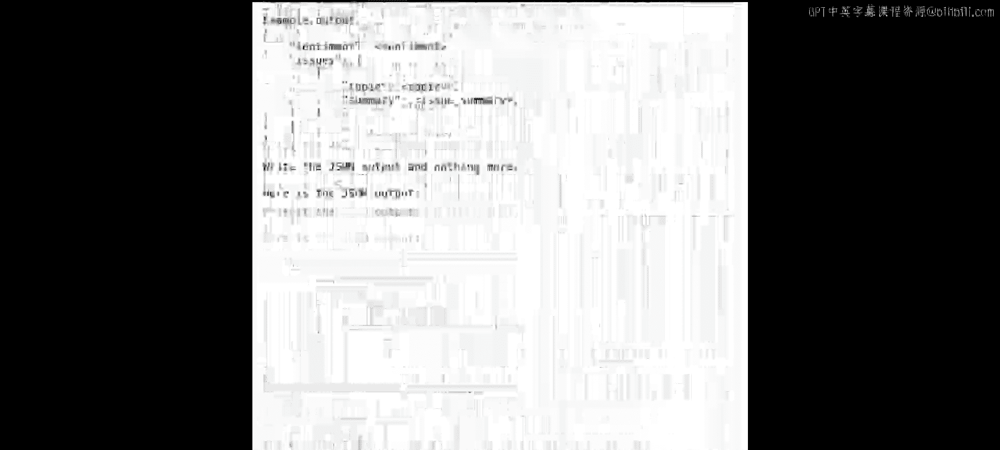

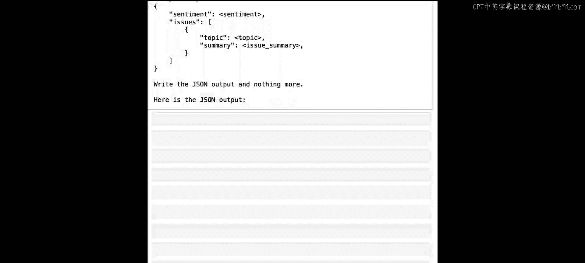

To be creative in its output and I want to try and ensure that it's going to get a nice syntactically correct Json output so by turning the temperature down。

 we stand a good chance of that working for us so let's run that so we've got that defines our keyword arguments and we'll just put the boilerplate code in that we've seen before So bedrock runtime invoke model passing in those keyword arguments we get our response back and you'll notice this is taking just a moment or two to run and while it's running。

 let's get the next code ready to go so we're just going to go again we're going to go into the response we're going to get the body out。

 we're going to read it we're going to load the Jason out of there all in one line get the response body and then inside of that response body we'll get results zero and output text it is worth noting actually while I mentioned this that the response body format will' be slightly different depending on which of the large language models you use from Amazon bedrock in this particular case because it's the Titan model then we know the location。

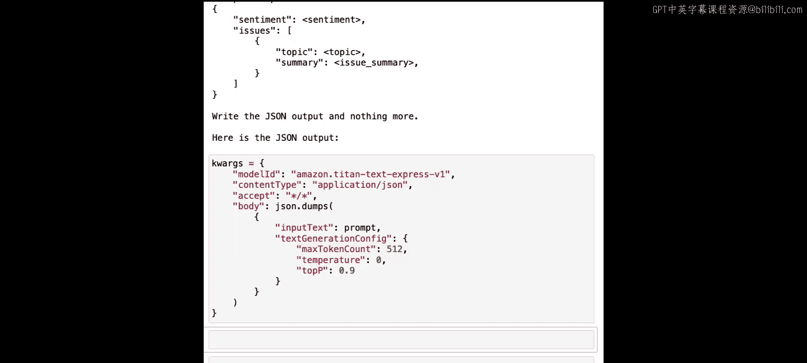

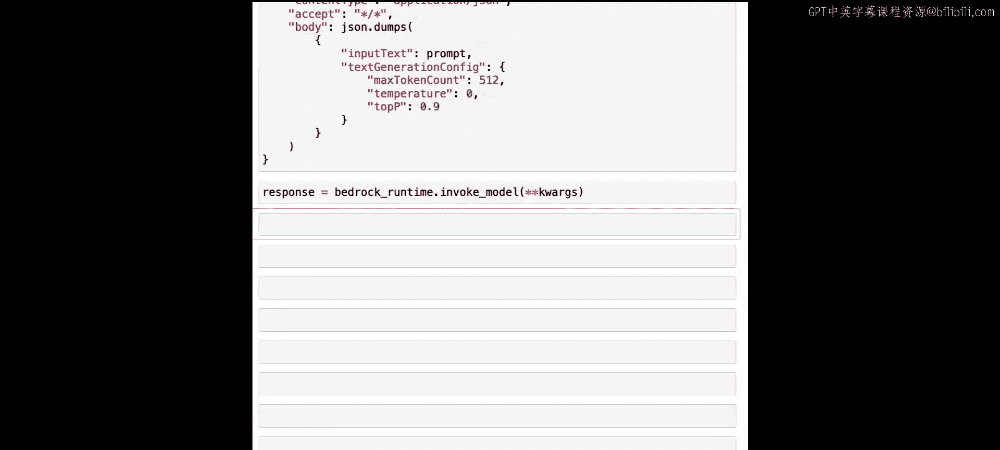

Of the output is like this with results0 and output text。

 but if you use something like the Claed models or the AI 21 labs models。

 then the output and the location of the output text or the generated text will be wherever it has been defined by those development teams。

 So let's run this So we get our generation and just print our generation out and take a look at what we've got and we should have and indeed we do have our Json structure which provides us with a single word sentiment analysis。

 So it's positive overall the transcription was positive。

 and then we have a list of all of the issues which have been identified。

 and at the moment it's pulled out a whole bunch of different issues talking about what Sp1 has done。

 And in most of these cases they seem relatively positive。

 we can filter to this more by being a bit more specific in our prompt templating and also in our prompt writing and we'll have a look at how to do that in a later lesson inside of this course。

 But for now what we've done is we've used Amazon transcribe to。

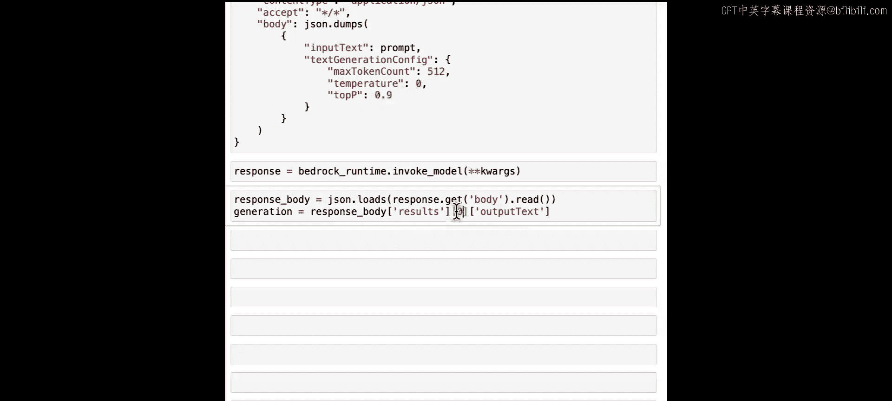

Transcribe the audio file using serverless services inside of the cloud。

 we've stored the actual audio file in S3 in the first place and then we've used Amazon bedrock again。

 serverless service fully managed service with that large language model。

 the Titan model to come out with this generation and so we're really pulling together the different building blocks that we need here to be able to implement this fully serverless event drivenven architecture data processing pipeline。

 Now we've looked at the code in some detail here including the prompts that we're using and we've printed them out to screen so that we can see them too what you want for that is an effective logging solution So for audit and compliance and for the all important debug logging is super useful and that's what we're going to have a look at in the next lesson。

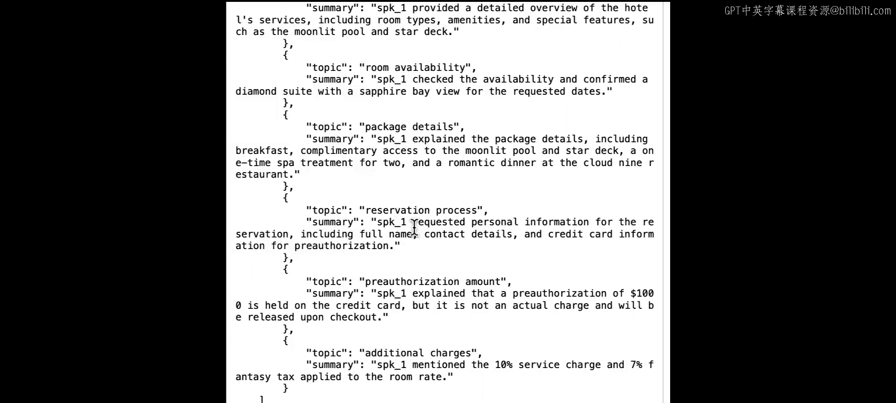