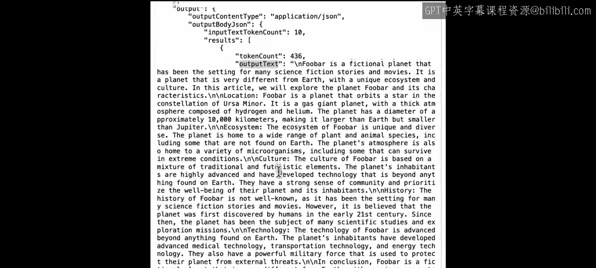
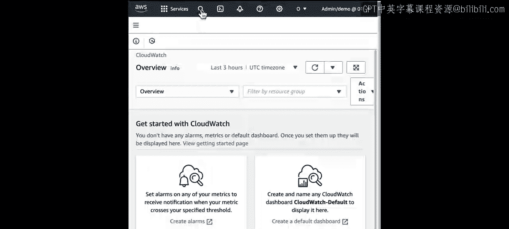
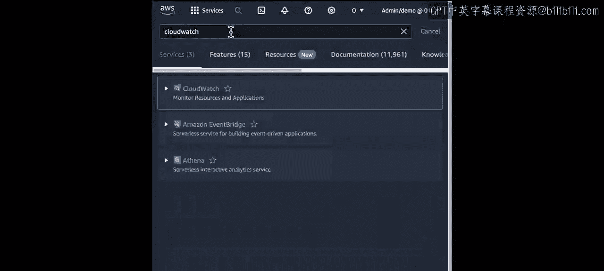
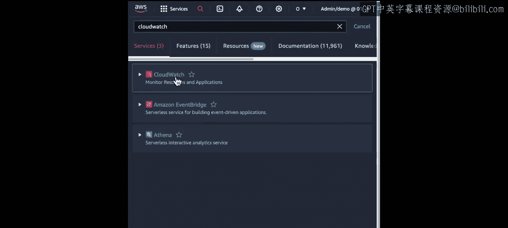
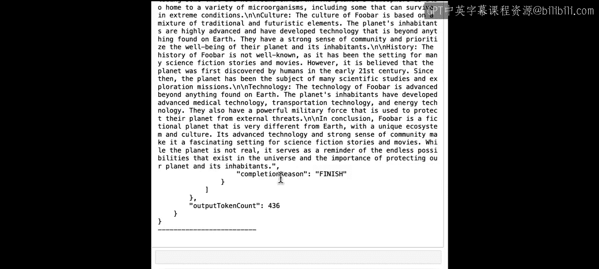

# 吴恩达《使用Amazon Bedrock构建无服务器LLM应用程序｜Serverless LLM apps with Amazon Bedrock》中英字幕 - P4：L3_Enable_logging.zh - GPT中英字幕课程资源 - BV1X1421Z7w9

So far in this course， you started to integrate LLMs and other AI capabilities。

 Part of developing and managing a deployed application is addressing security， audit and compliance。

 And one of the key tools for auditing and compliance is logging。😊。

In this lesson you'll learn how to enable logging for all of the calls that you make to LLMs that are within Amazon bedrock and how to review these logs。

 This is extremely powerful for audit and compliance and you'll use this to monitor for error conditions so let's take a look。

😊，So it be completely possible to put in lots of logging code into your application stack and start to push out various bits and pieces of what you're sending to and getting back from the large language model in there but sometimes that's not as easy as all that especially if you're using libraries such as Langchain for example and Amazon Brock does work natively with Langchain and so one of the things that I certainly found with Langchain as brilliant as it is is it can sometimes be a little bit tricky to know what's happening behind the scenes with all of that prompt engineering it's doing and sending data to and fro from the large language model and so what we can do here is we can actually set up Amazon Brock to globally log all of the calls which are made to and the responses you get back from the model when it's making its generation so let's have a look at how we can do just that So the first thing that I'm going to do is just import a bunch of stuff that we're going to need for this particular lesson and it's all stuff that we've seen before and so we can just go a little bit faster through this so importing photo。

3Ja and OS again so we can get our environment variables and then we're gonna go ahead and create ourselves a bedrock client So this is not a bedrock runtime client。

 It's a bedrock client because we're now going to be looking at and configuring the Amazon bedrock service itself rather than making a generation just in the first instance so let's run that cell so that we've got all of that up and running we then have this other cell as well and you'll see this in the code that we've supplied over on the other side of the screen but we've got these helper files and I've just written a quick Cloudwatch helper so Amazon Cloudwatch is the service which deals with logs and metrics and just the general health and what's going on inside of your AWS account and just make it a bit easier to work with I've created some helper functions here and in this particular case it's a cloudWch helper function to help us see what's going on inside of Cloudwaatch you can also see what's going on inside of Cloudwatch through the console as well and that's probably the more logical place to go we're gonna have a look at both of those so。

Now that we've got everything set up， we can start to write some code。

 And the first thing that I'm going to do is I'm going to define for us a log group name。

 So inside of CloudWtch logs， it has these log groups and you get to define what that naming structure looks like so that you can save essentially where we want to send our log files too So in this particular case I'm going to send it to this log group name of my Amazon bedrock logs。

 Now it is important actually for this particular lesson to use that specific name And a reason for that is because we've got some permissions setup inside of this account and the permissions are expecting to work with this particular log group name So if you do want to change it you can but you'll just needed to change those permissions as well if you're running this inside of your own account Now just a word on what those permissions are are IA permissions IA stands for identity and access management which give the Amazon bedrock service the ability to。

P logs or to create log streams and to put log events into Cloudwach Cloudwatch is the part of AWS that aggregates all the logging and metrics and logging and you can use it to add monitoring and logging to your applications。

 So let's take a bit of a look at that quickly just with this slide overlay。

 So this is the Json structure of what the permissions look like and you can see here that they have this statement structure where we have the effect of allow and the action here that we're going to allow is to create log stream and to put log events and you can see here that we've got it's locked down to this particular resource。

 So in other words， we're allowing the Amazon bedrock service and only the bedrock service model implications here to go ahead and put those logs into the log stream and so the other parts to this then is the trust policy and just quickly this trust policy basically means that this policy。

Can be assumed by the bedrock service。 So both of these things have been created for us already inside of this account and this is just a quick note to what we've already done。

 and the fact that this role exists。 So now that we've defined our log group name of course this is just a string and're going to go ahead and use my helper function which we've loaded in as cloudwatch here and we're going to call this command here to create the log group。

 So this is just going to send an API call off to the cloudwach service to create the log group called my Amazon bedrock logs you can see it's just returned back here that that's being created for us successfully。

 Now that's really easy to do inside of the AWS console And so that's why we've not gone into that in a great deal of depth。

 What I wanted to show you is how we configure Amazon bedrock to send those logs into Cloudwach logs So let's have a look at how we do that So we're going to create ourselves a dictionary of parameters that was going to essentially be our login configuration and we're going to send this。

Into Amazon bedrock。 So let's do this now， let's just say this is all going to be a login configuration。

 So the first thing that we need to do is set up a Cloudwatch config。

 So let's go ourselves a dictionary for that and then we gonna have our log group name that we pass in So this is define as we have already here with log group name of my Amazon bedrock logs this is telling Amazon bedrock where to put those logs。

 and then we need to tell it about the role。 So this is the role that we saw the outline of just a moment ago and there is an environment variable inside of this notebook currently running which will point us to the An or the Amazon resource name for that particular role that's already been set up So we've got that there and then we can define how we want to deliver particularly large objects。

 Now this is because Amazon Cloudwatch it's really good at storing sort of log entries So text entries。

 but imagine for a moment that we've got a massive generation which has been created or if we've used one of the text。

😊，Image models so we're actually generating some images。 Well if we want to log all of that。

 then we're going to need to give it an output location which isn't just Cloudwatch。

 something which is capable of storing larger objects and the clue there is in the name objects we're going to put this inside of S3 So let's go and paste in this configuration here and just have a look to this。

 This is the large data delivery S3 config and we're giving it the location of a bucket that we want to use to store those large objects and we can also give it here a key prefix as well So inside of that bucket let's give it a particular prefix。

 So it's all sectioned off into a particular area。 In other words this is a bit like having a folder called Amazon bedrock large data delivery you could call that whatever you want and in this particular case again we've got a bucket logging bucket which we've got the name of that bucket defined inside of our environment already So that is the cloudwach config there Now with the Amazon bedrock logging options we have the choice of being able to。

Logs into Cloudwatch then also with the large objects going to S3。

 but we could instead put things straight into S3 and not use Cloudwatch at all。

 So it's just another one of the options。 and we can do that with this configuration here。

 So in a similar way to having Cloudwach cong we can have S3 config And so we can go ahead and put the logs directly into S3。

 So this is different from this section up here。 This section is just where to deliver large things which relate to the cloudwatch logs。

 This is where we're going to put just anything。 And in this particular case with both of these things enabled。

 it means it will put the data inside of Cloudwatch and inside of S3 So we're just doing both just for the sake of it in this particular lesson。

 then we get to say what kind of data that we want to have loggged and this particular case we're working with text data。

 So we'll say the text data delivery is enabled andll set that to true and that is our login configuration So I can go ahead and run that of course that won't。

Anyything at this point it's just a dictionary which has being defined。

 but I can now go ahead and call on our bedrock client agent that we had before and I'm going to call a much longer method name than we've called before so this part time it's going to be called put model invocation login configuration and then we going to pass in our login configuration in there so we can do that just by passing in the logging config is the logging config so in other words we're going to point login config to this data structure so we just had up there so that's all we need to do now to go and apply that logging configuration to Amazon bedrock so let's run that and then we get a response back and the response is code200 so it's all positive it's been applied now while we're reviewing the different calls that we can make to the bedrock client let's have a go at this so bedrock get model invocation logging configuration so as opposed to put so this should return to us the actual logging configuration what it looks like so if we scroll down。

Here then indeed we see all of those values that we sent up into the model and in my particular case。

 I've got bucket names which relates to the environment variables that I have inside of my account and yours will be different So with the logging enabled it's now enabled globally across our entire account for any ins that we make to those text models inside of our account。

 So let's have a go at making a text generation so that we can see what it looks like and I've just pasted the entire line in here we've seen it many times before。

 this is the bedrock runtime clients that I've created inside of US West too so let's run that cell and I'm sure you can guess what's gonna to come next。

 Well almost I'm just gonna paste it in in one cell because we've seen it so many times before Here's our prompt in this case write an article about the fictional planet fubar then we have our keyword arguments much as we've seen before the temperatures a bit low let's set that temperature a bit higher because we are doing something a bit more creative here and then we're going to go and get a response the response。

Body deeration and then we're going to print the generation out and before we move on take a look at this code and make some adjustments to it so play around with it。

 tweak it a little bit and see what you can make it do So maybe pause the video here and have an experiment of course the reason why we're doing this is because we want to perform some generation so that we can then go and have a look in the log files and we should be able to see that it's in there so once this is finished writing its awesome article about the fictional planet Fuber I've got one more thing inside the helper functions that we created in order to help us see what's turned up in the logs now we do need to wait just a moment before we run this so this is just the helper function the Cloudwach helper function that we've got inside the lab and then it says print recent logs what this is going to do by default is it will look in our log group name which is defined up above and it will pull back all of the entries from the last five minutes so if you are running this multiple times。

😊，Then if you're not seeing things， then it's because it's only pulling back things from the last five minutes just to keep things sort of simple。

 But let's go ahead and run that now and fantastic， we actually get to see the output。

 Now we'll go and take a look at this inside of Cloudwatch itself in the console in just a moment。

 But this string here permissions are correctly set for Amazon bedrock logs。

 this is actually something which is sent into the logs by the backend system。

 So when we're giving it the An and An stands for Amazon resource name and these are unique identifiers to every instance of a resource inside of AW So in your account all of the instances of things have Ans for the role that needs to be able to perform the logging and then we set those logging parameters and that logging configuration The first thing that Amazon bedrock the service will do even before any generation is made is just go and check to make sure that all works。

 And so that's all that string is there。You'll see that once and then it will disappear in the logs and you'll never have to see it again unless you set it up another time so I then just do this quick lines so we can see the difference between the different lines here and here is the entire J structure of the particular call that was made to the service and you can see here the input text write an article about the fictional Planet Fubar you can see all of the parameters that were sent in as well super super useful for debug super useful and maybe essential for audit and compliance you can see the input token count and the output token count and of course you can see the output text as well so there is a chance that this output could get quite large especially if you're doing things other than textbased models but this is super useful for being able to log globally what's happening inside of your AWS account using Amazon bedrock and for me more than anything else this is really really useful for debugging all sorts of applications no matter what libraries you're using no matter what architectures。

😊。

You are using So if I want to see those logs inside of the AWS console well it's probably a little bit easier to see than it is inside of a notebook so I can go to my AWS console page and you can do that by following the link that's provided in the notebook environment I can click on the magnifying glass here and I can type in Cloudwach Now you'll notice that this is quite narrow on the screen here so you'll probably see more than this if you're doing this inside of a completely separate window but let's navigate to the cloudwach and then inside of Cloudwach I can go to log groups here So if I click log groups the menu should collapse away and then I'll get a list of all of the log groups that I have and here you can see my Amazon bedrock logs which was the log groups that we created just a moment ago if I navigate into there then I will be able to see the log streams right down the bottom here and if I click here I've got AWS bedrock model invocations and so there I have exactly the same view as we were looking at before So here are the model in。

Whi have arrived into Cloudwatch logs inside of the console。 So that's how to log。

 So in the next lesson we're going to get back to our event driven pipeline。

 we're going to put together all of the code that we've been doing inside of the notebook now in the cloud in serverless managed services and it's going to be a fully automated data pipeline working on our transcript。

 So when you ready， I'll see you in the next lesson。😊。

