# 吴恩达《使用Amazon Bedrock构建无服务器LLM应用程序｜Serverless LLM apps with Amazon Bedrock》中英字幕 - P5：L4_Deploy_an_AWS_Lambda_function.zh - GPT中英字幕课程资源 - BV1X1421Z7w9

In this lesson， you'll learn about AWS Lambda functions。

 a serverless type of compute and one of the easiest ways to manage code。

 You'll see how you can use them to run your LLM powered workloads。 Let's jump right in。 And by now。

 maybe just now， you've realized how long this lesson is。 Yes， it is quite long。

 because there's a lot for us to go through。 So in a break from tradition。

 Let's actually take a look at what we're gonna to cover in bullet points in this particular lesson。

 And what you can do is you can skip to the bit you want。 or maybe more practically。

 you can stop at some point， then come back later if you want to。 You've got all of the code。

 of course， as per all of the other lessons。 It's already there in the notebook。 So if you want to。

 you can just rapidly run through some of the cells and progress forward。

 if you're coming back after having taken a break。 So in this lesson， we're going to， first of all。

 take a look at some of the helper functions we've got available。 So I have written helper functions。

😊。

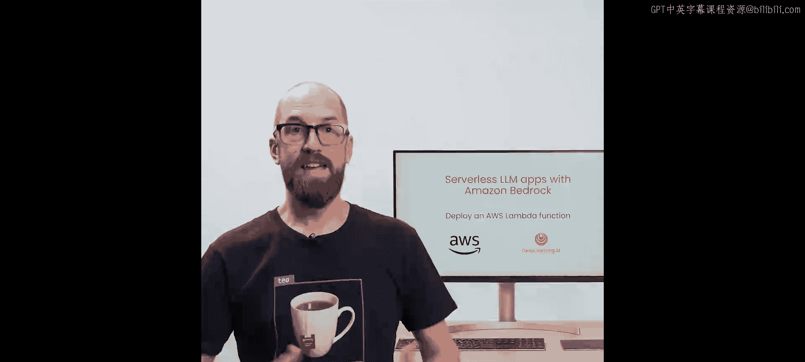

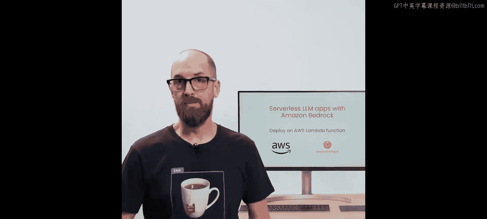

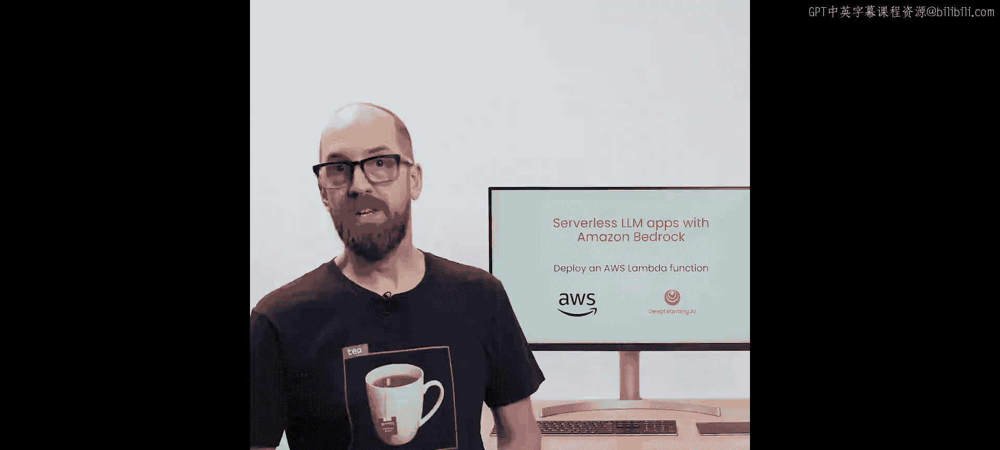

That will help us get some things done faster。 Yeah， believe it or not。 that's a shortcut。

 So once we've got those。 then we go to take a look at some of the data that we're going to be deploying into our Lada function。

 So we'll take a look at the prompt and the prompt template and how that's been set up for us then we'll take a look at the lambda function itself。

 and this is going to be the majority of this lesson So we take a look at the lambda function and piece by piece we'll build the lambda function up and we'll look at the different code and how it works and why it's been structured in the way it's been structured So that will take the significant amount of time again。

 you've got all of the code right there。 So if you don't want that detailed walkthrough。

 you don't have to have it or if you want to come back to the lesson another time then you can always go into more detail at that point once we've got the lambda function defined We deploy it and then basically we're going to do a test and so we're going to see the lambda function working and then we're done with this。

And we can move to the next lesson In the next lesson。

 then we bring it all together into the overall pipeline。

 and it's a much quicker lesson because we've kind of built the foundation。

 if you like inside of this one。 so if that's all good with you let's get started Now as you'll notice from the code over on the left hand side there's a bunch of helpers and things that we've got to help us through with this so that we don't have to do complicated deployments and things inside of the Jupiter notebook。

 I've got some helper scripts， but let's start off with the usual So we're going to import Boto3 I'm also going to import the OS the operating system library from Python so that we can get access to environment variables and things like that。

 So let's shift enter on that run that cell so we've got the necessary libraries there installed Now I'm going to import the helpers So these helpers here I'm just going to paste them in these are scripts that I've written to help us inside of the Jupyter notebook environment to do more complicated thing。

😊，Easier so that we can focus and concentrate on the things that we're really interested in so I'm just going to import these but we do also have to create instances of each of these as well and so let me do that and I'll explain what each of them do so there's no hidden surprises or anything so first of all we've got the Lambda helper here so what we're going to be doing in the detail of this code is we're going to be deploying a Lambda function into the AWS account that we're currently working on now there's lots of different ways to do that you can do it through the AWS console you can do it through cloudform or terraform or many。

 many different ways are more than I can list here and it's not necessarily that usual to do it from a Jupyter notebook but you can do it and I'm going to do it here and we're going to use this helper function that I've written to do it so we're going to create an instance of the Lambda helper and just to let you know there are a couple of different methods that we can call on this so we've got deploy function and add Lambda trigger and we'll see what they do in more detail when we actually go ahead and use them。

I'm just going to run that cell so I've got myself an instance of the Lambda helper The next helper that we've got is the S3 helper and so S3 is the simple storage service it's the most costeff place to be able to store data it's very very simple it's in the name right simple storage service and this is just going to help us do this too So if you read the Bo3 documentation interacting with S3 is not that hard but this just abstract us away from having to do some of this so we've got a method to upload a file to download an object from S3 and to list objects that are in there and again that's just going to help us if you are experimenting with this in your own environment you might choose to do this through the AWS console or through the AWS command line so once that's run the last one for us to just create an instance of is this one which is the display helper so this is a set of helper functions that I've created to help us to be able to display large text documents inside of a Jupyter notebook。

Environment and there's a couple of different methods that we can call we've got text file and JO file I think in this we're only actually going call J file we use text file earlier on in this course you may remember okay so I've got all the helper function set up they're just sort of now out the way these extra tools that we can use just to make it easier for us when we're deploying our code and the last thing that we need to do is just go and grab ourselves the name of the S3 bucket which has been created for us as part of this lab environment so if I just paste in this line here we're just using the operating system library from Python we're getting an environment variable called learn a S3 bucket name text so doesn't really matter what it's called but it's grabbing the name of a bucket which has been already created for us in this lab environment and each bucket is going to be called something slightly different so if you do see this bucket name in my output it will be different to yours because S3 buckets need to have a globally unique name across。

😊，all AWS accounts so no two buckets will have the same name And so this just is a way that we can set that up for this lab environment。

 So once that's set up we've got basically everything that we need to get started and we can deploy our Lada function that can integrate with Amazon bedrock and you're going to construct the prompt in the way that you did earlier in the course which makes it easier to swap in new prompt templates when you're deploying this into the production environment So what I'm going to do is I'm going to create a text file here and we can do that inside of the Jupyter notebook environment we're going to use this sort of magic syntax of a couple of different percent signs then we're going to say right file and then a name of a file and now anything that we type in this cell when we run this cell it's going to create that text file in the operating system in the file system of this Jupyter notebook environment so by running this cell it's not。

😊，Go run the code as such and it's not any code anyway it's just some text。

 but it's going to save this text out to the disk。 So let's paste in my prompt that I'm going I'm suggesting that we use and of course you get to change this if you want and experiment around with this but let's use this for the moment So this is the text prompt that I want to use for the summarization of the transcript between in the conversation that we have from our audio file So I need to summarize a conversation the transcript of the conversation is between the data XMl tags we've seen things like this before but this is a special piece of syntax here this is the ginger templating syntax this basically is a placeholder for where the transcript will go and then we have more information about what we want from the output and here we have an example output。

 So' saying this is what we want to see as the output We want to see some JO format and we've set it up like we might。

Have specified by our application development team or if it's ourselves by what we want to see coming out of this analysis of the phone call and so we want an overall sentiment So a statement about the sentiment of the overall conversation and then we want a list of any of the issues which have been detected in there and so postprocesing whatever is going to pick this information up after we've finished processing the data can summarize or can extract this knowledge out of the phone conversation and of course if we're doing that at scale across many different phone conversation from a call center。

 then this becomes really valuable analytical insight as to what's happening in those phone calls and so we've got that we're also going to add in something here we're going to say that we're interested in issues which align with a certain list of topics and so these topics again are something that we can actually insert into the template So we've got this iterative for loop written in Python The percent symbols here are special syntax that the。

Ginger library recognizes so that the python code will loop through the variable topic which is itself a list and each item of the list will get put into the final string of the prompt for topic in topics so when we pass this to Ging we pass a list of topics and it will render each of those in this sort of bullet list inside of this section of the prompt and then it's going to say here write the J output and nothing more here is the J output so this is prompting techniques to be able to get the large language model to output the kind of text that we want so I'm going to suggest that that's the template we're going to use for now and we're going to provide this to the Lada function and package it up with the Lambda function and deploy it into the serverless compute environment into the Lambda environment in AWS so for now I'm going to run that cell and so now I've run that cell we've now got this prompt template do TxT file。

Saaved on the disk of this Jupiter notebook environment。 In fact。

 we could go ahead and actually print this out to the screen。 Why not。

 Let's go and use a display helper function that we defined a little bit earlier。

 So let's say display helper and then we can use the text file method on there and then we're just going to ask it to print out our file that we've just created just to sort of prove the fact that it has actually just created it for us So here it's saying this is the file and here is all the data So exactly as you would imagine but it just shows that we've actually just created that file and saved it to disk if you run this lab again。

 this lesson again try running that beforehand。 It won't work because the file hasn't been created。

 So trust me yes we've just created this file there is our prompt template。

 Okay now let's go ahead and create the Lambda function itself of course this is the main part of this lesson is looking at Lada functions and how they work。

 Now we're going to be writing some code here。 but again we're not going to be。😊。

Executing this code inside of the Jupyter notebook environment， we're going to be defining it here。

 just like we did with a text file and then we're going to upload the code and we're going to execute it inside of AWS in the serverless compute environment which is Lada So we're going to do the same thing as we did before and we're going to basically write a text file but this text file will actually be a python file。

 a python function that we can upload So the first part that I've gotten here。

 I'm just going to paste this in again here because I think it's useful and of course you'll see it as well in the code that's been supplied。

 It's just a reminder this isn't going to run here。 this is just a text file that we're creating。

 Allright let's get into the architecture then of the Lada function itself。

 Now the Lada function is essentially it's a python file and the Lada environment。

 the execution environment will' look for a specific function name to call Now you can change this but very often I'll say not quite default but very often。

That's called the Lambda handler so we create a function definition inside of our file called the Lambda handler and this is our entry point。

 this is what will be called okay so before we get too deep into that let's include some of the imports that we need so we're going to needops we're going to need to import Boto3 because again this code will execute somewhere else so we need to in that environment include Boto3 we're going to need to import Jason and we're also going to need to import the Ginger2 templating library as we saw before we're using Ging2 template so let's import that now so that we've got all of that setup The next thing that I'm going to do as well outside of the actual function handler itself is set up an S3 client so I can get access to objects which are inside of S3 again from this function so let's do that I'm going to call it an S3 client that will then be available sort of。

For everything that runs inside of this Lambda function。

 and we're going to call the client and we're going to build it up just as we've done many times before。

 and there's our Bodo3 client for S3。 And then we're also going to need our bedrock runtime as well。

 So I'll paste that in because we've typed it many times before。

 but there's our bedrock runtime it's the Bodo3 client for bedrock runtime in the particular region that we're working in。

 So now we've got all those setup， then we can start to look at making use out of those。

 So let's fill out the rest of the Lambda handler。 Now if you do accidentally run this cell。

 It's fine you can just rerun it again。 So I'll do it right now。

 So Ill just press run it's written Lambda function。

 In fact it's already it's overr Lambda function because I've already done this mistake several times running this cell。

 that's fine we can just keep adding text to it And when we're ready we can just finish it there and we don't have to write anymore into it。

 so let's put some content into here。 Now when the Lambda handler gets。

Haed from the execution environment from the Lada environment it gets past a couple of different variables here one called event and one called context and we rarely do anything with context it's event that we're interested in because event carries with it the payload which is basically what caused this Lada function to run and there are many reasons why a Lada function might get called you might call it directly into say I want it to run passing it some variables and if you do so those variables will arrive through event but it might be that it's an API gateway which is been extended to be able to work with a Lambda function or it might be that an event has occurred somewhere else inside of AWS such as an object or a file being put into S3 and that's what we're going to be working with here So when this Lambda function is called it's going to be as a result of file being put into S3 you'll hear me say file and object sometimes interchangeably when a file。

Is uploaded into an S3 bucket。 It becomes an object。 So data that's inside of an S3 bucket。

 that's called an object。 So we're going to have an event triggered when the object has been placed inside of S3 and we're going get those details inside of this event variable right here so we can use that and extract out of that the information that we're interested in and we're going to be interested in knowing which bucket was it so where was this data put and we're also going to be interested in knowing the name of it。

 which is the key of the object the file name if you want or the key of the object which is inside of S3 so we can go and grab both of those things So let's first of all go and grab the bucket and it's going to be inside of event an event is essentially a dictionary so we can look up inside of there we can go and look at the records and of course if you want to you can experiment around with this and just maybe even print the events out so that you can get a sense of what the event looks like。

And it explain to you exactly where these values will be stored So inside of event inside of records there's a list we get the first one in the list because we're only going to be triggered by one thing and then we look inside of a key called S3 and then we look inside of bucket and then we grab from that the name and of course there's lots of other information inside of that structure that you might want to get as well but that's how to get the bucket name out of the event the other thing that we want to get is the key and in a very similar way we can get the key out of that event out of the records out of the same part the same list in S3 but this time we're going to get the object key and remember the item that's inside of S3 is called an object and the key is the name so if the file is in the root of the S3 bucket then that's just going to be literally just the file name of that object so we've got now access to the location of the object that which has been placed inside of S3 which caused this lambda。

to run and to be executed rather so now we can go ahead and actually open up that file。

 take out the contents of that file and use that for our generation。

 So let's add in some more code you'll notice actually on the code that's been supplied the stuff that we're going through I've got some big blocks of code here there's a lot of code here So I will paste some of it in sort of directly we'll talk about what it does and why it's been included and this is the first part that I'll include and it's got a comment in there actually which also explains what this is for This is essentially just a small piece of error checking really to make sure that the object that we're responding to is the object that we actually want to respond to and so as you'll see later on in the architecture that we put together over the next couple of lessons the file that we're going to respond to has hyphen transcript Do Jason it's going have something before that which is going to be a unique name and if it doesn't have that if the file name doesn't end in that then I don't want。

Run because there's challenges with that right we don't want to get given like an image file or an audio file。

 We just need to get rid of that and say okay we're not working with that。

 So that's just a quick check to make sure that we're doing the right thing。

 And so once that's done we can now go ahead and grab the actual content of the transcription J file and you'll notice that it is a J file it's not a text file this is going to be the raw output from the transcription service from Amazon transnscribe So previously we've worked with that and we sort of saw that working at a high level now we're going get a little bit more in depth。

 and we'll see what that looks like in a moment or two。

 So let's go and set up a tri block so we've got some error handling here and we're going to first of all create a location for where the file content is going live。

 So because we basically want to load this in as a string so let's set up somewhere that it can be and then we're going to use the S3 client that we set up before to grab the data out of that S3 object so。

I can call that much in the same way as you've seen other things being called from Boto3。

 So we've got a response that we're setting up and we're basically saying with our client。

 we want to get object what object do we want to get we want to get the object which is at this bucket location and this key location as easy as that and once we do that we get this response object back and we're going to unpack that in much the same way as we've done with other things for example with Amazon bedrock。

 So let me grab what that looks like and I'll paste that in trying to get my indentication right so the file content which is of course what we were setting up before is inside of the response it's set this point body we're going to read it and we're going to decode it So in a similar kind of way to when we were working with Amazon bedrock and we had to read the streaming body object response that we got back after a generation So once we've done that now we've got the file content。

 So we've got the content of this Json file now in string。Ready for us to do something with it Now。

 if you remember when we were at an earlier lesson and we were working with the transcribed service。

 it actually responded back with a JsonN object which is this JON object and that was quite let's say complex It has a lot of data inside of it with all of the different detections it's got just a block where we've got the basic transcription and then it's got each individual word broken out with who actually said it and we needed to scan through all of that file pass through all of that file and create the transcript which was more human readable I'll say but it's readable for the large language model So we needed to do that here again。

 Now I don't want to do that inside the lambmbda handler I would like to try and keep things a little bit organized So let's go and create quick function and this function is going to do that manipulation for us and it's going to use exactly the same code that we looked at in the。

😊，A lesson when we were dealing with the response from transcribe So for that reason I'm just going to paste it in here we will talk about it。

 but I'm not going to build it up slowly so I've just pasted it in here now I'm calling this function extract transcript from textt we didn't have that function defined before but we did have this code So this function is going to accept some file content which is going to be this file content in a moment and let's make a little bit of bigger gap there so we can see the difference so this function will take that raw Jason string in and the first thing that it'll do is it'll use Jason loads to actually load the content from that file into a Python object that we can then actually do something with and so that's going to be called transcript Jason So from there this is exactly from the previous lesson where we basically iterate through that particular Jason file we're looking at the structure of it and we're constructing a line by line transcript of first person said this second person。

Said this first person said this second person said this all the way through to the end。

 and it's going to output here this output text。 that's obviously a string and it's going to pass that back obviously to whoever called extract transcript from text。

 I guess this is abstract transcript from text formatted file。

 but this name of this function is already getting pretty long。

 Now we've got that in our file we can go and call that and bring the response back so that we've now got a pure transcript that we can send off to our large language model。

 So let's call this。 So I'm going to paste this in。😊。

So this is now our transcript so we're going through the processing。

 we started off with it raw and then we've gone and done this conversion。 So now our transcript text。

 it's calling that function with the original file content。

 So now we have a string of that transcript which is great。

 Now I'm keen on having some kind of logging。 This is something that you can check and have a look at inside of Cloudwatch logs just as we did before when we're looking at Cloudwatch logs with Amazon transcribe。

 you can also do that with the running Lambda function。

 So having an occasional logging line can be super useful。

 maybe we also want to print pass in here or log in here what the transcript actually is So let's log that out as well。

 And if we wanted to we could have a look at that。 Now of course you need to think carefully about what you log and what you don't log and have maybe a more comprehensive logging policy than just printing everything out because it could be confidential information in there that you don't want to have in the logs。

😊，For now for this particular demo， I think this is gonna to work fine。

 Okay so now we've got that set up。 We need to send that off to Amazon bedrock to do that summarization of the text and again I'm going to create a separate function for that So actually that's an interesting distinction here I keep talking about how a lambda function actually can contain multiple functions but there's just going to be one entry point So we have this this is our entry point and it can go ahead and call multiple other functions if you want to So let's define another function and for this function I'm going to call it bedrock summarization and the code that we're going to put in here we'll look very similar to code that we've seen multiple times before inside of this course and it's going to use the ginger templating So the majority of this code really is going to be about sort of hydrating I think that's the terminology putting our data into that ginger template So let's go ahead and do that。

😊，This is pretty simple that you'll see different ways that you could definitely extend on this and make it better。

 but first of all we just need to open up the text file that's being created。

 so it's going to open up prompt template now for the keyai amongst you obviously this isn't running on this server as we've said a few times this is going to be running inside of the Lambda service in the serverless environment up inside of AWS So when we send our Lambda function we also need to package up at the same time the prompt template and send them both and we absolutely will do that And so when we do that when the Lada function runs prompt template Txt we be saved on disk or in the file system right next to this Lambda function so it's fine to do this and we can just open up this text file and go ahead and grab ourselves the template string so that's going to be a text string holding that template as we've defined before so then we need to hydrate it we need to put the data into the template so to do that I'm going to create addiction。

Recaled data。 And then I'm going to load this up with the data that's required by the template。 Now。

 if we scroll back， I'm just going to scroll quickly， you don't necessarily have to do this。

 I'm scroll back to look at the actual template that we created。 There are a couple of variables。

 We have transcript that needs to be inserted into the template。

 and we have topics and inside of those topics they're going to be in a list of individual topics。

 So we need topics and transcript。 That's what we need to pass in。

 And that's what we need our lambda function to pass in on our behalf。 So let's set up transcript。

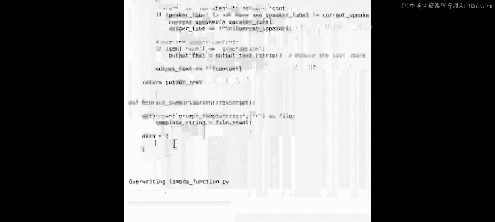

And into transcript， of course we're going to pass in the string which has been sent into this function。

 So that's super easy and then we need to pass in some topics and this is really just a sample so let's go and write a list of topics directly into here and so I've experimented around with these to see what works kind of well so let me paste in this list and put my colon back in there So charges。

 location availability。 these are the topics that we're interested in having an itemized breakdown of what's happened inside of the transcript and so you could put more in here。

 you could have less in here or you could have a different way of setting up your template if you wanted to so that's our data that we have ready to insert into our template and so then the next set of lines it's really just about the G process and so this is using the Ging templating library we have to set up this template object so template here is the template object from Ging So if you scroll back。

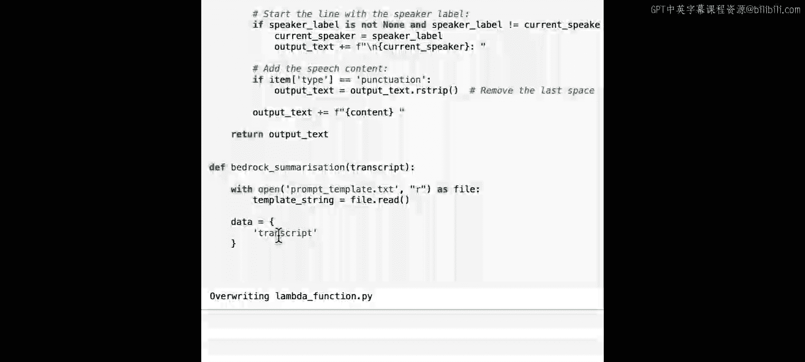

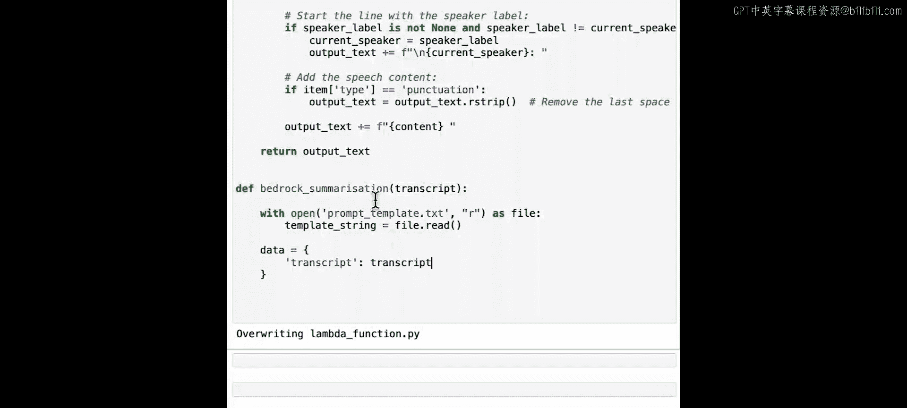

Up for a second。Through a halfcomplet code you'll see here that we're calling this this template object here and so we're creating a version of that and we're passing in the template string as it once in its creator and so we'll have this template ginger template object here and then we can use that to create our prompt so we can type in prompt and we can call template which is this variable here。

 this object here and we're going to render it。 that's the terminology from Ging hydrate render and we're going to pass the data in So that's all we need to do and by the end of this this prompt variable here well contain a text string and that text string will be our prompt template which has been populated with all of our data Now obviously that's a very simple version of this you can see how you could use Ging to do something more comprehensive potentially and even doing things like version control of prompt templates and all kinds of things like that which can be super useful especially in this sort of new era of large language。

😊。

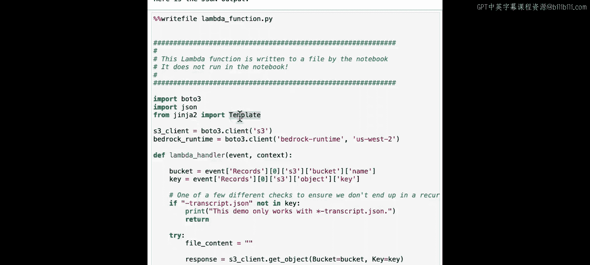

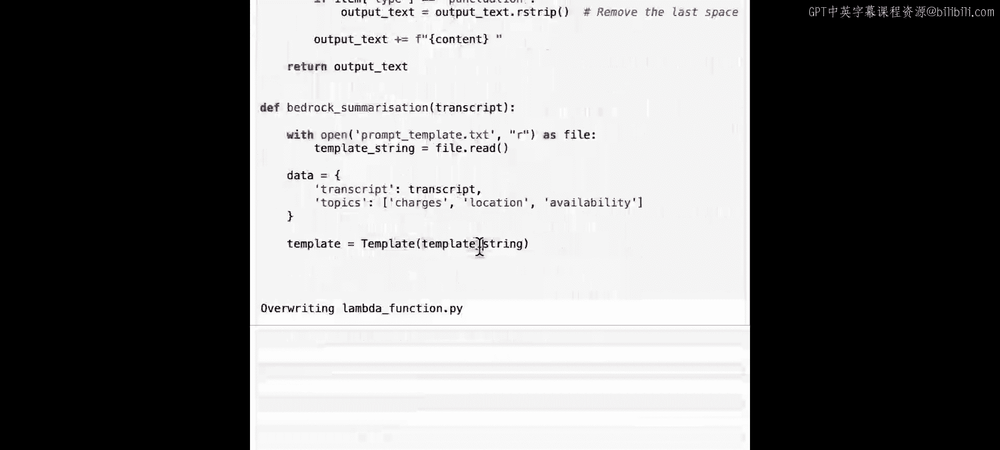

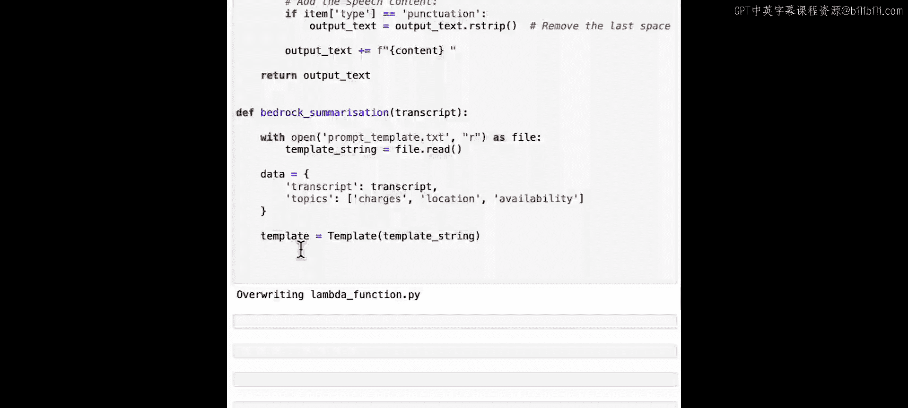

Where the prompts are really important and they contain essentially business logic inside of those prompts。

 So being out of version control those is really handy so we've got our prompt set now again。

 we can do some quick logging if we let's print that prompt out we probably won't see that this time around but again if we needed to to debug then it's going to now be inside of our Cloudwatch logs and now it's just a case of sending this prompt off to Amazon bedrock to the Titan text express model is the one we're going to use here and go and grab our generation back and so as we've seen many times before we're going to set ourselves up some keyword arguments so let's say that these are our keyword arguments here and it'll look very similar to many times that we've used this before but let's just cover it one more time we're calling the particular model that we want and then the key things in here are that the prompt gets passed into this text input and then we've got our generation configuration options here with maximum token stop sequences temperature。

And top P notice how the temperature is really low here。

 so we're not necessarily interested in the model being particularly creative setting temperature to zero will make the model more consistent。

 meaning that for the same transcript and for the same set of topics you'd expect the model to generate nearly the same response So again。

 you can experiment around with these parameters you could expose them out to environment variables there's lots of things you could do but for now I think these variables reasonably set so then we just go ahead and call our response back from the model which we've done many times before and we can go ahead and return the summary that we get and so let me again save you having to watch me write it one more time here is our summary we're going to do some Json loads we're doing it all in one line here from our response we're going into the body we're reading we're getting the results we're getting the output text and we're returning that in the string here summary okay so that is the bedrock summarization。

😊，Function that we've added inside of our overall Lada function。 So we're making great progress here。

 There's not much more to go with this Lambda function。

 and I do appreciate that we are building up a whole bunch of code and we're not actually running it here。

 So it's just a way for us to step through it step by step when you can see what's happening let's go back to our Lambda handler。

 we're essentially following the stages of the execution of this function we're almost there。

 we now have the ability to do our summarization using Amazon bedrock So we just have to go and call for it。

 So let's go and grab a summary back from bedrock summarization where we passed in our transcript and that's going to do all of those things for us。

 It's going to populate the template and then actually do the generation and then pass it back in summary。

 So this should be at this point the Jason return that we want to see that we've asked to have return from our generation from Amazon bedrock。

 and what do we want to do with the output So。😊。

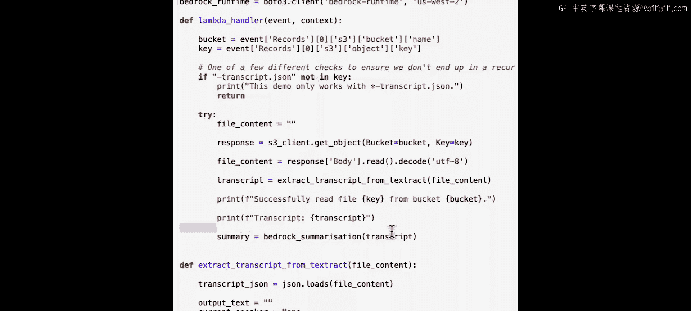

Wan to put that。 Now we could just print that out。 but if we did that。

 it would just end up inside of Cloudwatch logs and that's not very useful。

 Nothing that's actually called the service will actually be able to see that output。

 So a reasonably common way of outputting from a pipeline function like this is to save the output to S3。

 And so you'll notice that with this we put an object into S3 and then we process it and we save an object back out to S3 S3 really can be used as this sort of staging point for data manipulation like this in an event drivenven architecture。

 So let's go and do that we've got an S3 client that we've already created and we can go and use that client again to upload the object back into S3 and so we can do that I'm going to paste that in here。

 So this is S3 client。 We're using put object and we're going to put it into the bucket。

 we're going to write a specific key here of course， because we don't want to。

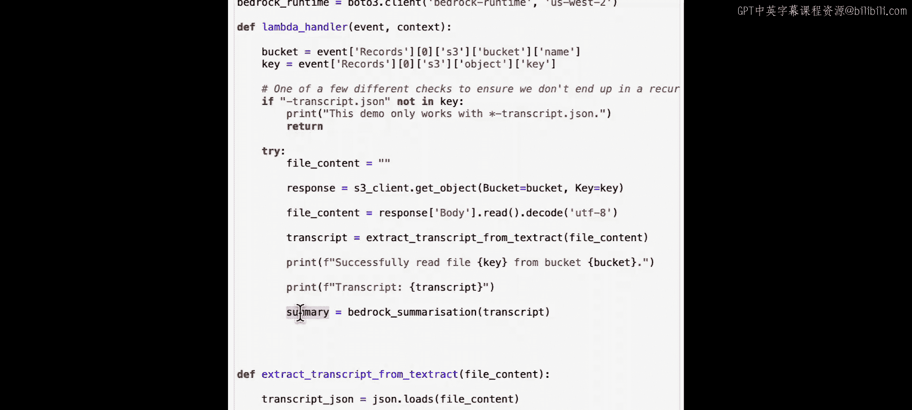

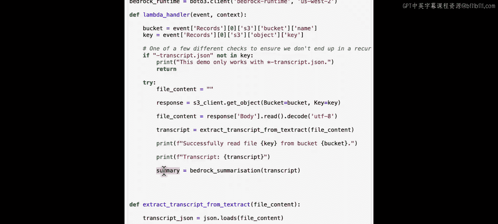

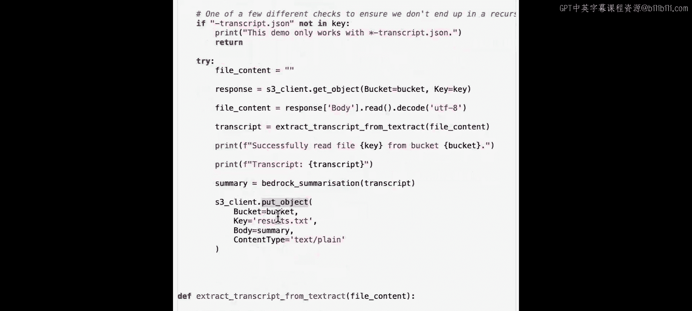

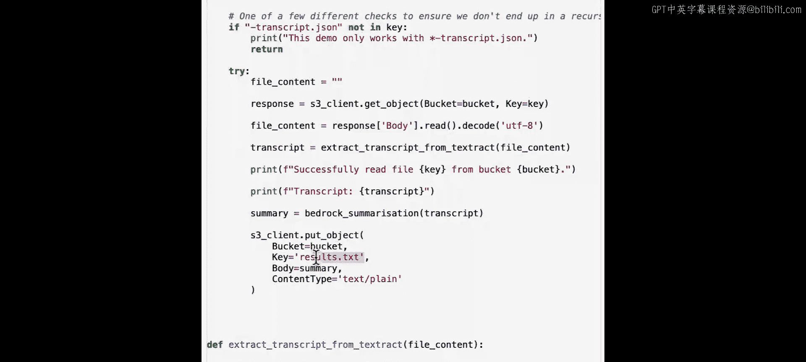

Overrite the Json file。 and we're going call this results do T XT。

 obviously that's reasonably hardcoded and probably would need to be extended。

 but for now it'll be fine in the body， we're going to put the summary。

 So that's the actual data itself goes into the body and it's a plain text files。

 we've got a mine type there when we call the S3 client put object。

 So that line on its own of course， it's multiline。 But that single command there。

 we'll upload our result into our S3 bucket。 And so it's going to put it back into the S3 bucket that we originally got something from for this example。

 since you're looking for the transcript file and also writing the summary to the same bucket。

 if you don't have some code to check what type of file is being added to the bucket the Lada function may get stuck in an infinite loop。

 What I mean is when the Lada function writes its summary text file to the bucket this will trigger the Lada function to run again。

 if you don't check the file name and the file。Is not what you're looking for。

 then the Lambda function may attempt to summarize its previous summary。 so to avoid this loop。

 we can add this statement and make sure that the Lambda function only proceeds when a new transcript dot Json file is added to the bucket and not when summaries or anything else is uploaded to the bucket。

 Okay， let's finish off this try block that we've got here。

 I'm just going to do that it's a boilerplate Python really at this point。

 So we're going have an exception。 we're going log the exception if it does occur otherwise we're going to return with a status code 200 this return block here is what you would see if you are calling this Lambda function。

 Now as it happens， it's going to get called by the event that happens on the S3 bucket but if you were to extend this and run this in a different way then you would get this output coming back saying hopefully everything's run successfully and so at this point the code should be complete we have a whole Lada function there。

And at this point， all we've done again is we've just populated this cell。

 but if we just review through all of that and make sure it looks fine。

 you can just take the code that's already there and just run it。

 you don't have to build it up step by step。 It's up to you but I'm going to press shift and enter on here and that should now write this Lada function out to the disk obviously it's overwritten it because I've already I've already done that once。

 So now our Lada function has been written。 the next part of this is now super easy because we've got all of those helper functions。

 So we're going to use the helper functions to actually upload this as a Lada function and start to actually see it working before we move to the next lesson where we tie all of it together into a fully automated pipeline。

 So to use the Lada helper， let's go ahead and call the Lada。😊。

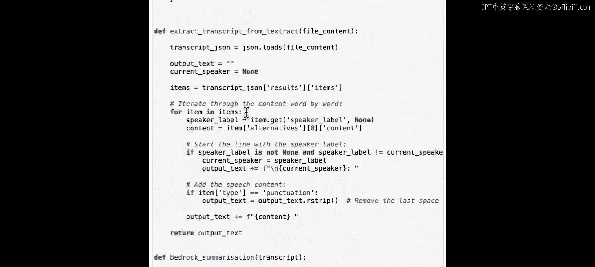

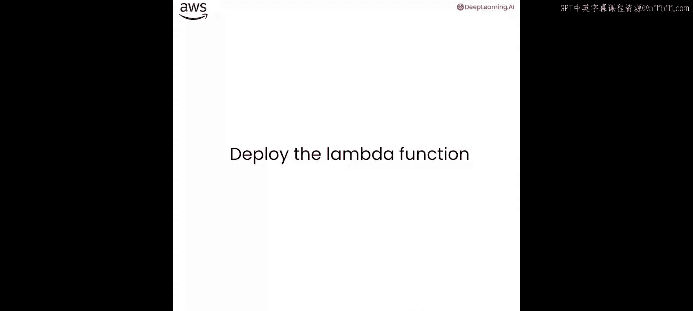

Helper。And deploy function。Do have to spell it correctly and the things that we pass into here where we're going to pass in everything that we want to have sent to the Lambda service so we have a list of files and so we have the Lambda function do py let's go and break this out over a couple lines so that we can actually see what we're doing so the first thing that we've got here is a list and this is just a list of all of the files that we want to upload and actually zips these up actually so it takes the Lambda function itself and our prompt template it zips it up and sends that to the Lada service and we also need to have in here the name of the function。

 So this just makes the code a little bit more portable so we've got function name and we're going to call this the Lambda function summarize because that's what this Lada function does so that's literally all we need and if we run that so shift enter you'll see it sort of going through the various stages so it's zipping up the function but what it does is actually looks to see if the function already exists。

Because it's compatible essentially with you reuploading and doing it again。

 So if you want to experiment with the code， alter the code， then you can do。

 and then you can just run this code again and rather than creating a new function。

 it'll just update the code from the function that's already being created。

 so it'll do all that kind of stuff for us So in this particular case it didn't exist because we've not run it before。

 So it goes ahead and creates it and it says done so thumbs up， everything's looking great。

 Now the next thing that we have to do at this point we have a Lada function inside of AWS it' set there。

 it's ready to be run。 it needs to be told to be run。

 Now we've written the code in such a way that it will work when it's been triggered by this object being passed to S3 but we actually have to set that trigger up now that the function exists we need to tell the Lambda function to be triggered whenever something is uploaded into that S3 bucket Now it's an S3 bucket。

 which。😊，Already being created for us inside of this lab environment and if I scroll back up seems like quite a long way now we have this bucket here。

 this bucket name text this is the actual bucket that we actually want to put the trigger on so whenever the object is put into this bucket we want to trigger our code and we can do that again with the Lambda helper so if I just call Lambda helper and this time we're going to add the Lada trigger and we pass it in the name of the bucket and just before we run that don't run it yet just before we run that I also would need to to set something else up for the Lambda trigger I just want to set up this is the filter rules suffix so remember before I setting how we have multiple safeguards to make sure that the trigger only works under certain circumstances so to prevent this trigger from working when a text file is uploaded as this Lambda function actually will do to itself we're setting the trigger to only work with JSO files。

😊。

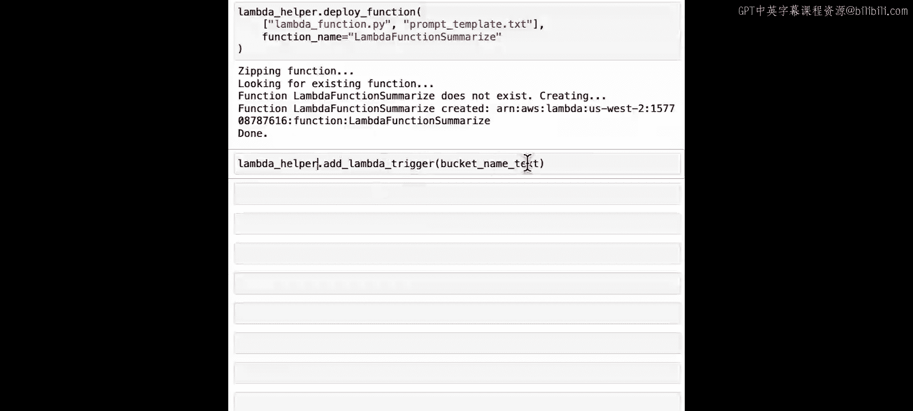

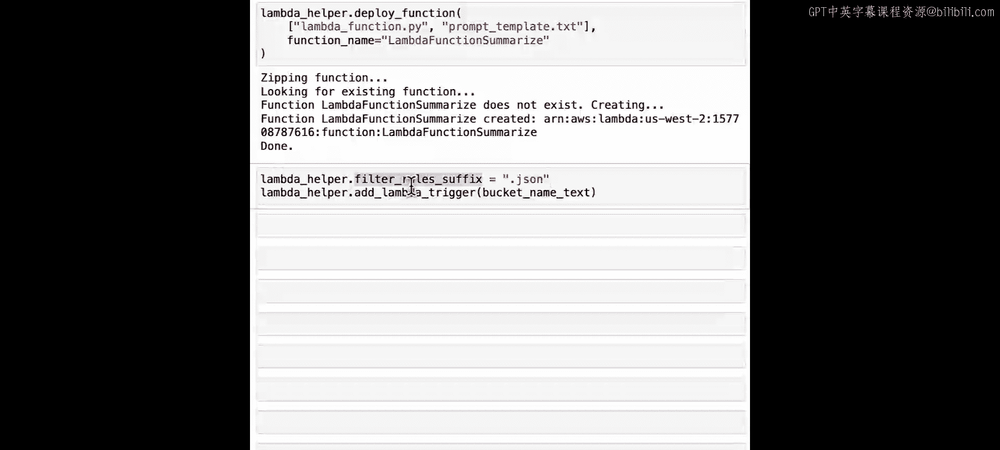

So that's going to pass that configuration parameter into this add Lada trigger and now we can run it so again。

 this is just the helper function doing this for us。

 and once we've done that we get back to here it says trigger has been added so everything's successful there Now if you do have an error message after you've run this it's possible that you ran this too quickly after deploying the function it does need just literally half a second in between deploying the function and deploying the trigger maybe a couple of seconds so just wait just a beat just before running all of these cells and you should find it fine you can just rerun it a number of times and it will it'll work eventually okay so now we've got our trigger setup up So now we're ready we're actually done if we upload an a object into that bucket it will actually go through and it'll do the summarization for us now realize that we're actually uploading the result here that transcribe will make for us so we've only done half of it and we will complete this。

😊，The next lesson but let's prove that what we've done here does actually work。

 And so to do that we've got a demo transcript sat on the file system here。

 Let me actually just use the display helper again this time using Jason file which will hopefully nicely print out this data to the screen for us Now this is enormous by the way so we're not gonna scroll through all of this and in fact what I'll probably do is I will comment out this line and run it again so that we sort of get rid of it and get more space back。

 I just want to show you that this is here so if I just run this oh it's put it into this sort of sliding box here so you can see this is the demo transcript or Jason the job name of when it was originally done this is an example that I ran on my own machine a while ago and we can use this just to show if you like that the Lambda function works so you can see all the bits and pieces in here and this goes on forever and ever and ever and ever there's all the different parts of the。

Speech and who said it in the start time in the end time。

 And this is essentially what we're passing through with that code that we looked at before to extract out something more readable which has actually got the speaker one speaker2 speaker1 speaker2 I just wanted to show you that it was there。

 I'm going comment that out and run it。 It's a useful way of getting rid of all that output。

 So what we need to do is we need to upload that adjacent file into our text bucket that we had and we can use our handy little helper functions to do that。

 we's going to call upload file we're going to tell it the bucket that we want to put it in and we're going to tell it the file which is local to us that we want to upload so let's go and run that and it says that it's been uploaded and there's a nice big typo in there。

 We'll fix that up at some point next's then use the next helper from the S3 helper。😊。

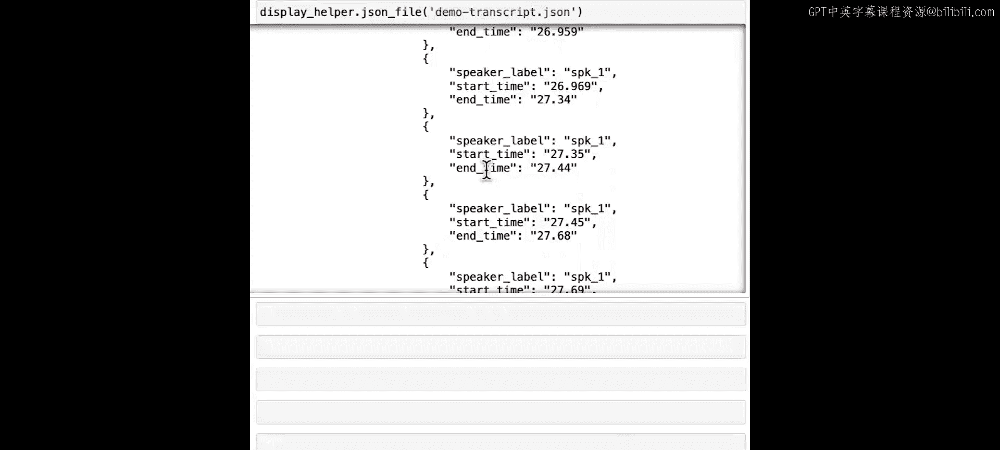

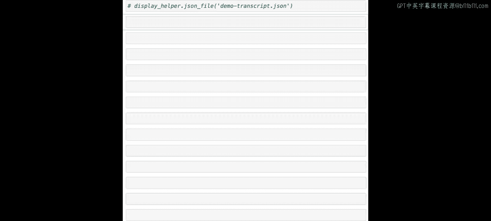

Which is to list objects So if I just run that then we can see here we've got what we have just uploaded there demo transcript and we can also see already results do Txt and the reason why that's there with a timestamp。

 which is very close by you notice it took three seconds sorry6 seconds So this results do Txt is the results from our Lambda function。

 it worked so our Lada function has been uploaded and it's actually being triggered and it's actually worked。

 And so essentially this is the end of the pipeline again in the next lesson we're going to come back and put in place the beginning of the pipeline and you'll see everything working back to back or all the way through is that's what I mean to say So let's go and grab that So if I just run the S3 helper again we're going to download the object again if you were doing this inside of maybe your own account you might just go to the S3 console and just download the object but this is going to download results do TxT。

 which is this object。😊，There and it's going to make it into a file when it downloads it。 Yep。

 Buck downloaded。 it was successful。 That's all good。 So now it's just a case of showing that file。

 And yeah， let's use a helper again。 could we could write something， but let's use display helper。

 So display helper。 and this is what this is a text file。😊，And we just pass in results。 Txt。

 So wait a minute。 What are we expecting to see here？

 We passed in the transcription data from the audio transcription and we've asked it to produce a Json output highlighting anything that might be of concern or of interest inside of the phone call。

 So now let's look at what we got and here we go。 So we've got a nicely formatted Json structure we've got a sentiment which is positive and it says yeah there's this topic of charges there are preauthorization is a standard procedure to cover any incidental expenses you make on your stay。

 However， it is only a hold and not an actual charge。

 So it's picking that out of the actual conversation of an issue of a topic of charges。

 And if you were to experiment around with the prompt and with a different topics that you want out。

 you could get it to do different kinds of things。 Of course there are other models that you can use with Amazon bedrock as well。

 but that's a really good example of how we。Create the end part anyway of this pipeline that we're going to put together in the next lesson we'll complete all of this now and we'll add in the automated transcription component and see it working end to end。

😊。

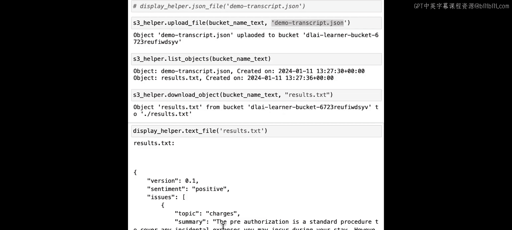