# 吴恩达《使用Amazon Bedrock构建无服务器LLM应用程序｜Serverless LLM apps with Amazon Bedrock》中英字幕 - P6：L5_Event-driven_generation.zh - GPT中英字幕课程资源 - BV1X1421Z7w9

Now that you've deployed your code into a Lambda function in order to automatically trigger it whenever an audio file is uploaded。

 you can set up an event driven architecture， so let's do that。😊。

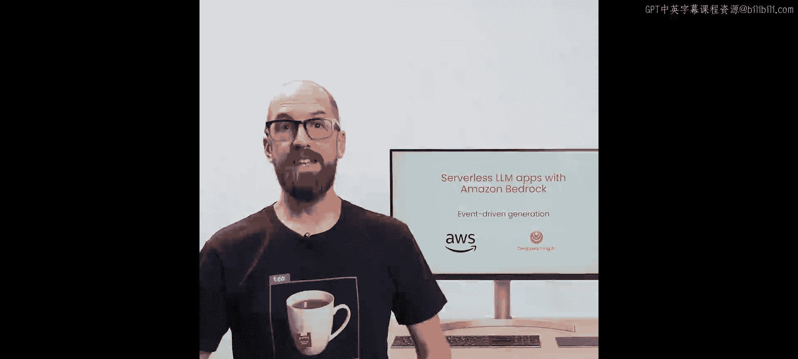

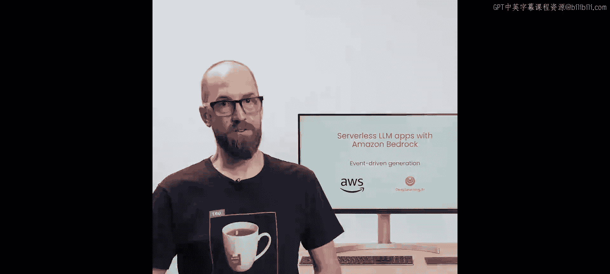

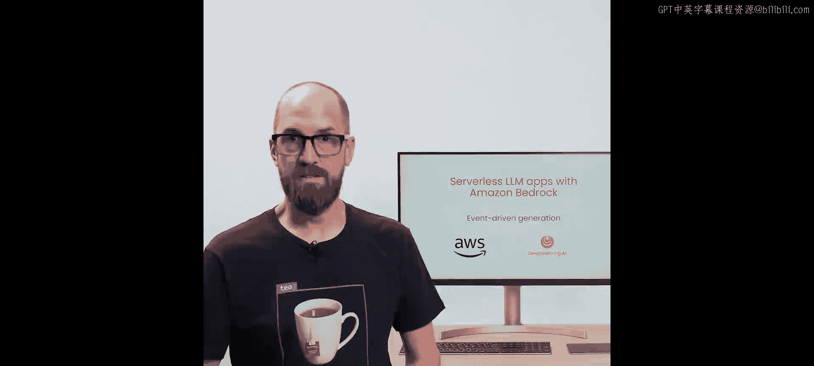

So you're doing really well congratulations in getting this far。

 Let's complete this code off and include the beginning of our pipeline so that we've got something end to end now inside of this lesson environment。

 you probably don't have any longer the Lambda functions we deployed from the last lesson so go back and do it all over again now I'm only kidding I'm kidding we don't have to do it again already deployed inside of this environment to the same functions that we did before with the template and all that kind of stuff so you can just carry on from where we left off all of that stuff is there for us so let let's rapidly get into this and get this up and running and working the first block of code is just to import the libraries much in the same way as we did before so we've got Bo3 and OS so that we can get hold of our environment variables then we've got a Lambda helpers which we used so much in the last lesson and we are going to grab ourselves a couple of different environment variables for the same reason as last time all S3 buckets need to have unique names globally so mine will be a different name to yours。

And this just allows us to be able to create these buckets inside of the lab environment and then have a standard name for them that we can use a reference。

 so let's go ahead and run that cell and once we've got that well we're back now into deploying Lada functions and the reason for that is that we need a Lada function to be triggered when the audio file is uploaded So if we look at this from an architectureural perspective we're going to have our audio file and the system that creates those or in this particular case it's going to be us is going to upload that into an initial audio S3 bucket and so that S3 bucket is where those audio files live and then when that happens when the object gets placed into the bucket it's going to cause an event to trigger and that event will call a Lada function Now it's exactly the same architecture if you like as the last lesson but this time it's going to call a Lada function which is going to find the location of that object in the same way that we did before and this time it's going to pass it to the Amazon transcribe service we did this by ourselves by。

And if you like inside of the Jupyter environment now we're going to get a Lada function to do that for us so that it's fully automated and we don't have to have obviously running code set in front of us。

 it's serverless， it's all happening for us and it can run at scale inside of the AWS cloud environment。

 So that's what happens。 So that Lambda function does that Now what it's going to do is it's going to provide the configuration for transcribe to say once you've done that once you've finished put the transcription JO file in this next bucket。

 which is the text bucket And from that point it's going to get picked up by what we deployed in the last lesson So we're putting on the beginning of our pipeline here and we are splitting this across multiple S3 buckets in this case two different S3 buckets one which contains our audio files and the other which contains our text files。

 Y we need to write another Lambda function and so we're going to use the same method that we did before where we're going to basically create this text file inside of this cell。

 and this time。😊，As this code is a lot less to specifically to do with generative AI。

 let's paste the function in and let's just step through it。 so again。

 I've just included this section at the top so that whenever it's seen。

 yes this isn't running inside of this notebook we're creating the file inside of this notebook。

 So we import when it's being run inside of the Lambda environment。

 we import Jason Bo3 Uuid and OS so OS again because we want to have access to environment variables inside of the Lambda environment UUid because we want to be able to make a unique name for the transcription job as we did before。

 we're going to create an S3 client and this time we're going to create a transcribe client So there's no Amazon bedrock here。

 it's using the Amazon transcribe service， which is a pretrained AI model for doing the transcription job for us so with those clients created we're now going to go ahead and create our Lambda handler。

 And if you remember this is the entry point for this code when it's run inside of the Lambda environment。

😊。

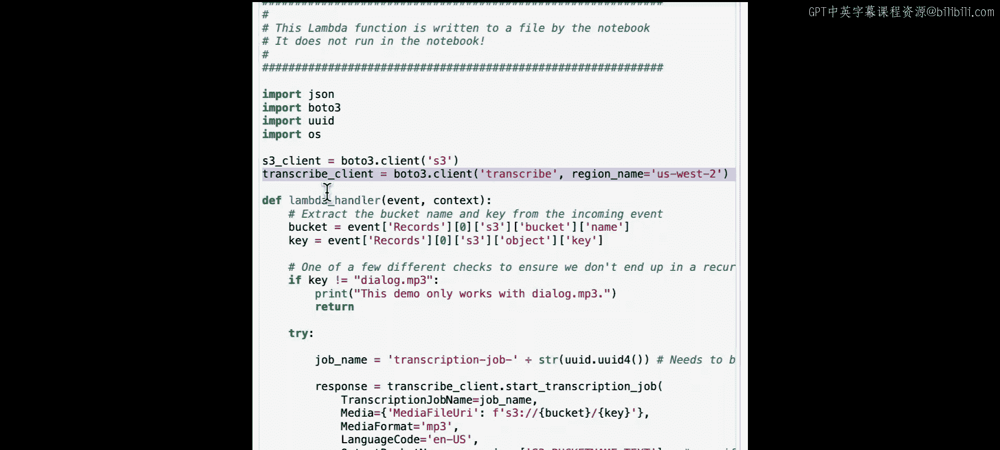

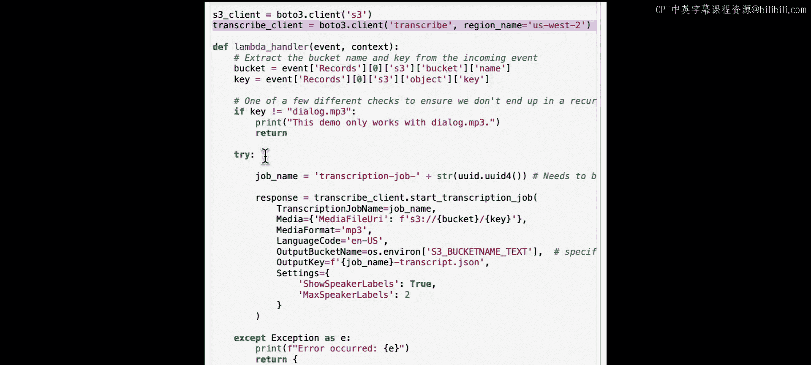

This is what's going to get called and as well if you remember it's the event which is going to contain the information about the event that caused the Lambda function to be run and so we can go into that we can inspect that we can grab out of the information about the object which is been placed into S3 so we can grab the bucket so the bucket name and of course that means that this lambmbda function could be triggered by objects being uploaded to the different buckets like it would be it would work it's not just tied to a single bucket anyway so we get the bucket in this particular case and the key or file name in this particular case and again we're only going to work here with dialomp3 when we could change that and say if it's onlymp3 files etc but we're only looking for dialogmp3 which is the audio file which we've been playing around with earlier in this course so it's the same one of course you could use a different one and so with that we have our object as long as it is dialogmp3 then we're happy to move forward and then we can call that。

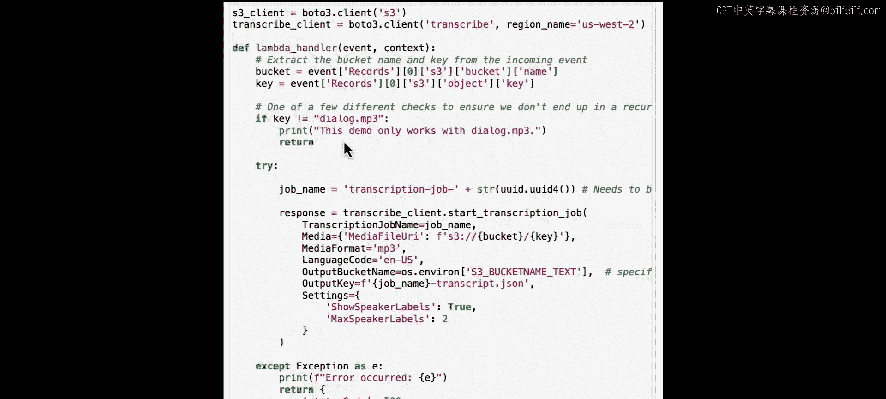

job and we've seen this code run before in a previous lesson。

 but now it's wrapped up inside of our Lambda function。

 So we create a unique transcription job name using the Uuid because it needs to be unique for the transcription service。

 And then we call start transcription job。 using the transcribe client and we pass into that the name of the transcription job that we've just created where the media is。

 so we know where the media is。 It's in this bucket location here。

 notice that we're not downloading it like we did before we downloaded the J object and manipulated it。

 We don't need to do that here。 We just need to know where it is。

 so we can tell transcription where it is the tran service where it is。

 And so that's what we do here。 It's in this bucket location key。 We give it the media format。

 we give it some help about which language it's got to look at。 And then here's the key part。

 So this is the output bucket name and we're going to pass in an environment variable。

 So this is actually an environment variable inside of。

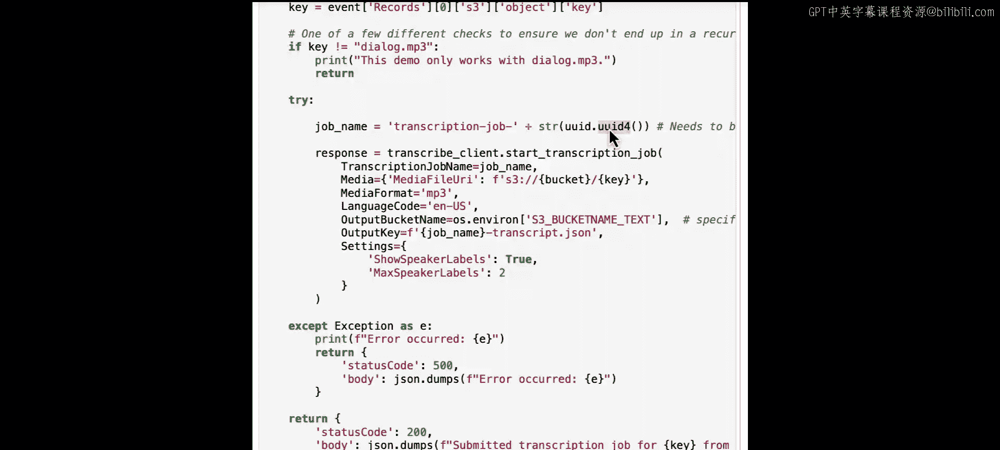

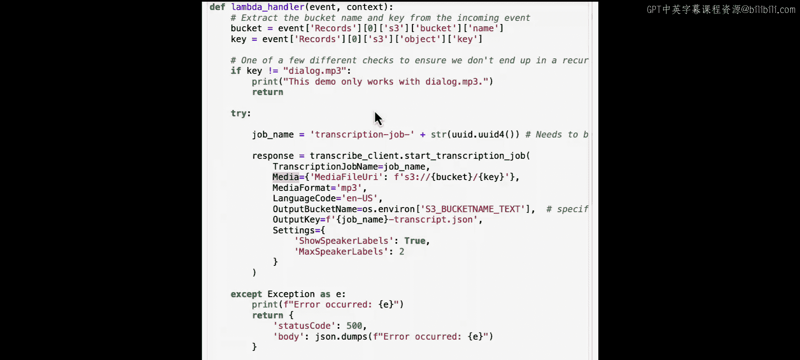

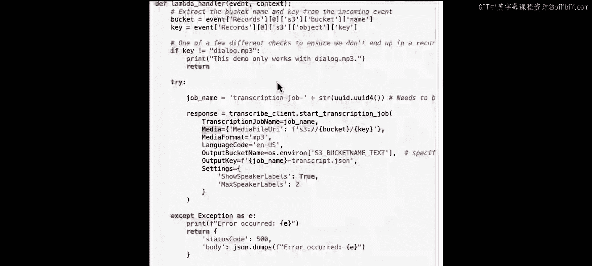

Lambda environment。 So this is an environment variable we need to set up alongside our Lambda function。

 So we'll use that with the Lambda helper will help us do that。 and then we have an output key。

 and so this hopefully will be familiar from the last lesson and from the code that we deployed in our last Lada function。

 We're going to output the transcription as the job name that we defined with the Uid and then hyphen transcript Jason so that it will pass the necessary filters and checks inside of the other code that we created and we're going to ask it to show the speakers and we're going to look for two different speakers inside of this conversation and then we're going to have some error exception handling kind of stuff down the bottom as is reasonably good practice I'm not claiming my code is the best code ever。

 but it's not too bad So let's go ahead and shift enter on that So we've run that and we've run that Lambda function and now we can get into deploying this code using the Lada helper of course let's go ahead and do that let's step through it line at a time and again the Lada。

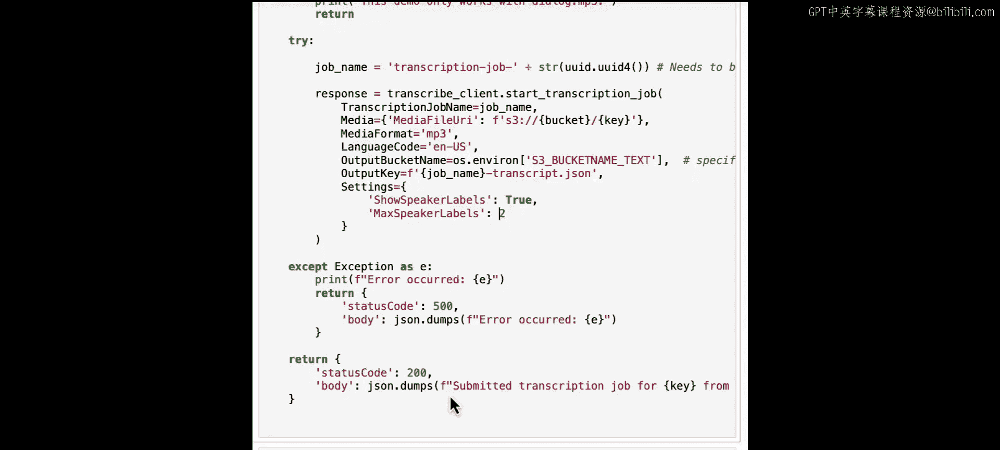

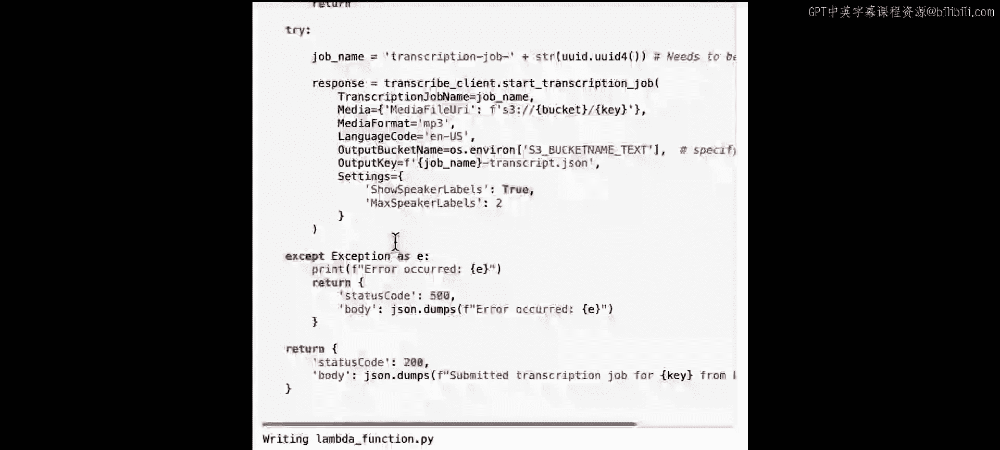

Heer is going to abstract us away from some of the complexity but what it's doing is important to know so let's paste this line in here So this is the Lambda helper。

 which is actually going to create some Lambda environment variables doesn't actually create them at this point but it sets the values of them for when the function gets created and so we're going to set something called bucket name text and then we're going to pass in the value that we've got loaded into our environment and if I scroll up then you can see of course that's the same as this so we're creating an environment variable inside of the Lambda environment which is called this and it's going to have the name of our bucket and so it's just a way of passing that information along rather than having to pass it into the event somehow we can define this as an environment variable for our Lambda function So once that's set let's paste in the next line as well and run these both at the same time I me just paste that in there so this is again the deploy function and we're gonna have one file to pass this。

Time so it's a list of just one。 We don't have any prompts or anything here this time and then we're gonna give it a name Lambda function transcribe and that's that So let's just run that shift enter and yep the Lambda function does not exist it's fine if it does because you just rerunning it again it will work just fine and it's just deployed our Lambda function for us So it's just taken the code that we wrote above packaged it up sent it to Lada and it's now sat there waiting to run and exactly as we did in the last one it's now needs to be triggered so we're going to trigger it we're going to set up our filter we're going to only run this trigger if it detects anmp3 file because that's the only time we want it to run。

 we don't need it to run if it sees a Json file or text file or anything else so a file with at least the extensionmp3 and then we are going to actually go ahead and create that trigger then and so here we go。

Lambda helper add Lambda trigger and we're going to add the trigger on the bucket， the audio bucket。

 and we're going to trigger our Lambda function transcribe function。

 which of course is what we've just defined above So let's go ahead and run that and it's worked successfully again as per the last one。

 if you race through this and then run this cell above and then immediately run this cell。

 you might find that it's got an error。 So just give it a few beats and then run this and it should be fine。

 Okay so now we are set up with our architecture。 So we have everything set up。

 we've got our audio bucket， which is got a trigger on it when that trigger is fired。

 it's going to cause our Lambda function to run that Lambda function is going to call the transcribe service and the transcribe service is going to do its thing It's going to listen to the audio file and do the transcription into that JO format which it will dump into our text bucket The fact that that has been dropped into that text bucket。

Cause the event to run， which causes our summarization function to run。

 which uses Amazon bedrock so it will go and look at the transcript J data。

 it will create a text version of that output it will then put it into the prompt it will then send it to the large language model and it will then get its response and it will put that response into the S3 bucket。

 So enough talking let's see it actually working so we have thatmp3 file set on the file system here along with us so we're going to use S3 helper to upload it to the audio bucket that we have so let's run that and hopefully it comes back with something looking successful again with our typo will change that so the file has been uploaded so it's upload that successfully so we can go and check to make sure that the files there or go and take a look so let's use our list objects on the audio bucket and indeed it's there so there's our dialogmp3 and it's just been uploaded。

That's all that's gonna happen inside this bucket。 Nothing else will happen here what's happened is it's triggered that Lambda function and so the next thing we should see is inside of the text bucket that's the next evidence that we'll see that it's working so let's call list objects on the text bucket right so there are a few things in here we've got right access check file temp this is actually something that transcribe create just to make sure before it starts to do the transcription does it have the right access to be able to write to this bucket it did so it moved on to the next part now what can we see here we've got this transcription job with this Uid name here transcript do Jason so that is the transcript that got created by the Lambda function that we've just created earlier in this lesson so that's successfully worked and then we can also see that just a few seconds later it has finished and created results do txt which is the output from our summary。

😊，It's the output from generative AI。 So let's go ahead and take a look at that。

 I can call my S3 helper and I can say that I want to download。An object and we need to get it from。

 where do we need to get it from， we need to get it from the text bucket and we want to call what do we want to get we want to get results。

 TXt。So let's place that in here。Let's run that。Excellent， that's downloaded。

 and we can use the display helper to show that。 but I we didn't actually load in the display helper。

 So let let's just do that quickly here。 So let's load display helper。

 we need to get ourselves a an instance of display helper。 So that's gonna be a display helper there。

 right now we can use display helper。 Obviously， you could just download this file as well。 So。😊。

Display。😔，Helper dot is text file isn't it， it's what we have to call and we're going to call text file on results。

 TXT， which should be downloaded into our file space okay。And there we have a very similar output。

 of course， to the last time that we ran this in the previous lesson。

 but this time we've actually seen it all the way through end to end。

 working from the actual original input which just up here just a moment ago was actually the MP3 file So we've gone in this pipeline all the way through from our MP3 audio recording。

 it's been transcribed and we've taken it all the way through to our summarization at the end Now of course this architecture is there to be manipulated and changed and you could do all kinds of things with it you could apply it to your own particular kind of business problem that you have and there's many different ways that you can extend this much in the same way as there is many different things you can do with Amazon bedrock。

 we've really just scratched the service here and so here is a set of resources you can connect to to be able to see some of the latest things that you can do。

😊，Amazonaz bedrockOkay， we've made it to the end， so let's go to the next video。

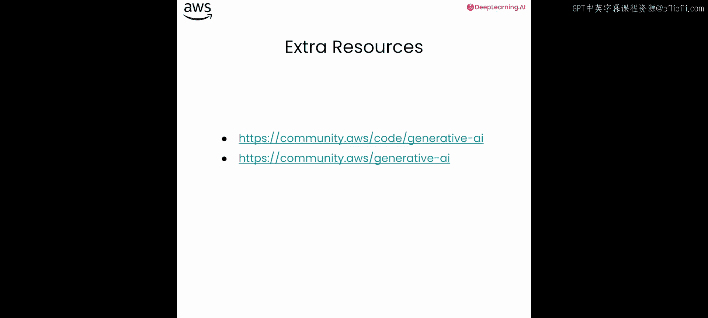

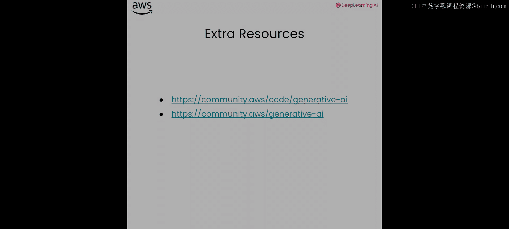