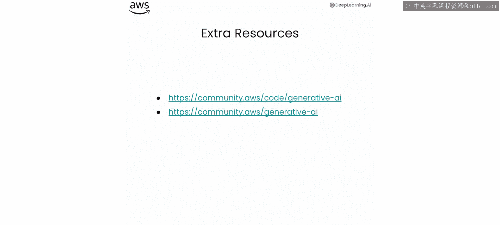

# 吴恩达《使用Amazon Bedrock构建无服务器LLM应用程序｜Serverless LLM apps with Amazon Bedrock》中英字幕 - P7：L6_Conclusion.zh - GPT中英字幕课程资源 - BV1X1421Z7w9

In this course， you've seen how to use Amazon Brock with a simple and powerful event driven pipeline to use LLMs to process the recordings of customer interactions。

 This architecture can be extended and adapted in many ways to work with your specific requirements。

😊，And what we've seen so far only scratches the surface of what you can do with Amazon bedrock。😊。

You can also deploy more sophisticated architectures such as agents。

 agents allow LLM powered applications to interact with external systems such as your other applications and thirdparty services。

 you could extend this architecture from this course so that the LLM powered agent could automatically update customer records in a CRM or send an escalation email to management。

😊，Amazon Brock enables you to build agents in Lambda functions。

 just like the ones we saw in this course， so that the agent workflows are all hosted in the cloud and work at scale。

😊，Amazon Brock also supports retrieval augmented generation or RaG using a service known as knowledgebase you can set up rag in just a few clicks。

 You can integrate customer support documentation into the application enabling LMs to find relevant and up to- dateate information quickly to find out more about these architectures and Amazon bedrock in general take a look at the resources at the end of the previous lesson so it just remains for me to thank everyone who is involved in putting this course together the awesome team at Amazon here at deeplearning。

 AI and of course you for spending your time with me I can't wait to see what you build with this technology and Amazon bedrock so please reach out and let me know Thank you and goodbye。

😊。

Great， are you sure you don't want some tea Go on then。You have some too， all two。

