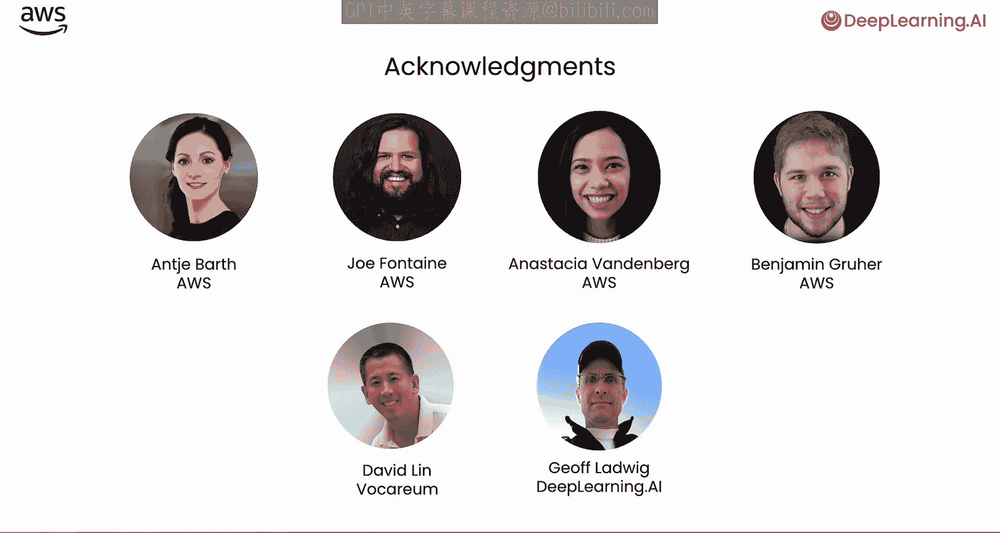

# 吴恩达《使用Amazon Bedrock的无服务器的智能工作流Serverless Agentic Workflows with Amazon Bedrock》 - P1：1.intro.zh_en - GPT中英字幕课程资源 - BV1auC2YvExE

Welcome to serverless agent Workflows with Amazon Brog built in partnership with AWS and taught by my Chambers。

 who is a senior developer advocate at AWS specializing in generative AI Mike also taught the serverless Lm apps with Amazon Bfor course It's great to have you back Thanks Andrew。

 I'm happy to be back and excited to be sharing insights this time on agent Workflows on AWS。😊。

In this course， you'll learn how to deploy a responsible agent application into production using serverless technology。

 you initialize an agent and tools， code execution and guardrails and then deploy it in a serverless environment。

As Genrative AI grows， applications are becoming more complex and more sophisticated in the past you may have created the chatbot by adding conversational history to the OM Now chatbots and RA applications can be much more complex than you want to fetch information from the web or from local sources and further it might determine by itself when the information is not enough and when to keep searching the web or other databases for more info。

😊，In other words， these applications have become much more agent。

Both these complex workflows when an agent may call loss of APIs。

 the complexity of getting a system up and running has also grown。 For example。

 there are now agents with access to many dozens of APIs rather than keeping a lot of hot service that you're painful by the minute ready to deserve any API call a serverless architecture lets you achieve the same effect with compute resources they get turned on only as you're needed and without you having to worry about maintaining and scaling a bunch of servers。

One of the important concepts you also see in this course is the development of agents as a standalone service。

 we can start with a pre bill agent and configure or customize it to support your application。

This change where you view an agent as a building block rather than the L M as a building block is an important shift。

 And you also hear about this in this course。 That's right。 In this course。

 you'll build a customer support agent for your business selling tea mugs。

 Here's how the course will progress。You get started with Amazon Brock where you create your first serverless agent。

 you'll learn to invoke it and to examine its trace。

 giving you visibility into the agent's thought processes。Next。

 you'll connect your agent to external services。 It will fetch these customer details and log support tickets in real time。

 demonstrating how it can interact with business tools like CRM systems。

You'll then equip your agent with a code interpreter， enabling it to actually perform calculations。

 This opens up possibilities for data driven decision making。

 and truth be told this is absolutely my favorite lesson。😊，After that。

 we'll implement guardrails to prevent your agent from revealing sensitive information or using inappropriate language。

Then you'll implement a fully managed rag solution， connecting your agent to support documents。

 This will help the agent to resolve issues independently and know when to escalate。 Finally。

 we'll briefly tour the Amazon Brock agents interface in the AWS console setting you up for further experimentation。

 By the end， you'll have built a sophisticated AI agent capable of handling real world customer support scenarios。

 fully serverless and ready to scale。 Many people have helped to develop discourse。

 including Auntiea Baf， Joe Fonine， Anastasia Vandenberg and Benjamin Grruer from EwS。

 David Lynn from Vulcarium and Jeff Luthwig from Tbl AI as disclosure。

 I also serve on Amazon's board of directors。😊。

And with that， let's go on the next video to get started。

