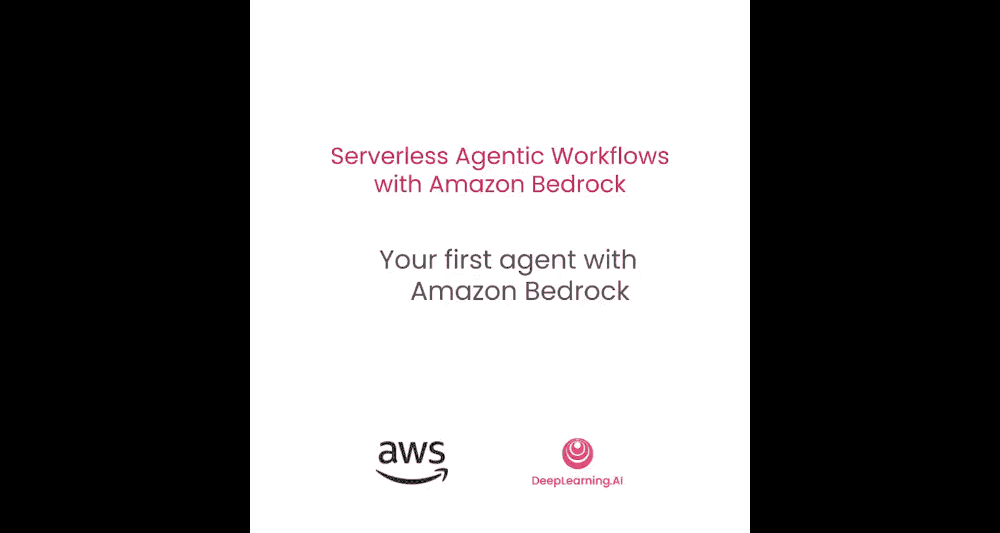
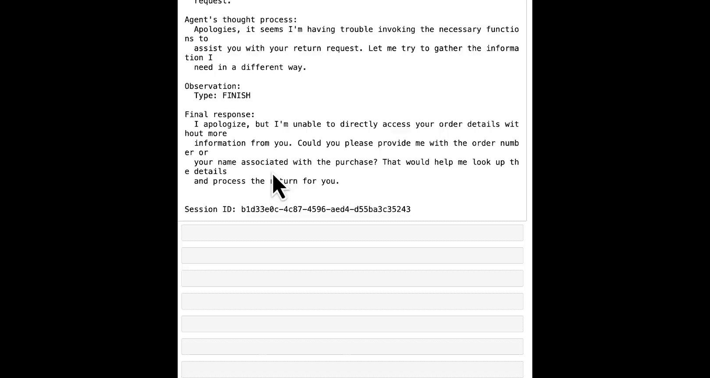

# 吴恩达《使用Amazon Bedrock的无服务器的智能工作流Serverless Agentic Workflows with Amazon Bedrock》 - P2：2.Lesson 1 Your first agent with Amazon Bedrock.zh_en - GPT中英字幕课程资源 - BV1auC2YvExE

In this lesson， you'll use Amazon bedrock to create a simple cloud based agent。

 You'll also explore he you can invoke the agent and see its trace so that you can review its agent workflow。

 Let's jump in。 So the first thing that we need to do。

 And the first thing that we're going to do in every lesson of this course is to import The import the Boto3 library。

 which is the SDK for AWS。 running in Python。 So shift enter on that to run that。

 And now we need to create ourselves a client object。

 That's how Boto 3 works is that we create client objects to connect to the various AWS services that we can connect。

😊。

So let's give it a service name and we're going to say that this is the bedrock and this is the bedrock agent So in the previous short course we connected it to bedrock and to bedrock runtime now we're connecting to bedrock agent in order to configure the bedrock agent service and we're going to give it a region that we're working in and so we're going to tell it that we're working in US West2 which is the Oregon region。

And let's load that into a reference so that we can get hold of it and shift enter。

 And we've got ourselves a client。 And so we're going to use this client to connect to AWS and configure our agent inside of AWS。

 So just to reiterate the code that we're writing here is configuring an agent running in the cloud that can run at production scale。

 It's not going to run inside of our notebook。 So let's go ahead and do just that。

 let's go ahead and create the agent。 And this is actually pretty simple。

 So let's use the bedrock agent client。 And we're going to call create agent。 Now， obviously。

 we have to pass in some variables， some parameters。 So let's do that。😊。

So agent name is the first one to pass in。 So what do we want to call this agent。

 And this is not something that the agent itself will know this is just something for us。

 I'm going to call this agent the mugs customer support agent， because I have a mug business。

 I don't know if I told you that。 And I want an agent which is going to help me with the customer support for my mug business。

 Okay Now let's go on with the other parameters。 so we need to give it a foundation model。

 So this is going to point to a particular large language model that's part of Amazon bedrock that it's going to use for the language understanding of how this agent works。

 So I'm just going to paste this Id in here。 There are a few different that we could use。

 and you can find these inside of the AWS documentation。

 But I'm going to use the anthropic Cla 3 Haiku model， which is a small， fast and very capable model。

Okay， next， I need to pass it in some instructions。

 So these instructions you can think of as the system prompt。 How is this agent going to behave。

 So I do actually have some of these already here。 So let me just go and copy and paste these in。

 Now this is very short， honestly， we would want something much more of verbo and much more descriptive to help the agent to understand what it's going to do。

 But for now， this will be fine。 So you are an advanced AI agent acting as a frontline customer support agent。

 Okay， so it's an agent to help me with my customer support in my mug business。 So let's carry on。

 and let's add in the last thing that we need in the configuration for our agent。

 And that is a resource role。 Now one's been created for us inside of this environment for this lesson。

 and it has an role A， which we pulled in from an environment variable。

 So this role is a definition of the security configuration。😊，For this agent。

 So it tells the agent or it defines for the agent what services it can connect into。

 and pretty much it just gives it access to this particular language model and nothing else。

 So we're operating on the principle of least privilege。

 So we only have access to what we need to get access to。 All right， well。

 that's going to create our agent。 That's it。 That's all we have to do。

 Now you may have noticed that we've not given it any tools。 So in Amazon Brock agents。

 we call these actions and their parts of action groups。

 We're going to look at that in the next lesson。 But for now we're just going to create this basic empty agent。

 And then we're going to see how we can actually invoke it and communicate with it。

 So let's load this into a variable so that we can actually get access to it。

 And so once we've created it， we can call it and use it with that Allright。

 let's press shift enter on that。 And that's it。 We've done it。 Well， not quite。

 So there is a lifecycl for the agents inside of Amazon Brock。Agents and so at the moment。

 this will be sat there in the creating state。 I think let's have a look。 So let's open this up。

 let's print this to the screen。 And what you can see here is a couple of useful things so we have an agent I which is something that we'll use later and we have this agent status and it's currently creating Now what's going to be the next state。

 Well， it's going to be the state of not prepared。 So if we look at a high level at the lifecycl of the agent。

 It goes from creating to not prepared and then we can prepare it which will send it to。

 as you may imagine prepared。 then once it's in the prepared state。

 we then can create an alias for it and this alias is essentially the production endpoint that we can use and it means that we can implement some version control and we can have some stability on our production endpoint versus sending a new version through the pipeline and making some adjustments to the agent。

😊，At a later state Now it's important for us that we don't carry on until we get to the not prepared state。

 So we need to look for that。 So I'm going to go ahead and store the agent ID in a variable here and so I'm just going to grab the response that we created before grab out of that the agent I which is the agent and then the agent I so we'll get this variable here So this is useful for us So that's stored and I've got a bunch of helper functions for this notebook which are going to help us in this lesson and in the subsequent lessons for waiting for things like this to enter the prepared state。

 So let me just import the helper functions and in the next lessons I'll just do this right up the top and then I'm going to paste in here the wait for agent status。

 this is a helper function we're going to pass it in the agent ID and we're waiting for this to be not prepared Now I've explained this and take all this time telling you。

All about it But if you are running this code through without following the video and waiting all this time。

 then you might find that this is necessary just to pause the code execution essentially so let's run this and I just scroll up and you notice that it's already in this not prepared state Okay that's actually a good thing that's what we want it to be so it's gone from creating to not prepared So the next thing we need to do is we need to prepare the agent and this is as simple as you maybe imagine so we're going to say bedrock agent。

 which again is our client that we created and we're going to call prepare agent okay and obviously we need to pass in something so it knows which agent and obviously that's going to be the agent ID。

😊，Agent I D， which we've stored in a variable before。 So that's all we need to do。

 So if I press shift enter on that。 you can see that it's now in the preparing state。

 So we have a draft version in a preparing state。 And guess what。

 I have a helper function for us again to now wait for it to be prepared。

 So let me shift enter on that。 till I get there in time。 No， it's already prepared。 Okay。

 but you did see it was preparing and now it's prepared。 again。

 if we ran this code from top to bottom， you know， doing that thing we just run all cells。

 then this would just prevent you from moving on to the next step before it's ready。

 So as I said before， the next thing to do is to create an alias。

 because we actually want to invoke this agent， we want to have a conversation with it。

 even though that'll be a very simple conversation because it's got no actions yet。

 And we can create the alias now， because our agent is prepared。 We can now create our alias。

 So let's do that。 I'm going to use my bedrock agent again， and we're going to。😊，AliasAnd again。

 we need to pass in some parameters。 So we need to pass into agent and agent Id so that we can define which one we're talking about。

 of course。And then we also need to pass in a name for the alias。

 So I'm going to put in here agent alias name。 And well。

 you can put in any agent alias name you want。 I have no imagination。

 So I'm going to put in my agent alias。 That'll do。 All right， So with that。

 let's just give that a variable to stick the response into so we can work with it。

 and we've got everything we need。 So bedrock agent create agent alias passing in the I and a name。

 And this time before we run this。 let's just add in a little bit of extra code。

 So this is where the agent alias Id is gonna come from。

 So we're going to get this from our response here。

 we're going to get the agent alias agent alias Id。 and we can store store that in a variable。

 And yeah， I've got a helper function here for wait for agent alias status。

 So it is going to enter into the prepared state。 And I'm doing it all as one cell this time。😊。

Just so that you can actually see this running and you'll see it with the different statuses Okay。

 now let's run this so we'll wait so it's gone into the creating state and creating state。

 you see it does work and then it goes into the prepared state which is what we were waiting for。

 So now we have an alias that has been prepared and with a prepared alias we can actually start using the agent So let's do that and we need a new client to do this So let's go ahead and call Boto3 we're going to create a new client and this one actually service name。

😊，And this one is going to be the bedrock。Agent run time。

 so similar kind of setup up to before in the previous course。

 when we did bedrock and bedrock runtime。 Now we have bedrock agent and bedrock agent runtime。

 So obviously， this is what we're going to use to actually interact with a running agent。

 So we need a region name as well。 And we're going to use US West2 again。Okay， we all set up there。

 Yep， that's all good。 I do want to store that in a variable again so that we can make use out of it。

 So let me go ahead and just do that。 So we have bedrock agent runtime is going to be this client here。

 So let's run that。 And now we're ready to go。 And in a syntax that should be coming familiar to you。

 we're going to call bedrock agent runtime。 And we're going to call invoke agent。

 which is pretty much all we need to do。 But obviously we need to pass in some parameters。

 So let's set these up。The first thing is we do need to tell it which agent。

 so I'm going to put in agent ID agent ID here， so this is a variable we've defined previously。

 of course， and so that defines which agent we're going to call。

But we also want to do the same thing for the alias Id。

 And you note that before we did actually store that in a variable called agent alias Id。

 so we could go ahead and use that。 Then we need to give it a message。

 or we need to send some sort of request into our agent。 We need to prompt it essentially。

 And we do that through input text。 And we need to pass it in a string of some sort。

 So I just want to break this out。 I'm just going to put this above our definition here。

 So let me just put that up here。 So this is my support message that's come into my support agent。

 So hello， I bought a mug from your story yesterday。 And it broke。 I want to return it。 Okay。

 so a simple， simple thing。 that actually this agent's going struggle with， right。

 because it's not got access to any actions to actually do anything。 There's no agentic workflow。

 But it should respond。So let's go and load that into there， so that's our message。

Some more things that we need。 So we do need to set up a session for this。

 So the session will be maintained， and the conversation history will be stored inside of the agent inside of the service。

 So we don't have to have to store the conversation history ourselves。

 We can use the conversation history will be stored inside of the agent itself in the cloud。

 so we need to provide it with a session I D。 So let's go ahead and do that。And for this。

 I'm going to use a U U I D。 Let me just insert a cell above。 We're going to import U U ID。

 and then I can insert this up here as well。 there。 Okay， so I have a session I D。

 which is just getting a string from U U ID， just something unique that we can use。

So let me put that in there。And then a couple of extra settings here。

 I'm just gonna to paste these in。 We can look at these in more detail later end session false。

 so I want to continue having a conversation， but that is how I could end the session if I wanted to and enable trace。

 We're gonna have that false for now as well。 I'll show you what that looks like in a moment。

 so let's go ahead and run this， but before I do that I just want to store the response in something there we go so invoke agent response is going to hold the response back from that。

 And that's all we need to do。 So let's press shift enter on I need to do this one first because I haven't actually done that one yet。

 So import Uid and then this one。 and I should now have some kind of response。

 Now if I go in print this out or just allow us to have a look at this。

 We see this response comes back it's actually an event stream。 So we can't just print this out。

 we actually need to go and inspect the in stream。And basically pull items off this stream。

 So let's go and do that。 And I'm just going to go and grab this completion out of the response。

 So I'm just going to get my event stream here and it's just going to grab that particular completion just makes it a bit easier for me。

 So shift enter and then what we can say is for every event。Inside of this event stream。

 we essentially want to be able to print the output。

 So let's just do a very simple print event and see what happens。 So if we run this。

 then what we actually only have one main event that's come back from this stream。

 and you can see it's called a chunk inside of that， It's got some bys。

 And then it's got a response that's come back from the agent。 Let's see what it said。 It said。

 apologies， it seems I'm having trouble invoking the necessary functions to assist you。 Okay。

 so the agent knows that it should have access to some functions。 But at the moment， this is a super。

 super， super simple agent， which has nothing。 It can't do anything。

 And so this is an entirely reasonable response。 But the question is， how did it figure that out。

 How did it figure out that it's not got actions that it can do。

 and figure out what the response was going be。 and we can see a little bit more of that。

 if we enable trace。 So let me set that to true。 And then I'm going to rerun this。

Sell and that's going to restate the message。 It's going to set up a new session I so we're not carrying on。

 and essentially we're going to have another conversation。

 So let me rerun that cell now with enable trace equaling true。

I'll go back and get my event stream again and let's print everything out。 Now。

 this is going to be a lot。 but don't worry， I've got a helper function that can help us pass through a lot of this stuff。

So insider here。 Well， let's just pick apart a little bit of it。 You can see some stuff in here。

 which will look familiar here。 Look the system prompt that we were talking about before。

 you're an advanced AI agent acting as a frontline customer support agent。 We put that in。

 That was something that we added in。 But all the rest of it actually we didn't。

 And this is actually part of a template， which is inside of the service。

 which explains what an agent is and how it should behave the fact that it might get some parameters coming in that it might have some functions that it can use。

 and really， it needs functions in order to be practically useful。

 It doesn't have any of those at the moment， which is why we're not getting a great response。

 But you can see all of these things in here。 So that template is there。

 It is actually something that we can change too if we wanted to do so。😊。

But what we can do as well as we can add some tools to this so that it can be a more useful agent。

 And obviously， there's all of this trace information here， which isn't beautifully printed out。😊。

Again， well I will look at a helper function in just a moment。

 but it goes all the way through all of the different iterative steps， if you like。

 to actually getting a response。 All right， let's quickly look at the helper function that I've got the little helpers pass through some of this and then we'll get to the next lesson where we can actually add some actions So let me just restate the message and a new session I so that we can basically start again and this time I'm going to call invoke agent and print。

 which is a helper function I've got。 you pass in very similar parameters here。

 so we've got the agent I the alias the session I the message and enable traces set to true So let me just run this cell because I haven't done that yet and then let me go ahead and run this and you can see a streaming response come back which is slightly nicer to look at So we have the initial question from the user as in my support request so I want to return my mug and the agent says its thought processes。

 so we can see that that was all in that output that we saw before which is。😊。

A little bit difficult to see。 So it says， okay， let's see how I can assist you with returning your purchase。

 I need to gather some more information。 And basically， yeah， the thought process it goes through。

 which it's going to realize that it can't really do an awful but。 So I apologize。

 I'm unable to directly access your order details。 blah， b， b。 Okay。

 so that's sort of show us a little bit more of the reasoning and the thought process that the agent's gone through。

 It doesn't have any actions that it can do。 I feel a bit sorry for it。

 So let's go to the next lesson and we add some actions into our agent。

