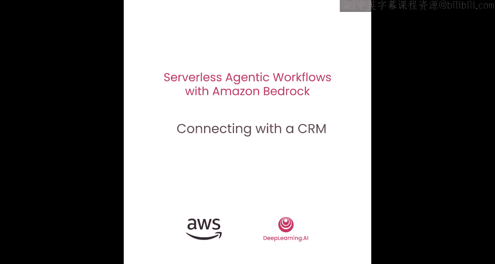
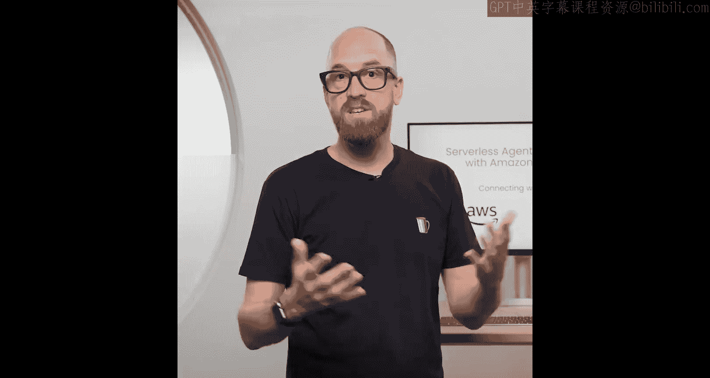
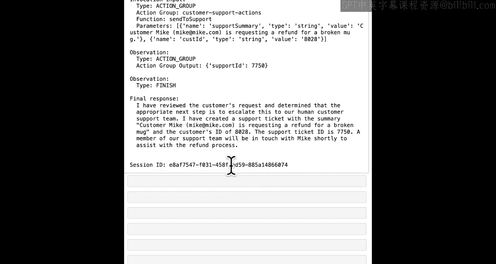

# 吴恩达《使用Amazon Bedrock的无服务器的智能工作流Serverless Agentic Workflows with Amazon Bedrock》 - P3：3.Lesson 2 Connecting with a CRM.zh_en - GPT中英字幕课程资源 - BV1auC2YvExE

Now that you have a basic agent in this lesson， you'll connect it to the outside world。

 you'll simulate connecting your customer support agent to services like a CRM to get customer details and to log support tickets Let's take a look。

And as always， the first thing we need to do is import the Boto3 library but we also have a couple of other libraries here to import as well。

 if you remember from the last lesson， these will just be super useful So Uid and also all of our helper functions as well So with those now defined and with the environment variables we've got from everything which has been preeployed into this environment we're ready to go So we do have an agent here running which is the same agent as we had from the previous lesson it is got slightly bigger instructions this time around just because I was able just to paste in a whole bunch more stuff So let's have a play with this So I'm just going to get my session I and another message which is very similar to what we had in the previous lesson so let me just define that and then just quickly let's use a helper function to have a see of what happens So we're going to use invoke agent and print the helper function we're going to send the message in and let's do it and it says my mug is broken I want to refund we wait。

😊，For the agent to respond and the agent says， hello， Mike， apologize。

 but I'm unable to directly process your refund similar kind of situation to the way we were before excellent So what we want to do is we want to connect our agent up with some tools and inside of Amazon bedrock agent。

 these are called actions and action groups and the logic that we're going to connect to for these actions a Lambda functions。

 and there's a Lada function deployed inside of this account ready for us to use。

 So let's go and take a look at that and the way it's written And here it is。

 Now there's this unpacked parameters， but I'm going to get back to that in just a moment。

 let's have a look at the Lambda handler itself。 So this is the invocation point。

 This is the point at which the Lambda code will start when it's called by the agent It'll pass this event in and the event will contain all information about the agent and why it's being called while why this Lambda function is being called。

😊，So it'll include the agent， the name of the agent， the name of the action group。

 which we haven't defined yet。 then something called a function and this function is going to be the tool。

 essentially the action that we want to call So there's a couple of different uses for function Lambda function and then these functions which are sort of inside of the Lambda function Think of them as the tools。

 and then we also have some parameters。 So these parameters are sent in for this particular function or tool okay and so we need to send this response body syntax back and so I'm just defining that upfront。

 This is a very simple piece of code。 you'd want something much more comprehensive in production。

 of course， and then what we do is we start to look at which action has been called。

And so we have two that are supported here， one called customer I and one called sendend to support。

 And so with customer I， the agent will send in either an email， a name or a phone number。

 something to define who this customer is。 And the idea is that this function will return the I for that customer。

 which is important for our agentic workflow， as you'll see in a minute。And in this particular case。

 though， as long as any one of those items has been sent in。

 then we'll send back an I and it will be just a random number because we're just doing sample code here。

 So that's customer I。 We then have sent to support and sent to support can accept a customer I and a support summary。

 In fact， both of those things will be required。 And so as long as you've got both of those things。

 then you can send a support ticket。 and we will respond with a support I and again。

 that's just a random number in this particular case。 But notice how we need a customer I。

 And so we can get one of those from up above。 But we're going to leave it to the agent workflow to figure out that that's what it needs and that it needs to go there first。

 if it hasn't been supplied the customer I in any other kind of way。

 And then the payload once it's been sort of furnished with all of the outputs。

 whether it's an error or whether it's the actual simulated response from a service， that output。

Get sent back to the agent。 Now just return back to this。 We have this unpack parameters。

 and this is just a helper function， which I've written inside of the Lada function。

 which can help to unpack the parameters that get sent in by the agent so we'll see the format of it in a moment。

 But when it sends in something like email for example。

 it will be more the boss than just saying email is this。 It will say here is a parameter。

 It's some text。 It's called email。 Here is the value So we just unpack all of that and make it a little bit easier for us to be able to consume inside of our code。

 So that's the Lambda function already de deployed inside of this environment。

 So let's see how we can hook this up to our agent。

 And so because we're going to make a change to the agent itself。

 We do need the client object And we've created this before。 So this is the bedrock agent client。

 not the agent runtime。 go ahead and store that inner value so that we've got our bedrock agent one more。

😊，And now what we're going to do is we're going to call our bedrock agent and we're going to create an action group。

So we're going to call create agent action group。 And as you can imagine。

 there are a lot of parameters that we need to send in here。 but it starts off simple enough。 We。

 first of all， need to pass in an action group name。

And so we can call this action group anything we like。 This is just for our own reference。

 So we can see what's going on， But you may remember as well。

 it did get passed into the Lambda function。 if that's useful。

 So I'm just going to call mine customer support actions。

 So it's a group of actions which help me with my customer support。😊。

We also have to pass it in a link to an actual agent。

 So which agent are we essentially trying to update here， So I'm going to pass in the agent I。

 and we have the agent I from environment variables already inside of this environment。

 So that's all I need there。I then need to explain to the Lada function what is actually going to do the running of the logic behind the scenes for this particular agent。

 And we've seen it is a Lada function。 So I'm going to define that the action group executor here is going to be。

 And then I just have this small amount of configuration。 So it's going to be a Lada function。

And I need to point to which particular Lada function。 And so a Lada function， as I said。

 has been deployed into this environment already， and we have an An for it。

 So the resource name for it already in a variable called Lambda function AN。

 Okay we put this off long enough。 We now need to give this particular agent all of the details of that Lada function that we were just looking at。

 And so we do that through function schema。 and this is a dictionary that we need to set and we need to define the functions that we had。

 And so this is the use of the term functions in exactly the same way as we had inside of the Lada function code just a moment ago。

 And this is going to be a list of all of the functions that we want to use。

And so each of these will be a dictionary。 So let's start off with the first one and we'll call this one。

 We'll add the name rather， it's already defined inside of the Lambda function。

 but this is customer I。 So this needs to be a match for what we have inside of that code。

 And now we need to tell the large language model which is working inside of this agent。

 We need to tell it what this function does。 what this function called customer I does。

 And so we do that through a description。 And this is exactly as it sounds a natural language description of what this function does。

 And we can be quite descriptive。 So let's see I've got get a customer I given available details。

 at least one parameter must be sent to the function。

 this is private information and must not be given to the user。

 And so this is the first line of defense really to explain to the large language model that we don't want to be discussing this。

With the user there are other things that we can do and we'll look at those a little bit later as well。

 so this is a description of what we want so let's just give ourselves a new line here and then the last thing to do is just to explain about the parameters that we need to send in to actually get this to work And if you remember we had email name and phone So we just need to describe those to the agent So first of all let's have a look at email and we can add in for that a description and again this is a natural language description which will explain to the model what it is Now it may well fully understand what email is just from the name email but we're going to be more specific and say that this is specifically an email address but we we could add more details in here if we found we needed to do that。

Then we need to explain whether this is required or not。 And I'm gonna to say for this false。

 There we go false。 because I don't want to have to require every single piece of information about the customer。

 Just one of them will be fine。 So required is false。 and then the type。

 So what data type we looking at and we're looking here at string。

 And so that is all of the information I need for email。

 So let's do the same with name in this case we're going to say first and last name。

 And I actually I might change that for the particular example I've got where I just said my names。

 didn't I say let's just say this is the customer name， just keep it simple for now。

 and then we'll add in phone。 So we have phone number and everything is exactly the same。

 So this is a complete description of customer I and all of the parameters。 And of course。

 we had two functions。 So let's go and put in another definition here。

 And this is for send to support。 So in this particular case I'm saying。

A message to the support team used for service escalation。 So essentially。

 if the agent can't deal with it by itself， which in most cases it probably can't。

 it can use this to send a support escalation ticket off to a human in the loop And so this requires customer I this time I'm saying that's actually required true and then a support summary。

 which is also required。 And so this customer ID here。

 we're leaving it up to the agentic workflow to figure out that actually it's going to need to get that from somewhere。

 Finally finally， before we finish up this configuration I've got one more thing to add in here and that's the agent version And because all of our agent are called draft I'm just using draft and that's it that's the complete action group definition that we need to send in。

 And before we actually run this， let's pop that into this value so create agent action group response so that we've got hold of it and then we can go ahead and run。

This and nothing happens because we are obviously we have it all inside of that value so let's run that and have a look there we go。

 we've got all our response come back so we've got the action group ID and we've got an action group state of enabled and we do have to wait for this to become enabled before we can do anything else let's just go and put in some helper code that will wait for it to be enabled even though it already is so if you do run this code from top to bottom it will still work and before we do that I just need to grab the action ID out of that response that we were just looking at and then I can put my helper code in here which we know it's going come back straight away because it's already enabled because we just made and change to the agent we do have to prepare the agent again and then update the alias so let's go and do that preparing the agent super simple as we've done before we just call our client and say preparepa agent and I'll put my weight code just beneath。

😊，So we can see it happen。 Let's run that preparing， preparing and any moment now preparing。

 it's obviously working hard and prepared。 there we go。 so that's now returned。

 And then we do need to update the agent alias as well。

 And so we use update agent alias passing in the I and the alias I and the alias name and just as it did before I'm going to put the weight code in there so that we can see that actually happen。

 So we're waiting for this to become prepared updating updating and prepared。 there we go。

 So now we have some actions inside of our agent so we can actually start to do something a little bit more useful。

 So let me paste in here a call。 so I'm going to reset my session I And then I'm going to send in the message in again almost the same。

 so my name is Mike my mug is broken and I want to refund。

 I've included my email address here or an email address。

 It's obviously not actually my email address。 And the reason why I've done that。😊。

I because I do find sometimes if I just say my name is Mike then the customer support agent and probably rightly so it can use that to look up my customer ID and then sort of concludes that actually just a first name like that it's probably not actually going to be definitely  Mike so we should do something else and it gets itself in a state So I've provided my email address so it will definitely be able to track down my customer I which of course in this particular case will be a random number but you get the idea So let's paste in my helper function here invoke agent and print and at the moment we have enabled tracers off or false so let's just run that in fact I need to run this first as well and now I'll run this cell let's see what the agent comes back with。

 So I want my refund and the agent says well yeah I've processed your request for a refund on the broken mug and have routed it to customer support team and now'll review your case and it has in this particular case given me an I。

For my customer support case， because I didn't say that that was private information。

 just my customer Id。Let me know if you've got any more questions。 Okay， fantastic。

 It's actually done it。 But let's actually peel back the lid。

 look under the hood and see it in action。 So I'm going to say enable trace as true。

 and then I'm going to run it afresh。 So this will be a different invocation。

 but let's see what happened。 So the first thing that happens is obviously it looks at my initial message。

 and it says okay， let's process this customer support step by step。 The first thing I need to do。

 and it sets itself out a little plan actually with what it needs to do。

 And the first thing that it does is it calls out to the customer I function。

 which is exactly what we want。 and it passes in these parameters。

 So it actually does pass in the name value of mic。

 and it also passes in the email value ofmic at mic co which isn't my email address。

 but just for demo's sake。 And so it gets back an Id， which is the Id for me as a customer again。

 this is just a random number in this demo。 And it says， okay。

 I was able to look up the customer's I。😊，Using the provided name and email address now I need to determine the appropriate next step to handle this request。

 And so it knows this from its previous planning。 So it calls out to send to support and it passes in this payload into send to support So it passes in the support summary which is customer mic and it put my email address in there is requesting a refund for a broken mug and then it passes in my customer I as a piece of structured information which is what was required and it obviously that's the customer I that it determined before So it's figured out its agent gen workflow it then gets a customer support I back which is 7750 and then it puts together its final response。

 and this is kind of interesting。 I've reviewed the customer's request and determined that the appropriate next step is to escalate this to a human customer support team but notice here has actually brought back my customer ID even though I kind of asked it not to and also the support ticket I which I'm fine with。

So the prompting of the agent to ask it to not reveal that kind of information is not foolproof。

 is not completely robust， and there are other things that we need to do that we'll look at later on in this course to prevent that kind of thing from happening。

 but for now， we've got an agent which is actually responding and using tools to process my customer support case and in the next lesson will make our agent just a little more intelligent by getting it to make some calculations before sending the request off to support。

