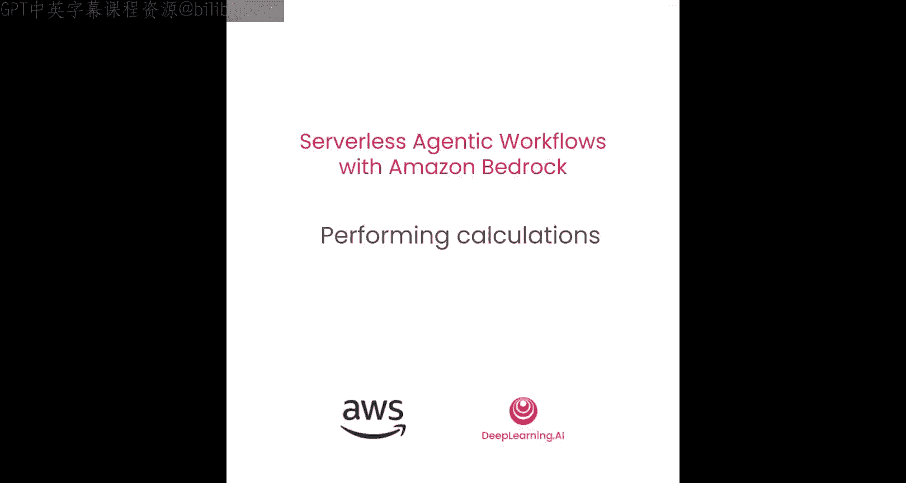
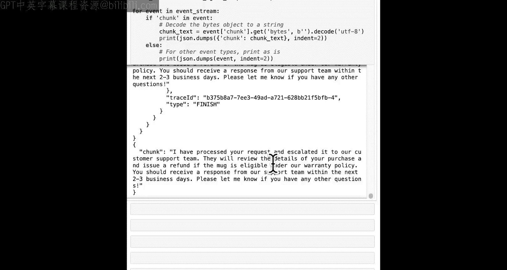

# 吴恩达《使用Amazon Bedrock的无服务器的智能工作流Serverless Agentic Workflows with Amazon Bedrock》 - P4：4.Lesson 3 Performing calculations.zh_en - GPT中英字幕课程资源 - BV1auC2YvExE

In this lesson， my favorite lesson， you'll attach a code interpreter to your agent。

 This will give the agent the ability to perform accurate calculations by writing and running ephemeral Python code to support its generation。

 Let's take a look and let's get started quickly So I'm going to run this first loading all of our libraries。

 and I'm going to create ourselves a bedrock agent client So we're ready to go。

 Now the agent that we have installed inside of this environment at the moment is the same as the one from the end of the last lesson。

 So we're going to update it here。 and we're going to call on our Amazon bedrock agent。

 and we're going to call on update action group because we want to add some features or one function in particular to this action group。

 Now if you remember from setting up the action group in the first place。

 So are a lot of parameters to put in here。 So I'm just going to paste them in in chunks。😊。

And we can look through them as I'm pasting them in。

 but they should all be pretty familiar and similar to what we did last time So we have the action group name。

 which is the same as it was before we have an action group state here have enabled we didn't actually pass that in last time because it enabled the state by default but because we're making a change and we're making an update to this action group I want to make sure that we're explicitly that we want this to be enabled you can enable and dis action groups and this might be something that's useful to do throughout the sort of lifecycl of the management of the action group but for us we just want to keep it enabled then we can pass in some of the other details that are familiar to us by now so we have a action group ID and agent ID they're set up and these are variables that we got from the environment variables of this current running environment let's paste in a couple more so we've got the agent version which we've seen before and then the group executor which is going to be the lambda。

Fun that we have in this environment。 Then it comes to the big one， which is the function schema。

 So let's get ready for this。 Now most of this function schema is going to be exactly the same as it was last time。

 So we're going to have our functions。 So we're going to set those up。 let's indent that properly。

 And that's going to be a list of functions and we set up last time two different functions and they were just I'm going to paste them in here。

  customer I which is exactly as we had last time and send to support again exactly as we had last time。

 but what we want to do here is that we want to add in one more function that we can make use out of which is going to be a function that we can use specifically in this particular example and this one's going to get called and this is supported by the Lambda function。

 which is already deployed inside of this account。 so it's called purchase search and in terms of the Lada function it works in exactly the same。

😊，As the other functions did in the last lesson and so it's going to return something random again。

 so there's nothing special there。 but the idea with this one is it can search for a purchase which has been made by a customer and get a reference like like a purchase order essentially so that when we're escalating to support we've actually found the actual instance of the thing that's been purchased that for example。

 maybe we want a refund for So in the same way as we've done before so we're going to add in a description and in this case。

 I've got a fairly lengthy description which I'm going to add in here and so let's just take a look through what we've got so search for and get details of purchases made De can be used for raising support requests's not saying it has to but they can be you can confirm you have this data for example I found your purchase or I can't find your purchase but other details a private。

And must not be given to the user。 So a decent step in the right direction。

 but we know that that's not completely foolproof。 So next let's add in the parameters that we want for this。

 and the first parameter as we've had before is customer I So we're just saying we require the customer ID in order to be able to search for purchases that they've made the next is going to be product description and here it is a description of the product to search for。

 So this the idea here is this is searching for and it needs to use the information it has and the logic that it's got in order to be able to find a candidate for what the purchase might have been。

 So that is product description and then finally in this list we have purchase date And again。

 it's not actually the date it's the purchase the date of purchase to start the search from and it specifies a particular formatting for this date as well of year month day。

So that's the format that we want All of these are strings。

 All of these are required and so that's everything that we need in order to update our action group essentially we're adding in one extra function there the purchase search but we had to include the original otherwise it would have removed those and just before we run this let's go and say that we want to store this output so we're going to store it in response how's that so update agent action group response so that's useful and then let's run that let's go and put our boilerplate code beneath so that we're going to wait for it to become ready and of course it's already enabled and but we needed to wait okay so we've made an update the issue we have now is the trying to get the date the purchase date for a given product because the message we're going to try to deal with is this one。

😊，Here， so it's got an email address。 fine， so it can find me。

 I bought the mug 10 weeks ago and it's now broken。

 I want a refund So we want to escalate this to support We want to try and find the purchase that Mike made 10 weeks ago but we have our search here expecting or requesting that the date comes in in well。

 a natural date rather than a sort of natural language representation of date So we've got a few things that we need to do here。

 How do we get the agent to figure out what the date was 10 weeks ago so that it can start to figure out the date of purchase and find the product find the purchase。

 Okay， so we're going to update our agent one more time。

 and in the same way that we did before we're going to call create agent action group because we're creating another action group which is specifically going to be for code interpreter。

😊，So we can actually write and run some code itself。 And that's configured in a special action group。

 which is actually much easier to create than the other one。 So don't worry。

 there's not as many parameters in here。 So let's go ahead and give it a name so I'm going to call this the code interpreter action for the code interpreter action group。

 We're going to keep it enabled， I think this is enabled by defaults。 we don't actually need this。

 but I'm going to put it in anyway。 we're going to have in an agent Id。

 and we're going to find our particular version， which is draft。

 So that's all the sort of boiler Play kind of stuff。

 So how do we go about setting up for the code interpreter。 Well。

 let's give ourselves plenty of space。 No I'm only kidding。 It doesn't。

 It's just one line of code here。 and that's it。 that's it right there。

 So the parent action group signature of Amazon code interpreter because this is a sort of out of the box feature for Amazon bedrock agents。

 So this is a special case of an。😊，Action group specifically for code interpreter。 So we've got that。

 let's go and set ourselves up with a variable or value for that to come back to let's do our boilerplate code that we're ready for this to return So we're going grab and grab the action group I for this particular action group and then we're going to wait for it to actually be a thing so let's run that so it's immediately enabled obviously very very fast for this particular one but still worth having that just in case so to enable we're just going to I'm just pasting it this point because we've seen this before so we're going to prepare the agent and we're going to wait for it to become prepared so we'll run that and there we go it's prepared。

 and then we're going to update the alias exactly the same situation on our agent we call update agent alias and this time we're going to wait for it to finish Up and prepared okay so really simple to set up let's just have a play So we're gonna set up。

😊，session I let's put a message back in here again so that we've got it and we can see it。

 so we're looking for it to try and figure out what 10 weeks ago actually looked like。

 so let's run that and then I'm going to go ahead and use my invoke agent in print and we've enabled trace。

 we're just going go for it this time So we're sending in our message we're sending in our session I let's go for it So let's run the cell and see what happens So still want to refund let's have a look so let's process through this customer's request step by step and so the first thing it does is it uses the code interpreter to figure out what 10 weeks ago actually looked like So it's written some code it's executed that code and it's come out with an output of this particular date which happens to be 10 weeks ago from the time when I'm recording this So it's actually picked up the current date from the code execution environment the code interpreter environment performed the Pyth。

😊，and then it's returned with that no errors， no timeout。

 which is what you want to see of course and then returned the actual date which is fantastic And so then it says okay based on the customer's message of the purchase date So next up it's going and grabbing the ID because in order to do the purchase search it needs the I So again this is the agent workflows figuring this out for itself and so it's come back with an ID Yes this is just a random number。

 but it's in principle my customer ID and then it's doing the purchase search So it's doing the search date。

 it's passed in the date in the correct format， it's then passed in my customer ID and then it's put in a description of the product which is just mug So enough to be able to try and find the purchase order。

 And guess what it found one and it brought back the purchase ID and so with that it can then go and send that to support And here is the payload that it uses to send to support with all of that information。

😊，including the purchase ID in there as well as customer ID and then finally。

 it says I have processed your request and escalated it to our customer support team they will review the details of your purchase and issue a refund eligible under our warranty policy so it's managed to do all of that work for us all of that agent flow and by figuring out what it needed to do and bearing in mind that all of this came from this natural language request which was I bought a mug 10 weeks ago it's broken I want a refund and we can't actually leave it there we we have to see this code that it's written's have another go set up the same session I this time I'm going to call it without the helper function let's ourselves the client we have bedrock client with the bedrock agent runtime client So set that up and let's go and grab the。

code that we had back in the very first lesson。 So we're going to call the bedrock agent runtime。

 We're going to invoke the agent passing in all the details。 We're going to enable trace。

 let's have that enabled and onte and then well let's go ahead and grab out the event stream from the completion if you remember back to lesson one and then I've just got this little chunk of code here。

 So this is basically just gonna handle all that event stream stuff coming out。

 try and do some nice formatting to it you'll see there's a lot of output which is why we've been using the helper up until this point but if we pass through it all we'll find the Python code which code interpreter is written for us to calculate that date So let's run this and well here we go and now you'll see all of the fine data that we have available to us from trace。

 So it starts off and it's got its very large prompt with all of the definitions of all of the。😊。

Fs in there， by the way， if you want to pause and take a look， then feel free to do that。

 Now let's carry on。 it is deciding what it needs to do。 it's going to go and what's it doing here。

 it's process the customer request So's lots and lots of this where nowhere near the bottom。

 So code interpreter invocation here we go。 So it's decided。

 I guess in this step above that it needs to try and figure out the date or approximately 10 weeks ago。

 And so it writes this code， this code right here there we go。 that's our Python code。

 or that's its Python code that it has written it's ephemeral code It just writes it to get the answer。

 So it's importing time and date it's importing time and date and time delta And then it's saying okay today equals that So it's actually getting today's date And then was it from there purchase date equals today minus time delta of 10。

😊，Exactly what you'd need and then it's getting that out as what purchase date and then printing it at the end there。

 so the printer of the output is actually what the large language model will see is the output from this code。

 and so that's it。 And once it's run let's have a look it should there we go。

 There's the code execution the execution output and that's it now the code can vanish。

 we don't need it anymore it's been written， it's been run。

 we've got our value and off we go all the way through all the rest of this which is going to do all of those things such as figuring out my I and then sending the customer support issue off and that is why I've been using the helper function up until this point because there's so much information in there but I did need to show you it using and writing its own code All right that's the end of this lesson I think this is super exciting and I really enjoyed showing you this in the next lesson I'm going to talk about putting some guardrails around the agent。

😊。

