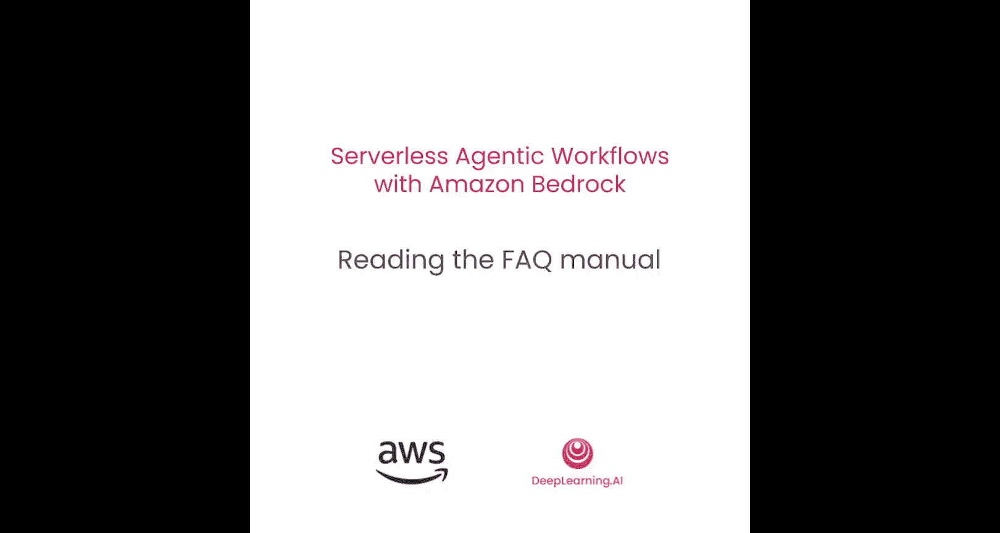
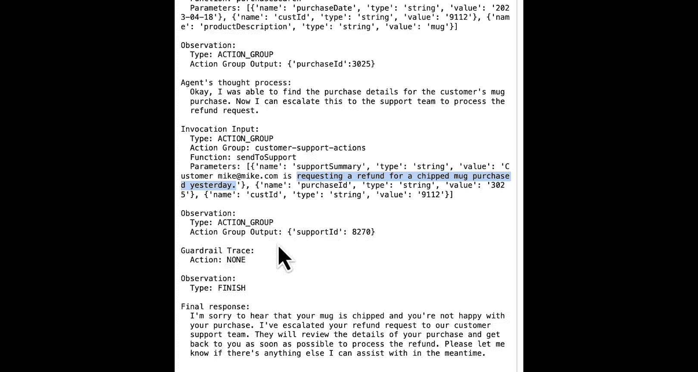
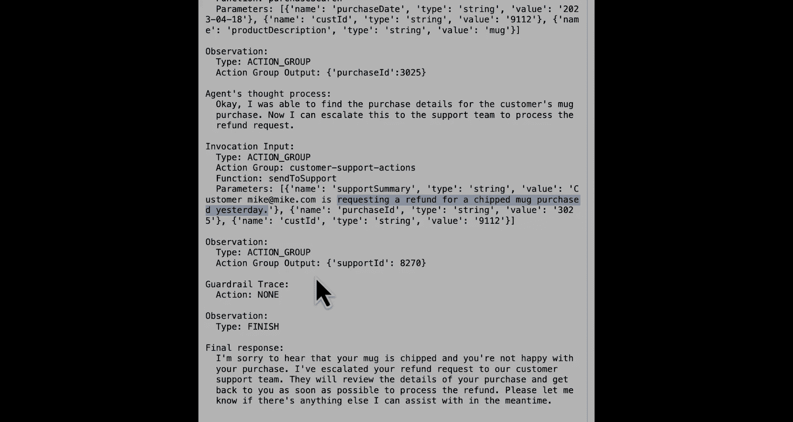

# 吴恩达《使用Amazon Bedrock的无服务器的智能工作流Serverless Agentic Workflows with Amazon Bedrock》 - P6：6.Lesson 5 Read the FAQ Manual.zh_en - GPT中英字幕课程资源 - BV1auC2YvExE

In this lesson， you'll connect your agent to a repository of customer support documents that discuss many simple issues that the agent could resolve itself。

 Once connected， your agent will be able to resolve some issues directly and escalate others to the human workflow。

 Let's take a look。 And let's paste in all of the imports that we need。

 As we've done with every other lesson in this course。 And I do hope you're enjoying this course。

 I've had a lot of fun putting it together。 I hope you enjoyed it。

 Let's create ourselves a client object here。 I'm just pasting this in at this point。

 because we've seen the creation of this before。 So here's my bedrock agent。

 And that's what I'm going to use。 to， well， first of all， let's get some details about the agent。

 which is deployed inside of this lesson。 And so in the same way that we've done before。

 I'm going to call on bedrock agent。 And I'm going to call get agent。😊。

And of course， we're going to need an identifier。 So let's go and add in an agent ID。

 which we've loaded from an environment variable already in this notebook。

 And that will get us some details about the agent。

 And I want to do that because I'm going to show you an update that I've made to the instruction for this agent。

 So let's run this control shift enter。 And now I've got all of the details in here。

 So if we just go ahead and grab all of that and just take a quick look。 then it's going be huge。

 and there's lots and lots of detail in here。 obviously。

 we can print that out a little nicer if we use like a J， let's go here Jasonson dump string。

 and then we can we're going have to do some indents on this and also there will be some dates and things in here。

 So we're just going to give an option to do that and let I think if we print。😊。

That out makes it even nicer。 So there we go。 Let's run this。 So now we can see it slightly。

 slightly nicer formatted。 And in here we have various things， including the instruction here。

 So let's extract that out specifically and print that out So I can do that here by just getting the agent instruction specifically out。

 So let's run that。 And here it is。 then there's a lot to of this。 And you can pass through this。

 And you can decide that you want to change some of this if you want to as well。

 But the thing in here is I have this handle issues based on complexity part to the prompt。

 And you notice here how from lesson one where we had just this really simple one line instruction。

 we've now got something much more sophisticated to help deal with some edge cases and to help the agent understand how it needs to behave。

 Remember this isn't the whole prompt。 This isn't the whole prompt that the large language model sees。

 It's it's part of a much larger template， which includes。😊。

The details of all of those actions that we have inside of our action groups， in other words。

 the tools， all of that information is in there too this is just the instruction to say how we want the overarching behavior of the agent to be and I've got this section in here where it talks about elevating or escalating complex issues for human intervention and it doesn't necessarily say how to do that and it can figure that out itself because it's got that tool that we've got to raise a support case but it's also got this simple issues in general product usage questions if that's the case。

 then take a look at your knowledge base which is what we're going to add now so right now this agent might be a little bit confused because it doesn't have a knowledge base So let's add a knowledge base in and as I say we've got a knowledge base already in this account ready set up so let's go and take a look at it I'm going to use my bedrock agent to the one that you can use to configure and this time I'm going to get the knowledge。

😊，So I'm going to get some details of this knowledge base just so that we can see that it's there。

 and I guess take a look at it。 and we need a knowledgebased ID and that's been set for us by an environment variable inside of this notebook already。

 so this is really all we need Now I'll just load that all into a variable so that we can play around with it a bit more effectively so let's run that cell。

 And then I'm just going to dump this out in the same way that I did before。

 I'm just going to do a J dumpstr of this data indent it and handle things like dates So let's run this。

 And again， there's a lot to this。 but just wanted to show you that it was here。

 And so you can see that it has a lot of configuration。

 And all of this configuration is something that the AWS console page will do for you So that's why I'm not necessarily going into this into a huge amount of detail now But in the next lesson I'll show you the buttons to click that will get you set up and running with a knowledge base that you can connect into your Amazon bedrock agent。

😊，And so to connect this in with the agent that we have。

 I'll just get my agent client object that I can use and I'm just going to call one simple function。

 which is associate agent knowledge basease and so that's kind of all we have to do in a way you can think of this as a special case of an action group much in the same way that code interpreter is a special action group Well。

 I guess knowledge basease it could be seen in that way as well。

's it's a special set of configuration to connect out to this managed retrieval augmented generation service that we've got。

 So let's add some details in here so we know where to go and you can imagine the first couple here going to be the ID。

 So we're going to have the agent I that we want to connect to and the knowledge base I and this is obviously the knowledge basease that we're going to connect in to our agent。

😊，We then do need the agent version。 And because this agent version that we're looking to edit is the draft version。

 So I'm going to type in draft。 So that's the draft version。

 which is sort of currently in a draft state that we can mess around with and then we can push it out as an alias And then finally。

 I do need a description。 So this is something that I do need to add the API requires it。

 and this is a description essentially for us。 So this is I go my knowledge base is all I'm going to do for now。

 but you can type something in more specific if you wanted to that you'd be able to read later if that's what you want to do。

 So let's grab the results from that from when it runs。 So I'm going to grab the response out。

 so that we can just take a look at it。 but this will do it。

 This is all we need to do apart from then preparing the agent again。

 So let's run that and we can take a quick look at the output here and you can see it's basically just。

😊，a thumbs up。 It is a knowledge base which is in the state of enabled and essentially we're good to go。

 And so we need to prepare our agent and then our alias and you know what I'm just going to do this all in one go because we've done it a number of times now preparing the agent then we're going to use the helper function to wait for that to finish and then we're going to update the agent alias and then we're going to wait for the alias to update and finish so I can just run this one cell and all of that all happen for us all automatically and the helper functions are really coming to the for here really being helpful for us and once that's finished which it has we're good to go and now we get to play around with our fully built customer support agent and we get to ask it some interesting questions and see what it will do。

😊，So I'll paste in here the question that we have used before just to make sure that it'll still work in the same way as it used to。

 so we're passing in a session I here and then my message， which includes my email address。

 I bought a mug 10 weeks ago and now it's broken。 I want to refund So that's good let's go and do invoke agent and print and it should be the same as it was before。

 So let me just make sure I run that cell。 So I've got my message and session I defined and then run this cell。

 and let's see what happens。 I've got trace off for the moment。

 so we leave it off and see what the agent says in response to my particular request So it's doing all of its orchestration at the moment and it says I've processed your request for a refund on your mug that you purchased 10 weeks ago I've escalated your details support and obviously if we turn trace on we'll be able to see the details of that but we have faith that the agent when it reports back like this that it actually did the right thing。

 So that's good。 So now let's go in a different direction So let's paste this back in。😊。

t a new session I and well at the moment， it's the same message。

 but I'm going change this to something different。 We're going to not have as many details in here。

 but also the situations not going to be quite as drastic as I want to refund So I can say my mug is chipped What can I do So I haven't said when I bought it I'm not complaining that I want to refund essentially this is a you could decide that this is a more minor kind of issue。

 So let's define that。 and then let's send that to the agent and see what happens What is the agent going to say I'm going to turn trace on this time and run that let's take a look at what happens So the agent takes in the message of course guardrails pass this is no problem at all and it says let me see what I can find to help you with your chipped mug and it decides to go to the knowledge base to see if we can find something to help it finds inside of the knowledge base a number of different articles。

Including chip happens， dealing with mug injuries and different documents which are inside of the knowledge base and then it can use the contents of those documents to try and answer the question So it's still checking with guardras。

 everything' is fine and it comes back with this response According to the search results Here are some options for dealing with aI mug if the chip is small you can apply a patented mugman enamel to smooth out the edge and continue using the mug for larger chips It's best to repurpose the mug as a pencil holder Okay so you might not agree with the customer support outcome here。

 but this is actually what it says in the customer support documentation that the agent has So let's decide that actually we're not happy with that as an outcome and let's throw a very similar thing back into the way we did before I'll include my email address and say I am not happy I'll say I'm not happy I want a refund and let's see what happens。

I'm not happy。 I bought this mug。Yes today， I bought this mug yesterday。 I want a refund。 Okay。

 so we're escalating here because we're not happy necessarily with being told to。

Fix the mugger ourselves or using it as a pencil holder。 So let's run this。

 And this will be part of the same conversation。 So let's see what it does。

 Let's paste back in our invocation。 Let's turn trace back on and run this。

 and I'll scroll up so we can see the answer here。😊，So it's happy with guardrails， which is all fine。

 Okay let's see if we can assist the customer with their chipped mug and request a refund。

 so it's going through the previous action， so it's going to get my customer ID it's searching for the purchase it finds the purchase and then it sends it to support and in the support request it's saying requesting a refund for a chipped mug purchase yesterday。

 so it's combined together the different pieces of information from the two different requests that we made the fact that it was chipped the fact that I want to refund and that I bought it yesterday so it's following the conversation flow and then using agent reasoning for figuring out what to do and how to handle this response for the customer So the agent that you've built here has multiple different paths lots of different things that it can do it can support a customer with simple problems or it can escalate to a human workflow when that is required it figures out where to go。

😊，Based on its agent workflow， the instructions we gave it。

 and then the tools which we provided for it。😊，And why don't you spend some time now sending different support requests in to this agent and seeing what the response is that you get。

 can you find other interesting pieces of information from the customer support documentation about maybe what to do if the tea keeps spilling out of your mug and can you get it to reveal secrets and get past guardrails potentially and once you've done all of that then it's time to move to the next lesson where we'll take a look at the AWS console page for Amazon bedrock and how some of these things can be set up quickly and easily with just a mouse and a few clicks。

😊。

