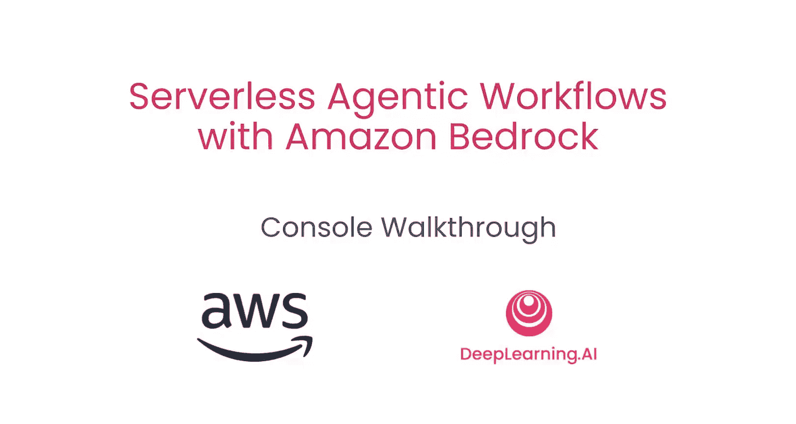
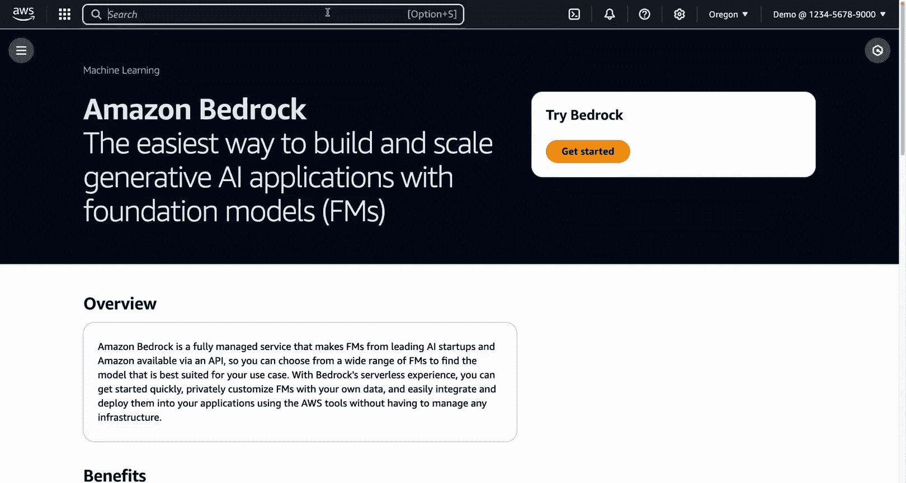
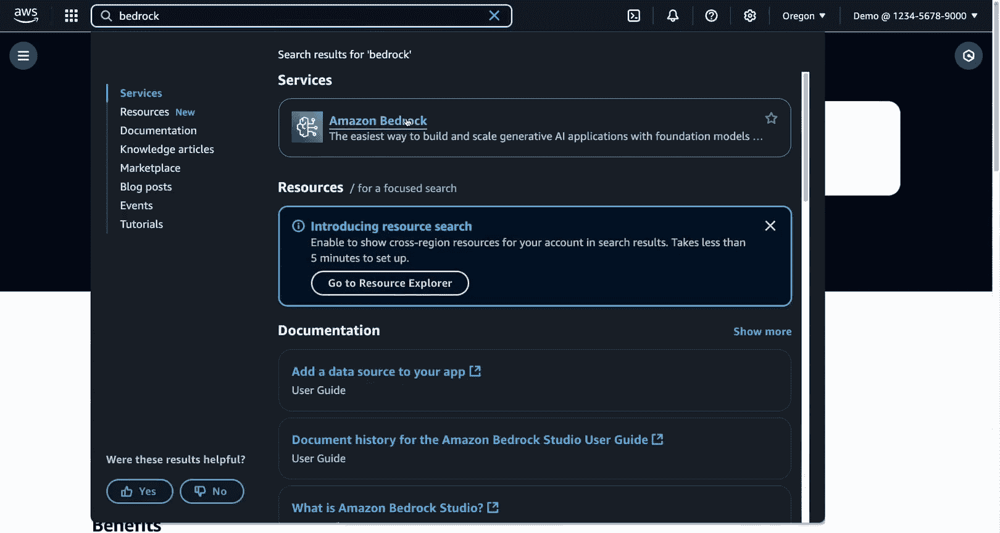
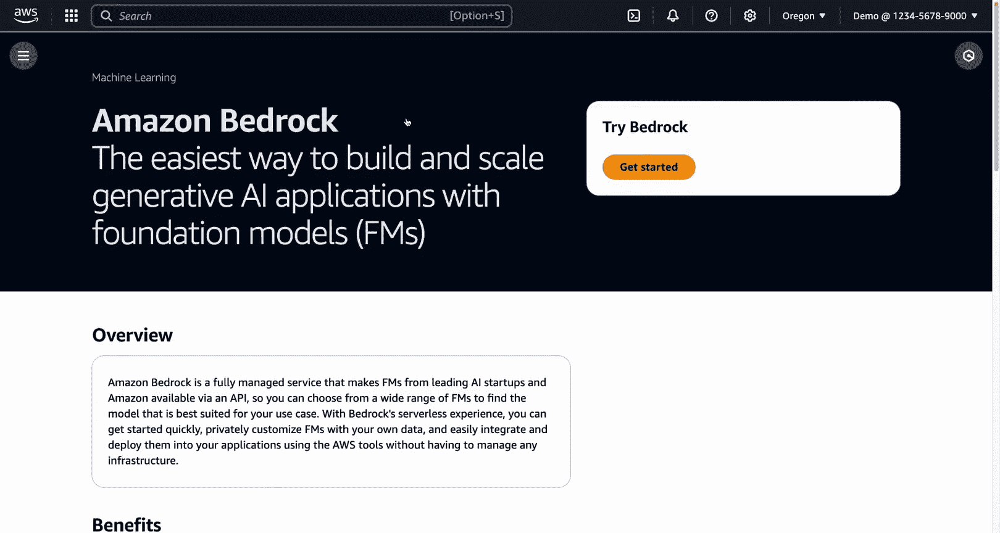
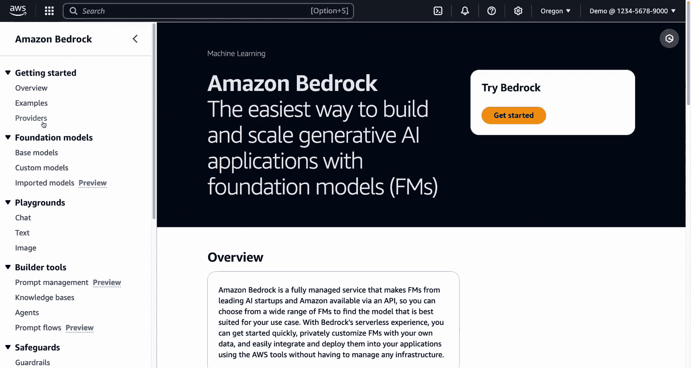
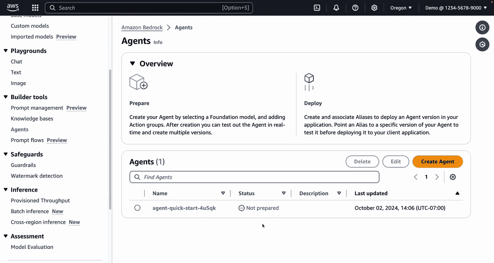
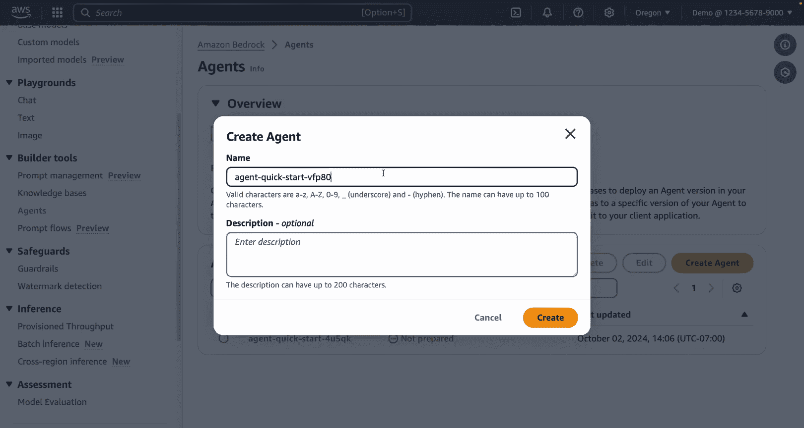
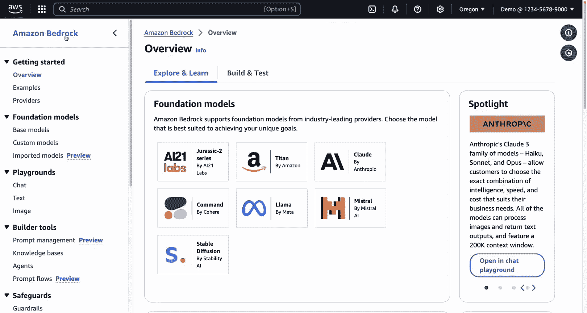

# 吴恩达《使用Amazon Bedrock的无服务器的智能工作流Serverless Agentic Workflows with Amazon Bedrock》 - P7：7.console walkthrough.zh_en - GPT中英字幕课程资源 - BV1auC2YvExE

Your customer support agent is built， and we did it with pure code In this lesson。

 I'd like to take a couple of minutes just to walk through the Amazon bedrock agents interface inside of the AWS console。

 This is a useful place to go if you want to experiment further with agents。

 guardrails or knowledge base。 So sit back， relax and let me take you through it。

 And here we are in the Amazon bedrock console page， which is， of course。

 part of the AWS console page。 And if you log into your own account。

 then if you just go to the search at the top and type in bedrock。

 then you'll find the bedrock service， the Amazon bedrock service。

 click there and that's how I manage to navigate here。

 Now there's just a few things that I want to show you which sort of relate to this course。

 So if I open up the menu on the left hand side。 The first thing that I want to show you is providers just under getting started。

 So if I click that， then you can see that there's a number of different providers from。😊。

Numb of different AI laboratories around the world。 So Amazon is one of them。

 Anthropic is one of them， and we use the anthropic models in this course。

 But there are other providers here as well， such as AI 21 labs， Cohere， Me， Mistral。

 and if I scroll over even stability AI there as well。So you can navigate here。

 click on a particular model provider。 And if you scroll down a bit。

 you get to see the different models that are available。 Now， as you're doing that。

 if you're seeing error messages suggesting that these models aren't available for you。

 Then that's probably because they haven't been enabled inside of this particular region inside of this particular account。

 So let me show you how you can do that。 If I scroll to the left hand side again and grow all the way to the bottom。

 I can click on model access。 And if I do that， then I can see all of their different models which are available in this region for this account。

 And you can see that I have access granted to all of them。😊，If you don't have that。

 then you can optionally select individual models and grant yourself access to those。

 And it's just literally a case of agreeing to the end user license agreement for that model。

 or you'll have a button around about here where I have this modify model access which will grant you access to all of the models So I can come in here and modify access。

 I can select and deselect the models I want to have access to scroll to the bottom and from there I can click next and change my access。

 I don't want to do that， though， in this case。 I'm just going to click cancel and come back out。

And once you've got access to the models that you want to have access to。

 then you can start to use them。 Now， back into the menu on the left hand side。

 there are some things that are probably worth having a look at。

 but we're not going to focus on them in this particular lesson。

 And that's playgrounds where we can go to chat。 our text or image playgrounds and experiment with the models。

 But what I want to focus on here are the elements that we've looked at in this course。

 And that's agents。Guardrails and knowledge bases。So first of all， let me click on agents。 Now。

 in here， you can see that I've already been planning around it here。

 and I've already got an agent which is currently not prepared。

 And you remember these states as statuses of agents from the previous lessons in the course。

 Let's go and click on create agent and make an agent from scratch。

 I'll just take the default name that's given here。 But， of course。

 you can change that and put a description in。 click create， and it puts you into the agent builder。

 And this agent builder allows you to be able to configure all of those things that we looked at in code in the earlier lessons of the course。

 So we have the details of the agent， including its name in the description。

 We can set up which model we want to use。 So which large language model will give this agent the language understanding it needs。

 Here's where I can put some instructions。 And yes， don't worry。

 this can be made much bigger than this default size。

 So you can add in all of the instructions that you want for your agent there。

 Then let me just show you。😊。

Se and just one in particular， because inside of here。

 this is where you get to enable code interpreter that we looked at in this course。Now。

 if I scroll down past some of these other settings， I get to action groups。

 and it's inside of action groups， of course， where we can set up those action groups and then those actions that essentially link off to tools。

 So if I click add here then I can create an action group， give it a description。

 and the one thing I want to highlight here is this option here。 Quick create a new Lada function。

 And what this will do is it will create the Lada function which responds to this particular action group with some sample code in there。

 which is very close to the code that we looked at earlier in this course。

 it'll create that Lada function and all of the necessary permissions that you need in order to use that with this action group And so once that's done。

 you can just edit the code of that Lada function just to perform the logic that you want。

 And then when you've defined your functions inside of there。

 you can then tell the action group all about it in this section here where you can enter the name the description。

😊，hich will go to the large language model so it can understand what this function does。

 And then you can add some parameters in here as well。

 So that's how you set up action groups and all of the steps that you need to set up agents。

Once you've done that， and if I can go to this agent that I prepared before or I didn't prepare is not prepared from before。

 then you can actually go through that process。 You can create the alias from here and you can even go to this section on the right hand side to actually experiment with and test your agent by having a conversation with it and throwing your different use cases in and seeing how the agent will respond。

 So that's setting up the basic agent inside of the console。

The next thing we looked at in the course was guard railils。 So if I click on guard railils here。

 you can see that I can create those guard railils。

 but you'll notice that they're outside of the agents themselves。

 because this is something which is existing beyond just agents。 You can use them elsewhere to。

 but we use them within the context of an agent。 Now you can create them using the create guardra button。

 and of course， you follow through the process much like we did in code。

 but obviously were taken through point and click style with these forms。

 So we can configure the content filters that deny topics。

 the word filters and all of the other aspects of the guard railil。

 So let me just quickly do that without necessarily following through right to the very end。

 I just want to show you that we can set all of those values， including if I click next。

 I can set things like the harmful categories。 And I get this sliding bars that I can set for the strengths for the different kinds of filters。

 we did all of this in code before here。 you can。😊，Do it point and click。

 So that's how you can set up a guard rail inside of the console for Amazon bedrock。Finally， then。

 let's take a look at knowledge bases and knowledge bases。 again。

 you can set this up through the console， and we didn't actually do this in code。

 and it's actually much easier to do inside of the console。

 So let me show you how we click createre knowledge base。

 We have a name that we provide a description， which is just for us。

 And then we get to set some permissions。 Now， in the console， it will create a role for you。

 So you can just use the role it will provide。 And then you get to choose a data source。 Now。

 in the lesson that we've just come from， the data source actually was an S3 bucket。

 which was populated with a bunch of Pf files， which were support documents for our business。😊。

But you're not limited to S3。 and currently， as I'm recording this。

 there are some options in preview to use a web crawler so you can crawl a publicly available website that you have permission to crawl。

 You can grab information from that website and index that。

 or you can connect to a number of different thirdpart data sources。

 including confluence Salesforce and SharePo。 Now I've got S3 selected。

 So when I scroll to the bottom here and click next。 it will ask me to configure S3。

 So Im going to point to the S3 bucket where my documents are stored。 and I get to choose my bucket。

 Then I have more advanced options if I want to change the way that chunking and passing of those documents is done Then I get to choose the embeddings model that I'm going to use。

 So I can select one optionally， I might be able to change the vector dimensions。

 And then we get to choose the vector database that we're going to use behind the scenes。

 Now in the last lesson， we were actually using an Amazon Open search server。😊。

Colllection and that was created for us by the course environment。

 And it was actually the same as if we had selected this option here。

 So by selecting this option here， the Amazon Brock console page will automatically create us an Amazon Open searcharch serverless collection and configure it with all of the indexes we need to start putting our vectors inside for our retrieval augmented generation。

 Oply， though we do have the choice to be able to choose a vector store that's been previously created。

 So we could choose an Amazon Opensearch serverless collection that already exists。

 or we could connect to an Amazon Aurora instance Mongo Db Atlas Pine cone or Redis enterprise cloud So any of these managed services we can connect to with the knowledge base service。

 So I'll scroll back to the top here and I will remain with this quick creation of a brand new Amazon Opensarch serverless collection。

 and I'll leave this enable redundancy unchecked and that will ensure that it deploys the small。😊。

Allest possible open search serverless collection for us。 But there will still be a cost for this。

 So check the price list for open search serverless in your particular region where you're implementing this infrastructure。

 Next， I click next， and that's it。 That's all I need to do。

I can scroll to the bottom and click createreate Knowge basease and when I do that my knowledge base will be created in just a moment or two and then I can trigger off the document ingestion so I can actually start to vectorize the data into my vector data store and then all I need to do is connect it to my agent and I'm up and running。

😊，So that is a quick overview of the Amazon Brock console page。

 where I can easily configure access to models。 I can configure agents。

 I can set up guardras and knowledge base。 and as you've seen a lot more besides over time。

 you might notice that the Amazon Brock console page will change as new parts of the service get released。

 So it's a great idea to come here from time to time to see what's happened。😊。

But that's it for this lesson and the course is very nearly finished。

 I'll see you in the next lesson。😊。

