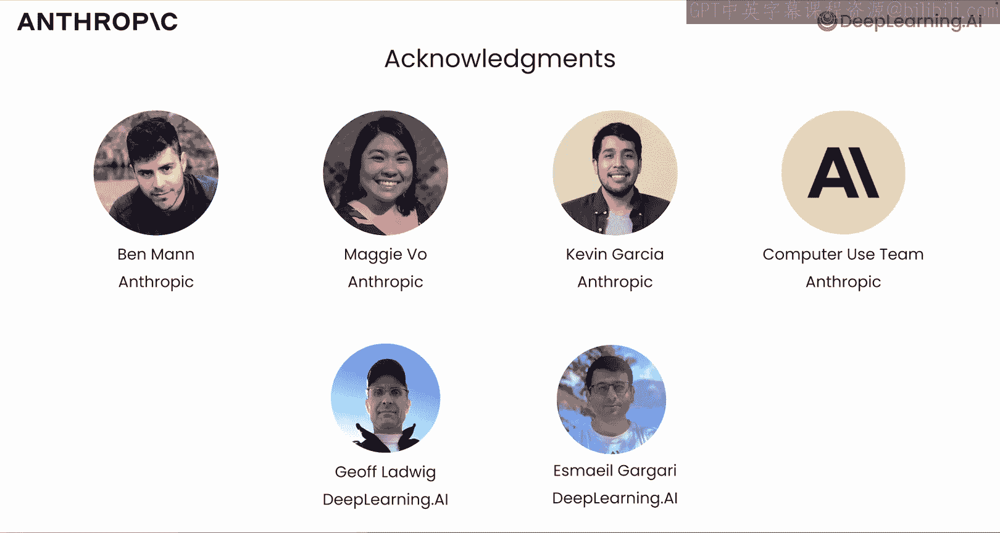
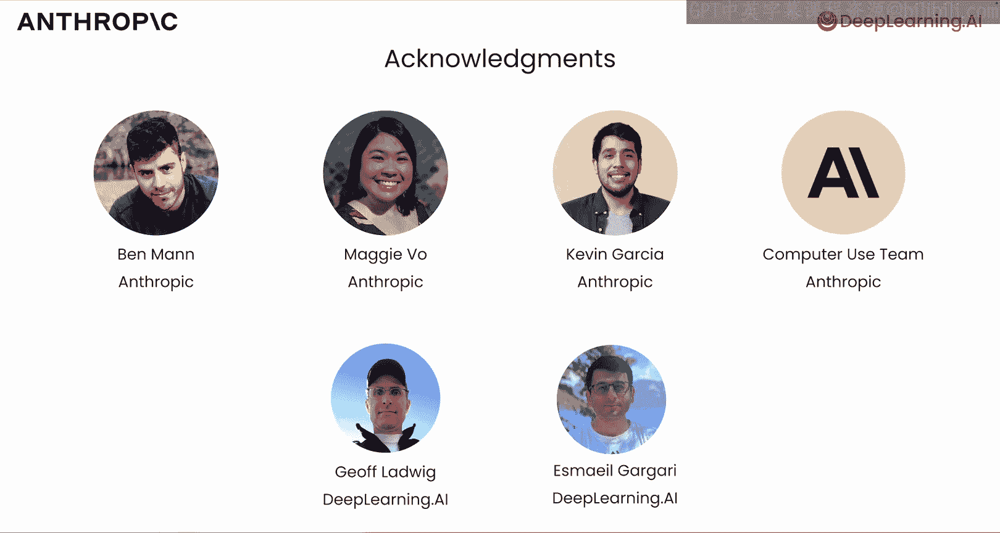

# 吴恩达《使用Anthropic构建计算机操作｜Building Towards Computer Use with Anthropic》中英字幕deepseek - P1：1.intro.zh_en - GPT中英字幕课程资源 - BV11hfiYeEDu

Welcome toBuilding toward computer use with Anthropic built in partnership with Anthropic and taught by Co whos inthropics hiter curriculum welcomee code Thanks Andrew I'm delighted to have the opportunity to share this course with all of you Anthropic made a recent breakthrough and release a model that can use a computer that is they can look at the screen of computer usually running in the virtual machine to a screenshot and generate mouse clicks or keystrokes in sequence to execute some tasks such as search the web using a browser and download an image and so on This computer use capability is built by using many features of large language models in combination including their ability to process an image such as to understand what's happening in a screenshot or to use tools to generate mouse clicks and keystrokes and these are wrapped in iterative agent workflow to then carry out complex tasks by taking many actions on that computer。

😊，In this course you learn about the individual features which will be useful for your applications even outside of OM based computer use as well as see how it can all come together for computer use and Cols will show you how all this works Thanks Andrew in this course you will learn how to use many of the models and features that all combine to enable computer use so here's how the course will progress you'll first learn a little bit about anthropic background and vision and what's unique about our family of models。

Then you'll use the API to make some basic requests This then leads to multimodal requests where you'll use the model to analyze images then you'll dive into prompting which Anthropic has really leaned into making models much more predictable with solid prompting you'll learn about the prompting tips that actually matter。

 things like chain of thought and endshot prompting as well as get a chance to use our prompt improver tools recently La line models have been supporting large input contact Anthropic law for example。

 supports over 200，000 input tokens， which is more than 500 pages of text long inputs can be expensive to process and in fact in a long conversation of your chatbot if you're processing that conversation history over and over to keep on generating that NI response that N response then that too gets more expensive as that history gets longer as a conversation goes on exactly and that brings us right to prompt caching。

Prompt Caching retains some of the results of processing prompts between invocation to the model。

 which can be a large cost and latency saver you'll also get to use the model to generate calls to external tools and produce structured output such as JSO。

And at the very end， we'll walk through a complete example of computer use that you can run on your own machine。

Note that because of the nature of the tool， you will have to run that on a Docker image on your computer rather than directly in the deep learning AI notebook I've tried out computer use myself using anthropic models and found it really cool and I think this capability will make possible a lot of new applications where you can build an AI assistant to use a computer to carry out tasks for you kind of think RP or robotic process automation which has been good at repetitive tasks but now easier to build and more general with LM based tools。

Or as this technology gets even better than even more flexible。

 more open ended tasks that gradually for you more and more like personal assistance。

 I could not agree more。 very excited to see where it goes。

 Many people have worked to create this course。 I'd like to thank from Anthropic Ben Man， Maggie Vo。

 Kevinvin Garsier， the team working on computer use And from deep blendlaming AI Jeff Ludwig and Ashmar Gagari Anthropic has built a lot of really great models。

 and I regularly use them myself Go， will share the details of these models in the next video。

 Allright， let's get started。😊。

